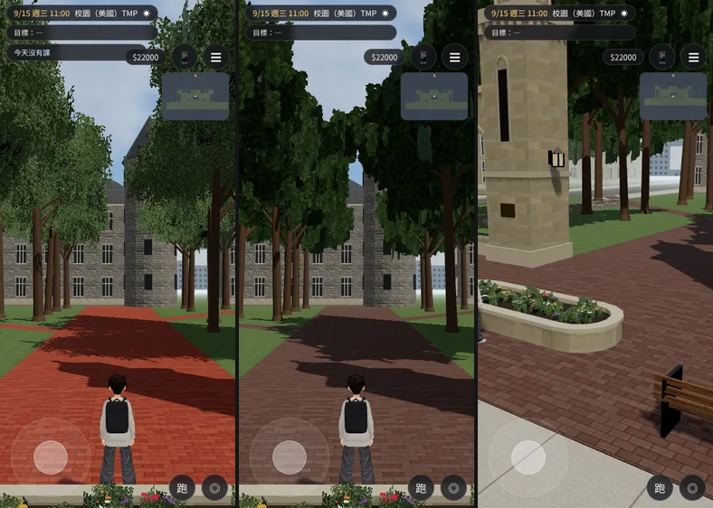
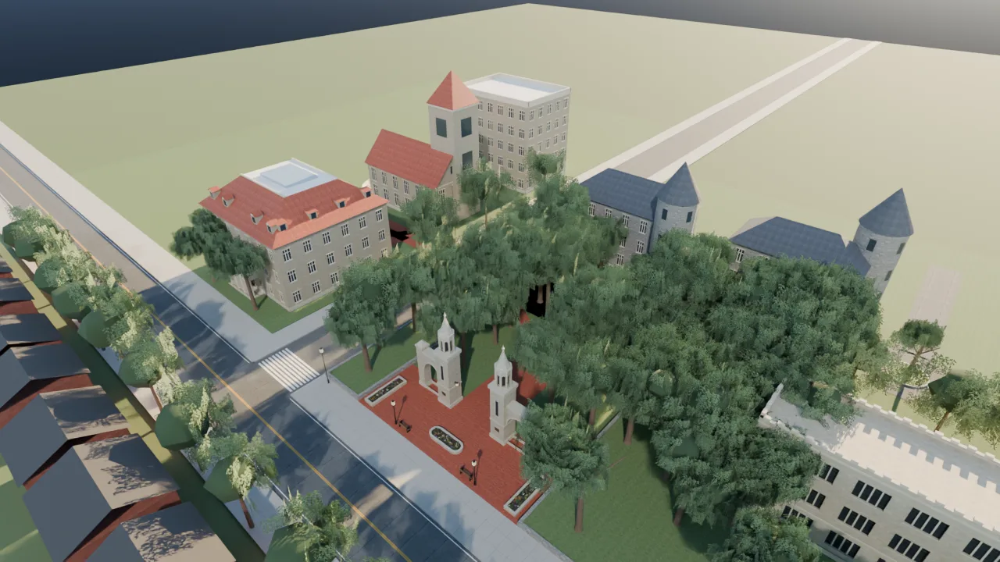
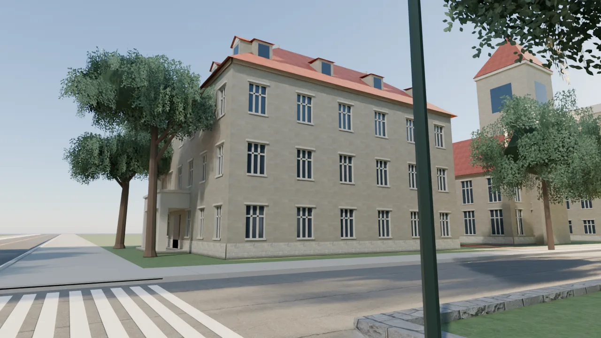
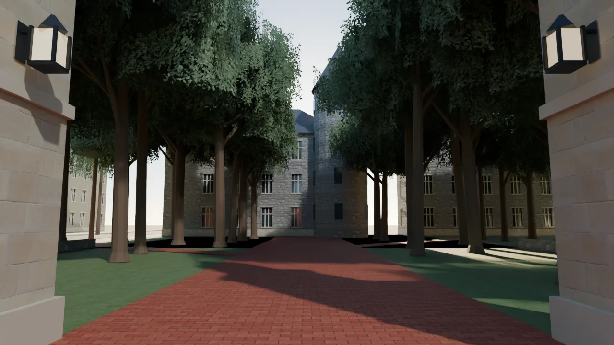
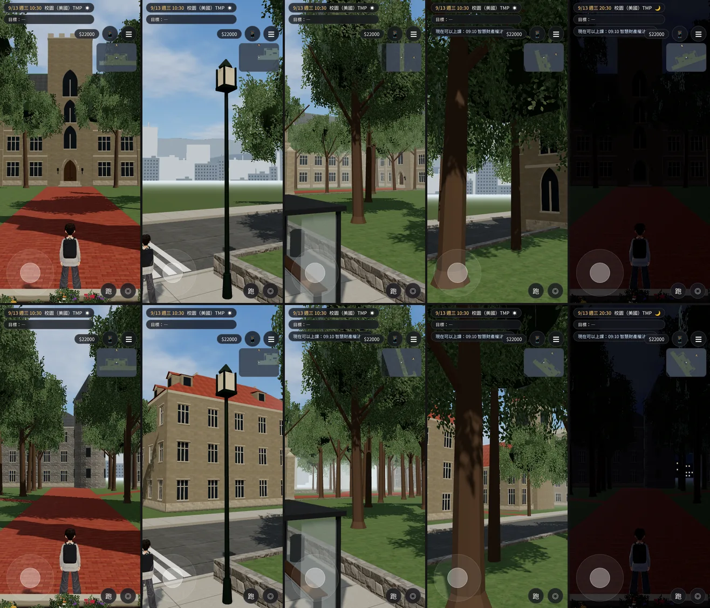
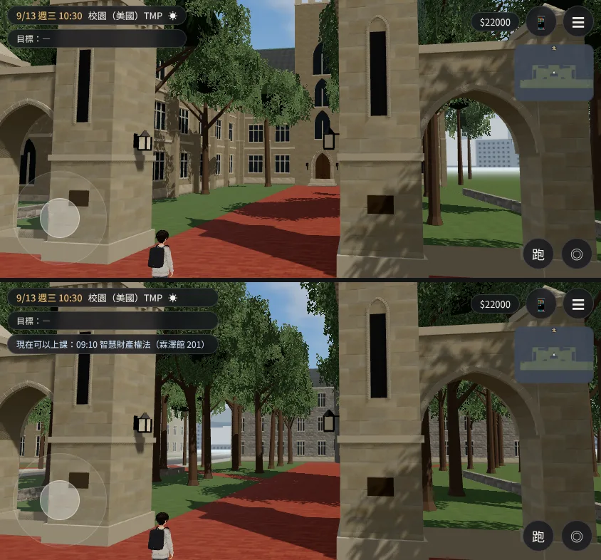

# SCN-US-02 第三版：校門西邊、後面的老校區（背景）

LAWWW2-C，2026-10-18。
- 誰派的：
  - 使用者 10-18 03:1x～03:3x 直接對 LAWWW2-C 說，LAWWW-C 03:06、03:08 也轉達了同一件事。
  - 使用者給了一張空拍圖，說「校門口左邊的空拍圖，校門口位於我給你的這張圖片的右下角」，還說「其他地區你可以就是照樣子設計，但是可以先不要開放進出」。
- 狀態：`MODEL_READY`。場景美術 **READY_FOR_ART_REVIEW**，使用者看過才算。
- 空拍圖只用文字描述（`docs/art-rebuild/second_ai/HANDOFF.md` 的 ★★），照片不進公開 repo。
- 沒有真實校名、建築名、標誌（D77）。

## 原本（第二版）
- 校門後面只有兩棟學院哥德式系館，背景是七棵樹。
- 西邊路口對面什麼都沒有，只看得到遊戲預設的遠景城市剪影。

## 現在（玩家會看到）
全部是背景：走不到、進不去。

| 空拍圖（文字描述） | 遊戲裡 |
|---|---|
| 沿街一棟大建築：紅瓦四坡屋頂、沿街和東側一排老虎窗，屋頂圍著中庭，中間白色平屋頂＋玻璃天窗 | 西邊路口對面、轉角的三層石灰岩大樓。紅瓦屋頂圍著中庭，中間是平屋頂＋天窗。南面和東面各一排老虎窗，正面中間一個石頭門廊（四根方柱） |
| 它西北邊：長形山牆屋頂大廳、東北角一座方塔、西側弧形平台 | 大樓北邊的紅瓦山牆大廳。東北角一座方塔（24 m、四角錐紅瓦頂、上層長窗），西側一個半圓平台＋石欄杆 |
| 兩棟之間：紅磚步道和一個小廣場 | 從路口人行道往西的紅磚步道，中間一個小廣場，一條岔路通到方塔 |
| 上方：幾棟灰色石材、深灰石板瓦的老建築，其中一棟有圓塔（像城堡） | 校門後面北邊兩棟灰色粗石老建築，石板瓦四坡屋頂，各一座圓塔＋圓錐頂。從校門往北的紅磚路走到底，圓塔在右手邊 |
| 它們東邊一個圓形迴車道 | 東邊一個柏油圓環，中間一塊草地、一棵樹，一條車道往北接出去 |
| 左邊：較高的多層石材建築，旁邊一條往北的路 | 西邊那條往北的路旁，一棟五層石灰岩大樓（平屋頂、女兒牆） |
| 右半邊：一大片茂密的樹林，紅磚小路穿過 | 校門後面 46 棵樹的樹林。紅磚小路從校門往北、往西北、往東北斜斜穿過；中間往北那條路兩邊不種樹，看得到老建築 |
| 左下：草地和大樹 | 紅瓦大樓前面的草地、兩棵大樹 |

- 距離照比例壓縮：區域範圍小，真的校區大很多。
- 建築的樣子照空拍圖和查到的文字（石灰岩牆、紅瓦、灰色石板瓦）設計，**不是**照真實建築的立面測繪。

## 第二輪（10-18 10:4x）：地上的紅磚不要橘色
- 使用者：「交換學生大學地板的橘色好醜」。
- 那是校門廣場、門後步道、樹林裡小路的紅磚：第一版 `#9c4b35`、對比 1.2，在遊戲的光線下整片是橘色。
- 改成舊紅磚：偏褐、低彩度（`#6b5047`、彩度 0.7、對比 1.0），法線加強，看得到灰色的磚縫。空拍圖的步道是紅磚，所以還是磚，只是不橘。
- 遊戲內（Playwright 手機直向模擬，9/15 11:00）：左：改之前；中：改之後，同一個鏡頭（校門往北）；右：改之後的校門廣場。

- 同一個 GLB 也加了四季（ART-US-SEASON，見 `../us_season_1018/`）：夏天的葉子換成和社區同一張「夏末深綠」，所以樹比較深。

## 沒有變的
- 導航、出生點、互動點、阻擋都一樣。
  - 配置第 3 版和第 2 版逐項比過：`bounds`、`blocks`（44 個）、`spawn_*`、`interact`、`road`、`walk_s`、`cross_streets`、`gate`、`law`、`plaza`、`bus`、`props` 完全相同。
  - 只多了 `oldcampus`、`drive`、`woods`、`paths` 四個鍵（只有 Blender 用），`trees` 從 19 棵變成 60 棵（只有 Blender 用，遊戲不讀）。
  - 第 2 版的 `halls`（兩棟哥德式系館）清空。
- 法學院、校門、公車站、人行道、馬路都沒動。

## Blender 算圖
- 老校區鳥瞰（校門在中下，對照空拍圖「校門在右下角」）：

- 西邊路口看對面的紅瓦大樓：

- 從校門廣場往北看：

## 遊戲內前後截圖
Playwright、iPhone 直向 390×844 模擬，SwiftShader，週三 10:30（晚上那張 20:30）。
- **不是實機**。
- 測試工作樹：LAWWW-C 分支 `a53cc871`，加上**臨時**接的 `us_campus` 區域（`us3d.js` 的 `outdoorZone`，讀這份 GLB 和配置）。這個工作樹不 commit，正式接線由 LAWWW-C 做。
- 上排：第 2 版。下排：第 3 版。
- 左到右：校門往北、西邊路口往西、公車站往西北、校門廣場西側往西北、晚上的校門。
- 截圖時用 CSS 藏起手機面板：可昕的訊息（「週末來政大？」）在測試狀態下會自己打開、蓋住畫面。只有截圖這樣做，遊戲沒改。

橫向（844×390），校門：

## 交付
- `assets/models/env/second_ai/us_campus.glb`：
  - 8.4 萬三角形 → 12.3 萬；5.9 MB → 8.7 MB；材質 48 → 52。比 `us_market`（9.9 萬／6.5 MB）大。
  - 第二輪加四季以後：13.3 萬三角形、10.5 MB、材質 82（落光以後樹冠裡的細枝、樹下落葉、秋冬的貼圖）。**這份 GLB 要配 `patches/us_season.diff`**：沒套的話，細枝和落葉夏天也看得到。
  - 多的大部分是樹林。樹林的樹比較省：
    - 離校門廣場 20 m 以內的 21 棵：葉片卡是一般的 3/4；
    - 更遠的 25 棵：一半，卡片大一點，樹冠裡深色的芯縮小。
  - 第一版樹林全部用省版，校門口看得到樹冠裡深色的芯（一塊塊黑的），所以近的改回比較密。
- `assets/models/env/second_ai/us_campus.layout.json`：配置第 3 版。
- 腳本：
  - 新的 `tools/blender/env_second/us_oldcampus_kit.py`：
    - `tile_hall` 紅瓦中庭大樓、`tower_hall` 方塔大廳、`castle_hall` 石材圓塔老建築、`stone_block` 多層石材大樓；
    - 材質共用 `us_campus_kit` 的石灰岩、石板瓦，新增紅瓦（Poly Haven `grey_roof_tiles` 改色）、粗面石材（`japanese_stone_wall`）、平屋頂、天窗。
  - `us_campus_layout_gen.py`：第 3 版配置。
  - `us_campus.py`：
    - 蓋老校區、紅磚小路、迴車道、老校區的草地；
    - 路口行道樹避開老建築；
    - `--preview --cam oc|gatein|west` 三個新鏡頭。
- **遊戲端**：
  - 正式接線時，`us_campus` 區域換這份 GLB＋配置就好，導航不用改。
  - 第 2 版還沒接進開發分支：LAWWW-C 說 SCN-US-02 和第 3 版一起接。

## 測試
- `us_campus_layout_gen.py`：problems []，從公車站的出生點找得到全部出生點和互動點（3544 格），和第 2 版一樣。
- 遊戲內 12 張截圖（前後各 6 張），沒有 JS 錯誤。
- 沒測：
  - iPhone 實機；
  - 正式接線之後的區域切換、存讀檔（區域還沒接）。

## 還沒做到的（誠實列出）
- 老建築都是背景，近看是簡化的：
  - 窗是方窗，沒有窗框細節（`detail=0`）；
  - 圓塔、方塔沒有內部；
  - 中庭天窗只是一塊淺藍玻璃盒。
- 方塔大廳山牆上的窗是方的，空拍圖看不出形狀。
- 樹林裡沒有路燈、長椅。
- 晚上老建築的窗不會亮，校門後面一片黑（第 2 版也一樣）。要亮窗得在遊戲端多一組夜間發光材質，這一版沒做。
- 遠景剪影（遊戲預設的城市剪影）還在，從路口往西看，老建築後面還是看得到城市大樓的剪影；美國小鎮不該有。這是遊戲端的遠景設定，要 LAWWW-C 決定 `us_campus` 要不要關掉或換掉。
