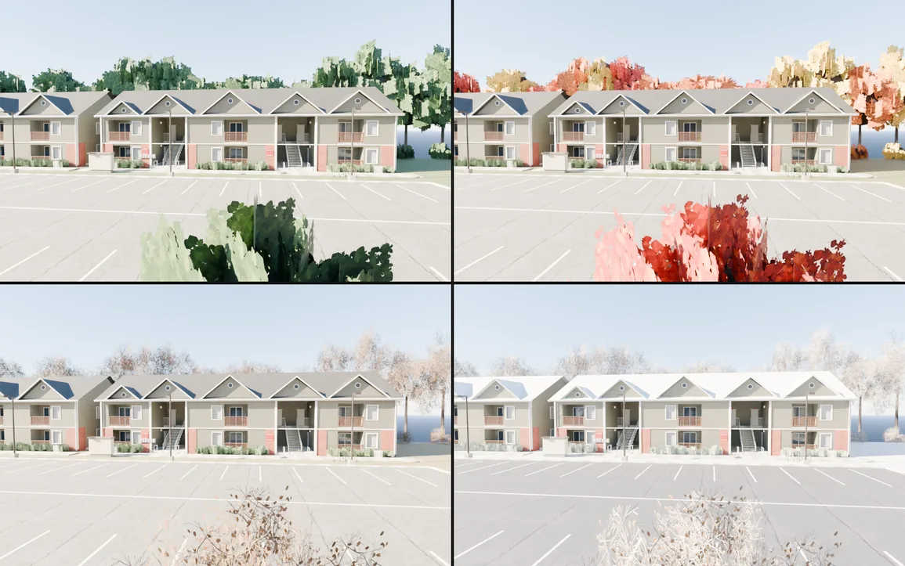
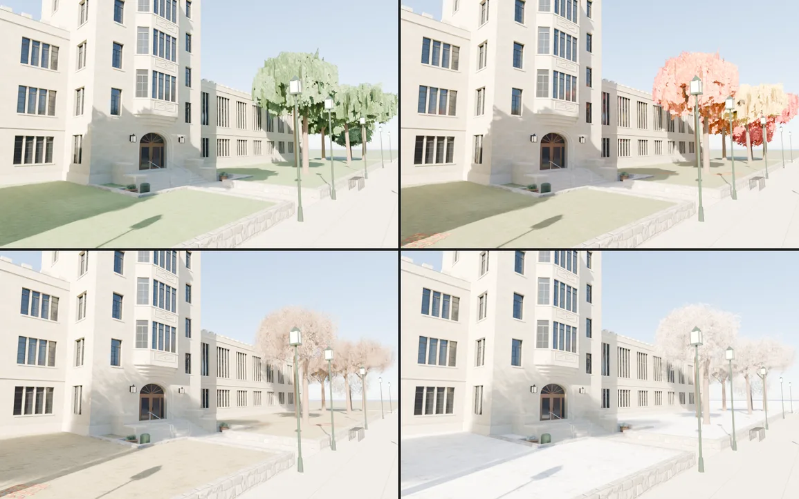
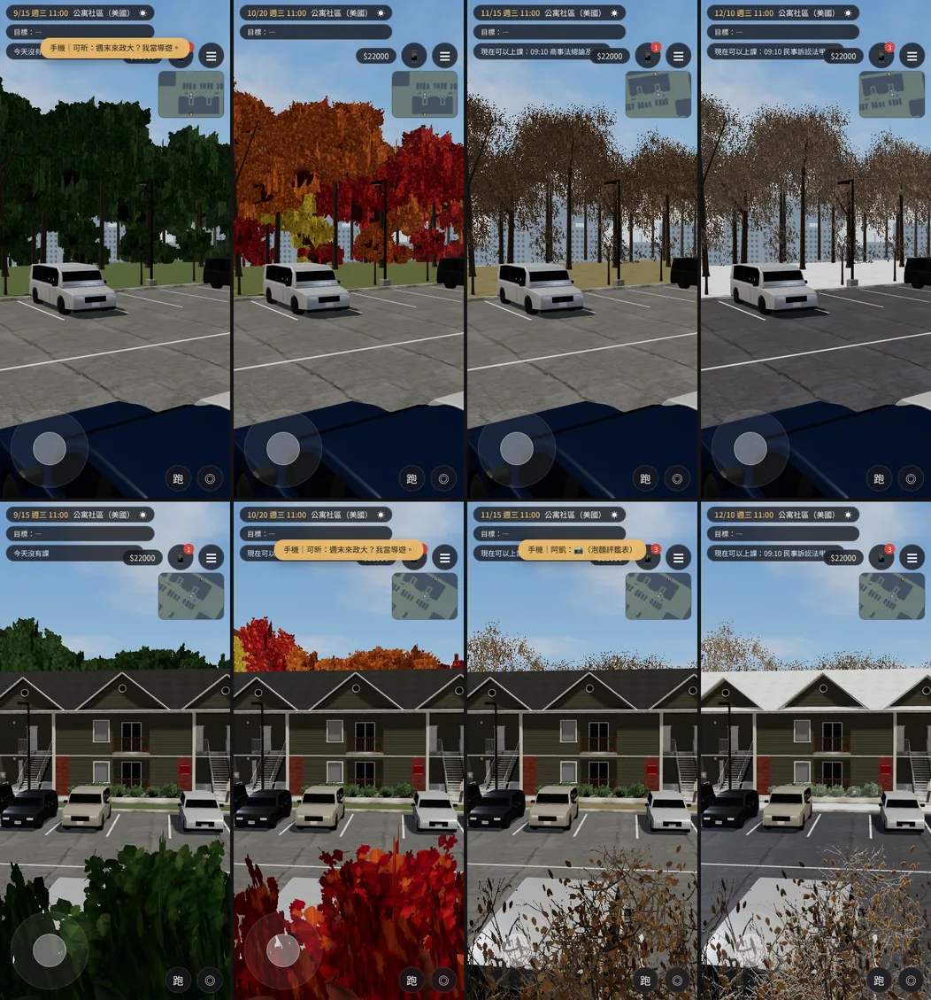
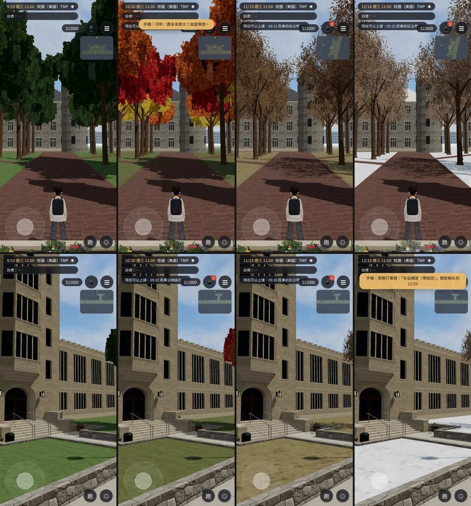

# ART-US-SEASON：美國篇的四季（公寓社區、校園）

LAWWW2-C，2026-10-18。
- 誰派的：LAWWW-C（佇列最後一項；使用者 10-18 03:3x 要四座台大建築先做，這項先存 WIP `53d9ef55`）。
- 日期照 AA_213：祐廷 8/2 到美國、12/23 回來。
- 狀態：`MODEL_READY`。場景美術 **READY_FOR_ART_REVIEW**，使用者看過才算。

## 玩家會看到
| 季節 | 日期 | 樹 | 地上 | 屋頂 |
|---|---|---|---|---|
| 夏末 summer | 8/2～10/8（4/16～8/1 也是） | 深綠、偏一點橄欖色的闊葉 | 綠草 | 原本的 |
| 秋天 autumn | 10/9～10/31 | 每棵樹隨機轉紅、橙、黃（不會整片同一個顏色），樹冠裡偏紅褐 | 草稍微轉黃，樹下有落葉 | 原本的 |
| 初冬 bare | 11/1～12/1（3/16～4/15 也是） | 葉子落光，只剩細枝（橡樹留幾片乾葉），樹冠裡面也是細枝 | 枯黃的草，落葉還在 | 原本的 |
| 雪 snow | 12/2～3/15 | 細枝上積雪 | 雪地；柏油是剷過雪、濕的深色 | 積雪 |

- 常綠的灌木（社區的樹籬、校園花台）不落葉，只有雪天葉子上緣積雪。
- 季節照遊戲日期自動換；在同一個區域裡過了午夜（例如 10/8 → 10/9）也會換。

## 做法（同一個 GLB 帶四季）
`tools/blender/env_second/us_season.py` 的約定：
- `SEASON_MATS`：藏在地底的節點，底下每個小三角形帶一個替換材質，名稱 `<原材質名>__S_<季節>`。遊戲把用原材質的網格在那一季換成它；沒有列的季節用原材質。
- `SEASON_GEO_*`：季節網格，節點的 `seasons`（例：`'bare,snow'`）＝只有那幾季看得到。
  - `tree_core`（樹冠裡深色的芯）：summer、autumn；
  - `twig_inner`（落光以後樹冠裡面的細枝）：bare、snow；
  - `leaf_litter`（樹下落葉）：autumn、bare。
- 貼圖是本作程式產生的（`us_season_tex.py`，固定亂數種子），草、雪、柏油是 Poly Haven CC0（本機已有）。

## 遊戲端
- patch：`docs/art-rebuild/second_ai/patches/us_season.diff`（對 LAWWW-C 分支 `a53cc871`，`git apply --check` 乾淨）。
  - `src/us3d.js`：
    - `usSeasonKey()` 照 `CALENDAR.dateOf(G.day)` 算季節；
    - `usSeason(root)` 換材質、開關季節網格，原本的材質記在 WeakMap，換回夏天時還原；
    - `outdoorZone` 載入正式模型時、換時段時（`applyTimeOutdoor`）呼叫，同一季不重做。
  - 新的 `tests/us_season_unit.js`：15 個日期 → 季節；換材質、開關、還原；GLB 的命名照約定。
- **新的 `us_community.glb`、`us_campus.glb` 要配這個 patch**：沒套的話，夏天也看得到樹冠裡的細枝和地上的落葉。
- `us_campus` 區域還沒接進開發分支；接的時候走同一個 `outdoorZone`，自動有四季。

## GLB
| | 之前 | 之後 |
|---|---|---|
| `us_community.glb` | 8.9 萬三角形、5.5 MB、材質 32 | 10.1 萬、7.6 MB、材質 55 |
| `us_campus.glb` | 12.3 萬、8.7 MB、材質 52（SCN-US-02 v3） | 13.3 萬、10.5 MB、材質 82 |
- 多的是細枝、落葉的葉片卡（遠的樹少一點），和秋冬的貼圖。

## Blender 算圖（`render_cycles.py --season`；Cycles 曝光偏亮，看顏色以遊戲截圖為準；這兩張是改秋天樹芯顏色之前算的）
公寓社區（停車場往北看建築）。左上：夏，右上：秋，左下：初冬，右下：雪。

美國校園（人行道看法學院和草坪），排法一樣：

## 遊戲內截圖
Playwright、iPhone 直向 390×844 模擬，11:00，晴。**不是實機。**
- 季節：左到右 9/15 夏末、10/20 秋天、11/15 初冬、12/10 雪。
- 測試存檔裡有要回的訊息，手機會自己打開、遊戲暫停（D103）。截圖時關掉手機、不讓它再自己打開（只在截圖的頁面裡，遊戲沒改）。第一輪沒關，第二張以後拍到的都是停住的畫面，重拍。

公寓社區：

美國校園：
- 臨時接線的測試工作樹，不 commit。
- 上排：校門往北；下排：法學院草坪。

## 測試
- `node tests/us_season_unit.js` ALL PASS（patch 裡的新測試）。
- `node tests/nav_us_unit.js` ALL PASS（套 patch 的樹；導航沒動）。
- 遊戲內截圖沒有 JS 錯誤。
- 沒測：iPhone 實機；`flow_us_exchange.py`（真實流程，慢）。

## 還沒做到的
- 天氣沒有跟著季節：雪季的天空、下雪的粒子是遊戲端的天氣系統，這一版只有地上、屋頂、樹。
- 公寓室內窗外的景照舊（原本就有 `SEASON_SNOW_on/off` 兩種），沒有秋天、初冬的窗景。
- 超市、機場是室內，不用換。
- 雪天路邊沒有剷起來的雪堆，車頂沒有雪。
- 秋天樹冠裡的芯第一版太暗（遊戲裡一塊塊黑的），改成紅褐之後還看得到一點深色，是樹冠裡的陰影。
- 社區截圖的遠方還看得到遊戲預設的城市剪影（原本就有）；LAWWW-C 說 us_campus 接的時候會關，社區要不要一起關也請 LAWWW-C 決定。
