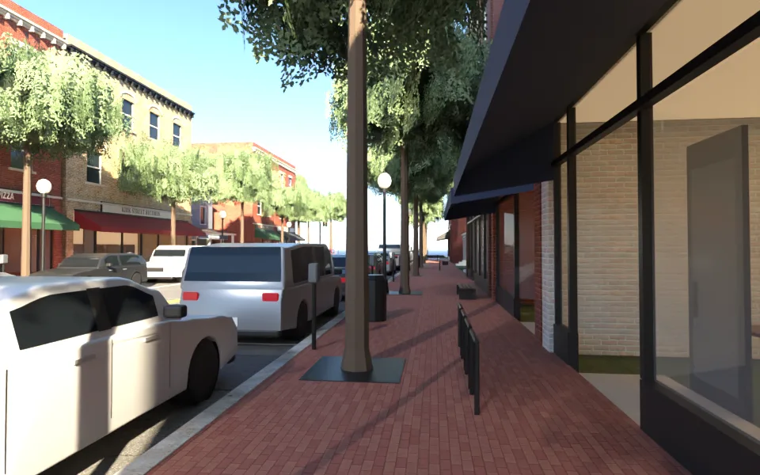
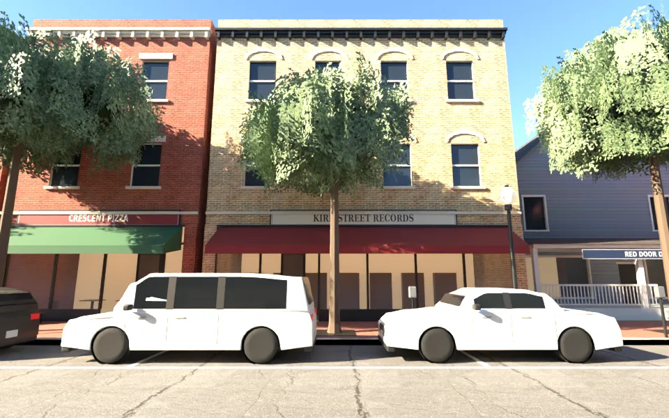
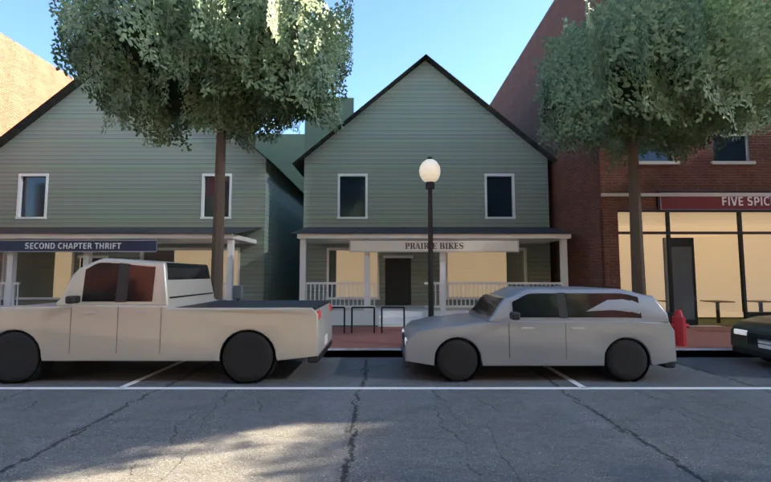
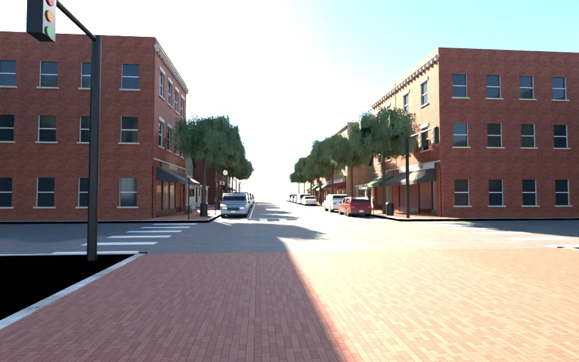
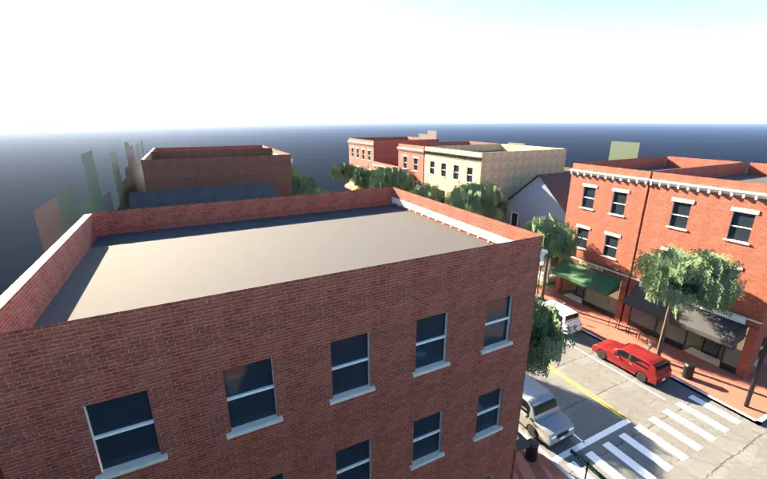
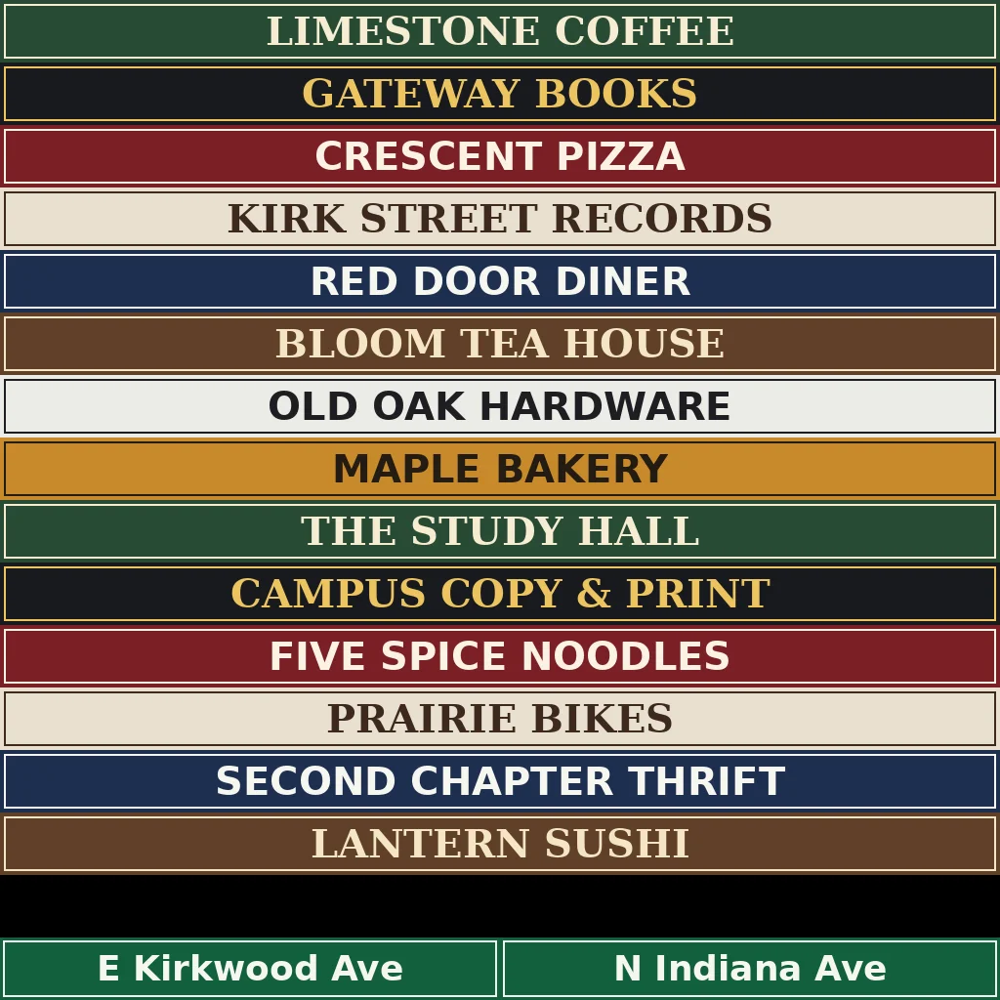

# SCN-US-02 美國校門前的主街（第一階段：主街一段＋路口；區域 `us_street`）（LAWWW2-C 2026-10-17；狀態 MODEL_READY → READY_FOR_ART_REVIEW）

依據：AA_30「校園一小段（石灰岩建築、校門、主街）」；地點布魯明頓（AA_144 5-4）。參考資料：`docs/art-rebuild/second_ai/research/us_campus_street.md`（主街＝Kirkwood Avenue：兩三層磚造商業樓、一樓大櫥窗、招牌、有的磚漆成白色、民宅改的店面，連到校門 Sample Gates）。
**店名全部虛構**（D77）；街名照真的（E Kirkwood Ave、N Indiana Ave）；校名、校徽不出現。
**第二階段還沒做**：校門（Sample Gates）本體與校園裡的石灰岩建築——沙盒查不到校門的照片，等使用者給照片再做（D38：不放假的校門；這一版路口東邊是紅磚廣場＋草坪＋大樹）。
場景美術的 `ART_APPROVED` 只有使用者能標。

## 交件
- 模型：`assets/models/env/second_ai/us_street.glb`（3.9 MB、49,269 三角形、33 個物件；同材質合併）。
- 配置：`assets/models/env/second_ai/us_street.layout.json`（`tools/blender/env_second/us_street_layout_gen.py` 產生；自我檢查：出生點、出口、互動點不在阻擋裡）。
- 貼圖：`tools/blender/env_second/us_street_tex.py` → `textures/gen/ust_signs.png`（14 家虛構店名＋路名牌）；磚 Poly Haven `red_brick_03`（調成紅、淺黃、深褐、漆白四種）、石材 `sandstone_blocks_08`、紅磚人行道 `brick_pavement_04`、柏油 `asphalt_02`、水泥 `concrete_wall_006`、草地 `grass_ground`、屋瓦 `grey_roof_tiles`（CC0）；民宅的壁板沿用社區的 `us_siding*.png`。
- 腳本：`python3 tools/blender/env_second/us_street_layout_gen.py` → `python3 tools/blender/env_second/us_street_tex.py` → `/opt/blenv/bin/python tools/blender/env_second/us_street.py`（`-- --preview <out.glb>`：把車停進路邊停車格的驗收版）。

## 空間（區域座標 x 往東＝往校門、z 往南）
| 東西 | 位置 | 說明 |
|---|---|---|
| 主街 | x −72～0、車道 z −6～6 | 中間黃色雙線、兩側路邊停車（格線）；`cars` 18 台（us_cars.glb 上色） |
| 人行道 | z ±6～±10 | 紅磚；行道樹（樹穴鐵蓋）、古典路燈（球形燈罩發光）、停車收費柱、腳踏車架、長椅、垃圾桶、消防栓 |
| 店面 | 兩側共 14 棟（`buildings`） | 磚造 2～3 層：一樓櫥窗＋內凹的門＋氣窗＋招牌帶＋帆布雨遮＋暖光店內；樓上上下拉窗、石材窗台與過梁（淺黃磚是拱形窗楣）、簷口托架；路口的轉角那棟側面也有窗。民宅改店 3 棟：壁板、山牆朝街、前廊、前院 |
| 路口 | x 0～12（N Indiana Ave） | 斑馬線、停止線、紅綠燈兩組、路名牌 |
| 校門前 | x 12 以後 | 紅磚廣場、草坪、大樹（**校門本體等照片**） |

- 出生點 `spawn`（南側人行道、面向東）；出口 `exits`（west＝往市中心、campus＝進校園）；互動點 `interact`（咖啡、書店、披薩、茶、麵包、麵店）；阻擋 `blocks` 101 個。
- 發光：`GLOW_ust_interior`（櫥窗後面的店內）、`GLOW_ust_lamp`（路燈）；晚上由遊戲調亮度。

## 圖（Blender Cycles，Standard、曝光 −1.4；**不是遊戲內截圖**）
往校門的方向看（南側人行道）：

北側店面（紅磚、淺黃磚拱形窗楣、民宅改的餐廳）：

南側（民宅改的二手店、腳踏車店，轉角的麵店）：

路口（從校門那一側往西看；轉角那棟的側面有窗）：

上方：

招牌貼圖：

### 版本（自己退件的）
- 第一版（`v1_south_house.webp`、`v1_intersection.webp`）：南側的招牌字是反的、路口有黑色的洞（只有道路沒有地面）、轉角那棟的側牆整片沒有窗、女兒牆和側牆同一平面（頂端一條黑）、樹冠稀疏看得到深色的芯。這一版都改了。
- 路口東南那一塊在大樹與遠景剪影的影子裡，渲染看起來很暗（地面有東西，不是洞）。

## 八項（ART_SOP 3-2）
| 項目 | 結果 | 說明 |
|---|---|---|
| 輪廓與倒角 | 通過 | 簷口三層線腳＋托架、窗台與過梁、拱形窗楣、店面磚柱凸出、內凹門口、雨遮的垂邊、前廊的柱子與欄杆 |
| 材質 | 通過 | 磚、石材、紅磚人行道、柏油、水泥、草地是 Poly Haven CC0；四種磚色；金屬度 ≤0.45 |
| AO | 部分 | 內凹門口、櫥窗後面暗的店內深度；沒有烘焙 AO |
| 磨損 | 部分 | 柏油貼圖的裂縫；牆面沒有做髒污、褪色 |
| 生活痕跡 | 通過 | 店內的層架與桌子、窗簾高低不一、路邊停車、腳踏車架、收費柱、垃圾桶、消防栓 |
| 比例 | 通過 | 一樓 4.2 m、樓上每層 3.6 m、門 2.9 m、窗 1.1×1.75 m、車道 12 m（含停車）、人行道 4 m |
| 效能 | 通過 | 49,269 三角形、33 個物件 |
| 遊戲截圖 | **沒有** | 要等 LAWWW 接成區域 |
