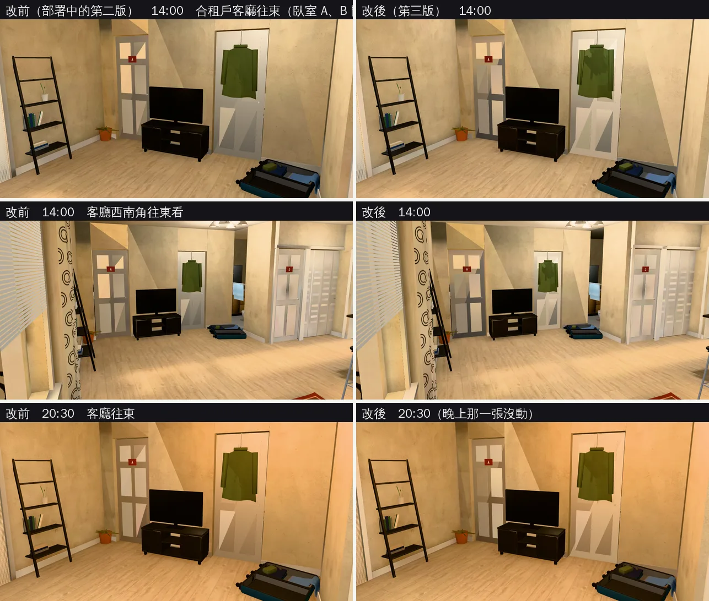
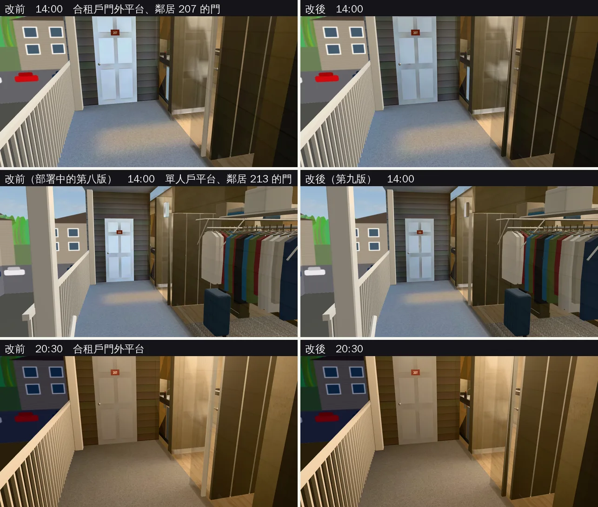

# 美國收尾第二輪：合租戶客廳東邊白天偏暗、鄰居的門白天偏亮（INTERIOR-AAA 美國；LAWWW2-B 2026-11-01）

- **起因**：LAWWW-B 11-01 06:5x 派工。上一輪（`us_wrapup_lm_1101`）README「還不夠的」寫了兩處，美國交換是 D99 第三項，先收：
  1. C 棟合租戶客廳東邊（臥室 A、B 門前）白天只有 0.17～0.25（窗都在北牆西半邊）。
  2. 平台上鄰居的門白天很亮（207；單人戶那一扇是 213）。
- **狀態**：`READY_FOR_ART_REVIEW`。建築、場景只有使用者能標 `ART_APPROVED`。
  - 截圖是 Playwright＋SwiftShader（電腦 1280×720），不是實機。
  - 讀檔放時間、藏玩家和 NPC 是 [捷徑]。
- **不用改程式**：兩個公寓區域照舊走 `Z3.attachRoomGLB`，只換 GLB 和光照貼圖。
  - 兩支既有測試的「要烘的物件」清單要改一個名字，見第四節。

## 一、鄰居的門（兩戶都改：合租戶第三版、單人戶第九版）

- **為什麼亮**：
  - 門是白色六片門板，在屋簷下照到天光，白天光照貼圖 0.40～0.61。
  - 上一輪把旁邊的外牆、地板壓暗了（`--dayscale`），可是門和屋裡的門合成同一個物件（`usa_door`），沒辦法只壓它。
  - 結果是深色壁板中間一扇偏藍的亮白門。
- **修法**：
  - `us_apartment.py`：`merge_by_material` 留下平台上鄰居的門 `door213`，自己一個物件（多 1 個 draw call）。
  - `bake_us.sh`：兩戶的 `--dayscale` 都加 `door213=0.65`，只改白天那一張。
  - 晚上不動、屋裡的門不動。

## 二、合租戶客廳東邊（合租戶第三版）

- **為什麼暗**：窗、陽台門都在北牆西半邊（x −3.8～−0.6），臥室 A、B 的門在客廳東牆（x 1.4），離窗 3 m 以上。
  - Cycles 算的反射光是對的，可是遊戲沒有曝光調整：人在屋裡眼睛會適應、看得清楚的角落，畫面上是一塊暗的。
- **修法**：`bake_room.py` 新選項 `--dayfill`。
  - 格式和 `--lights` 一樣。
  - 只在白天那一張有的朝下柔和面光源：晚上、熄燈那兩張不亮，不乘 `--daylights`，顏色是偏白的天光。
  - 代表白色天花板、牆之間來回的天光。
  - 合租戶：天花板下 x 0.3～1.3、z −2.8～0.8、12 W。
  - 用面光源、不用點光源：點光源離天花板只有幾十公分，天花板會烘出一塊亮斑。
  - 試烘：64 取樣、x 0～1.3 那一版，客廳中間也亮了 0.17。所以往東移、窄一點。

## 三、數字（`lm_probe.py`；白天／晚上）

| 合租戶 | 部署中的第二版 | 第三版 |
|---|---|---|
| 客廳東邊 臥室 A 門前 | 0.23／0.30 | **0.46**／0.31 |
| 客廳東邊 中間 | 0.17／0.23 | **0.28**／0.22 |
| 客廳東邊 臥室 B 門前 | 0.25／0.30 | **0.43**／0.31 |
| 客廳中間偏東（x 0.2） | 0.30／0.48 | 0.53／0.49 |
| 客廳中間（吊扇下） | 0.68／1.07 | 0.78／1.08 |
| 客廳木地板（陽台門前） | 0.53／0.58 | 0.66／0.56 |
| 廚房地板 | 0.31／0.73 | 0.34／0.73 |
| 走道地板 | 1.36／0.76 | 1.37／0.79 |
| 陽台地板（屋外） | 0.68／0.11 | 0.69／0.12 |
| 門外平台地板 | 0.71／0.29 | 0.69／0.28 |
| 鄰居 207 的門（0.3／1.2／2.0 m） | 0.40／0.51／0.61 | **0.26／0.33／0.38** |
| 平台外牆 | 0.50／0.08 | 0.49／0.08 |

| 單人戶 | 部署中的第八版 | 第九版 |
|---|---|---|
| 鄰居 213 的門（0.3／1.2／2.0 m） | 0.41／0.47／0.58 | **0.22／0.31／0.39** |
| 客廳中間 | 0.58／0.92 | 0.57／0.92 |
| 廚房、走道、陽台、平台地板 | 0.31、1.35、0.71、0.57 | 0.30、1.38、0.69、0.58 |

- 單人戶只改了鄰居的門。其他地方差 0.02 以內，是重烘的取樣雜訊。
- 晚上那一張兩戶都沒有改（差 0.03 以內，重烘的取樣雜訊）。

## 四、改前改後（同一個鏡頭）

- 改後：臥室門前、電視櫃前的地板亮了，臥室 B 的門（掛外套那扇）不再發灰。20:30 是燈的光，和改前一樣。

- 改後：鄰居的門從偏藍的亮白變成淺灰白，和旁邊的深色壁板、壓暗過的平台比較搭。晚上不變。

## 五、怎麼套（給 LAWWW-B）

1. **換二進位**（從我的分支 `claude/funny-albattani-iawshm` 拿）：
   - 合租戶：`us_shared.glb`、`us_shared.json`、`us_shared_lm_day.webp`、`us_shared_lm_night.webp`。
   - 單人戶：`us_apartment.glb`、`us_apartment.json`、`us_apartment_lm_day.webp`、`us_apartment_lm_night.webp`。
2. **不用改程式**。
3. **patch**：`docs/art-rebuild/second_ai/patches/us_wrapup2_lm_1101.patch`（只有測試；對開發 `f812b45c3`，`git apply --check` 過）。
   - `tests/us_shared_lm_unit.js`：
     - ② 的清單 `usa_door` 改 `lau_w_door`；
     - 新 ⑨：兩戶的鄰居門 `door213` 是自己一個節點、有第二套 UV、材質照舊是 `usa_door`。
   - `tests/us_apartment_lm_unit.js`：清單 `usa_door` 改 `lau_w_door`。
   - **為什麼改名**：以前 `usa_door` 是 `door213`＋洗衣機櫃的門 `lau_w_door` 合起來的。鄰居的門拆出來以後，`lau_w_door` 只剩自己一個，`merge_by_material` 不合併、保留原名。
   - 遊戲程式沒有用到 `usa_door` 這個節點名字（`grep src/` 確認過）。
   - **兩支測試要和新 GLB 一起換**：新測試對舊 GLB 會 FAIL，舊測試對新 GLB 也會 FAIL。
4. **工具**（只在我的分支）：
   - `bake_room.py --dayfill`；
   - `bake_us.sh`：公寓第九版、合租戶第三版；
   - `us_apartment.py`：`door213` 不合併；
   - 烘焙紀錄 `us_apartment_lm.json`、`us_shared_lm.json`。

## 六、測試

- `tests/us_shared_lm_unit.js`（patch 後）：
  - 開發分支原樣 GLB：FAIL 2（⑨ 兩戶）；
  - 新 GLB：ALL PASS。
- `tests/us_apartment_lm_unit.js`（patch 後）：新 GLB ALL PASS。
- 全部 Node 的結果寫在交件訊息：開發 `f812b45c3`＋這一包＋醉月湖那一包（`lake_night_1101`）一起跑。
- 沒跑：手機實機、導航（模型只拆了一個物件、光照貼圖重烘）。

## 七、還不夠的（照實寫）

- 客廳東邊中間（兩扇臥室門之間）照舊 0.28。牆邊有梯子書架、電視櫃擋，截圖看不黑，先不補。
- 鄰居的門照舊比壁板亮很多：門是白漆，本來就是畫面裡最亮的東西之一。要再暗得改門的顏色（外門用舊一點的白），會影響「白色六片門」的設定，先不動。
