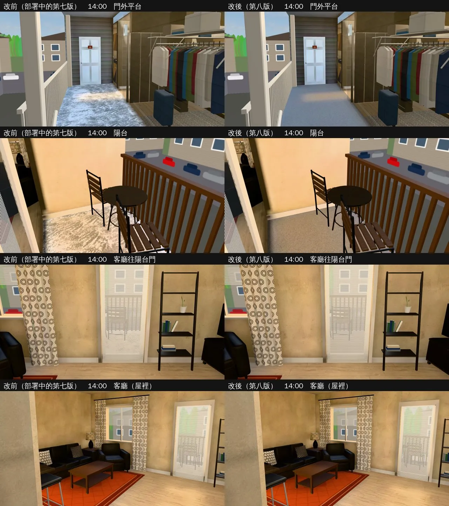
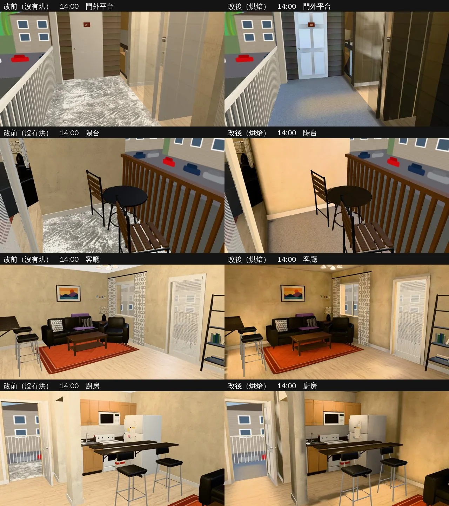
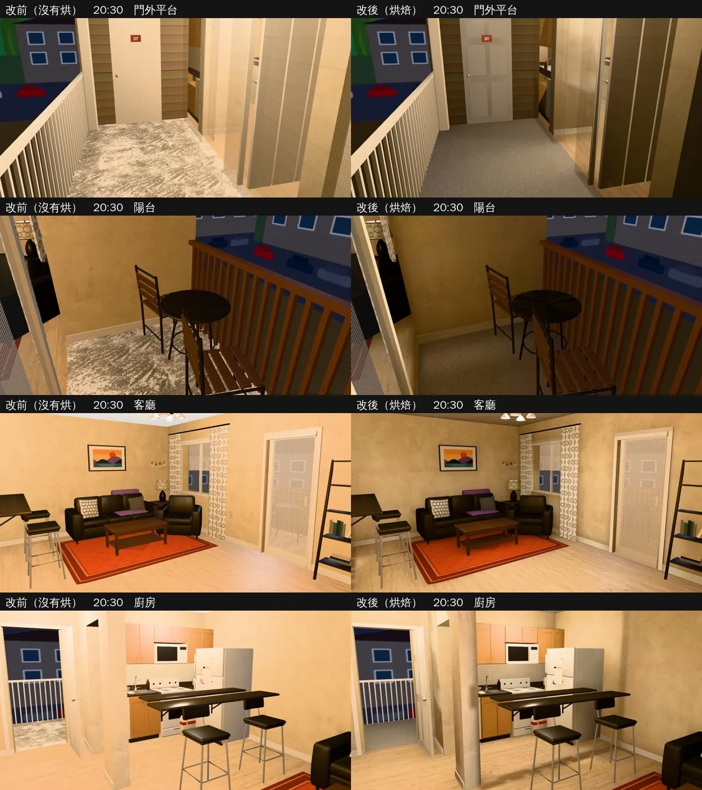

# 美國公寓收尾：門外平台、陽台白天偏白＋C 棟合租戶光照烘焙（INTERIOR-AAA-REVIEW-1028 美國收尾；LAWWW2-B 2026-11-01）

- **起因**：LAWWW-B 11-01 02:53 派工（INTERIOR-AAA 美國收尾）。上一批（`us_apartment_lm_1031`）README「還不夠的」寫的兩項：
  1. 公寓門外平台、陽台白天偏白（光照貼圖 0.89、1.38）；
  2. C 棟合租戶（`us_shared`）只修了壁板、沒有烘光照。
- **狀態**：`READY_FOR_ART_REVIEW`。建築、場景只有使用者能標 `ART_APPROVED`。
  - 截圖是 Playwright＋SwiftShader（電腦 1280×720），不是實機。
  - 讀檔放時間、藏玩家和 NPC 是 [捷徑]。
- **不用改程式**：us3d.js 的兩個公寓區域都走 `Z3.attachRoomGLB`，看到 GLB 的 `extras.lightmap` 就接（和上一批一樣）。

## 一、公寓門外平台、陽台（`us_apartment` 第八版）

- **為什麼白**，兩個原因：
  1. **光**：屋外的天光比屋裡亮好幾倍，遊戲沒有曝光調整。有屋簷的平台、陽台白天的光照貼圖照舊 0.89、1.38，淺色水泥 × 這個亮度就接近白。
  2. **貼圖**：水泥用的是 `concrete_floor_painted`，sat 0 去色。原貼圖剝落的藍色油漆去色以後變成一塊一塊白斑，白天看起來像積雪（改前截圖最明顯）。
- **修法**：
  - 新的烘焙選項 `bake_room.py --dayscale 'PAT=F,K,A'`：
    - 只改白天那一張，名稱符合的物件：屋外的地板、屋簷、外牆、陽台桌（`usa_concrete|usa_roof|breezeway_wall|_siding|US_BALCONY_TABLE`）。
    - 亮度乘 0.7，超過 0.5 的平滑壓到最多 0.7（和 `--knee` 同一個公式）。
    - 只改這些物件 LM UV 蓋到的像素，加上 Blender 烘焙留的 6 px 邊；邊只往「沒有任何物件」的空白長，不會壓到旁邊屋裡的物件。
    - 屋裡、晚上那一張都不動。
  - `us_apartment.py`：屋外水泥改素面 `granular_concrete`（`tile 1.2`、底色 `#c2bfb8 → #a9a6a0`、sat 0），沒有油漆斑。
  - C 棟合租戶同一支腳本、同一個材質，也一起改（第三節）。

| 光照貼圖（`lm_probe.py`；白天／晚上） | 改前（部署中的第七版） | 第八版 |
|---|---|---|
| 陽台地板（屋外） | 1.38／0.12 | **0.71**／0.12 |
| 門外平台地板（屋外） | 0.89／0.13 | **0.57**／0.13 |
| 客廳木地板（陽台門前） | 0.62／0.61 | 0.63／0.59 |
| 客廳中間地板 | 0.70／1.12 | 0.70／1.13 |
| 廚房地板 | 0.31／0.67 | 0.31／0.67 |
| 走道地板 | 1.37／0.78 | 1.35／0.79 |

- 屋裡差 0.03 以內，是取樣的雜訊。走道白天 1.35 是大門開著、平台那邊的天光照進來，屋裡的值，這次不動。

- 看得到的差別：
  - 平台、陽台變成均勻的中灰水泥，沒有白斑；
  - 從客廳透過百葉看出去的陽台不再一片白；
  - 屋裡不變。

## 二、C 棟合租戶光照烘焙（`us_shared` 第二版）

- 學姊她們那一戶（208，US2 9/13 要自己走去的必要劇情）。和單人戶同一支 `us_apartment.py`、同一套天光、外殼、窗外景（`bake_us.sh shared`）。
- **燈**：照配置的燈具。
  - 客廳吊扇燈 (−1.6, −1.0)；
  - 廚房吸頂燈 (−3.2, 2.0)；
  - 臥室 A 吸頂燈 (3.2, −2.0)（門關著，小一點）；
  - 走道 (−1.0, 2.0)：沒有燈具，天花板下一顆小面光源；
  - 門外平台的壁燈 (−0.2, 3.05)。
  - 臥室 B、衛浴、衣物間（B 的套房，門關著）不放燈。
- **不烘的**：
  - EVENT_US2（9/13 的劇情道具，平常藏著）烘焙時當作不存在：影子不烘進地板，藏起來的時候地上不會留一塊暗影；劇情時用即時光。
  - 臥室 A、B 的床、書桌椅（兩間一樣，匯出是 GPU instancing）不烘：同一份 UV 兩個位置，烘了光會錯（第一版烘了，新測試第 ④ 項抓到，第二版拿掉）。
- 屋外和單人戶第八版一樣壓暗（`--dayscale`），水泥同一個素面材質。

| 光照貼圖（`lm_probe.py`；白天／晚上） | 第二版 |
|---|---|
| 陽台地板（屋外） | 0.68／0.11 |
| 門外平台地板（屋外） | 0.59／0.13 |
| 客廳木地板（陽台門前） | 0.60／0.62 |
| 客廳中間地板 | 0.68／1.07 |
| 客廳東邊地板（臥室門前） | 0.25／0.32 |
| 廚房地板 | 0.31／0.73 |
| 走道地板 | 1.36／0.76 |

- 截圖是第一版拍的；第二版只差臥室 A、B 的床、書桌椅不烘（門關著，畫面上看不到）。

- 看得到的差別：
  - 改前整戶一樣亮，看不出燈在哪裡；改後吊扇燈底下亮、牆角和臥室門那一帶暗一點，廚房吸頂燈底下亮。
  - 晚上是燈的暖光，窗外暗。
  - 平台、陽台和單人戶一樣變成中灰水泥。
- **還不夠的（照實寫）**：
  - 客廳東邊（臥室 A、B 門前）白天只有 0.25：窗都在北牆西半邊，東邊離窗遠。看截圖不黑，先不補。
  - 平台上鄰居 207 的門白天很亮（門板白色、屋簷下照到天光）。門和屋裡的門是同一個物件（`usa_door`），沒有另外壓。

## 三、怎麼套（給 LAWWW-B）

1. **換二進位**（從我的分支 `claude/funny-albattani-iawshm` 拿）：
   - 單人戶：`us_apartment.glb`、`us_apartment.json`、`us_apartment_lm_day.webp`、`us_apartment_lm_night.webp`。
   - 合租戶：`us_shared.glb`、`us_shared.json`，新的 `us_shared_lm_day.webp`、`us_shared_lm_night.webp`。
2. **不用改程式**。
3. **patch**：`docs/art-rebuild/second_ai/patches/us_wrapup_lm_1101.patch`（只有測試）：新 `tests/us_shared_lm_unit.js`。
4. **工具**（只在我的分支）：
   - `bake_room.py --dayscale`；
   - `bake_us.sh`：公寓第八版、新 `shared`；
   - `us_apartment.py`：水泥材質；
   - 烘焙紀錄 `us_apartment_lm.json`、`us_shared_lm.json`。

## 四、測試

- 新 `tests/us_shared_lm_unit.js`：
  - **開發分支原樣 FAIL 4**（① ② 合租戶沒有烘、⑧ 兩戶的水泥是油漆斑那一張）；
  - 第一版 FAIL 1（④ 床、書桌椅被烘了）；
  - 第二版 ALL PASS。
- 既有的：`us_apartment_lm_unit`、`us_apt_closet_unit`、`us_apt_siding_unit`、`singleside_us_unit` 都 ALL PASS。
- 全部 Node：結果見 HANDOFF。
- 沒跑：手機實機、導航（模型只換了水泥的貼圖）。
