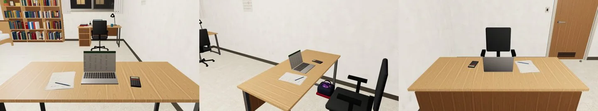

# 經濟系那一年的宿舍（V0-ART-DORM／DORM2）遊戲內驗收

## XUN_DESK 筆電朝向（LAWWW-B d0e02c7f，2026-10-16 遊戲內，cab58d64，`stage:'econ'`、20:00）

- 遊戲端：`XUN_DESK` 放 (1.8, 0.77, 1.5)、不轉；椅子 (1.8, 2.2)；`XUN_BOWLING` (2.40, 0, 1.70) ry −π/2。
- 結果：**筆電螢幕朝 +z，對著椅子**——LAWWW-B 的讀法對，不用轉。我之前說「轉 180°」是錯的。
- 左：從椅子的位置看書桌（螢幕正對鏡頭）；中：側面（保齡球袋在書桌下靠牆那一端）；右：從書桌另一邊看（筆電背面，椅子在對面）。

- `ROOMMATE_KAI`（阿凱的螢幕、零食、飲料）在這一年藏起來了，畫面裡沒有出現。
