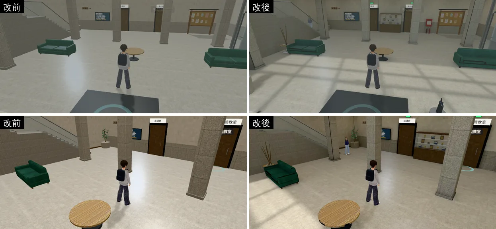
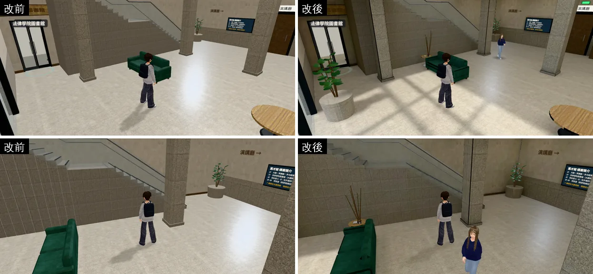
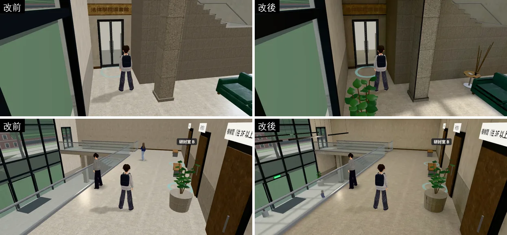
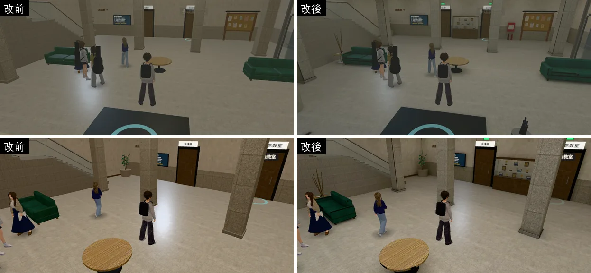
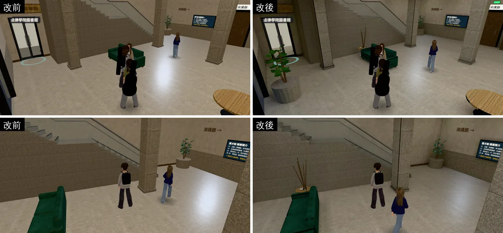
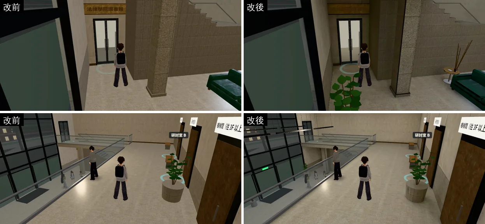

# 萬才館室內（一樓大廳＋二樓）：擺設＋光照烘焙（WANCAI-LM-1028；LAWWW2-C 2026-10-28）

- **起因**：使用者 10-28 P0（UA-LAWWW2-1028-01）「校內建築 空間內配置……廉價手遊感」。
  - 檢討報告第 5 節的順序：201 → 霖澤館大廳 → 其他。萬才館是法律系的另一棟，社團（法服社）在一樓大廳聚會。
- **做法和霖澤館大廳一樣**（`test_shots/linze_lobby_v2_1028/README.md` 的光照一節）：同一套燈具、同樣朝南的兩層樓玻璃帷幕，亮度、白平衡照大廳校正好的參數。
- **光照的程式不用改**：萬才館也走 `B3.attachFormal`，大廳那一包加的接法看到 GLB 的 `extras.lightmap` 就接上（已整合在開發分支 `ac2ab0ae9`）。
- **擺設**（和霖澤館大廳第二版同一套）：改前的大廳只有兩張沙發、一張圓桌、柱子，一大片地板（截圖第一排）。這一包加：
  - 北牆兩扇門（演講廳、多功能教室）中間的展示櫃：法服社、模擬法庭的獎盃、獎牌、合照、法槌（沒有字和校徽，D77）。
  - 東牆（電梯南邊）飲水機＋三個回收桶；北牆消防栓箱＋兩支滅火器。
  - 出口燈：兩扇門上方、入口上方（綠色發光，跟著牆淡出）。
  - 南面玻璃前的長椅、入口東邊的傘架、兩張沙發旁的小圓桌（雜誌、小盆栽）、兩盆大葉盆栽。
  - 中庭兩排線型吊燈（6.4 m 高）。
  - 位置都在牆邊，離劇情、社團站位 1.2 m 以上（`story3d.js` 的 `CLUB_SPOTS`、`TA_SPOT`、吉他社成發 (0,4.6)、出生點 (0,5)）。
  - 純色擺設合成一個頂點色材質（和霖澤館大廳 LOBBY-VC-1028 一樣）。
- **狀態**：`READY_FOR_ART_REVIEW`。建築、場景只有使用者能標 `ART_APPROVED`。
- **怎麼套**：
  1. 程式：`git apply docs/art-rebuild/second_ai/patches/wancai_lm_1028.patch`：
     - `src/data/wancai_layout.js`：九筆擺設。
     - `src/wancai3d.js`：家具多一種 `prop`（備用方塊＋導航阻擋），和 `building3d.js` 一樣。
     - `tools/blender/wancai_interior.py`：模型。
     - `tests/wancai_lightmap_unit.js`：新的測試。
  2. 二進位檔：`assets/models/env/wancai_interior.glb`、`wancai_interior_lm_day.webp`、`wancai_interior_lm_night.webp`。
- **截圖**：遊戲內、玩家鏡頭，手機橫向 844×390，Playwright＋SwiftShader 模擬，**不是 iPhone 實機**。讀檔進萬才館、人放到指定位置是 [捷徑]。

## 同角度對照

- 白天 14:00、晚上 20:30，六個鏡頭：
  1. 入口往北（出生點附近）；
  2. 大廳中間往北（兩扇門、展示櫃）；
  3. 西邊沙發往北；
  4. 西側樓梯；
  5. 西南角法律學院圖書館門口；
  6. 二樓北側走廊往東。
- 改前：開發分支 `165ec9ebe`（萬才館和 `116d70325` 一樣）。改後：開發分支 `116d70325`＋這個 patch＋三個二進位檔。路人每次位置不一樣。

**玩家會看到什麼不同**：
- 白天：南面玻璃帷幕的陽光照進來，地上有窗框的影子；柱子、沙發、樓梯下面有接觸陰影，不再是整片一樣亮。
- 晚上：原本地板上幾塊白白的反光（即時燈的高光）不見了，整個大廳照天花板燈板、吊燈、二樓樓板下的崁燈均勻亮起來；樓梯下、二樓樓板下面比中庭暗一點。
- 北牆兩扇門中間多了展示櫃，消防栓箱、出口燈、飲水機、回收桶這些公共設施讓大廳像有人在用的地方。
- **西南角（法律學院圖書館門口）、樓梯那一側比改前暗**：在二樓門廳、迴廊的樓板下面，陽光照不到。量畫面的地板亮度，白天樓梯那一格 0.49 → 0.22、圖書館門口 0.31 → 0.18（改前那兩格有即時燈的大片反光）。截圖看起來是「樓板下面比較暗」，沒有黑掉；BB 看畫面覺得太暗的話，可以在二樓門廳樓板下加崁燈再烘一次。

## 模型為了光照貼圖改的（`tools/blender/wancai_interior.py`，外觀一樣）

- 樓梯：原本每一階一個從地面長上來的方塊（互相重疊），改成只有看得到的面：踏面、踢面、東側的鋸齒形側面、第二跑的背面。
  - 西側面貼著西牆的內面，看不到，不做。
  - 止滑條改用自己的材質，不烘（1.5 cm 高，光照貼圖分不到一個像素）。
- 光照貼圖分給各面的比例（`lm`）：一樓地板 1.6、二樓地板 1.3、8.4 m 高的天花板 0.3、二樓以上的牆 0.7～0.8。
- 看不到的面不分像素（`lmhide`）：一樓地板方塊的四邊、二樓樓板的上面（被地板蓋住）。
- 同材質合併時照 `lm` 分組。

**光照貼圖填滿率 42.1%**（1024×1024；霖澤館大廳 44.7%）。一樓地板實際的面每公尺約 22 像素、二樓地板 18、牆 8～10。

## 沒有動的（玩法、存檔）

- 原本的家具、互動點、劇情站位（社團聚會、助教）、電梯、樓梯的走法都沒改；配置只多九筆擺設，導航都在牆邊。
- 存檔格式沒改。

## 測試

- **開發分支 `116d70325`＋這個 patch＋三個二進位檔**（Node；也套了霖澤館 LOBBY-CEIL-1028 那包，`room_ceiling` 才會整支過）：
  - `wancai_lightmap_unit`（新的）、`room_ceiling_unit`、`nav_buildings_unit`、`wancai_semb_unit`、`nav_lawlib_unit`、`linze_lightmap_unit`：ALL PASS。
  - 會讀萬才館配置（`wancai_layout.js`）的單元測試 50 幾支也都 ALL PASS（`seat_reach`、`quick_travel`、`rooms_glb`、`stairs_cam_slab`……）。
  - `wancai_lightmap_unit` 檢查的：
    1. 正式模型：場景 `extras.lightmap` 指到的兩張貼圖在 repo 裡；地板、天花板、樓梯、二樓地板有第二套 UV（共 62 個網格），燈板沒有。
    2. 假的 GLB 走萬才館真正的建區域流程（`wancai3d.js` → `B3.attachFormal`）：一樓地板接上 lightMap（強度 2π）；12:00 白天那張、20:00 晚上那張；電梯照舊更新。
    3. 大廳六筆 `prop` 擺設擋住導航；出生點、劇情和社團站位（9 個）照舊站得住。
  - **拿掉 `wancai3d.js` 的改動**，第 3 項 FAIL（展示櫃、兩張小圓桌站得上去）；改回來 ALL PASS。改前的 GLB（沒烘焙）第 1、2 項 FAIL。
- **站位**：加擺設前後，劇情、社團站位離最近阻擋的距離一樣；沒有小孤島（`islands.py`）。
- **深色木地板**（使用者 10-23 的永久規則 UA-LAWWW2-1023-03）：`scan_floors.py` 標出的是盆栽土（`wc_soil_pot`，0.63 m）和二樓長椅的椅面（`wc_wood`，4.67 m，原本就有），都不是地板。兩層地板都是淺色磨石子。
  - 改前的模型被標出一項 `wc_wood_dark`（0.12 m，踢腳板頂面和門合在一起算），改後合併的方式變了，沒有再標出來；兩邊都不是地板。
- **瀏覽器**：白天、晚上各一輪（上面的截圖），沒有 JS 錯誤；遊戲裡接上光照貼圖的材質 62 個。
- **iPhone 實機沒有測。**

## 效能

- **模型**（`wancai_interior.glb`）：

| | 改前 | 改後 |
|---|---|---|
| 檔案 | 2,514,352 bytes | 2,886,908 bytes（+15%） |
| 網格 | 75 | 86 |
| 三角形 | 7,130 | 13,009（展示櫃的獎盃、兩盆大葉盆栽、吊燈） |
| 材質 | 22 | 27（純色擺設合成一個頂點色材質 `wc_vc`） |

- **光照貼圖**：白天 79 KB、晚上 73 KB（WebP，1024×1024）。顯示卡記憶體兩張約 8 MB（含 mipmap 約 10.7 MB），和霖澤館大廳、201、202 一樣大。
- **draw call**：萬才館本身，人物先移出場景再量（`perf_views2.py`），白天 14:00，同六個鏡頭：

| 鏡頭 | 入口 | 中間 | 西邊沙發 | 樓梯 | 圖書館門口 | 二樓走廊 |
|---|---|---|---|---|---|---|
| 改前 | 128 | 110 | 116 | 73 | 78 | 182 |
| 改後 | 139 | 121 | 124 | 78 | 86 | 197 |

  - 多 7～10%。三角形每個鏡頭多 5～6 千個（萬才館本身 1.2～1.7 萬）。
- **fps**：雲端沙盒是 SwiftShader（1～4 fps），量不出意義。**手機實機沒有量。**

## 缺點、還沒做

- **陽光的位置是固定的**：和霖澤館大廳一樣，烘焙的太陽是秋天中午前後從南面照進來；早上、傍晚地上那塊陽光也在同一個地方，17:00～18:36 慢慢換成晚上那張。人物的即時影子方向和地上窗框的影子不一定一致。
- **西南角、樓梯那一側比改前暗**（見上面）。要再亮，就在二樓門廳樓板下加崁燈重烘。
- **盆栽、獎盃、扶手、玻璃照舊即時光**：不烘的東西照樣吃原本的光，在陰影處會比旁邊亮一點（201、霖澤館大廳也一樣）。
- **吊燈**：燈管是一直亮的發光材質，沒有加光暈。發光條和霖澤館一樣只拿掉朝上那一面（LOBBY-CEIL-1028）。
- **展示櫃的玻璃**：半透明的一片，沒有反射（遊戲沒有環境貼圖）。
- **填滿率 42.1%**，沒有到 50%。
- **烘焙工具在我的分支**（`tools/blender/env_second/lightbake/`：`bake_room.py`、`bake_wancai.sh`、`bake_linze_lobby.sh`……），開發分支沒有這個資料夾；要在開發分支重烘，`git checkout <交件 SHA> -- tools/blender/env_second/lightbake`。
- **還沒做的室內**：總圖大廳、男一舍交誼廳的光照烘焙。
