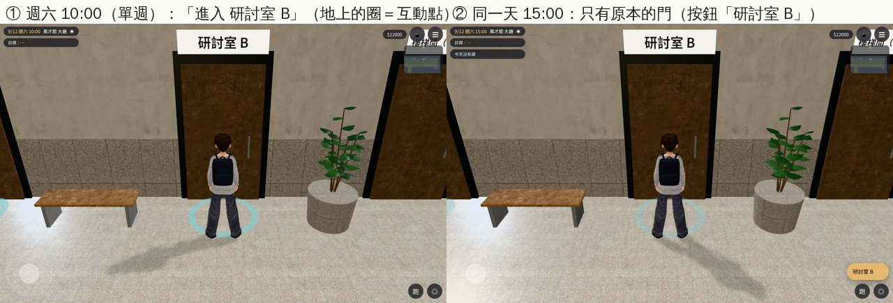
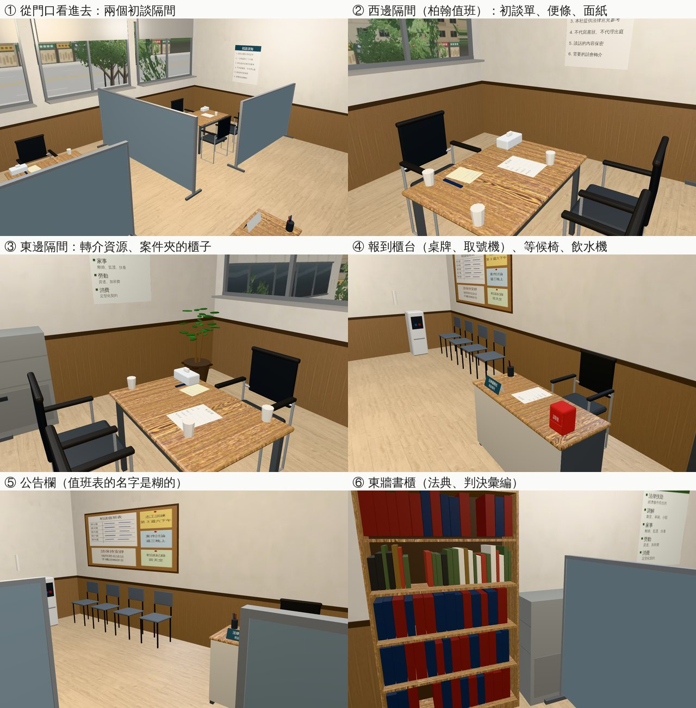
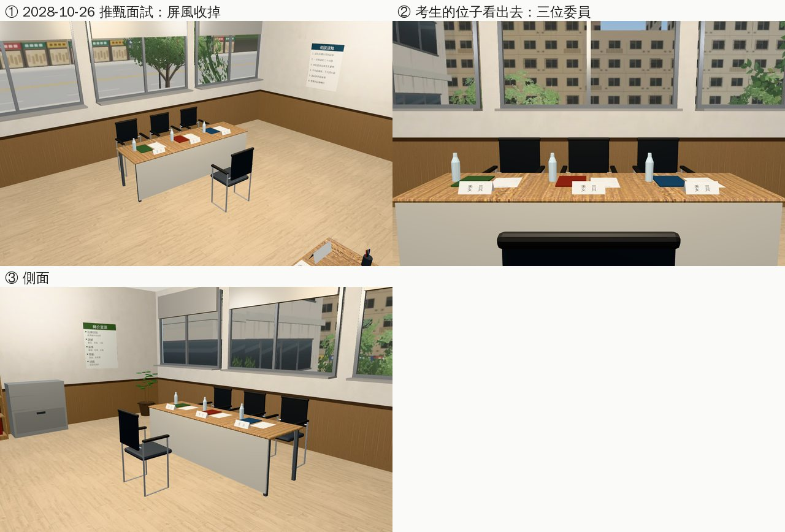

# 萬才館研討室 B＝法服的初談室（AA_399 第 5 節；任務 #82 第一間）

- **企劃**：AA_399 第 5 節（AA-B，企劃線 `5d09bb725`）。
  - 平常：單週六 09:00～12:00 開，門上「法服初談：單週六上午」，柏翰值班；其他時間關著（門上同一張紙）。
  - 事件換到這裡：語彤阿姨來法服（2027-05-22）、推甄面試（2028-10-26 10:00，門上換「推甄面試，請在外面等候」）、支線 SQ02 帶去法服那一步。
- **派工**：LAWWW-B 10-24 03:53（P2）：AA_399 剩下要 3D 房間的七處，順序我排；這是第一間。
- **做的人**：LAWWW2-B。
- **狀態**：`READY_FOR_ART_REVIEW`。場景美術的 `ART_APPROVED` 只有使用者能標。
- **Patch**：`docs/art-rebuild/second_ai/patches/rooms_ab3_1024.patch`（研討室 B、系辦、共同教學館 3F 考場同一份；對開發 `907cdc2f9`、`738cc7ffc` 都 `git apply --check` 過）。模型在我的分支。

## 做了什麼

- **模型**（Blender bpy，`tools/blender/env_second/wancai_semb.py` → `assets/models/env/second_ai/wancai_semb.{glb,json,layout.json}`）：
  - 1.29 MB、14,528 個三角形；研討室 A 的會議椅、旁聽椅、書櫃直接拿來用（`wancai_seminar.py`）。
  - 房間 7.6 × 6.0 m，門在走廊那一側靠東，南面一排窗（窗景借研討室 A 的照片：同一面、隔壁間）。地板淺色木紋。
  - **共用**：門口西邊的報到櫃台（「法律服務社／初談報到」桌牌、取號機、一疊初談單、筆筒）、北牆四張等候椅＋飲水機、公告欄（值班表的名字是糊的）、時鐘、東牆書櫃（法典、判決彙編）、上鎖的案件夾鐵櫃（書背只有年度和上下學期）、冷氣、盆栽。
  - 兩套布置，同一時間只開一套：

    | 節點 | 什麼時候 | 內容 | 三角形 |
    |---|---|---|---|
    | `SET_CONSULT` | 平常 | 兩個初談隔間：中間一道屏風、前面各一道矮屏風（入口 1.3 m）；每間一張小桌，志工坐窗那一側、來談的人坐對面兩張；桌上面紙、初談單、便條、紙杯。隔間牆上「初談須知」（西）、「轉介資源」（東） | 5,408 |
    | `SET_INTERVIEW` | 2028-10-26 推甄面試 | 屏風收掉；窗前一張長桌、三位口試委員面向門（名牌只寫「委員」）、水、資料夾；前面一張考生的椅子；報到櫃台多一張「報到處」 | 3,244 |

  - 字都是虛構的一般用語（沒有真實姓名、機構名稱、商標）。
- **配置**（`room_glb_layouts.js` 的 `wancai_semb`，從 layout.json 產生）：
  - `sets.consult`／`sets.interview`：各自的 `blocks`、`seats`、`spots`；`set_days`＝`{'2028-10-26':'interview'}`，其他日子 `set_default`＝consult。最上層的 `blocks`、`seats`、`spots` 是 consult（舊程式只讀最上層也能用）。
  - `spots`（劇情放人用）：
    - consult：`duty`（柏翰值班，西邊隔間志工的位子）、`volunteer`（東邊隔間的背景志工）、`desk`（報到櫃台）、`client`（來談的人：語彤阿姨、SQ02 的店員）、`companion`（陪同的人＝玩家）。
    - interview：`panel`×3（口試委員）、`candidate`（考生＝玩家）、`desk`（報到處的助理）、`wait`×3（等候的考生）。
  - `open`：`{wd:6, h0:9, h1:12, termWeeks:'odd', days:['2027-05-22','2028-10-26']}`（學期的第 1、3、5…週的週六上午；事件那兩天整天開）。
- **程式**：
  - `rooms_glb3d.js`（通用，以後的房間也用）：
    - 兩套布置：進區域時照當天選一套（`Z3.roomGlbSet`），導航、座位照那一套；GLB 的 `SET_<名字>` 只開那一套；`z.roomSet`、`z.spots`。
    - 開放時段：`Z3.roomGlbOpen(id, G)`；有 `open` 的房間，門的 `closed`（門上的字）留著，加 `d.gate`。
    - `Z3.roomGlbGate(it, shut)`：門的兩個互動點照時段藏起來（每一格問一次）。
  - `wancai3d.js`：研討室 B 的門在時段內是「進入 研討室 B」，時段外照舊是原本的門（看門上的紙；`closed2_3d.js` 的字）。兩個不會同時出現。
  - 其他房間（研討室 A、多功能教室、霖澤館 202）沒有 `open`、沒有 `sets`，行為和原本一樣。

## 給劇情接線（LAWWW-B）

- 單週六上午柏翰在 `spots.duty`（坐姿）；背景志工可以放 `volunteer`。
- 語彤阿姨（2027-05-22）、SQ02：2D 換 3D 時進 `wancai_semb`，照 `client`／`companion` 放人。
- 推甄面試（2028-10-26）：那一天自動是面試的布置；玩家坐 `candidate`，委員放 `panel`。
- 門上的紙照 `closed2_3d.js`（推甄那天的字也是那裡換）。

## 截圖（遊戲內，Playwright＋SwiftShader；不是 iPhone 實機）

開發 `738cc7ffc`＋ART-WZ6 patch＋這次的 patch。每張的 `post` 都確認區域、布置（`SET_CONSULT`／`SET_INTERVIEW` 哪一個開著）、正式模型載入；門的兩張確認最近的互動點是哪一個。

截圖時遊戲 10:00 跳出手機訊息會把畫面暫停：截圖工具加了一個每 0.3 秒解除暫停的看門狗（只在截圖的頁面，遊戲沒有改）。

### 萬才館 2F 走廊的門（2026-09-12 週六，學期第 1 週）

### 平常：初談隔間（2026-09-12 10:00）

### 推甄面試（2028-10-26 10:00）

## 測試

- `tests/wancai_semb_unit.js`（新，19 項；改之前第 1 項就失敗）：
  - 區域、正式模型、門的 `to`／`gate`、門上的字留著；
  - 開放時段：單週六 10:00 開；同一天 08:30、12:00、15:00 關；雙週週六、平日、寒假的週六關；2027-05-22、2028-10-26 整天開；
  - 萬才館 2F 的門：時段內只有「進入 研討室 B」、時段外只有原本的門；進去的落點＝配置的 spawn；
  - 兩套布置：2028-10-26＝interview、其他日子＝consult；建出來的區域照那一套；
  - 引擎的 `simWalk`：兩套的每一個座位（走近點）、看東西的點、出口都從門口走得到；spots 站得住。
- 開發 `738cc7ffc`＋ART-WZ6 patch＋這次的 patch（三間一起）：`wancai_semb_unit`、`rooms_glb_unit`、`x78_rooms_unit`、`aa399_closed2_unit`、`room_ceiling_unit`、`nav_buildings_unit`、`classes_unit`、`quick_travel_unit`、`zone_dispose_unit`、`zone_prewarm_unit`、`guide_unit`、`placemap_unit`、`crowd_unit`、`follow_buddy_unit` 都 ALL PASS；用到 `teach3d`／`building3d`／`closed2_3d`／`rooms_glb3d`／`room_glb_layouts` 的 59 個單元測試也都 ALL PASS（三間一起）。

## 還沒做／已知

- 人（柏翰、志工、委員、考生）沒有放：位置在 `spots`（LAWWW-B）。
- 公告欄、初談須知、案件夾的「看」：遊戲裡顯示的字等 AA 寫（現在顯示名稱）。
- 推甄那天的布置只看日期；如果推甄面試改日子，要改 `set_days`。
- 牆裙是中間偏深的木紋（和研討室 A 一樣）；使用者說的是地板，這裡地板是淺色。
- 手機效能沒實測。
