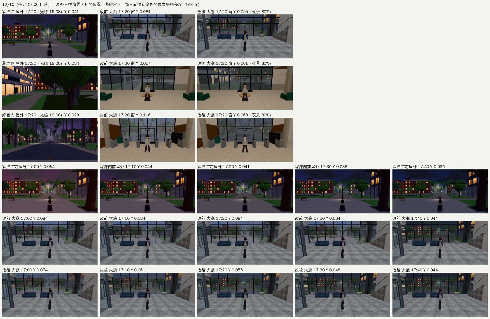

# ART-HALL-WINDOW-DUSK-1025：黃昏大廳窗外跟著屋外暗下來（2026-10-25，LAWWW2-B）

- **任務來源**：BB-B RELEASE-91010-TEST 附註④：「12/10 17:20（lightH 19.1）三個大廳窗外的白天照片比屋外亮（19.2 才換夜景），可以考慮 18.6～19.2 跟著 nk 調暗」。LAWWW-B 排的，P3。
- **驗收條件**（tasks.json）：12/10 17:20 窗外和屋外亮度一致；改前改後截圖。
- **對**：開發 `96c11e3fa`（`e015b7c10` 這五個檔案沒變，patch 兩個都 `git apply --check` 過）。
- **環境**：Playwright＋SwiftShader 手機模擬（844×390），不是 iPhone 實機。
- **狀態**：`READY_FOR_ART_REVIEW`（patch，沒進遊戲；LAWWW-B 整合）。

## 原因

- 12/10 臺北 17:06 日落；引擎把 17:20 換成光線用的時刻 19.08。
- 屋外：引擎的夜晚係數 nk 已經 0.92。天幾乎全黑，路燈、亮著的窗都開了。
- 窗外：大廳窗外是照片（遊戲裡 11:00 拍的白天、20:30 拍的夜景）。光線 19.2 以前一直是白天照片，只靠色調壓暗；18.4 以後色調 `0x8a8aa8`，亮度約 26%。19.2 才一下子換成夜景照片。
- 結果：17:00～17:35 窗外是調暗的白天街景，比屋外亮；到 17:35 左右（光線 19.2）一下子跳成夜景。

## 改法（`patches/window_dusk_fade_1025.patch`）

- `world3d.js`：
  - 新 `W3.photoFade(h)`：光線 18.6～19.2（nk 0.625 → 1）回傳 0 → 1，跟著屋外的夜晚係數走；其他時間 0。
  - 窗景材質（`windowMat`）多 `map2`／`nmap2`／`xf`：白天照片（×色調）照 `xf` 疊成夜景照片；兩層窗景的近景也一起疊。
  - `setWindowView` 多一個參數 `xf`：
    - 白天、`xf>0` 時，把夜景照片放進 `map2`（同時開始載入，換夜景那一刻不會等）；
    - 夜景照片還沒載入時照舊只畫白天那張。
  - `photoTint` 沒動。
- 用照片的窗景都把 `photoFade` 傳進去：
  - `building3d.js` 的 `setOutView`：霖澤館、萬才館、法圖、社科圖、教學館（大樓大廳）；
  - `library3d.js`：總圖大廳；
  - `l118_shops3d.js`：118 巷店內；
  - `zones3d.js` 的 `room()`：房間、教室的照片窗景。
- 到 19.2 已經全是夜景照片，換的那一刻不跳。店家那種夜景比白天亮的（亮著的招牌：118 巷、Café），也不會先暗下去、再亮起來。
- 清晨不動（5.5／6 以前夜景，之後白天照片）。

## 12/10 17:20 窗外和屋外（改前改後同角度）

**怎麼量**：

- 屋外：在校園上拍窗景照片的那個位置、方向（`tools/shots/window_views.py`、`library_views.py` 的鏡頭），拍遊戲當下的畫面，算整張的平均亮度（線性 Y）。
- 窗：把窗景平面藏起來再拍一張，兩張不一樣的像素＝看得到窗外的地方，算那些像素的平均亮度。
- 包括玻璃本身的反光；屋外是整張，所以兩邊不是完全同一件事，看趨勢。

工具：`tools/blender/env_second/shots/window_dusk_ab.py`。讀數：`readings.json`。

| 12/10 17:20（光線 19.08） | 屋外 | 改前 窗 | **改後 窗** |
|---|---|---|---|
| 霖澤館大廳（南面玻璃） | 0.041 | 0.084 | **0.055** |
| 萬才館大廳（南面玻璃） | 0.054 | 0.057 | 0.061 |
| 總圖大廳（正面玻璃帷幕） | 0.029 | 0.116 | **0.069** |

霖澤館 17:00～17:40：

| | 17:00 | 17:10 | 17:20 | 17:30 | 17:40 |
|---|---|---|---|---|---|
| 光線時刻 | 18.78 | 18.99 | 19.08 | 19.17 | 19.25 |
| 屋外 | 0.054 | 0.044 | 0.041 | 0.038 | 0.036 |
| 改前 窗 | 0.084 | 0.084 | 0.084 | 0.084 | **0.044**（一下子換夜景） |
| 改後 窗 | 0.074 | 0.061 | 0.055 | 0.048 | 0.044 |

**霖澤館**：

- 改前：窗外 17:30 以前一直是白天的景，是屋外的 2 倍亮，17:35 左右一下子跳成夜景。
- 改後：一路跟著屋外變暗，17:20 已經 80% 是夜景（亮著的窗、路燈），換的那一刻不跳。

**萬才館**：

- 改前就和屋外差不多。萬才館南邊的夜景照片（陽台下、亮著的窗）本來就比調暗的白天照片亮，所以改後高一點點，等於提早 20 分鐘看到晚上的樣子。

**總圖**：

- 改前是屋外的 4 倍，改後 2.4 倍。
- 剩下的大多是玻璃帷幕本身的反光（室內燈照在玻璃上）。夜景照片本身很暗（平均 0.016），天全黑以後窗的亮度也差不多在這裡。
- 總圖 17:40 沒拍，是用照片的亮度推算的。玻璃反光不在這個任務的範圍。

## 夏天（BB-B 10-25 實測；LAWWW2-B 10-30 決定維持）

- 夏天也變了，不是「照舊」：`photoFade` 照光線用的時刻，夏天光線和時鐘差不多，6/20（18:47 日落）從 18:26（光線 18.6）開始疊夜景，18:43 一半、19:01 九成八，19:03 換夜景不跳。
- BB-B 補量夏天屋外（BB 分支 `a1df82e90`、`9b3185665`，`BB_218_瀏覽器實測紀錄.md`）：霖澤館新版窗 18:34 0.076（屋外 0.055）、18:43 0.067（0.048）、19:01 0.046（0.037）——每一格都還是屋外的 1.2～1.4 倍，沒有比屋外先暗；舊版同時段 1.5～2.3 倍。總圖 1.8～2.3 倍（舊版 2.6～4.8），萬才館 0.94～1.18。
- **決定（LAWWW2-B 10-30，美術總監）：維持**。夏天窗景跟著屋外一起暗、不會在日落前先黑，比舊版更一致；不改成「只有冬天疊」。

## 測試

- 新 `tests/window_dusk_fade_unit.js`，**開發 FAILED、改後 ALL PASS**：
  1. `photoFade`＝(nk−0.625)/0.375，18.6 以前、19.2 以後是 0，一直往上、19.2 前一刻到 1；
  2. 窗景材質照 `xf` 疊成夜景照片；
  3. `setWindowView` 的八種情況（白天／晚上、夜景還沒載入、白天照片還沒載入、兩層窗景、`xf` 最多 1、舊材質沒有 `xf` 不出錯）；
  4. 四個地方都把 `photoFade` 傳進去，`photoTint` 只有這四處用；
  5. 12/10 17:20 白天照片剩下的亮度 5.4%（改前 26%）；12/10 16:30、7/15 18:00 照舊白天照片；7/15 18:30（日落前 16 分鐘，nk 已經 0.67）才開始疊、不到兩成；12/10 17:45 已經是夜景；
  6. `photoTint` 和改前一樣。
- 舊的 `window_night_sync_unit`、`us_airport_dusk_unit` ALL PASS。
- 全部 Node：開發 `96c11e3fa`＋這份 patch，`tests/` 629 支，0 失敗。
- 沒跑：瀏覽器流程測試、整套回歸、手機實機。

## 還沒做到的

- 清晨（5.5～6.5）沒有反過來的漸變：夜景照片一下子換成偏冷的白天照片。冬天早上 6 點多才會看到，這次沒動。
- 總圖玻璃帷幕的反光。
