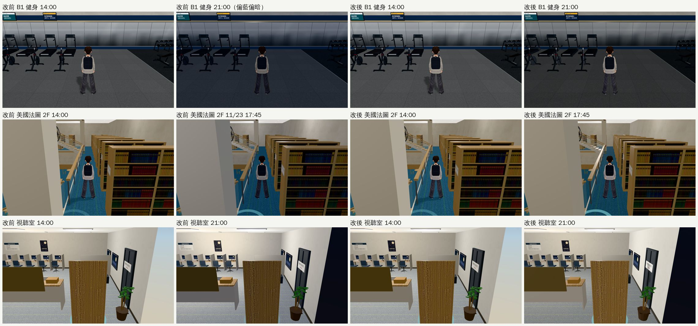

# WINDOWLESS-NIGHT-1025：沒有窗的室內晚上和白天一樣亮（2026-10-25，LAWWW2-B）

- **派工**：LAWWW-B 10-25 00:10。B1 健身房交件時記下「21:00 偏藍偏暗」，LAWWW-B 說可以做：沒有窗、燈開著的室內，晚上的光線應該和白天差不多。
  - 動 `engine3d.js` 前，00:3x 已先告訴 LAWWW-B 改哪兩處（照 D108）。
- **對**：開發 `32ddad549`。
- **環境**：Playwright＋SwiftShader（1280×720），不是 iPhone 實機。
- **狀態**：`READY_FOR_ART_REVIEW`。場景的 `ART_APPROVED` 只有使用者能標。

## 交件

| 檔案 | 內容 |
|---|---|
| `patches/windowless_night_1025.patch` | `src/engine3d.js`、`src/gym3d.js`、`src/library_b1_3d.js`、`src/rooms_glb3d.js`，新測試 `tests/windowless_night_unit.js` |

## 哪些區域沒有窗

- 一個一個看正式模型和 Blender 腳本裡有沒有對外的窗、窗景。
  - 程序化備用房間寫 `windows:false` 的區域有 11 個，但大多數正式模型都有窗或窗景，例如公寓、超市、法圖、118 店面、3F 主球場的高窗。
- 真的沒有窗的有四區：

| 區域 | 怎麼標 |
|---|---|
| 體育館 B1（`gym_b1`） | `gym3d.js` 區域定義 `windowless:true` |
| 總圖 B1（`library_b1`） | `library_b1_3d.js` 區域定義 `windowless:true`。這一區當初已經在 `applyTime` 固定了光線，加標記只是讓四區用同一套規則，畫面不變 |
| 總圖視聽室（`library_media`） | `rooms_glb3d.js`：GLB 房間的配置窗數＝0 就是 windowless（`room_glb_layouts.js` 寫「沒有窗（視聽室）」） |
| 美國法學院圖書館 2F（`us_lawlib_2f`） | 同上（配置寫「二樓沒有窗」） |

- 以後新的 GLB 房間只要配置沒有窗，就自動是 windowless。

## 做法（`src/engine3d.js` 的 `E.applyTime`，只對 windowless 的室內有作用）

1. 室內的燈不切到夜間：`lamps=!nw&&…`。
   - 燈照白天的狀態：天花板燈、光暈和白天一樣。
2. 室內那一段（`if(E.indoor){…}`）：`night`、`dusk`、清晨 `h<8` 的色調，windowless 時一律不用。
   - 半球光整天 1.2、顏色 `#f4f1ea`、太陽光 0.9：就是使用者看過的白天樣子。
- 其他室內、戶外、天色那份 patch 的 `lightHour` 都不動。

## 測試

- **新測試 `node tests/windowless_night_unit.js`**：改前 FAIL 8、改後 ALL PASS。檢查項目：
  1. 引擎的判斷（燈、室內那一段）；
  2. 四個區域的標記；GLB 房間裡 windowless 的只有視聽室、美國法圖 2F；
  3. 抽出室內那一段來跑：windowless 在 21:00、17:00、7:00、23:30、3:00 都和 14:00 一樣；一般室內 21:00 照舊是夜晚。

- **相關的 Node 測試**（和 `window_night_sync_v2_1025.patch` 一起套在 `32ddad549` 上）：
  - ALL PASS：`season_dusk`、`after_midnight`、`window_night_sync`、`us_lawlib_sky`、`us_lamp_pools`、`gym_unit`、`gym_arena`、`gym_b1_fitness`、`library_b1`、`rooms_glb`、`linze_5f`、`shadow_levels`、`ui_night_bg`、`night_forget`、`campus_lamps`、`l118_shops`、`library_upper`、`nav_buildings`。
  - 會讀到改過檔案的 `boya_*`、`dorm_*`、`classes`、`crowd` 等 20 支也都 ALL PASS。
- **遊戲內量到的**（`E.hemi`、燈）：

| 區域 | 14:00 | 21:00 改前 | 21:00 改後 |
|---|---|---|---|
| 體育館 B1 | 1.2、`#f4f1ea`、燈白天 | 1.05、`#e6ecfa`（偏藍）、燈夜間 | 1.2、`#f4f1ea`、燈白天 |
| 視聽室 | 同上 | 同上 | 同上 |
| 美國法圖 2F（11/23 17:45） | 同上 | 同上 | 同上 |
| 總圖 B1 | 1.15、`#eef2f8` | 1.15、`#eef2f8`（本來就固定） | 不變 |

## 改前、改後（同一個鏡頭）

- 改後晚上和白天一樣。唯一的差別是人物腳下的影子：引擎晚上本來就關掉太陽的影子（`E.nightShadow`），這次沒動。
- 【捷徑】讀檔直接設時刻。
- **沒測**：手機實機、整套回歸。
