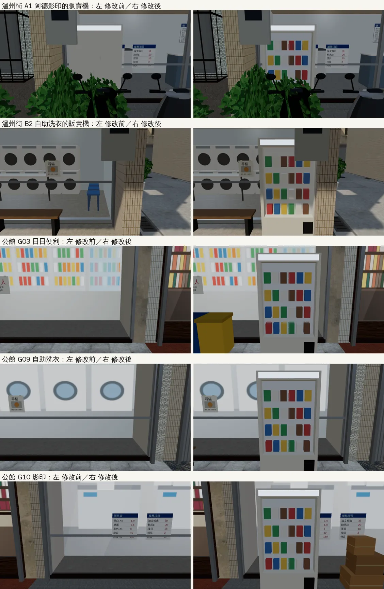
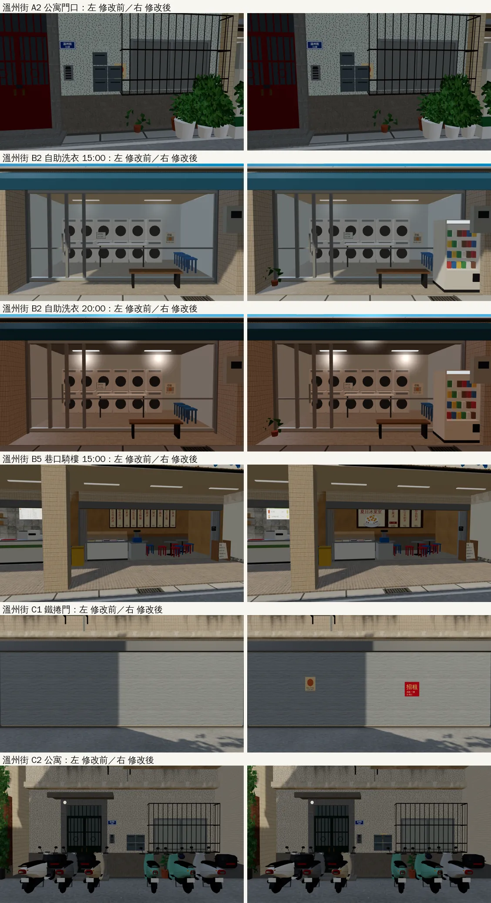
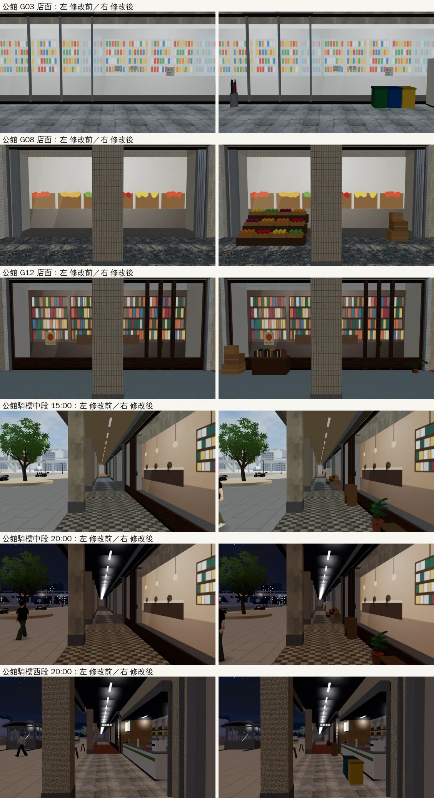
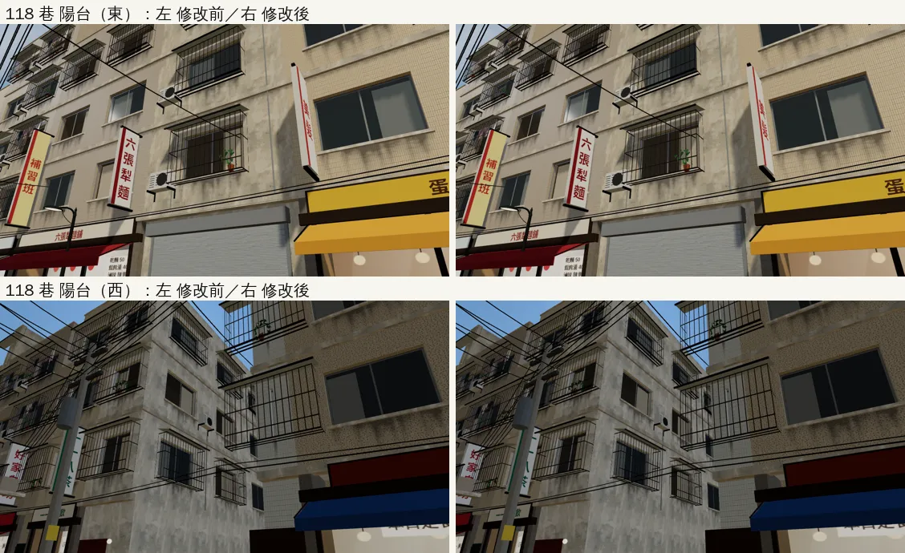

# 溫州街舊店面翻修（ART-WZ0）第二、三批：照 7b 準則補缺的層（溫州街、公館騎樓）＋門口雜物不讓人穿過去

帳號 A 的 LAWWW2，2026-10-21 23:0x～10-22 05:3x UTC。狀態：**已交件**（`READY_FOR_ART_REVIEW`；建築／場景美術由使用者驗收）。模型、導航、單元測試、瀏覽器回歸、遊戲內前後（第 4 節）都好了。

使用者 10-21 15:2x：「溫州街修改直接收尾　舊店面翻修繼續」。準則：AA_164 第 7b 節（店面的層次、每間店至少要有的東西、相鄰兩間不能同一種組合）。

## 1. 盤點（靜態：`wz_shopkit.py` 的店面表對 7b-2 規則）

第 1 條：每間店至少一種招牌、一種門、地面或騎樓兩樣東西、立面一樣生活痕跡。第 2 條：相鄰兩間的招牌、門、雨棚、磁磚至少三樣不同。

| 棟 | 店 | 招牌 | 門 | 雨棚 | 地磚 | 門口雜物 | 紙條 | 結果 |
|---|---|---|---|---|---|---|---|---|
| A1 | 阿德影印輸出 | 燈箱 | 鋁門 | 鐵皮 | 花崗石 | 2 | 4 | OK |
| A3 | 巷口書房 | 木招牌 | 木門 | 綠條紋 | 石英磚 | 4 | 2 | OK |
| A4 | 林家乾麵 | 招牌板 | 開放 | 紅條紋 | 馬賽克 | 4 | 1 | OK |
| A5 | 日日便利 | 燈箱 | 自動門 | — | 白磁磚 | 3 | 3 | OK |
| B2 | 自助洗衣 | 招牌板 | 鋁門 | 藍 | 磨石子 | **1** | 2 | **缺一樣雜物** → 這批補 |
| B3 | 巷子裡定食 | 木招牌 | 格子門 | 深藍條紋 | 花磚 | 4 | 2 | OK |
| B5 | 巷口茶飲／夏日冰菓室（騎樓） | 設計稿 | — | — | 白磁磚／磨石子 | 1＋1 | 2＋1 | 騎樓裡（見第 3 節） |
| B6 | 阿忠水果 | 招牌板 | 開放 | 橘條紋 | 水泥 | 3 | 1 | OK |
| B7 | 半熟 | 木招牌 | 木門 | — | 磨石子 | 4 | 2 | OK |
| B1、C1 | 拉下鐵捲門的店 | — | 鐵捲門 | — | — | B1：紙箱 1 | B1：2、**C1：0** | **C1 什麼都沒有** → 這批補 |
| A2、B4、C2、W0 | 公寓大門 | 門牌 | 鍛造鐵門 | — | — | 1～3 | **C2：0**，其他 1 | **C2 沒有生活痕跡** → 這批補 |

相鄰兩間：溫州街每一組都至少三樣不同。

**公館南側（同一份準則檢查）**：15 間騎樓店面**門口雜物全部是 0**（第 1 條要兩樣），G05／G06、G09／G10 只有兩樣不同（門一樣、都沒有雨棚）。原本的接法特意「騎樓裡不放雜物」（怕動到導航）；10-18 的騎樓截圖整條空蕩蕩。這一次連同導航一起做（第 2b 節）。

## 2. 這一批改了什麼（`wz_shopkit.py`，重建 `wenzhou_street.glb`）

- **B2 自助洗衣**：門廊加洗衣粉販賣機、門邊盆栽（都在門廊裡，建築的導航阻擋範圍內）。
- **C1**（Café 南邊拉下鐵捲門的店）：鐵捲門貼「招租」和一張海報。只貼紙，不放東西：門口就是人走的地方。
- **C2**（45 號公寓）：門邊的社區公告。
- 和原本的 GLB 比：多 3 張紙、1 台販賣機（含玻璃）、1 個盆栽實例；其他網格的三角形完全相同（用原本的腳本重建，也有 6 個索引緩衝只是順序不同，三角形一樣）。

## 2b. 公館騎樓（第三批，`wz_shopkit.py` 的 `SF_GG`＋`arcade_front_v2`，重建 `gongguan_shops.glb`）

- `arcade_front_v2` 支援 `clutter`：貼著店面玻璃（玻璃前 0.7 m 內），避開店門和店門口的四個互動點（麵店、茶行、書房、便利商店）。
- 每間 2～4 樣：麵店凳子＋回收桶、茶行菜單立牌＋回收桶、書房書車＋大盆栽＋立牌、便利商店回收桶＋傘架＋販賣機、藥局立牌＋紙箱＋盆栽、滷味凳子＋回收桶、咖啡輕食黑板＋長椅＋兩個大盆栽、水果行一座三層水果架＋紙箱、洗衣長椅＋販賣機、影印販賣機＋紙箱、定食菜單＋大盆栽＋傘架、唱片行特價書車＋紙箱＋盆栽、文具立牌＋傘架＋盆栽、早午餐黑板＋長椅＋大盆栽。G06 腳踏車行的三台車本來就是遊戲擺的（`zones3d.js`）。
- 第 2 條：G10 影印改自動門；G06 腳踏車行改玻璃櫥窗＋寬門（遊戲本來就在「櫥窗裡」擺兩台車）。
- `gongguan_shops.glb`：畫的三角形 85,387 → 93,141（+9%）、網格 52 → 54、材質 113 → 114、4.46 → 4.91 MB。第一版放了四座水果架（原型一座 2.8k 三角形，2.2 m 寬，兩座還會疊在一起）+11k，改成水果行一座、唱片行用書車。

## 2c. 街上的自動販賣機原本是米色大方塊（10-22 遊戲內截圖發現，`7be8b62f`）

- 門廊雜物的販賣機原型（`wz_shopkit.py` 的 `p_vend`）：機身整塊做到最前面（z 0.36），飲料（z 0.25～0.33）和玻璃（0.345）都包在機身裡面——從街上看只有米色方塊加一個退幣口。
- 用到的地方：溫州街 A1 阿德影印、B2 自助洗衣，公館 G03 日日便利、G09 自助洗衣、G10 影印。
- 改成展示窗凹進去：機身只到 z 0.22，窗的四邊是框，窗裡一塊白色背板，飲料排在背板前面、玻璃在最前面。
- `wenzhou_street.glb` 三角形 +104、`gongguan_shops.glb` +156；導航腳印（`*.props.json`）完全一樣。
- 遊戲內前後：佇列 j19c（五台販賣機的近景，修改前＝`34e488e4`）。

## 3. 門口雜物不讓人穿過去（`patches/wz0_prop_nav.diff`）

巡的時候發現：公寓大門、鐵捲門的門口雜物放在牆面外，而溫州街的導航只擋到牆面——人貼著牆走，身體會穿過盆栽、紙箱。

- `wz_street.py` 建模時把地上雜物的腳印（世界座標、高度）寫進 `wenzhou_street.props.json`（新）。
- `tests/street_props_nav_unit.js`（新）：在 Node 建出遊戲的溫州街，用引擎的做法取樣「人站得到的地方」（半徑 0.3 m），看身體和雜物最多重疊多少，超過 2 cm 算穿模。
  - 修改前 **6 個會重疊**：A2 公寓門邊的盆栽 30 cm、B1 鐵捲門前的紙箱 30 cm、B5 巷口茶飲騎樓裡的回收桶 30 cm、夏日冰菓室的 A 字立牌 25 cm、W0 巷底公寓的兩個盆栽 15 cm／8 cm。
  - 公館騎樓新放的 39 樣全部在人走的地方（騎樓可以走到玻璃前 0.4 m）。
  - `zones3d.js`：`WZ_PROP_BLOCKS`（溫州街 6 個）、`GG_PROP_BLOCKS`（公館 39 個），照腳印擋住那幾格（`blockRect` 加半格 pad：它只擋格子中心在範圍裡的）。**正式模型接上的時候才擋**：套件備用模型（`?nobldg`、模型載入失敗）沒有這些雜物，先擋就變成看不見的牆。
  - 測試也檢查「接上以後才擋」。修改前 **4 FAIL**（兩區各兩項）、修改後 **ALL PASS**。
- 導航的副作用（Node，模擬模型接上以後）：
  - 兩區都沒有小孤島（0.1 m 取樣、半徑 0.3）；
  - 可以走的面積：溫州街 1213.7 → 1209.0 m²（−0.4%）、公館 9914.6 → 9884 m²（−0.3%）；
  - 互動點都走得到：溫州街 11 個、公館 8 個（茶飲菜單 (23, −6.5) 就在回收桶旁邊，照樣走得到）。
- 第一版對開發分支 `34e488e4` 乾淨；**第二版對 `be8c1b0e` 乾淨**（`34e488e4` 套不上：`Z3` 的匯出那一行之後改過），和 `wz_shops2.diff`、`l118_bar_lift.diff`、`dorm_lounge.diff` 一起套也乾淨。

## 4. 遊戲內前後（佇列 j19，10-22 01:52～；修改前＝開發分支 `34e488e4`，修改後＝套 `wz0_prop_nav.diff`＋新的三份街景 GLB）

- 環境：Playwright＋SwiftShader，1280×720，演出鏡頭（不是 iPhone）。
- 截圖：修改前、修改後各拍到 12 張（`scene_shot.py` 兩次都在 2400 秒逾時）；沒拍到的公館 G08、G12、118 巷兩張陽台，和販賣機修正以後的五台近景，在 j19c 補（`fast_shots.py`，修改前後同一支工具）。
- 回歸（修改前／修改後）：
  - `reachability_all --zones wenzhou,gongguan`：ALL PASS／ALL PASS（2 區、34 個互動點、11 個出入口）。
  - `gongguan_layout_nav`：修改前、修改後都 ALL PASS。
  - `wz_street_integration`：修改前 ALL PASS；修改後（patch 第一版）**1 FAIL**：「導航格：正式模型和程序化版完全相同」——正式模型多擋 16 格（21,789 對 21,773）。這是照設計的：門口雜物只有正式模型才有，接上模型才擋（不然 `?nobldg` 會有看不見的牆）。
    - **patch 第二版**（`wz0_prop_nav.diff`，對開發分支 `be8c1b0e`）把這一項改成更嚴的檢查：**正式模型的導航格＝`?nobldg` 的導航格＋門口雜物的阻擋（同一份 `Z3.PROP_BLOCKS.wenzhou`、同一個 `Z3.propBlocks`），其他一格都不能不同**；雜物沒擋到、或 `?nobldg` 也擋了，都會 FAIL。`zones3d.js` 多匯出 `PROP_BLOCKS`、`propBlocks` 給測試用。
    - 第二版的瀏覽器測試排在 j19c（修改後跑 `wz_street_integration`、`gongguan_layout_nav`）。
  - `street_props_nav_unit`（Node）：修改後 ALL PASS。

- **patch 第二版的瀏覽器回歸（佇列 j19c，開發分支 `be8c1b0e`＋`wz0_prop_nav.diff` 第二版＋新的三份街景 GLB）**：
  - `wz_street_integration` **ALL PASS**：正式模型的導航格＝`?nobldg` 的＋門口雜物的阻擋，其他完全相同（21,789 對 21,773＋16 格）；鏡頭碰撞方塊 28＝28；互動點 26＝26。
  - `gongguan_layout_nav` ALL PASS；`street_props_nav_unit` ALL PASS。
- 遊戲內前後補拍：j19c 兩次都在第一張 `Target crashed`（當時同時在建人物模型、記憶體不夠），j19d 重拍 12 張，修改前＝開發分支 `be8c1b0e` 原本的 GLB。

### 街上的販賣機（2c）

左：修改前（米色大方塊，或那一版還沒有販賣機）；右：展示窗凹進去、看得到飲料。

### 溫州街（第 2 節）

自助洗衣門口多了販賣機和盆栽；巷口冰菓室的騎樓換成冰菓室招牌；空店的鐵捲門貼招租。

### 公館騎樓（2b）

### 118 巷陽台（`lane118_street.glb` 用現在的腳本重建，補上鐵花架）

## 接法（LAWWW）

1. `git apply docs/art-rebuild/second_ai/patches/wz0_prop_nav.diff`（第二版）
   - 動到 `src/zones3d.js`（`WZ_PROP_BLOCKS`、`GG_PROP_BLOCKS`、匯出 `PROP_BLOCKS`／`propBlocks`）、`tests/street_props_nav_unit.js`（新）、`tests/wz_street_integration.py`。
   - 對開發分支 `be8c1b0e`、`7e00ad05` 都乾淨；和 `wz_shops2.diff`、`l118_bar_lift.diff`、`dorm_lounge.diff` 一起套也乾淨。
2. 換檔（我的分支）：
   - `assets/models/env/second_ai/wenzhou_street.glb`、`.json`、`.props.json`（新）
   - `assets/models/env/second_ai/gongguan_shops.glb`、`.json`、`.props.json`（新）
   - 上面兩組在 `7be8b62f`。
   - `assets/models/env/second_ai/lane118_street.glb`、`.json`（`e6c2669a`；`.json` 的 out 路徑在 `bc5b08a8` 改回 assets）
3. 測試：
   - `node tests/street_props_nav_unit.js`
   - `tests/wz_street_integration.py`
   - `tests/gongguan_layout_nav.py`
   - `tests/reachability_all.py --zones wenzhou,gongguan`
4. GLB 和 patch 要一起接：只換 GLB，門口雜物擋不到（人穿過盆栽）；只套 patch，導航會擋住舊模型上沒有的雜物（看不見的牆）。`street_props_nav_unit` 讀新的 `.props.json`，沒換檔時會失敗。

## 4b. ART-WZ7 路邊小物（總表寫「待開工」，其實三件已經在模型裡）

- AA-B 做的 `aa_support/wz7_street_props.glb` 五件（安全帽、傘桶、U 型鎖、外送保溫箱、回收紙箱捆＋寶特瓶袋），LAWWW2-B 10-1x 已經把其中三件擺進溫州街的正式模型（`wz_street.py` 的「ART-WZ7 路邊小物」那一段；`test_shots/wz_perf/README.md`「第五輪之後」）：
  - 外送保溫箱＋上面一頂安全帽：林家乾麵（A4）門廊的西端（外送員在等餐）；
  - 回收紙箱捆＋一袋寶特瓶：日日便利（A5）門廊的西端（門在東邊）。
- 都在店面退縮的門廊裡（建築的導航阻擋範圍內），不用另外擋導航。這次的 `wenzhou_street.glb`（第二、三批、販賣機修正）是用同一支腳本重建的，三件照樣在。
- 傘桶、U 型鎖沒擺：當時溫州街的三角形預算不夠（每件 1.3～1.7k）。公館騎樓這一批放了傘架（第 2b 節），溫州街暫時不加。
- **請 LAWWW 改總表**：ART-WZ7 換溫州街模型時就一起整合了（擺放不依賴劇情）；剩下的兩件不做。

## 5. 還不到的地方（誠實寫）

- 公館騎樓的雜物在遊戲裡看過了（j19、j19d），不擠；晚上的燈色和溫州街一樣是暖白。
- 只看了店面表的資料，溫州街巡場景（j11，24 張）還沒看；看完可能還有要補的（二樓以上的生活痕跡、晚上的燈色）。
- `lane118_street.glb` 沒有跟著陽台盆栽那次的腳本修改重建：已用現在的腳本重建（`e6c2669a`，補上陽台盆栽的鐵花架），和這一件一起交；遊戲內前後在 j19c（118 巷兩張陽台）。
- 真機沒看過。
