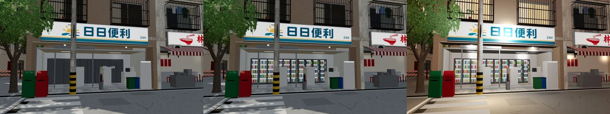
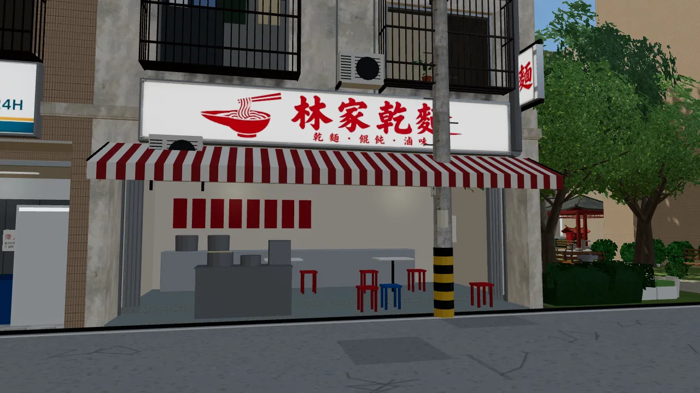
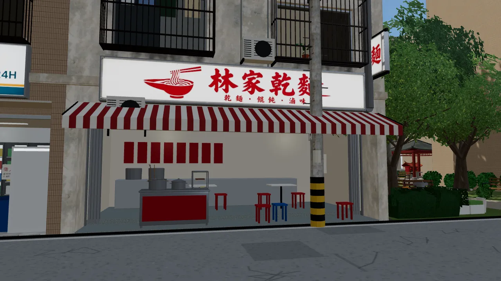
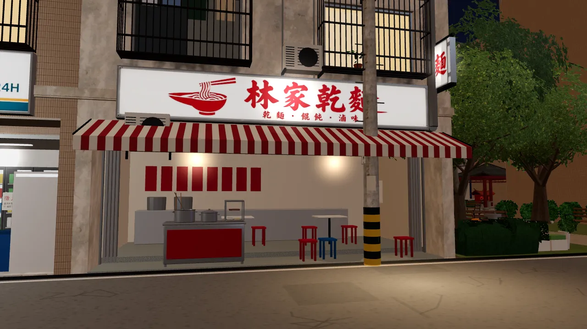
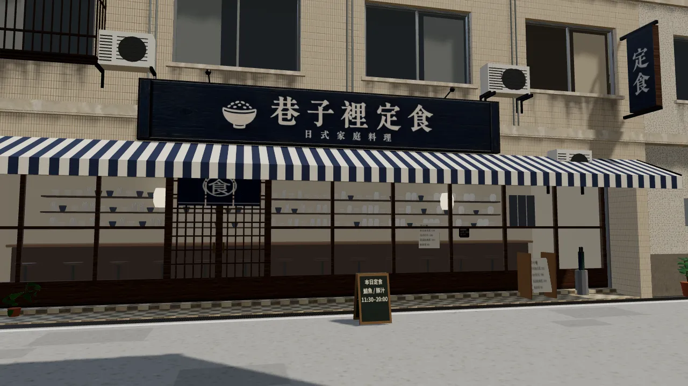
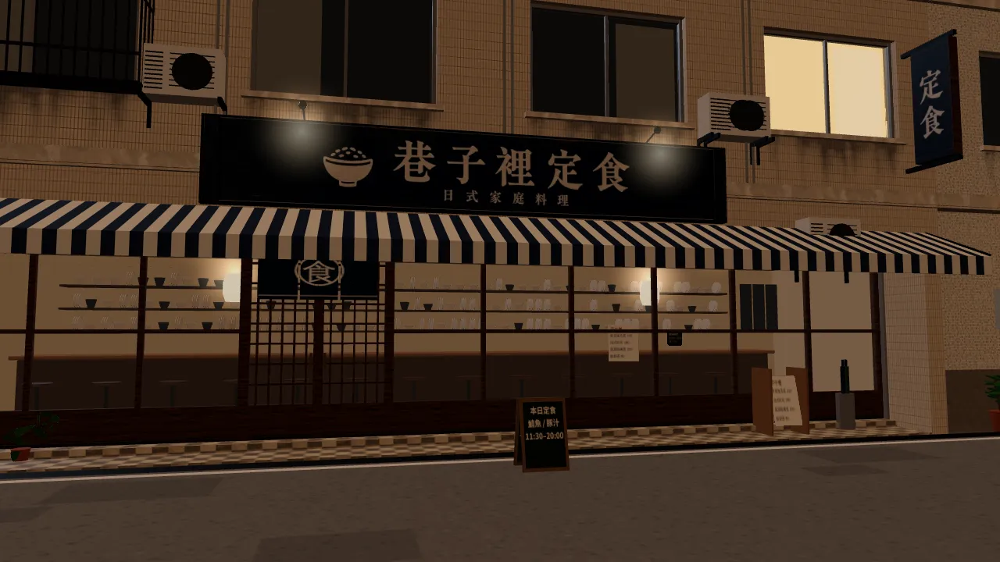

# 溫州街店面翻修（ART-WZ0）＋三家新店外觀（ART-WZ2）——驗收圖與整合說明

LAWWW2-B，2026-10-16。模型：`tools/blender/env_second/wz_street.py`＋`wz_shopkit.py` → `assets/models/env/second_ai/wenzhou_street.glb`。
一盞茶屋的外觀：`wz_jphouse.py` → `wz_jphouse.glb`。

## 做了什麼

依 AA_164 7b「店面設計準則」與使用者 10-16 的指示：
- 「店面都太單調」；
- 「招牌的字體就太假了」；
- 「日系加一點寫實 不要很像積木」。

1. **招牌改用使用者核可的設計稿**（BB-B `signs_approved/`，13 張，逐字核對過）：
   - `sign_atlas.py` 自動切圖，只延長字外面的底板，字不拉長，排成一張貼圖集；
   - 燈箱（影印、乾麵、便利商店、洗衣、茶飲、水果）晚上自己亮；木招牌、鐵皮招牌（書房、定食、半熟、冰菓室）上面有投光燈；
   - 有直立招牌的店：影印、書、麵、定食、冰。
2. **店門退縮成門廊**（0.9 m，在建築的導航阻擋裡）：
   - 每家不同的地磚與門檻；
   - 門：鋁門、木框玻璃門、自動門、木格拉門＋暖簾、整面拉開；
   - 鐵捲門箱、條紋或單色帆布、鐵皮雨遮；
   - 玻璃上的紙條（徵人、營業時間、支付貼紙、價目、招租）；
   - 門口雜物：凳子、A 字黑板、傘桶、垃圾桶、販賣機、水果架、麵攤、書車、紙箱、長椅、冰箱、盆栽；
   - 一樓冷氣、電錶箱、排油煙管。
3. **公寓大門**（A2、B4、C2、W0；取代平板鐵門）：
   - 石材門框＋兩階台階；
   - 對開鍛造鐵門：下半實心、上半鐵條＋圓形花樣；
   - 鐵條氣窗、混凝土小雨遮、門燈；
   - 藍底白字門牌 `PLATE_FACE_door_*`、對講機、各樓層信箱；
   - 旁邊的鋁窗，一半有鐵窗。
4. **B5 騎樓拆成兩間立體小店**（AA-B：冰店在茶飲旁邊、公園對面）：
   - 巷口茶飲（x 16～23）：點餐櫃台、收銀機、杯子、封口機；後面工作檯的茶桶、搖茶機；層架；兩塊菜單燈箱。
   - 夏日冰菓室（x 23～30）：
     - 整面拉開的摺門、配料冰櫃（十盒配料、斜玻璃）、剉冰機；
     - 三張小圓桌＋塑膠凳、木板牆腰＋長條木牌菜單、吊扇；
     - 冬天拉下鐵捲門、貼「冬天休息」（季節節點）。
5. **B7 改成半熟早午餐**：
   - 木框玻璃門、木招牌（設計稿）；
   - 黑板、長椅、大盆栽。
6. **A1 改名阿德影印輸出**（招牌用設計稿）。
7. **B4 二樓是小書包兒童課輔**：中間那扇窗貼割字貼紙，一樓樓梯口旁邊掛帆布布條。
8. **小公園四周**：
   - A3、A4、S1 的背面：後陽台鐵窗籠、熱水器、小窗＋排風扇、冷氣、排水管；一樓後門、鐵窗小窗、瓦斯錶。
   - 北側兩棟背景公寓 P1、P2（z 30.9 以北，導航格外面，走不到），加上公園北牆到這兩棟之間的地。
9. **一盞茶屋**（日式宿舍改成茶屋，AA_164 2-3）：
   - 院門掛紙燈籠：「一盞」是設計稿，正反兩面都有字，晚上亮；
   - 右門柱掛木牌；
   - 玄關掛素面麻布暖簾；
   - 「私人住宅 請勿進入」拿掉。

## 給 LAWWW-B 的整合事項

1. **B5 中間的分隔柱**要加導航阻擋：`blockRect(23.0, -5.3, 0.6, 0.6)`。騎樓走得到；兩端的柱子和原本一樣。
2. **季節節點**：`SEASON_ICECLOSED_on_B5i`。10～4 月顯示（鐵門拉下、冬天休息；AA_164 1-2：只在 5～9 月開），5～9 月藏起來。和小公園同一個規則：`_on`＝那個季節的樣子。
3. **招牌**：
   - 有設計稿的店不再有 `SIGN_FACE_*`、`VSIGN_FACE_*`，字在貼圖裡，遊戲不用畫：A1、A3、A4、A5、B2、B3、B5、B5i、B6、B7。
   - 沒有設計稿的照舊（Café、公館）。
4. **門牌** `PLATE_FACE_door_A2`、`_B4`、`_C2`、`_W0`（`plate:'door'`，藍底白字）：照現有的 wzPlateTex 畫。
5. **文字和互動點**：
   - 影印店的名字改成「阿德影印輸出」（原本「大學影印」）；
   - 日式宿舍的「看日式宿舍」改成進一盞（`wz_shops_layout.js` 的 `teahouse.enterAt`）；
   - B7 的進店點：`brunch.enterAt`。
6. **規格**：
   - `wenzhou_street.glb` 48.7k 三角形（instancing 後畫 170k）、106 個材質、4.8 MB。
   - 比上一版多的主要是 P1、P2、背面、B5 室內、大門。
   - 手機太重的話，先拿掉 P1、P2 的細節（`far`）。
   - `wz_jphouse.glb` 5.6k 三角形。

## 驗收圖

- `before_after_*.jpg`：同一個鏡頭（遊戲內，iPhone 以外的 1280×720），左＝修改前、右＝修改後，白天／晚上。
- 修改前的截圖是開發線 `5ec6a388` 的原本模型。

## 還沒做（下一批）

- 舊店的玻璃後面還是平面景深卡：麵店、便利商店、影印、洗衣、定食。要改成 B5 那種 2～3 m 的立體淺店內。
- 冰菓室的「開店／休息」要遊戲做季節切換才看得到夏天版。截圖裡夏天版是用程式把節點藏起來拍的。
- 公館南側的招牌：等「清葉台菜」「阿圓手工皂」的名字定案，BB-B 再請使用者生成。
- 兩點半 Café 的舊招牌：BB-B 看街景再判斷。

---

## v6b／v6c（LAWWW2-B 2026-10-16 08:5x UTC）：遊戲內驗收

1. **v6b 便利商店冰箱**：
   - v6 第一版的冰箱是實心方塊，飲料被包在裡面，從外面看是一排深灰色板子。
   - 改成開放框架：發光背板、側框、5 層層架，飲料在前面。
   - （左：v6；中：v6b 白天；右：v6b 晚上）
2. **v6c 麵攤**：
   - v6 是直角的灰色方塊加兩個圓柱，像積木。
   - 改成倒角的不鏽鋼台：正面紅色烤漆板、有捲邊和提耳的湯鍋（一鍋蓋著）、竹撈、湯杓、玻璃櫥窗（碗疊、麵球、滷味盤）。
   - 修改前：
   - 修改後：
   - 晚上：
3. 三角形：65.8k（v6b）→ 67.4k（v6c）。

### BB-B 看 v5 截圖提的兩點（v6d 做）

1. 定食店（B3）玻璃後面看起來像書店的彩色書架 → 換成碗盤架、菜單板。
2. 定食店門口三塊深色暖簾像三塊方板 → 中間開衩、印白色「食」字。

## v6d（LAWWW2-B 2026-10-16 09:3x UTC）：BB-B 提的兩點＋店外的盆栽

- **定食店（B3）**：
  - 玻璃後面的彩色方塊（像書店）換成碗盤架：一疊疊白色、藍色的碗，立著的盤子；牆上一排米色木札菜單。
  - 暖簾：三片布中間開衩、布面有起伏，白色圓圈裡一個「食」跨三片（`shopkit_tex.noren()`）。
- **大葉盆栽**（店門口、公寓門口）：葉片卡換成 `plants.py` 的模型葉子。
- 三角形：67.4k → 80.2k（畫出來 217k）。

| 定食店（白天） | 定食店（晚上） |
|---|---|
|  |  |

半熟店門口的盆栽：`../wz_shops/ig_v3_door_brunch_day.webp`。
