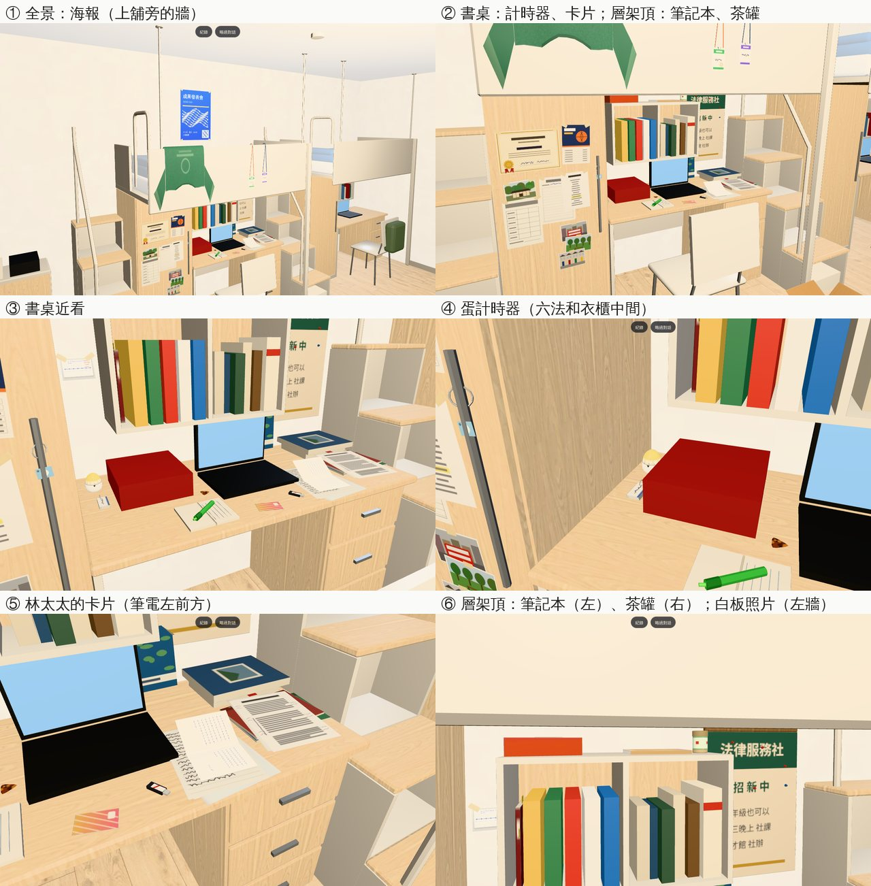
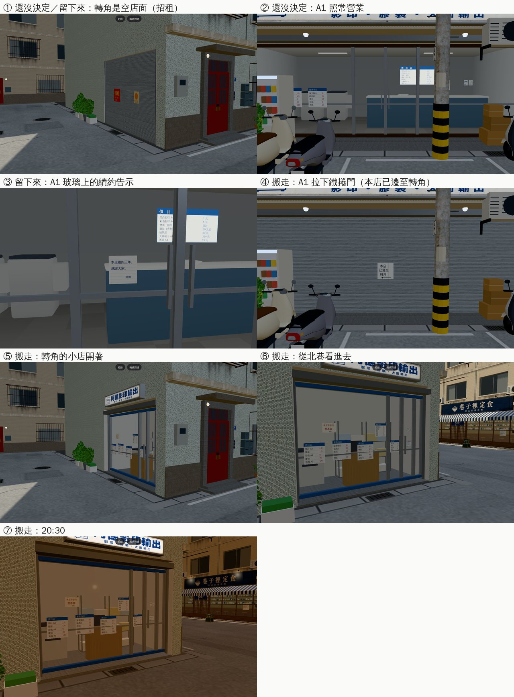
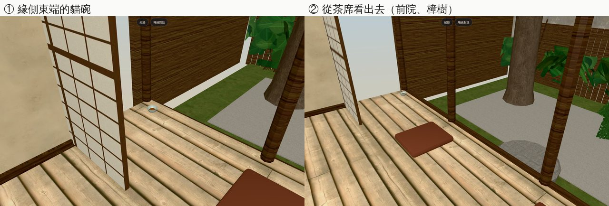

# ART-WZ6：溫州街打工線的 3D（房間六件東西、阿德影印兩種外觀、一盞的貓碗、三家店上班的站位）

- **企劃**：AA_420 第 9 節（AA-B）；`tasks.json` DL-11。字已經在開發分支（`WZ_JOBS_DATA.room`、`jobs3d.js` 的 `S.room`、`STORY.ROOM_EXTRA`）。
- **派工**：LAWWW-B 10-23 19:3x 佇列第 ⑤ 項：「你只要做模型和放的位置」。
- **做的人**：LAWWW2-B。
- **狀態**：`READY_FOR_ART_REVIEW`。場景美術的 `ART_APPROVED` 只有使用者能標。

- **Patch**：`docs/art-rebuild/second_ai/patches/wz6_market_1024.patch`（ART-WZ6 和二手市集同一份：`src/zones3d.js`、`src/jobs3d.js`、`src/assets3d.js`、`src/data/wz_shops_layout.js`、`src/data/wz_park_layout.js`、四個新測試）。
  - 對開發 `738cc7ffc` `git apply --check` 過。模型（GLB）在我的分支 `claude/funny-albattani-iawshm`。

## 1. 房間裡的六件東西（宿舍四人房，大一 203～大四 409 同一組家具）

- **模型**（Blender bpy，`tools/blender/env_second/dorm_wz_items.py` → `assets/models/env/second_ai/dorm_wz_items.{glb,json}`）：
  - 71 KB、987 個三角形、一個材質、一張貼圖 `textures/gen/dorm_wz_print.png`（卡片、照片、海報的字和圖都是自己畫的，沒有真的店名、商標）。
  - 每一件一個節點 `ITEM_wz_<key>`，key 和 `WZ_JOBS_DATA.room` 一樣：

    | 節點 | 旗標 | 東西 | 放哪裡 |
    |---|---|---|---|
    | `ITEM_wz_timer` | `WZ_ITEM_TIMER` | 半熟的蛋計時器（三分四十秒那一格有舊刮痕） | 書桌右後角，六法和衣櫃中間 |
    | `ITEM_wz_card` | `WZ_CARD` | 林太太手寫的卡片，對摺攤開 | 書桌前緣、筆電左前方 |
    | `ITEM_wz_notebook` | `WZ_ITEM_NOTEBOOK` | 阿德給的膠裝空白筆記本 | 層架頂上平放，書背朝房間 |
    | `ITEM_wz_tea` | `WZ_ITEM_TEA`（`WZ_TEA_GIVEN` 以後收起來） | 一盞的一小罐茶 | 層架頂上、筆記本左邊 |
    | `ITEM_wz_board` | `WZ_YE_DONE` | 讀書會白板的照片，紙膠帶貼著 | 層架和衣櫃中間那一條牆 |
    | `ITEM_wz_poster` | `WZ_POSTER_ITEM` | 子晴成發的藍色海報 | 上舖旁邊的牆，四個角貼紙膠帶 |

  - 貼在牆上的兩件，網格叫 `WALL_left_wz_board`、`WALL_left_wz_poster`（`dir [1,0,0]`），跟左牆一起淡出，鏡頭不會被擋住。
  - 擺之前量過大三、大四的東西（`ROOM_Y3_ITEMS`、`ROOM_Y4_ITEMS`）和黃金葛，沒有疊在一起。
- **程式**：
  - `jobs3d.js`：新增 `JOBS.roomKeys(G)`（現在有哪幾件），`S.room` 改成照這一份（文字不變）。
  - `zones3d.js` 的 dorm：第一次需要時才載入 `bldg.dorm_wz_items`（`ASSETS` manifest 新增，lazy）；每幀照 `roomKeys` 開關節點；搬家收拾的那幾天（`ROOM_Y2/3/4_MOVING`、`PACKED_Y4`）全部收起來。

## 2. 阿德影印的兩種外觀（`WZ_COPY_SHOP`）

- **模型**（`tools/blender/env_second/wz_shopkit.py` 加 ART-WZ6 那一段、`wz_street.py` 呼叫；重建 `wenzhou_street.glb`）：
  - A2 東側一樓的轉角原本是實心牆，改成一間凹進去的小店面（寬 3.8 m、深 2.15 m），四個開關節點：

    | 節點 | 什麼時候 | 內容 | 三角形 |
    |---|---|---|---|
    | `COPY_CORNER_SHUT` | 還沒決定、留下來（`stay`） | 轉角是空店面：鐵捲門、「招租」紅紙、一張舊海報 | 42 |
    | `COPY_CORNER_OPEN` | 搬走（`moved`） | 轉角的小店開著：鋁框玻璃門、招牌（阿德影印輸出的設計稿 `ade_print_h`）、玻璃上的公告、影印機、櫃台＋螢幕、開放式鐵層架（紙箱、紙捲） | 536 |
    | `COPY_A1_SHUT` | 搬走 | 原本的 A1 店面拉下鐵捲門 | 8 |
    | `COPY_A1_RENEW` | 留下來 | A1 玻璃上一張續約的告示 | 2 |

  - 開關節點裡沒有光暈（`GLOW_` 會被合批，關不掉），所以搬走以後 A1 晚上的招牌燈照舊亮（見「還沒做」）。
  - 公告的字在 `textures/gen/wz_copy_notices.png`。
  - 整條街重建：1,038 個物件、93,881 個三角形、8.08 MB（之前 1,022／93,165／7.98 MB）。
- **配置**（`src/data/wz_shops_layout.js` 的 `print.moved`）：搬走以後的進店點 (3.9, 6.5)「進去阿德影印輸出」、出店點 (4.0, 6.5)。室內照舊是同一個 `wz_print`（LAWWW-B 10-23：室內共用）。
- **程式**（`zones3d.js` 溫州街）：
  - `wzCopyState(G)`：`'stay'`／`'moved'`／`''`；進溫州街時決定店門在哪裡（`wzCopyAt`），每幀照旗標開關四個節點（`copyTick`）。
  - 從影印店出來：`moved` 回到轉角 (4.0, 6.5)，其他回到 A1 門口。
- **效能**（溫州街轉角那個角度）：143 → 153 calls（搬走以後 +10）、三角形 +452。

## 3. 一盞前院的貓碗

- **模型**（`tools/blender/env_second/wz_shops_interior.py`，一盞茶屋；重建 `wz_teahouse_interior.glb`）：節點 `WZ_CATBOWL`：淺綠的陶碗＋飼料，放在緣側東端的地板上、靠外緣（3.95, 0, 6.0）。
- **程式**（`zones3d.js` 的 `attachRoomGLB`）：找到貓以後（`WZ_CAT_FOUND`）顯示；收養以後（`PARK.catGone`，2028-12-14）收起來。
- 單元測試只量位置（`wz_copy_shop_unit` 第 7 項）；開關（沒找到貓、收養以後）沒有單元測試，截圖只確認有 `WZ_CAT_FOUND` 時顯示。

## 4. 三家店上班的站位（`WZ_SHOPS_LAYOUT.<店>.work`）

- 照 `jobs3d.js` `runShift` 的三段（a／b／c），每一段 `me`（祐廷）、`boss`、`mate`／`kid`，加上 `end`（下班站的地方）；`act` 是動作的提示（stand、wipe、cook、serve、wash、sit、sweep、brew），`note` 寫在做什麼。

  | 店 | a | b | c | end |
  |---|---|---|---|---|
  | 半熟 | 開店：祐廷四人桌擺餐具；小米姐煎台試蛋；小蕙擦兩人桌 | 尖峰：祐廷出餐檯前端盤；小米姐檯後裝盤；小蕙結帳 | 收尾：祐廷水槽洗杯子；小米姐收爐子 | 門口 (0.4, 3.2) |
  | 阿德影印 | 接單：祐廷坐櫃台後面；阿德長工作檯；阿芃小桌寫功課 | 做：祐廷長工作檯（膠裝、裁紙）；阿德大影印機 | 交件：祐廷櫃台後面；阿德在睡著的阿芃旁邊 | 客人區 (0, 2.6) |
  | 一盞 | 院子：祐廷緣側東端、面向前院；蘇姨水屋前 | 泡茶：祐廷水屋前；蘇姨在旁邊看 | 收席：祐廷緣側；蘇姨長桌收杯子 | 玄關 (−3, 4.2) |

- **要注意（阿德影印）**：櫃台中間的缺口只有一格 0.4 m 導航格，人走不過去，**櫃台後面現在從客人區走不到**。
  - 上班時用淡出換位置就好；下班一定要放回 `end`，不然出不來（D36）。
  - 要讓人真的走進櫃台，缺口要開到 1.2 m（模型＋blocks 一起改）；要的話我做。

## 截圖（遊戲內，Playwright＋SwiftShader；不是 iPhone 實機）

開發 `eeed54fc2`＋patch。上面兩顆「紀錄／略過對話」是那一天另一段劇情的按鈕（截圖時把對話框藏起來了），和這次無關。

### 房間（大四 409，六件都在；`post` 確認六個節點都顯示）

### 阿德影印（2025-11-15 14:00；`post` 確認節點和店門位置）

### 一盞的貓碗（`WZ_CAT_FOUND`；`post` 確認 `WZ_CATBOWL` 顯示）

## 測試

- 新的單元測試（改之前的開發分支第 1 項就失敗）：
  - `tests/dorm_wz_items_unit.js`（15 項）：`roomKeys` 照旗標、茶送出去以後收起來；節點和 `room` 一一對應；牆上兩件是 `WALL_left_*`；每一件的高度和範圍（書桌、層架頂、左牆），不碰上舖床板、大三大四的東西、黃金葛；dorm 有接上、資產清單有。
  - `tests/wz_copy_shop_unit.js`（16 項）：三種狀態的節點和店門位置；搬走以後重新進溫州街門就在轉角、從主巷走得到、沒有別的互動點搶按鈕；出店的位置站得住、不會自動再進去；凹口在建築的導航阻擋裡、北巷照舊走得到；開關節點沒有光暈；貓碗在緣側東端的地板上。
  - `tests/wz_work_spots_unit.js`（19 項）：三家店三段都有 me、boss；祐廷的位置站得住（半徑 0.32）、從門口走得到；NPC 不在家具裡；同一段的人不疊（≥ 0.6 m）；下班的點站得住、離出口 ≤ 3 m；阿德影印櫃台後面確實走不到（寫進配置的注意事項）。
- 開發 `738cc7ffc`＋patch，ALL PASS：上面三個，加上 `aa420_jobs`、`aa420_wz`、`aa420_wz2`、`aa413_wz`、`aa289_jobs_ev`、`aa431_jobs`、`aa433_jobs`、`job_tutor_readers`、`dorm_cam`、`dorm_lounge`、`dorm_moved_out`、`dorm_seethru`、`dorm_y2_items`、`dorm_y3_items`、`kai_dorm`、`v0_dorm_props`、`wz_cat`、`wz_shops`、`wz_shops2`、`wz_shops_cam`、`wz_aa364_shops`、`cafe_wz4`、`street_props_nav`、`street_trees`（都是 `_unit`）。

## 還沒做／已知

- 搬走以後 A1 的招牌燈晚上照舊亮（光暈合批，關不掉）。要關的話要把 A1 的光暈從合批拿出來，排在之後。
- 阿德影印櫃台缺口走不過去（上面第 4 節）。
- 上班時人的動作（擦桌子、泡茶）是遊戲端的事，配置只給位置和提示。
- 街景重建有一點不確定性：店內商品約 420 個三角形的順序每次重建不同（看起來一樣）。
- 手機效能沒實測。
