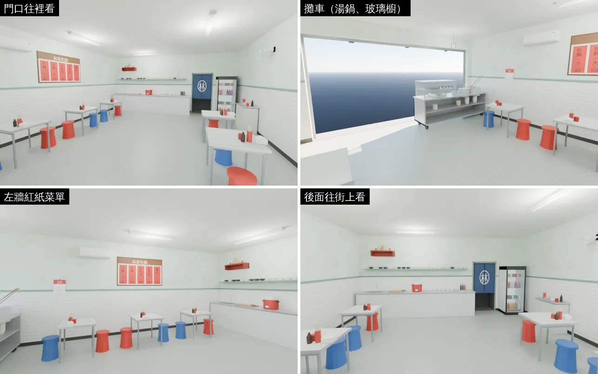
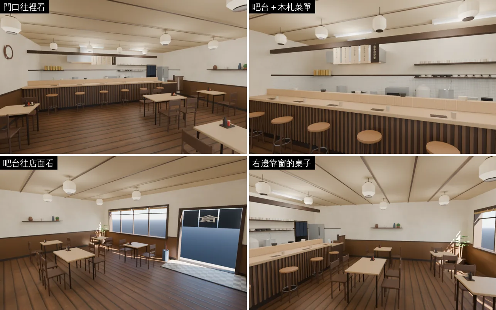
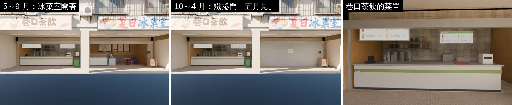
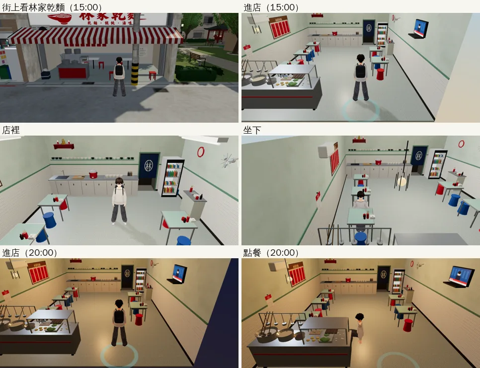
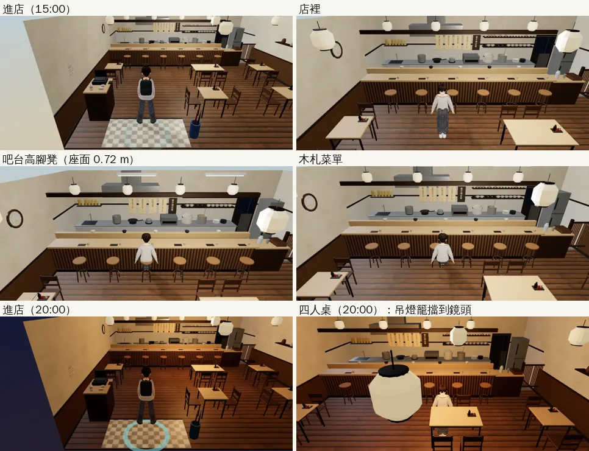
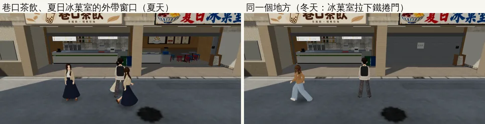

# 溫州街店面（AA_364）：林家乾麵、巷子裡定食走得進去內用；巷口茶飲、夏日冰菓室的外帶窗口（WZ-SHOP-AA364-ART）

帳號 A 的 LAWWW2，2026-10-21 23:0x～10-22 06:3x UTC。

- **狀態**：已交件；`READY_FOR_ART_REVIEW`（場景美術由使用者驗收）。模型、配置、patch（**第四版**）、遊戲內截圖、單元測試、瀏覽器 reachability、座位檢查都做完了。
- 第三版：林家乾麵兩張椅子的走近點，「坐下」按鈕的座位也帶著（第二版只寫進區域的座位表，j23b 照樣卡住）；j23c 瀏覽器 reachability ALL PASS。
- 第四版：巷子裡定食的和紙燈籠網點透空（配置 `seeThru`、區域 `seeThru`）。

- 規格：AA_364 第 1、2 節（企劃線 `2b0429cd`）、店名虛構（D77）。
- 排程：tasks.json 這一項寫「v9.10.3 發布後」整合（D99 三個優先項目先做）。這次先交，**什麼時候接由 LAWWW 決定**；不用插在 D99 前面。

## 做了什麼

| 店 | 這一版 | 給 LAWWW 接的（AA_364 第 4 節） |
|---|---|---|
| 林家乾麵（A4，`wz_lin`） | 走得進去、10 個位子坐得下、出得來；Blender 正式模型 | 點餐、店員、營業時間（eat3d） |
| 巷子裡定食（B3，`wz_teishoku`） | 走得進去、18 個位子（12 張椅子＋吧台 6 張高腳凳）坐得下、出得來；Blender 正式模型 | 同上 |
| 巷口茶飲（B5 西半） | 騎樓的櫃台原本就在；菜單換成 AA_364 的品項 | 外帶窗口（點餐點、店員）——座標在下面 |
| 夏日冰菓室（B5 東半） | 菜單換成 AA_364；10～4 月鐵捲門上的紙條改成「五月見」 | 外帶窗口（只在 5～9 月） |
| 巷口書房 | 照現在（只看櫥窗） | — |

另外修一個舊問題：**半熟（早午餐）的椅子都是反的**（椅背朝桌子）。原因是腳本把椅子轉了 `yaw+π`；遊戲的座位 yaw 是坐的人面向的方向，椅子正面就是那個方向。GLB 重匯出（大小、三角形不變）。

## 照 118 巷的店面做法（AA_364「不另外從頭做」）

- 腳本 `tools/blender/env_second/wz_aa364_shops.py`（`--shop lin|teishoku`）用 118 巷九間店那一套零件（`lane118_shops.py`：桌子、圓凳、木椅、日光燈、飲料冰箱、電視、壁扇、層板、櫃台）。
- 配置只寫在 `src/data/wz_shops_layout.js` 的 `lin`、`teishoku`（遊戲的 `wzShop` 讀同一份）：家具位置、導航阻擋、座位、店員站的位置。腳本最後檢查「零件自己的阻擋框都在配置的阻擋框裡」：兩家都是 0 項不一致。
- 遊戲那一邊用溫州街三家新店（半熟、阿德影印、一盞）同一套 `wzShop`：`room()` 空房間＋家具色塊是備用，正式模型載入後藏起來；牆分四組 `WALL_*`，鏡頭在牆外時那一面淡出。

| | 林家乾麵 | 巷子裡定食 |
|---|---|---|
| 大小 | 6.4×8 m，高 3.0 m | 8×8 m，高 2.9 m |
| 位子 | 五張方桌、紅藍塑膠圓凳 10 個 | 兩人桌 4 張＋四人桌 1 張（椅子 12）、吧台高腳凳 6 |
| 店員站的位置 | 攤車後面（−1.7, 2.55），面向街上 | 吧台後面的廚房（−0.6, −2.75），面向客人 |
| GLB | `wz_lin_interior.glb` 1.55 MB、18,206 三角形、18 材質 | `wz_teishoku_interior.glb` 1.58 MB、19,488 三角形、24 材質 |

## 美術上的決定（美術總監自己決定的，寫出來讓大家知道）

- **林家乾麵＝老麵攤**：一樓整面開著（鐵捲門捲在上面），門口左邊是煮麵攤車（三格湯鍋、玻璃櫥裡的生麵和青菜、滷味盤），客人從右邊 2.2 m 進來。白磁磚牆、灰綠腰帶、馬賽克地磚、日光燈、壁扇、電視、飲料冰箱、後面往廚房的布簾（「林」字，不能進去）。左牆一排紅紙菜單；牆上一本里辦公處送的月曆（10 月）。
- **巷子裡定食＝溫州街唯一「吃好一點」的店**：深色木地板、木條吧台、白牆＋木腰板、紙燈籠吊燈。吧台上方的橫樑掛木札菜單（正反兩面各一張圖：從吧台後面看不會是反字）；格子拉門外面掛暖簾（從街上看字是正的）。門口有傘架、招財貓、結帳台。
- **吧台高腳凳的座面 0.72 m**：座位帶 `lift: 0.27`（和兩點半 Café 的吧台一樣），人坐在凳子上、不會坐進凳子裡。這要 `zones3d.js` 的 `wzShop` 把 `lift` 傳下去（patch 裡一行）。
- **菜單的字照 AA_364 第 2 節**（貼圖 `tools/blender/env_second/shops_tex.py aa364`；B5 兩張在 `shopkit_tex.py`）：

| 店 | 牆上 |
|---|---|
| 林家乾麵 | 乾麵（小）40／乾麵（大）55／餛飩湯 40／燙青菜 35／滷蛋 15 |
| 巷子裡定食 | 薑汁燒肉定食 180／鹽烤鯖魚定食 190／炸雞定食 170／味噌湯續一碗 免費 |
| 巷口茶飲 | 紅茶 30／青茶 30／珍珠奶茶 55／冬瓜檸檬 45 |
| 夏日冰菓室 | 芒果冰 140（6～8 月）／紅豆牛奶冰 70／綜合剉冰 60 |

- 公館的手搖飲（G01）也用舊的手搖飲菜單：**不動**，溫州街這家用自己的一張（`menu_tea_wz`）。

### Blender 渲染（不是遊戲畫面；店外是空的背景，遊戲裡是街景照片）

## 遊戲內截圖（佇列 j23，開發分支 `be8c1b0e`＋`wz0_prop_nav.diff`＋`wz_shops2.diff`＋新模型；Playwright＋SwiftShader，不是 iPhone）

林家乾麵（攤車在門口、五張方桌配紅藍塑膠凳、紅紙菜單、電視、飲料冰箱、往廚房的布簾）：

巷子裡定食（木吧台六張高腳凳、開放廚房、木札菜單、紙燈籠）：

巷口茶飲、夏日冰菓室的外帶窗口（冰菓室 10～4 月拉下鐵捲門）：

## 測試

- 單元測試（Node）：`wz_shops2_unit`、`wz_shops_unit`、`street_props_nav_unit` ALL PASS（j23）。
- `reachability_all --zones wz_lin,wz_teishoku,wenzhou`（j23，引擎的移動模擬）：**林家乾麵 1 FAIL**，其他 ALL PASS。
  - 第一張桌子（夾在攤車和第二張桌子中間）的兩張椅子，「坐下」走近的點（`GAME.seatApproach` 的 8 個候選）一個都站不住。
  - 候選全滅時，seatApproach 退回椅子前面 0.5 m，那裡在桌子裡面，走過去卡住。
  - **patch 第二版**：這兩張椅子的配置加 `ap`（從中間走道走近：(−1.3, 1.05)、(−1.3, 2.2)），`wzShop` 把 `ap` 帶進座位。
  - `wz_shops2_unit` 加一項「每張椅子走近的點至少一個站得住、從門口走得到」：沒修 1 FAIL（正好是這兩張椅子）、修好 ALL PASS。
  - j23b 瀏覽器重驗：**照樣 FAIL**。`ap` 只寫進區域的座位表（`z.seats`），「坐下」按鈕的座位是另一份（`GAME.seatMenu` → `freeSeat` 沒人坐就原樣回傳 → `seatApproach`），沒有 `ap`。
  - **patch 第三版**：按鈕的座位也帶 `ap`。`wz_shops2_unit` 改量按鈕的座位、加一項「配置寫了 `ap` 的座位，按鈕和區域的座位表都帶著」：第二版 2 FAIL、第三版 ALL PASS。
  - j23c（開發分支 `c08889bf`＋第三版）：`reachability_all --zones wz_lin,wz_teishoku` **ALL PASS**（林家乾麵 11 個互動點、「坐下」都走得到）。
- `seats_on_furniture`（j23）沒跑成：測試用 `p.chromium.launch()` 沒給 `executable_path`，這個沙盒沒有 Playwright 預設的瀏覽器。
  - j23b 用包一層的方式（`pwwrap.py` 補上預裝的 Chromium）重跑：林家乾麵 10、定食 18、半熟 12 個座位，有問題 0（第二版）。
  - 第四版在 j30 再跑一次：林家乾麵沒排進這一輪；定食 18、半熟 12、一盞 12 個座位，有問題 0。
- **第四版：巷子裡定食的和紙燈籠**（j23 晚上坐四人桌，燈籠吊在鏡頭前面）：
  - 配置 `seeThru: ['GLOW_wz_teishoku_washi']`，`wzShop` 把區域的 `seeThru` 打開、模型接上以後標材質。
  - 燈籠擋在人前面、或在鏡頭旁邊 1.7 m 內時網點透空（`engine3d.js` 的樹幹透視）。
  - `wz_shops2_unit` 第 5 項：第三版 3 FAIL、第四版 ALL PASS。
  - j30（第四版，完整工作目錄）：`wz_shops2_unit`、`wz_shops_unit`、`street_props_nav_unit` ALL PASS。鏡頭在人前面的角度排 j33 補拍。

## 外帶窗口：給 LAWWW 的座標（溫州街世界座標，都在人行道上、走得到）

| | 點餐的人站的位置 | 店員（店裡，導航格不能站：不要 `unstick`） |
|---|---|---|
| 巷口茶飲 | (17.4, −7.35)，面向 −z（看櫃台） | (16.8, −9.2)，面向 +z |
| 夏日冰菓室（5～9 月） | (24.4, −7.4) | (24.4, −9.3)，面向 +z |
| 夏日冰菓室（10～4 月，看鐵捲門） | (26.5, −7.4) | — |

- 現在騎樓中間的「看手搖飲菜單」(23.0, −6.5) 在兩家中間；接外帶窗口時建議拿掉，改成兩個點。它的文字寫「綠茶 30」，AA_364 是「青茶 30」。
- 冰菓室 10～4 月的鐵捲門已經在溫州街的模型裡（`SEASON_ICECLOSED_on`，`wzParkSeason` 照遊戲月份切換），這次只換紙條上的字。

## 接法（LAWWW）

1. `git apply docs/art-rebuild/second_ai/patches/wz_shops2.diff`
   - `src/data/wz_shops_layout.js`：`lin`、`teishoku` 兩家的配置。
   - `src/zones3d.js`：`wz_lin`、`wz_teishoku` 兩個區域（同一套 `wzShop`）、溫州街的店門（原本的「看林家乾麵」「看定食店」換成「進去」）、`room()` 的窗外景大小可以指定（`winW`、`winH`；預設照舊 2.2×1.6）、座位的 `lift`、`WZ_FLOOR` 多一個馬賽克地磚、資產登錄（寫在 `zones3d.js`，不動 `assets3d.js`）。
   - `tests/wz_shops2_unit.js`（新）。
2. 換模型（我的分支）：`assets/models/env/second_ai/` 的 `wz_lin_interior.glb`＋`.json`、`wz_teishoku_interior.glb`＋`.json`（新）、`wz_brunch_interior.glb`＋`.json`（椅子方向）、`wenzhou_street.glb`＋`.json`（B5 菜單、紙條）。
3. 窗外的街景照片（我的分支）：`assets/models/env/views/wz_lin_day.webp`、`wz_lin_night.webp`、`wz_teishoku_day.webp`、`wz_teishoku_night.webp`。
4. `wz0_prop_nav.diff`（溫州街雜物導航，另一件交件）可以一起套：兩種順序都套得上。
5. 半熟的 `wz_brunch_interior.glb` 後來又改了兩次（排煙罩歸後牆、吊燈自己的材質），以 `test_shots/wz_shops_cam_1022/` 那一件為準（`38c4b821`）。

## 還不到的地方（誠實寫）

- 點餐、店員、營業時間還沒有（LAWWW 的部分）：這一版走進去只能坐下、離開。
- 店外是照片（`room()` 的窗景），不是 3D 街景。
- 林家乾麵往廚房的布簾不能進去（照設計）。
- 巷子裡定食的燈籠：第四版網點透空了；鏡頭在人前面的角度還沒在遊戲裡拍到（j33）。
- 半熟早午餐（`wz_brunch`）j23 拍的「坐下」那一張，鏡頭被一大塊灰色擋住：查到是排煙罩的煙囪（掛在後牆上，後牆淡出了它還在）。已修，另一件交件（`test_shots/wz_shops_cam_1022/`）。
- 巷子裡定食吧台上方的橫樑、木札（菜單牌）：鏡頭在廚房那一側時，橫在畫面中間一條（人看得到）。
- 真機沒看過；遊戲內截圖是 Playwright＋SwiftShader 手機模擬。
