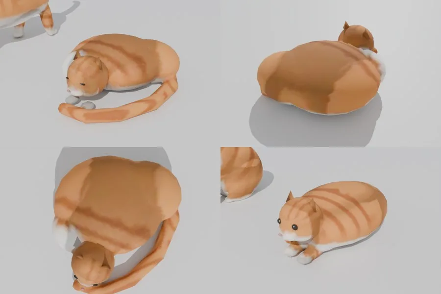
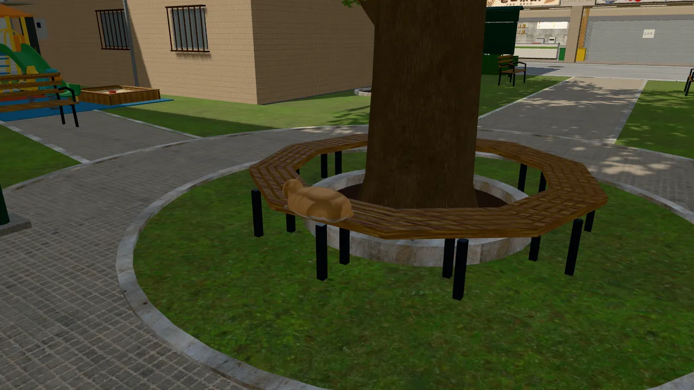
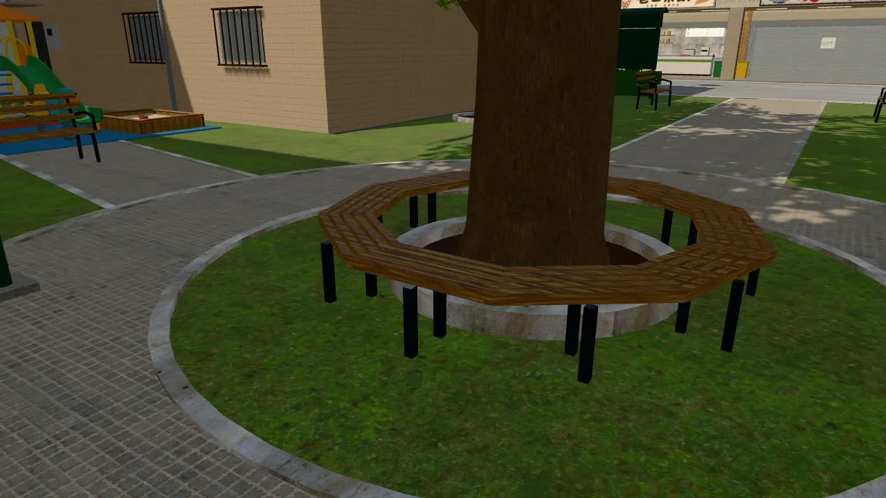
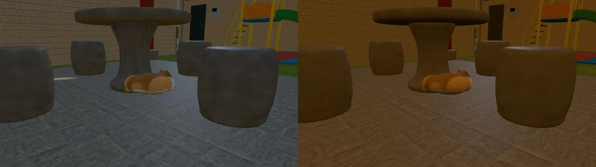
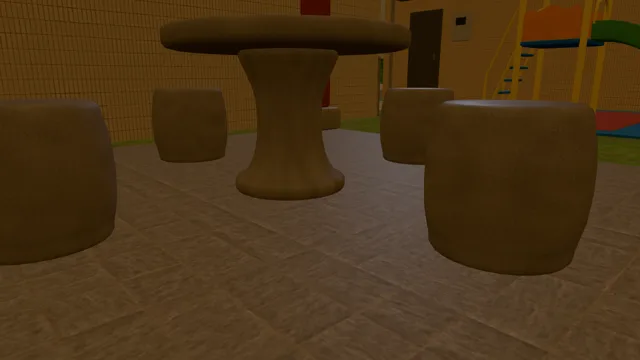

# WZ-CAT-LIFE-1023：公園的貓——寒流縮成一團、被收養以後公園沒有貓

- **誰要的**：
  - 使用者 10-23：「貓咪要能動 能互動吧 甚至安排其中一個女主角收養」。
  - 劇情是 AA_397 第 3 節：子晴收養，企劃線 `8f1701b23`；程式在 `src/sideq3d.js`、`src/wzpark3d.js`。
  - LAWWW-B 10-23 分派四件事（見下面）。
- **做的人**：LAWWW2-B。
- **狀態**：`READY_FOR_ART_REVIEW`。場景美術的 `ART_APPROVED` 只有使用者能標。

## LAWWW-B 要的四件事

| # | 要求 | 結果 |
|---|---|---|
| 1 | `PARK.catAdopted(G)` 為 true：公園的 3D 貓不顯示 | **FIXED**：`catG.visible` 每一格看 `PARK.catAdopted`。玩家待在公園裡過了 23:00 也會不見。 |
| 2 | `PARK.catCold(G)` 為 true：用縮成一團的 `CAT_curl` | **FIXED**：貓的正式模型新增 `CAT_curl`。寒流那一週進溫州街時用它；位置照舊由 `catUnder` 放在石桌底下。 |
| 3 | 12/14 22:10 子晴站在涼亭石桌旁（idle，不做抱貓動畫） | 站位 (15.7, 25.8) 的檢查**通過**：站得住、從公館進來走得到、玩家站得到她旁邊。沒有新動畫。 |
| 4 | 冰菓室窗口「看價目板」(25.4, −7.4) r 1.0，確認走得到 | **通過**：見下面「導航檢查」。 |

## 改了什麼

1. **貓的模型** `tools/blender/env_second/aa_support/wz_cat.py`，輸出 `assets/models/env/second_ai/aa_support/wz_cat.glb`：
   - 新姿勢 `CAT_curl`：身體捲成一圈，尾巴繞到前面蓋住前腳，頭靠在尾巴上，眼睛閉著。
   - `CAT_curl` 是 2,672 個三角形；整個檔案 11,925 個三角形（原本 9,253）、690 KB（原本 536 KB）。
   - 一次只顯示一個姿勢，畫面上的量和趴姿差不多。
   - 毛色貼圖多一格：`textures/gen/wz_cat_fur.png`、`wz_cat_fur_old.png` 重新產生。
   - 項圈、名牌、繃帶的 UV 擠到第四格的下半。舊的三個姿勢照舊，算圖確認過（下圖右下是趴姿）。
2. **遊戲**：`patches/wz_cat_curl_adopt_1023.patch`，只改 `src/zones3d.js`，對開發分支 `c42228351`。
   - `wzCatModel` 多一個 `curl` 姿勢。舊的貓模型沒有 `CAT_curl` 時退回趴姿，不會沒有貓。
   - 正式模型載入時，`PARK.catCold(G)` 為 true 就用 `curl`。
   - `wz_cat` 整組的 `visible` 改成 getter：`PARK.catAdopted(G)` 為 true 就不顯示。
     - 套件的貓、正式模型都在這一組裡。
     - setter 照舊能用：正式模型載入後藏起套件的貓，走的是同一條路。
   - 「看圓椅」的互動點照舊由 `PARK.catHidden` 管，這次沒有動。

Blender 算圖（左上：縮成一團的正面；右上：背面；左下：正上方；右下：原本的趴姿，比較用）：

## 遊戲內畫面

- 測試環境：Playwright＋SwiftShader，1280×720，**不是 iPhone**。
- 【捷徑】用讀檔把時間跳到那一天（`GAME.G.day=STORY.dayOfKey(...)` 後重進溫州街）；藏起路人和玩家；自訂鏡頭。

| 情況 | 日期時間 | 遊戲回報（拍完以後讀的） |
|---|---|---|
| 平常 | 2028-11-20 14:00 | 貓顯示，`CAT_lie`（圓椅上） |
| 寒流白天 | 2028-12-12 14:00 | 貓顯示，`CAT_curl`，`catCold` true |
| 寒流晚上 | 2028-12-14 22:30 | 貓顯示，`CAT_curl` |
| 收養以後 | 2028-12-14 23:30 | **不顯示**，`catAdopted` true |
| 收養的隔天 | 2028-12-15 14:00 | **不顯示** |

平常（圓椅上趴著）：

收養的隔天（圓椅上沒有貓）：

寒流（涼亭石桌底下縮成一團），白天與晚上：

收養以後的涼亭（23:30，石桌底下沒有貓）：

## 導航檢查（Node，不用瀏覽器；腳本在 LAWWW2-B 的工作區，結果如下）

- 在開發 `c42228351` 的溫州街，用引擎的導航格（人物半徑 0.3 m）檢查：
  - 「看價目板」(25.4, −7.4) r 1.0：
    - 範圍內站得住的點 203 個。
    - 其中 166 個是它最近、不會被旁邊的「買一碗冰」(24.4, −7.4) 蓋掉的點。
    - 166 個全部從公館進來的出生點走得到，例如 (24.9, −7.6)。
  - 子晴的站位 (15.7, 25.8)：
    - 站得住，走得到。
    - 玩家站得到她旁邊 0.9 m：16 個方向裡有 6 個。
  - ALL PASS。

## 沒做的、要注意的

1. **貓還不會走動**（「貓咪要能動」）。
   - 這一批只做寒流和收養，平常還是趴在圓椅上。
   - 模型本來就有 `CAT_walk` 姿勢。要在公園裡走來走去，需要遊戲端的路線和動畫，要 LAWWW-B 排。
2. 縮成一團的貓在石桌底下、涼亭的陰影裡：晚上很暗，只看得出一團橘色。
3. 收養的那一場是子晴站在石桌旁（idle），沒有蹲下、抱貓的動畫。
4. iPhone 實機沒看過。
