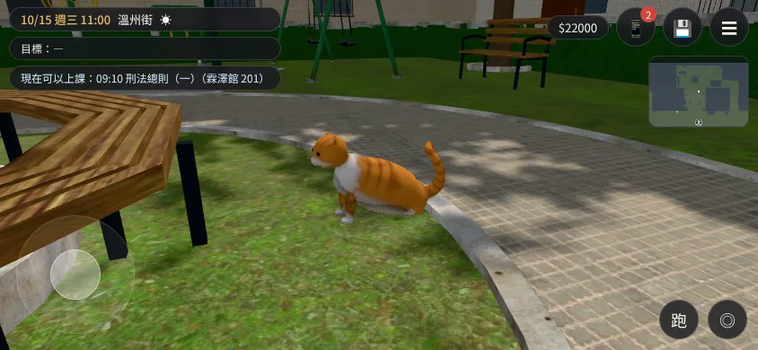
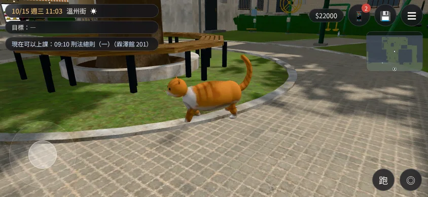
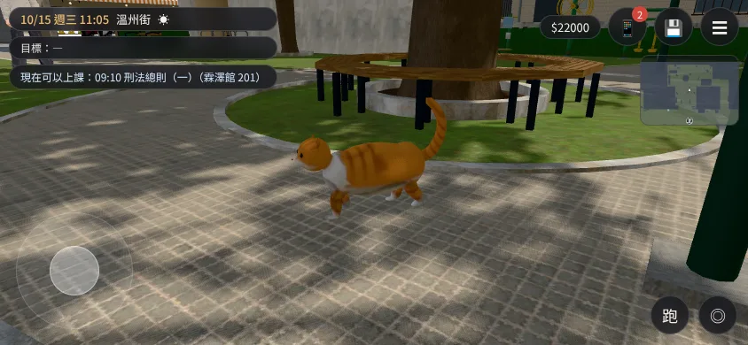
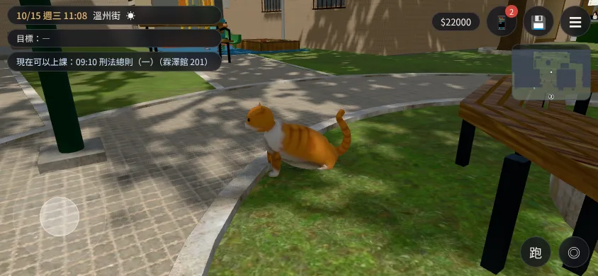

# WZ-CAT-LIFE-1023（USER_WANTS J13）：溫州街的貓會走動（LAWWW2-C 2026-10-27）

- **使用者**（10-23）：「貓咪要能動 能互動吧」。摸、餵、子晴收養、寒流、走失之前已經在遊戲裡；**剩「貓平常會走動」**（3D 貓原本是四個靜止姿勢挑一個）。評估：`docs/art-rebuild/second_ai/EVAL_J13_A21_D40_1027.md`。
- **對**：最新開發 `d874aa740`（`git apply --check` 過）。

## 玩家會看到什麼

- **白天（07:00～17:30）、沒下雨**：貓在小公園裡。先坐在老樹圓椅前，坐一陣子（真實時間 25～70 秒）→ 站起來、轉頭看一下 → 沿著公園的路慢慢走到另一個地方坐下。會去的地方：老樹圓椅前（兩個點，最常回來）、涼亭東邊台階下、路燈下、土地公旁邊、東邊路燈和鞦韆之間、前面草地的步道邊。
- **玩家走到 1.6 m 內**：走路的貓停下來，站著轉頭看玩家；玩家走開再繼續。**劇情在演的時候**貓坐著不動。
- **「摸摸」的按鈕跟著貓走**（就是原本那一個互動點，`PARK.catLabel`、`catHidden` 照舊）。
- **晚上、下雨、寒流那一週、走失、收養以後**：和原本一樣（趴在老樹圓椅上／躲在涼亭石桌底下／縮成一團／沒有貓）。
- 舊存檔不受影響（貓的位置不存檔）。

| 站起來看 | 走路 | 走路（繞過老樹圓椅） | 走到下一個點坐下 |
|---|---|---|---|
|  |  |  |  |

遊戲畫面，手機橫向模擬（SwiftShader）、10/15 11:00 晴天；[捷徑] 讀檔、第一次坐的時間縮短、劇情鏡頭跟著貓拍（只為了截圖看清楚）。每 6 秒一張：`ingame_walk_sheet.jpg`。

## 做法

- **Blender**（`tools/blender/env_second/aa_support/wz_cat.py` v3）：原本靜止的「走路中的一步」（`CAT_walk`，遊戲沒有用到）改成**站姿＋骨架**：24 根骨頭（身體、脊椎、胸、脖子、頭、四隻腳各 3、尾巴 5）。權重：每個頂點照最靠近的部位決定候選骨頭（腳不會被另一隻腳拉走），再照到骨頭的距離分配。四段動畫：
  - `cat_walk` 一步一秒循環（側對步：左後、左前、右後、右前；身體、頭、尾巴跟著擺；原地走，水平位移交給遊戲）
  - `cat_idle` 站著 4 秒循環（尾巴慢慢甩、轉頭、呼吸）
  - `cat_sit` 坐下 0.75 秒（以肩膀為支點屁股往下、前腳一直踩在地上、後腳折起來；倒著播＝站起來）
  - `cat_sit_idle` 坐著 4 秒循環（尾巴尖甩、點頭）
  - 項圈名牌綁脖子、繃帶綁左前腳（大三才有的那兩個，走路時跟著動）；胖瘦 `fat`、老貓毛色照舊。坐、趴、縮成一團三個靜止姿勢沒動。
  - 驗證：Blender 裡量坐姿四隻腳的末端（前腳在地面、後腳離地 2 cm、屁股離地 6 cm）寫在 `wz_cat.json` 的 `rig.check`；`wz_cat_preview.py` 讀**匯出的 GLB** 每段動畫拍幾格：`blender_anim_frames.jpg`。
- **遊戲**（patch `docs/art-rebuild/second_ai/patches/wz_cat_walk_1027.patch`）：
  - 新 `src/wzcat3d.js`（`WZCAT`）：`attach` 用 `SkeletonUtils.clone`（一般 clone 不會重新綁骨頭）＋`Z3.wzCatModel(…,'walk')`（照學期換樣子那一套照用）＋`AnimationMixer`；找路用公園的導航格（`E.pathTo`），幾個點用 `E.canStand` 檢查；走 0.32 m/s（一步一秒、步幅 0.32 m，腳不滑）；腳下一個淡淡的影子（模型不投影，走起來會像浮著）。
  - `src/zones3d.js`：正式模型載入後先問 `WZCAT.attach`（白天醒著、不在石桌底下才接手；接手就不放趴著的貓）；溫州街的 `zone.update` 每一格呼叫 `WZCAT.update`。
  - `index.html`：`wzpark3d.js` 後面載入 `src/wzcat3d.js`。
  - 舊的 GLB（沒有骨架）：`attach` 不接手，照舊趴著。

## 測試

- 新 `tests/wz_cat_walk_unit.js`（Node，用真的溫州街區域、導航格）：**改前 FAILED 6、改後 ALL PASS（23 項）**——GLB 的骨架、四段動畫、名牌繃帶綁骨頭、fat、三角形 ≤ 3000；醒著的時段；七個點都站得住、彼此走得到、**玩家從公園入口走得到每個點旁邊**（摸得到貓）；坐→站起來→看→走→坐；**走路速度不超過 0.32 m/s**；互動點一直跟著貓；玩家走近停下、劇情時坐著；離開溫州街不再更新；接線。
  - 寫測試抓到兩個錯：①東邊路燈旁那個點站不住（程式會略過，但等於少一個點）→ 換位置；②走到轉折點時「吸過去」那一下超過 0.32 m/s（腳會滑）→ 只在這一格走得到的時候才吸。
- 溫州街相關的 40 支 Node 測試（含原本的 `wz_cat_unit`、`wz_park_unit`）ALL PASS。
- 瀏覽器（`$S` 的 `cat_probe.py`，SwiftShader）：貓坐→站→看→沿著路繞過老樹圓椅走到下一個點坐下，互動點跟著，沒有 JS 例外。SwiftShader 一格的時間被夾住，貓走得比真機慢（約 0.07 m/s），真機是 0.32 m/s。
- `tests/reachability_all.py --zones wenzhou`（11:00，貓醒著、在老樹圓椅前）：**ALL PASS**——32 個互動點（含「摸摸」）都站得到、按鈕會出現、走得到；沒有 JS 例外。
- **沒測**：手機實機；BB 的玩家流程（走進公園、摸貓、餵貓）。

## 還不夠好（誠實）

- 走路動畫是程式算的關鍵格（腳擺、膝蓋彎），不是手調的動作；近看腳步有點機械。
- 坐下時後腳折在身體下面，側面看像「蹲坐」，正面斜看比較像。
- 白天的劇情如果寫「貓睡在圓椅上」，畫面上貓可能在別的地方走——**請 AA-C 看一下白天公園有沒有這種句子**（我沒有逐條查劇情）。
- 美術狀態：`READY_FOR_ART_REVIEW`。

## 檔案（我的分支 `claude/focused-cray-c9uwvw`）

- patch：`docs/art-rebuild/second_ai/patches/wz_cat_walk_1027.patch`
- 正式模型：`assets/models/env/second_ai/aa_support/wz_cat.glb`＋`.json`（取代原本的；四個姿勢的名字照舊，`CAT_walk` 現在是骨架節點）
- 原始檔：`tools/blender/env_second/aa_support/wz_cat.py`（v3）、`wz_cat_preview.py`（新）、`textures/gen/wz_cat_fur*.png`（重烘：走路姿勢那一格換成站姿）

---

## 劇情要貓趴在圓椅上：`WZCAT.hold('lie')`／`WZCAT.release()`（LAWWW-C 10-27 23:08Z；AA_493「所長回來」那一場）

- **patch**：`docs/art-rebuild/second_ai/patches/wzcat_hold_1027.patch`（對開發分支 `fe2fc0241` apply --check 過）。
  - 改 `src/wzcat3d.js`。
  - `src/zones3d.js` 一行：attach 多傳晚上趴著的位置 `lie:{x,y,z,yaw}`，和晚上放趴著的貓同一個位置、同一個朝向。
  - 改 `tests/wz_cat_walk_unit.js`。
- **用法**：演之前 `if(typeof WZCAT!=='undefined') WZCAT.hold('lie');`，演完在 `finally` 裡 `WZCAT.release()`。hold 不存檔，讀檔以後沒有 hold。
- **玩家會看到什麼**：
  - 貓正在公園裡走（白天）時 hold：走路的貓藏起來，圓椅上出現趴著的貓（和晚上同一個模型、同一個位置），「摸摸」的互動點回到圓椅。
  - 還沒進公園就 hold：進公園時 attach 不接手，`zones3d.js` 照晚上的做法放趴著的貓。下雨照舊在涼亭石桌底下（AA_493 第 5 節）。
  - hold 期間 `WZCAT.awake()` 回傳 false，`PARK.catAwake` 跟著變：取名、環境句自動用「趴在圓椅上」那一版。所以白天的替代句可以拿掉。
  - release 以後：拿掉趴著的貓，走路的貓從剛才的位置接著走。如果 hold 時沒有走路的貓（進公園時就是趴著的），那一次待在公園都是趴著，下次進公園才會走。
- **測試**：`tests/wz_cat_walk_unit.js` **改前 FAILED 2、改後 ALL PASS（29 項）**。
  - 新加的檢查：
    - hold、release 存在。
    - 正在走時 hold：走路的貓藏起來、圓椅上的趴姿貓出現在晚上那個位置、不再走。
    - 互動點回到圓椅；awake 變 false。
    - hold 期間進公園：attach 不接手。
    - release：趴姿貓拿掉、走路的貓出現、awake 照時段，release 以後接著走。
    - zones3d.js 有把位置交給 WZCAT。
  - 溫州街、貓、公園相關 20 支 Node 測試（含 `aa493_cat_lines_unit`）ALL PASS。
- **沒測**：瀏覽器截圖（LAWWW-C 接上「所長回來」那一場以後，BB 照那一場驗）；手機實機。
