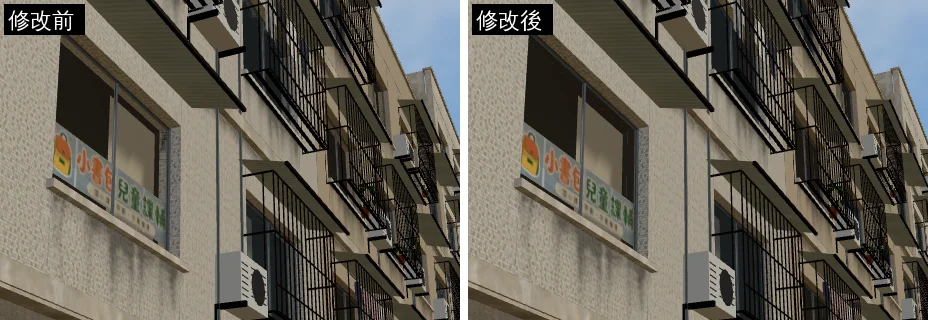
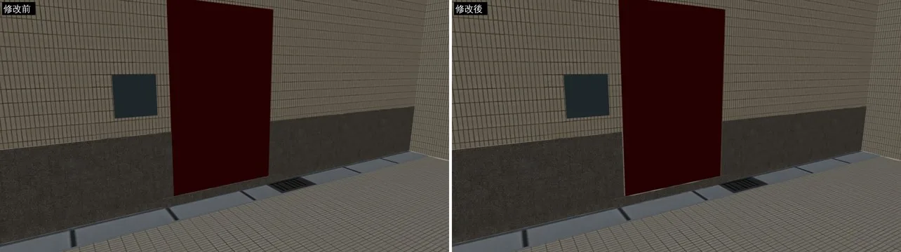

# BUG-WZFLICKER：溫州街、舊路書店的閃爍（z-fighting）

- **起因**：使用者 iPhone 實機回報溫州街新店面的牆、舊路書店的書架會閃。
- **做的人**：LAWWW2-B。
- **狀態**：`READY_FOR_ART_REVIEW`（場景美術的 `ART_APPROVED` 由使用者決定）。
- **只改 GLB，遊戲程式不用改**。

## 1. 原因
兩個面放在同一個平面上，GPU 分不出誰在前面，鏡頭一動就輪流顯示。
- 工具：`tools/blender/env_second/check_coplanar.py`，找 GLB 裡疊在同一個平面的面。
  - 「同一面朝外」的一定會閃。
  - 「背對背」的只有雙面材質才看得到。

## 2. 改了什麼
| 地方 | 原本 | 改成 | commit |
|---|---|---|---|
| 舊路書店（`bookstore_interior.glb`） | 靠牆三座書架的背板正面和牆的內面同一個平面：從書的空隙看進去，白牆一塊一塊閃 | 書架往房間挪 3.5 cm | `a5de0c2e`（LAWWW-B 已整合 `20429b81`） |
| 溫州街：騎樓後面兩間小店（B5） | 一樓牆體和小店後牆同一個平面：茶飲店後牆的室內磁磚和外牆馬賽克磚互相閃 | 一樓牆體再退 2 cm | `472f89f8`、`4541df35` |
| 溫州街：住家一樓小窗（`housedoor`） | 玻璃直接貼在牆面上：牆的磁磚從玻璃裡透出來閃 | 玻璃後面加一層拉上的窗簾（離牆 6 mm）、玻璃再往前 8 mm | `472f89f8`、`4541df35` |
| 溫州街：店面住家一樓小窗（`wz_shopkit.py` 的 `housefront_v2`） | 同上 | 同上 | `8dc8e5f8` |

### `check_coplanar` 重掃 `wenzhou_street.glb`（同一面朝外）
- 疊面：23 → 7；窗玻璃和牆：8 → 0。
- 剩下 7 對：一樓店面頂的色帶和牆，在 3.4 m 高度的水平面。
  - 夾在一樓和二樓之間，遊戲畫面看不到，沒改。
- 舊路書店：書架和牆、踢腳板已經沒有疊面。

## 3. 遊戲內修改前後（同一個鏡頭、11:00；左修改前、右修改後）
- 修改前：開發分支 `dd24edbb`（＋機車、腳踏車 v2）原本的 GLB。
- 修改後：同一個工作樹，換成這次的 GLB。
- Playwright 手機模擬，**不是真機**；閃爍是動態的，靜態截圖只拍得到其中一格。

舊路書店的書架（白牆從書架背板透出來）：

溫州街 x 15 一樓小窗（牆的馬賽克磚從玻璃透出來）：

溫州街 x −37 住家鐵窗後面的小窗：

溫州街 x 22 茶飲店後牆（室內磁磚和外牆馬賽克磚疊在一起）：

## 4. 還沒做
1. **公館、118 巷沒有重建**（`gongguan_shops.glb`、`lane118.glb`）。
   - 它們也用 `wz_shopkit.py`，可能有同樣的小窗。
   - 現在重建出來的結構和遠端的 GLB 差很多（物件 815 → 459、860 → 657），要先查原因才能換。
   - 118 巷重掃，前 200 對裡沒有「同一面朝外」的疊面。
2. **真機沒驗證**：要請使用者在 iPhone 上看溫州街、舊路書店還會不會閃。
3. 窗簾是素色的灰，看起來比較單調。之後可以換成有布紋、有顏色的窗簾。

## 5. 第二輪（6e5aa462）：掃描工具漏列的小疊面
- **起因**：
  - 第一輪的 `check_coplanar` 單檔輸出只存面積前 200 對，大多是相鄰兩棟背對背的側牆。
  - 比較小、同一面朝外的疊面沒列出來。
  - 工具改好以後（17986bd3），溫州街「一定會閃」的有 5,263 對。
- **改了什麼**（`wz_street.py`，重建 `wenzhou_street.glb`）：

| 地方 | 原本 | 改成 | 對數 |
|---|---|---|---|
| 所有窗共用的「窗內房間」 | 地板、天花板、左右四面剛好在窗洞的四個側面上，從玻璃斜看進去，窗洞側面的牆磚和房間一直閃 | 四面往內縮 6 mm | 上千 |
| 窗台 | 窗下的牆頂和窗台頂同一個平面 | 窗下的牆停在窗台裡面（低 1 cm） | 上千 |
| 冷氣 | 兩扇窗中間，左右兩扇各放一台、疊在一起 | 只放一台（少 9 台） | 79 |
| 住家鐵門、鐵捲門 | 牆腳的磨石子護牆整條橫過去，門片正好在護牆正面的同一個平面上，下面 0.9 m 一直閃 | 門的地方不做護牆 | 31 |

- **重掃**：「一定會閃」5,263 → 1,087 對。
- **剩下的**：
  - 大多是牆的內側面：一、二樓之間的樓板色帶和外牆、窗台背面和牆背面。在建築裡面，遊戲裡看不到。
  - 少數小的下一輪：
    - 二樓一塊招牌和亮燈的窗玻璃，x 10.35；
    - 一家店面玻璃和窗框細條，x 41.4；
    - x −4.3 的一處金屬條。
- **遊戲內修改前後**：
  - 修改前：第一輪的 GLB。
  - 靜態截圖只拍得到一格，閃爍要在遊戲裡移動鏡頭才看得出來。

北側二樓的窗（放大）：修改前，窗洞右側是房間的灰色側牆和牆磚交錯；修改後，窗洞側面是牆磚、裡面才是房間。

住家鐵門（x 47.7）：靜態截圖看不出差別（閃爍是動態的）；掃描確認門片和護牆的疊面已經沒有了。

