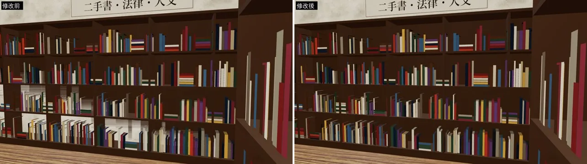
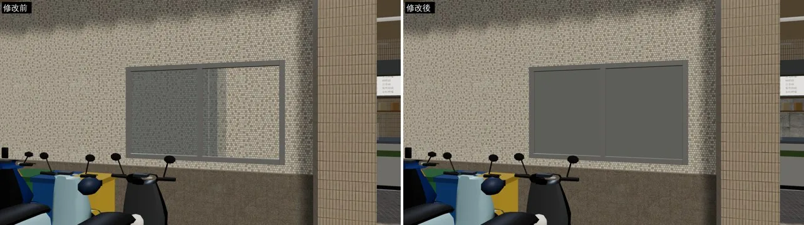
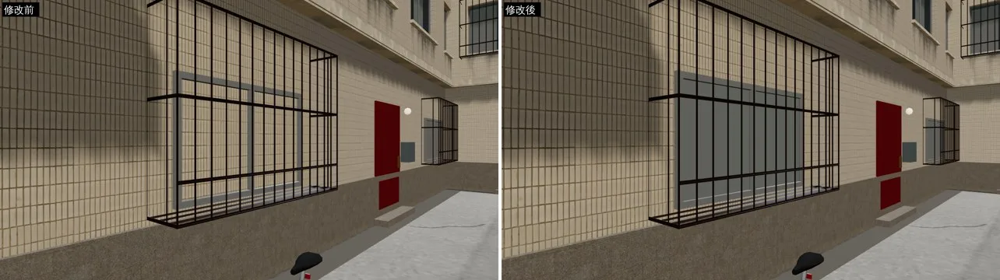
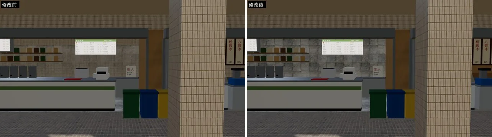

# BUG-WZFLICKER：溫州街、舊路書店的閃爍（z-fighting）

- **起因**：使用者 iPhone 實機回報溫州街新店面的牆、舊路書店的書架會閃。
- **做的人**：LAWWW2-B。
- **狀態**：`READY_FOR_ART_REVIEW`（場景美術的 `ART_APPROVED` 由使用者決定）。
- **只改 GLB，遊戲程式不用改**。

## 1. 原因
兩個面放在同一個平面上，GPU 分不出誰在前面，鏡頭一動就輪流顯示。
- 工具：`tools/blender/env_second/check_coplanar.py`，找 GLB 裡疊在同一個平面的面。
  - 「同一面朝外」的一定會閃。
  - 「背對背」的只有雙面材質才看得到。

## 2. 改了什麼
| 地方 | 原本 | 改成 | commit |
|---|---|---|---|
| 舊路書店（`bookstore_interior.glb`） | 靠牆三座書架的背板正面和牆的內面同一個平面：從書的空隙看進去，白牆一塊一塊閃 | 書架往房間挪 3.5 cm | `a5de0c2e`（LAWWW-B 已整合 `20429b81`） |
| 溫州街：騎樓後面兩間小店（B5） | 一樓牆體和小店後牆同一個平面：茶飲店後牆的室內磁磚和外牆馬賽克磚互相閃 | 一樓牆體再退 2 cm | `472f89f8`、`4541df35` |
| 溫州街：住家一樓小窗（`housedoor`） | 玻璃直接貼在牆面上：牆的磁磚從玻璃裡透出來閃 | 玻璃後面加一層拉上的窗簾（離牆 6 mm）、玻璃再往前 8 mm | `472f89f8`、`4541df35` |
| 溫州街：店面住家一樓小窗（`wz_shopkit.py` 的 `housefront_v2`） | 同上 | 同上 | `8dc8e5f8` |

### `check_coplanar` 重掃 `wenzhou_street.glb`（同一面朝外）
- 疊面：23 → 7；窗玻璃和牆：8 → 0。
- 剩下 7 對：一樓店面頂的色帶和牆，在 3.4 m 高度的水平面。
  - 夾在一樓和二樓之間，遊戲畫面看不到，沒改。
- 舊路書店：書架和牆、踢腳板已經沒有疊面。

## 3. 遊戲內修改前後（同一個鏡頭、11:00；左修改前、右修改後）
- 修改前：開發分支 `dd24edbb`（＋機車、腳踏車 v2）原本的 GLB。
- 修改後：同一個工作樹，換成這次的 GLB。
- Playwright 手機模擬，**不是真機**；閃爍是動態的，靜態截圖只拍得到其中一格。

舊路書店的書架（白牆從書架背板透出來）：

溫州街 x 15 一樓小窗（牆的馬賽克磚從玻璃透出來）：

溫州街 x −37 住家鐵窗後面的小窗：

溫州街 x 22 茶飲店後牆（室內磁磚和外牆馬賽克磚疊在一起）：

## 4. 還沒做
1. **公館、118 巷沒有重建**（`gongguan_shops.glb`、`lane118.glb`）。
   - 它們也用 `wz_shopkit.py`，可能有同樣的小窗。
   - 現在重建出來的結構和遠端的 GLB 差很多（物件 815 → 459、860 → 657），要先查原因才能換。
   - 118 巷重掃，前 200 對裡沒有「同一面朝外」的疊面。
2. **真機沒驗證**：要請使用者在 iPhone 上看溫州街、舊路書店還會不會閃。
3. 窗簾是素色的灰，看起來比較單調。之後可以換成有布紋、有顏色的窗簾。
