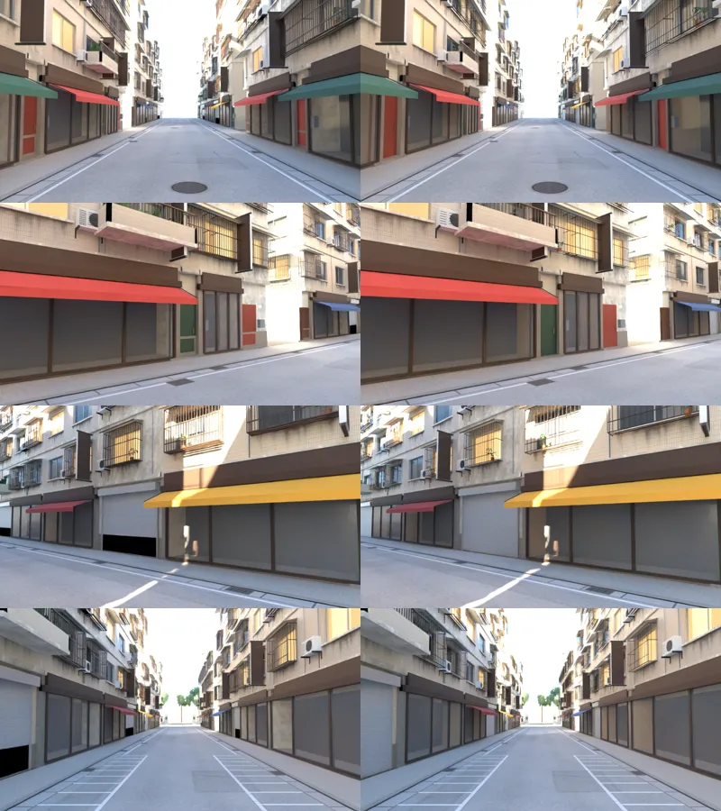
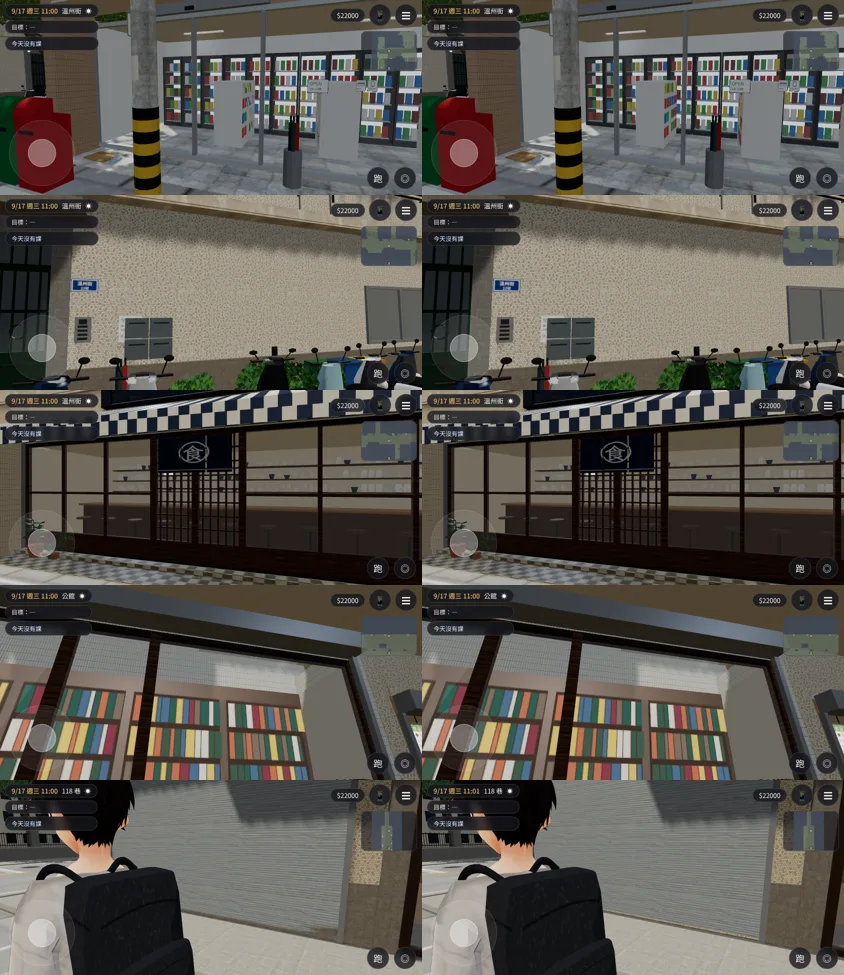

# BUG-WZFLICKER-2：溫州街、公館、118 巷的疊面（閃爍）

LAWWW2-C，2026-10-18～20。
- 誰派的：LAWWW-C 10-18 11:47（溫州街三處＋公館、118 巷鐵捲門）。
- 10-20 13:25 LAWWW-C：修閃爍、修卡頓算修 bug（X69、X79），溫州街這次也可以換。
  - B10「店面翻修」照舊暫停。
- 狀態：GLB 換進 assets，交給 LAWWW-C 整合。場景美術沒有改樣子。

## 數字（`tools/glb_coplanar.py`；「一定會閃」＝同一面朝外、兩個平面相差 < 0.5 mm 的重疊面積）
| GLB | 開發分支（改之前） | 改之後 | 其中「不同材質」 |
|---|---|---|---|
| `wenzhou_street.glb` 溫州街 | 619.35 m² | 605.62 | 257.75 → 249.64 |
| `gongguan_shops.glb` 公館 | 397.75 | 389.02 | 152.78 → 144.05 |
| `lane118_street.glb` 118 巷 | 423.41 | 374.17 | 162.32 → 113.75 |

- 「遠處才會閃」（相差 0.5～2 mm）：
  - 溫州街 19.47 → 19.47；
  - 公館 43.86 → 43.86；
  - 118 巷 0.06 → 0.07。
- **剩下的大部分看不到**：
  - 牆和樓板線（水泥帶）在牆的內側面重疊：建築裡面，窗內有房間擋住；
  - 地面那一層的底面（朝下、貼在地上）；
  - 同一個網格、同一個材質自己重疊：貼圖是世界座標投影，兩個面畫出來的顏色完全一樣，不會閃。
- **看得到、這次修掉的**：
  1. 溫州街 B4：玻璃上的割字貼紙和亮燈的窗同一個平面 → 貼紙離玻璃 6 mm。
  2. 溫州街鋁框店面（x −4.34、−20.74）：鋁框側面和店內的牆同一個平面 → 店內側牆厚 9.4 cm、前緣退到玻璃後 1.2 cm。
  3. 溫州街 A5 日日便利：
     - 冰箱背板離後牆 5 mm；
     - 冰箱上下框夾在兩側板中間；
     - 冰箱門玻璃嵌在框裡；
     - 貨架上的商品凸出貨架側面 5 mm（原本 3.26 m² 同一個平面）。
  4. 公館、溫州街的木框門、鋁門、自動門：
     - 直框兩端藏進上下橫框（頂面、底面原本和橫框同一個平面；公館木門 3.48 m 高的頂面 4.37 m² 看得到）；
     - 木門直框前後凸出橫框 5 mm。
  5. 景深卡店面、公館騎樓、茶飲櫃台：店內側牆的前端原本和壁柱正面同一個平面 → 退 1.2 cm。
  6. 118 巷：
     - 鐵捲門和下面的護牆（21.8 m²）收掉；
     - 窄樓房的窗：窗的原型是共用的，窄窗在 x 方向縮小，窗內房間側牆原本內縮 6 mm，縮完只剩 0.9～1.6 mm，和牆洞兩側同一個平面 → 房間的左右兩面從牆厚後面（−0.26）才開始。

## 118 巷外觀沒變（Blender 算圖；左：改之前、右：改之後）
- 用現在的腳本重建，店面組件比 10-17 那一版新：物件 860 → 652、材質 74 → 84。
- 四個角度比過，一樣；只少了鐵捲門下面那條黑縫。

## 遊戲內
測試工作樹：LAWWW-C 開發分支 `928d3b78`，只換這三份 GLB。
- `python3 tests/flow_lane118.py`（真實流程）**ALL PASS**：
  - 後門 → 118 巷（正式街景）→ 阿哲在麵舖門口 → 家常菜週一休「鐵門拉下來一半」→ 和阿哲一起點餐、扣 150 → 走回校園；
  - 沒有卡住保險、沒有 JS 例外。
- `python3 tests/wz_street_integration.py`：一項 FAIL「效能：三個鏡頭的 draw call ≤ 310、三角形 ≤ 42 萬」，數字 lane_east 321／467,249、arcade 336／453,166。
  - **用原本的 GLB 跑也是同一項 FAIL、數字完全一樣**，不是這次造成的。
  - 這就是 X69「溫州街很卡」可以先看的地方：draw call 超過目標 3～8%，三角形超過 6～11%。
  - 其他項目（導航格、鏡頭碰撞、互動點和套件版完全相同，夜間發光，樹幹透視……）都 PASS。
- `python3 tests/gongguan_glb_integration.py`：四項 FAIL。
  1. 「16 棟的店內景深卡都有貼圖」；
  2. 「騎樓柱子有樹幹透視」；
  3. 「沒有標記的群組沒有多藏任何一個」；
  4. 「效能 ≤ ?nobldg 的 1.3 倍」：from_gate 1.395。
  - **用原本的 GLB 跑也是同樣四項 FAIL**（效能的倍數一樣，draw call 差幾個是路人的量測雜訊）。
  - 看起來是 ART-GG-SHOPS-1018 換成騎樓店面組件以後，這支測試沒有跟著更新（例如店內景深卡變成立體淺店內）。
  - 要不要改測試、還是改模型，請 LAWWW-C 決定，我沒動測試。
- 前後截圖（`tools/shots/wzflicker2_shots.py`，同一個鏡頭，Playwright 844×390 橫向，9/17 11:00）：左：改之前，右：改之後。
  - 上到下：溫州街日日便利、B4、定食屋木格門、公館木框門（從騎樓往上看門的上框）、118 巷鐵捲門。
  - 外觀一樣。疊面的閃爍在靜止的截圖裡拍不出來：這組圖只證明外觀沒有變。

## 交付
- GLB（同檔名，manifest 不用改）：
  - `assets/models/env/second_ai/wenzhou_street.glb`
  - `assets/models/env/second_ai/gongguan_shops.glb`
  - `assets/models/env/second_ai/lane118_street.glb`
  - 各自的 `.json`
- 腳本：`tools/blender/env_second/wz_shopkit.py`、`wz_street.py`（`WZ_NOMERGE=1` 不合併材質，掃描時看得到零件名稱）。
- 截圖腳本：`tools/shots/wzflicker2_shots.py`（換 GLB 前後各跑一次，同一個鏡頭）。

## 三份 GLB 的面數（X69「溫州街很卡」：LAWWW-C 要量 draw call，PERF-WENZHOU-1020）
| GLB | 三角形 | 含 instancing 畫出來 | 物件 | 材質 | 大小 |
|---|---|---|---|---|---|
| 溫州街 | 81,165 | 132,483 | 1017 | **131** | 7.7 MB |
| 公館 | 34,825 | 61,093 | 407 | 111 | 4.0 MB |
| 118 巷 | 23,421 | 59,591 | 652 | 84 | 2.1 MB |
- 這次沒有改面數、材質數：溫州街、公館的三角形、材質和改之前完全一樣。
- 118 巷是新組件：三角形 21,763 → 23,421，畫出來的 110,155 → 59,591。
