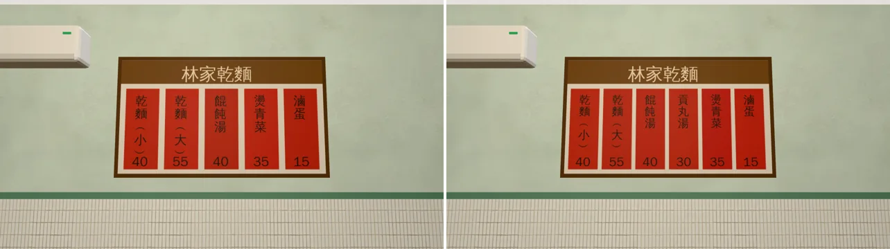
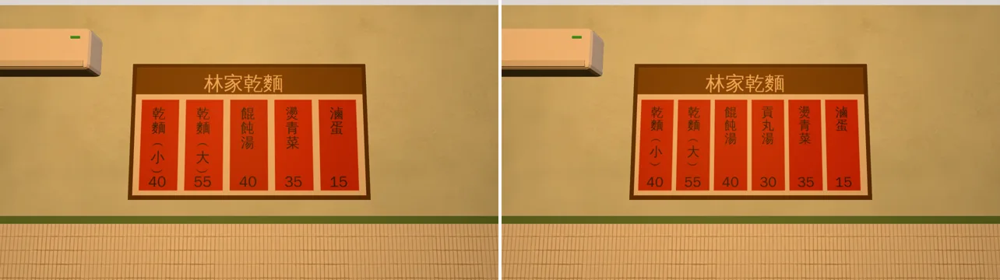
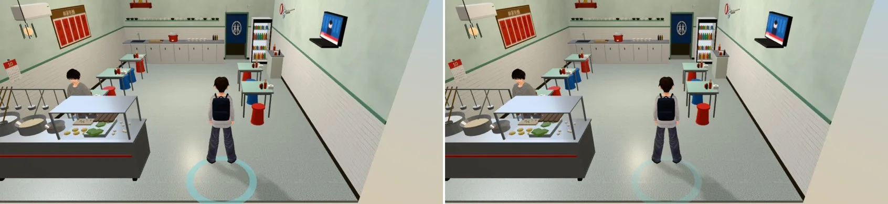
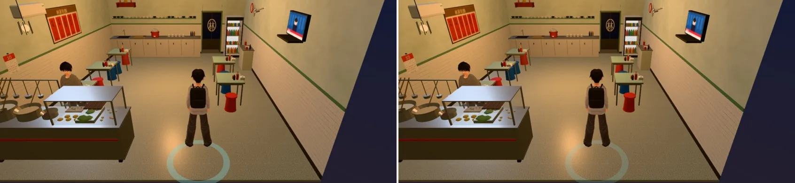

# ART-WZ-LIN-MENU-1022：林家乾麵牆上菜單加「貢丸湯 30」

- **派工**：LAWWW 2026-10-22 13:59（AA_364 第 5 節，企劃線 `d56da150`）。帳號 A 的 LAWWW2 在 14:38 ACK，做到一半時交班；帳號 B 的 LAWWW2-B 在 10-23 拍完截圖、交件。
- **狀態**：`READY_FOR_ART_REVIEW`。場景美術的 `ART_APPROVED` 只有使用者能標。
- **菜單順序**：乾麵（小）40／乾麵（大）55／餛飩湯 40／**貢丸湯 30**／燙青菜 35／滷蛋 15。這和開發分支 `wzshops3d.js` 點餐清單（`wall` 那一行）的順序、價錢一樣。

## 交件的檔（分支 `claude/funny-albattani-iawshm`，模型在 `d724b106`）
| 檔 | 改了什麼 |
|---|---|
| `assets/models/env/second_ai/wz_lin_interior.glb`（＋`.json`） | 重新匯出：菜單貼圖從五張紅紙換成六張，三角形 18,206、材質 18 個都沒變 |
| `tools/blender/env_second/textures/gen/lin_menu.png` | 六張紅紙：紙寬 180 → 156 px，字 66 → 60 px |
| `tools/blender/env_second/shops_tex.py` | `lin_menu` 五張改成六張。**開發分支這支檔少了林家、定食的函式**（`d37cf28c` 拿回的是舊版），整合時要整支換成這一版 |
| `src/data/wz_shops_layout.js` | 只改 `lin` 那家 `menu_strips` 的註解，數值沒動 |

- 布簾、定食木札、暖簾等其他 6 張貼圖：位元組不變（md5 驗過）。
- 遊戲程式不用改：區域、座位、導航、互動點都沒動。

## 遊戲內修改前後（左＝開發分支 `719cca3b` 原本的 GLB，右＝這次的 GLB）
- 測試環境：Playwright＋SwiftShader，**不是 iPhone**。
  - 菜單近拍：1280×720；
  - 一般鏡頭：844×390 手機橫向、像素比 2。
- 【捷徑】用讀檔把玩家放進 `wz_lin` 區域；菜單近拍是自訂鏡頭，位置 (−0.9, 1.75, −0.3)、看向 (−3.17, 2.0, −0.3)。
- 路人藏起來了；一般鏡頭照遊戲預設，玩家和老闆留在畫面上。

15:00 菜單近拍：

20:00 菜單近拍：

15:00 一般鏡頭：

20:00 一般鏡頭：

## 還沒到的地方
1. iPhone 實機沒看過。
2. 晚上一般鏡頭的畫面右邊有一條深藍色：那是店門口外的夜色，修改前就有，這次沒有處理。
