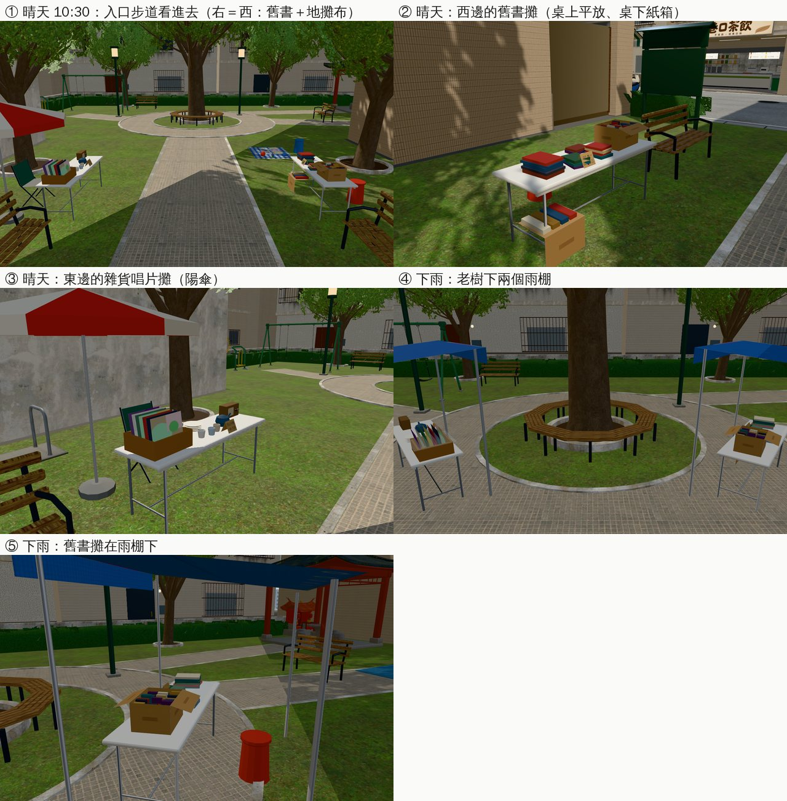

# ART-WZ-MARKET-1023：溫州街小公園的二手市集攤位

- **企劃**：AA_420 12-2（AA-B）；`wzlines3d.js` 的 `WZL.market`、`WZL.MARKET.at` 已經在開發分支（LAWWW-B）。
- **派工**：LAWWW-B 10-23 20:11Z（P2）：
  - 2～3 個小攤，只在市集時段出現（每月第一個週六 09:00～13:00）。
  - 晴天在入口步道 (26.0, 12.6)，下雨在老樹下 (26.0, 18.3)。
  - 「push 後告訴我 commit」。
- **做的人**：LAWWW2-B。
- **狀態**：`READY_FOR_ART_REVIEW`。場景美術的 `ART_APPROVED` 只有使用者能標。

- **Patch**：`docs/art-rebuild/second_ai/patches/wz6_market_1024.patch`（ART-WZ6 和二手市集同一份：`src/zones3d.js`、`src/jobs3d.js`、`src/assets3d.js`、`src/data/wz_shops_layout.js`、`src/data/wz_park_layout.js`、四個新測試）。
  - 對開發 `738cc7ffc` `git apply --check` 過。模型（GLB）在我的分支 `claude/funny-albattani-iawshm`。

## 做了什麼

- **模型**（Blender bpy，`tools/blender/env_second/wz_market.py` → `assets/models/env/second_ai/wz_market.{glb,json}`）：
  - 世界座標，和 `wz_park.glb` 同一套。
  - 462 KB，7 個網格；一張字卡貼圖 `textures/gen/wz_market_print.png`（價錢牌、書背、唱片封面）。
  - 兩個節點，同一時間只開一個：

    | 節點 | 什麼天氣 | 內容 | 三角形 |
    |---|---|---|---|
    | `MARKET_CLEAR` | 晴天、陰天 | 入口步道兩邊兩張摺疊桌：西＝舊書（桌上平放、桌下紙箱立著），東＝雜貨、舊唱片、杯盤（紅白陽傘）；西側樟樹下一塊地攤布（舊雜誌、童書、玩具） | 3,270 |
    | `MARKET_RAIN` | 下雨 | 老樹下的環狀步道兩張桌子，各有一個藍色雨棚；書蓋透明塑膠布 | 2,784 |

  - 攤主的位置是空的椅子／凳子（人由遊戲放，見下面）。
  - 沒有真的店名、商標（D77）。
- **配置**（`src/data/wz_park_layout.js` 的 `market`）：
  - `clear.stalls`、`rain.stalls`：每一攤的中心、轉向、`keeper`（攤主坐的位置和朝向，面向客人）。
  - `blocks`：市集開著的時候要擋的導航格 `[x, z, 寬, 深, 轉角]`。
    - 晴天：桌子、攤主椅、地攤布，6 塊。小椅子至少 0.6 m，才蓋得到 0.5 m 導航格的中心。
    - 下雨：兩個雨棚整個（含攤主的椅子），2 塊，斜放（轉角＝`NavGrid.blockRect` 的 rot＝−yaw）。
  - 入口步道中間、老樹的環狀步道都留著，走得過去；`WZL.MARKET.at` 的互動點（晴天 (26.0, 12.6)、下雨 (26.0, 18.3)）沒被擋住。
- **程式**（`src/zones3d.js` 溫州街那一段）：
  - 只有市集那一天（`WZL.marketDay(G)`）才載入 `bldg.wz_market`（`ASSETS` manifest 新增，lazy）。平常的日子不下載。
  - 晴雨照進溫州街時的天氣，和 `WZL.addMarket` 的互動點一樣。
  - `zone.update` 裡每幀看 `WZL.marketOn(G)`：
    - 時段開始：顯示模型，擋住 `blocks` 的格子；
    - 時段結束：藏起來，把那幾格還原成原本的值（只還原這次改到的格子）；
    - 改導航後 `nav._cm=null`，讓找路重算。
  - `zone.market`＝`{on, grp, cells, w}`，測試和除錯看得到現在的狀態。

## 給遊戲接線（LAWWW-B）

- 攤主（NPC）沒有放：位置在 `WZ_PARK_LAYOUT.market.<clear|rain>.stalls[i].keeper`（坐姿，`yaw` 面向客人）。
- 「逛二手市集」的對話照 `WZL.market`，我沒改。

## 截圖（遊戲內，Playwright＋SwiftShader；不是 iPhone 實機）

開發 `eeed54fc2`＋patch，`2025-10-04（六）10:30`。

- 每張的 `post` 都確認：`zone.market.on=true`、模型載入、導航擋住；④⑤ 是 `w='rain'`。

## 測試

- `tests/wz_market_unit.js`（新，15 項）：
  - 配置有晴天三攤、下雨兩攤，各有 `blocks`、`keeper`；
  - 第一個週六 10:00 開著、每一攤都擋住；同一天 14:00 收了、那幾格還原走得過去；再回到 10:00 又擋住；
  - 普通的週六沒有市集，攤位的地方照常走得到；
  - 下雨用老樹下那一組：兩個雨棚擋住、入口步道那兩攤的地方沒擋、老樹下三個圓椅照樣走得到；
  - 兩個「逛二手市集」互動點、入口步道從公園入口走得到（引擎的找路）；
  - 模型有兩個節點、資產清單有 `bldg.wz_market`（lazy）。
  - 改之前（開發分支原本的程式）第 1 項就失敗。
  - 沒有檢查：攤主的朝向（只是配置的數字）、平常的日子沒有下載（看程式的條件）。
- 開發 `738cc7ffc`＋patch：`wz_market_unit`、`wz_park_unit`、`wz_park_people_unit`、`wz_park_talk_unit`、`wz_cat_unit`、`street_props_nav_unit`、`street_trees_unit` 都 ALL PASS。

## 還沒做／已知

- 攤主 NPC（LAWWW-B）。
- 下雨的塑膠布是透明的，遠看不太出來。
- 手機效能沒實測（多 3 千個三角形、7 個網格，只在市集時段）。
