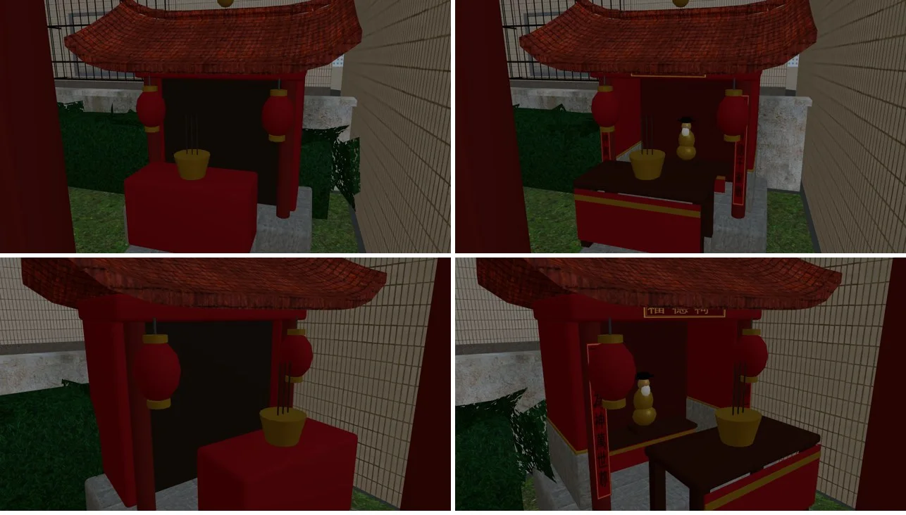
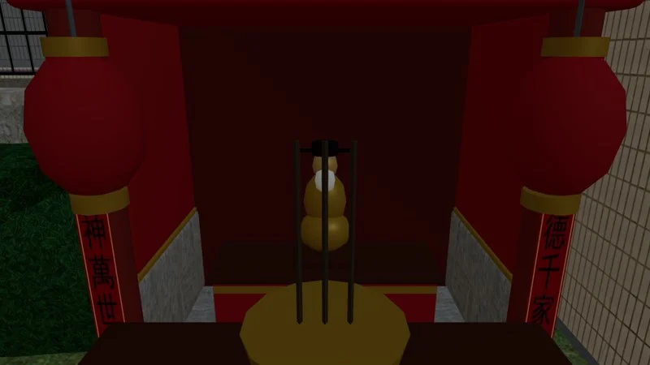

# 溫州街小公園（ART-WZ1）——驗收圖

LAWWW2-B，2026-10-16。配置：`src/data/wz_park_layout.js`（v2）；模型：`tools/blender/env_second/wz_park.py` → `assets/models/env/second_ai/wz_park.glb`。

## 版本

| 版本 | 內容 | 圖 |
|---|---|---|
| v1 | 配置圖（俯視） | `park_plan_v1.png` |
| v2 | 全部項目第一次建模 | `v2_blender_*.jpg`、`v2_ingame_sheet.jpg` |
| v3 | 去積木化（見下） | `v3_blender_*.jpg`、`v3_ingame_sheet.jpg`（白天：入口、遊戲場、涼亭、裡面；傍晚；晚上）、`v3_ingame_spring_azalea.jpg`（季節節點切成 `_on`：杜鵑開花、楓香紅葉） |

v2 遊戲內截圖的狀況：
- 季節的兩組（杜鵑花／楓香紅葉 `_on`，和平常 `_off`）同時出現：遊戲還沒做季節切換。
- 舊小公園的套件物件（白色花台）還在：等 LAWWW-B 拿掉。

## v3 改了什麼

使用者 07:1x：「這次公園看起來蠻好的 我覺得很重要就是 日系加一點寫實 不要很像積木」。

- **杜鵑花籬**：實心圓頂長條（不透明葉子貼圖）＋表面一層葉片卡，像修剪過的花籬。v2 第一版是零散的蕨葉片，像羽毛。
- **地面**：每棵樹的樹穴有花崗石緣和泥土；直的步道兩側有花崗石收邊，碰到環狀步道就停。
- **老茄苳**：放大到 1.38 倍，是公園最大的樹。
- **涼亭**：
  - 柱子、柱珠、樑都倒角，樑下有一排掛落；
  - 四坡攢尖頂有厚度、微微內凹、四角起翹，加上垂脊和寶頂。
- **溜滑梯**：
  - 圓柱、圓角平台、兩側護板、四坡小屋頂；
  - 圓角踏板和扶手；
  - U 形滑道有厚度。
- **搖搖馬 ×2**：彈簧，加上橢球做的身體、頭、耳朵、鬃毛、尾巴。v2 是兩個方塊。
- **土地公廟**：
  - 倒角的廟身、兩根前柱、神桌、金身；
  - 兩坡屋頂兩端起翹，燕尾脊中間有寶珠；
  - 紅燈籠有金色上下蓋。
- **長椅**：圓角木條，椅背往後仰；鑄鐵側架是曲線，有扶手。
- **公布欄**：倒角框，加一個小屋簷。正面改朝主巷（layout v2：yaw π）。直飲台也是。
- **「溫州公園」名牌**：柱子退到板子後面（v2 柱子擋到字）；整塊移到 x 20.5～22.1（v3 第一版一半在 A3 的房子裡，「園」被牆吃掉）。
- **沙坑**：木框四個角不再重疊。v2 重疊的地方閃黑。

## 規格

- 35.9k 三角形（v2 是 20.9k；去積木化的倒角、橢球、彈簧、曲面屋頂增加的）。
- GLB 裡 25 個材質，3.7 MB。
- 特殊節點：
  - `SEASON_AZALEA_on`／`_off`（3 月開花）；
  - `SEASON_SWEETGUM_on_*`／`_off_*`（12～1 月紅葉）；
  - `PLATE_FACE_parksign`（「溫州公園」）；
  - `GLOW_*`（路燈、土地公廟的燈籠）。

## 還沒做

- 公園後面的公寓背面：A3、A4 的背面、北側 P1／P2、東側 S1 的背面。現在後面看得到天空和遠景板。
- 互動點的文字：等 AA-B。

## v4：土地公小廟去積木化（LAWWW2-B 2026-10-16 14:5x UTC）

使用者 07:1x「日系加一點寫實 不要很像積木」；交接紀錄列的「土地公廟的廟身」。遊戲內截圖，左是之前、右是之後：

近看神龕：

改了什麼：
- **供桌**：原本是一個紅方塊，改成木桌面、四隻腳、前面紅桌裙＋金邊。
- **神龕裡面**：
  - 原本是一整塊實心的土色方塊，把神桌和金身整個包在裡面，從來看不到。
  - 改成暗紅的背板，看得到神桌（木桌面＋紅桌裙）和土地公像：坐姿的金身、白鬍子、黑官帽、台座。
- **牆**：下段石材（勒腳）、上段紅牆，中間一條金色收邊。
- **匾、對聯**：
  - 樑上的匾「福德祠」；兩根柱子貼對聯「福而有德千家敬／正則為神萬世尊」，常見的土地公廟對聯，不是店名。
  - 紅底金字、黑字畫成一張貼圖 `textures/gen/shrine_text.png`（文泉驛正黑畫成點陣圖）。
  - 這張貼圖不進貼圖集，字才不會糊。
- **花籬**：南邊那一段（layout x 12.0～36.0）穿過廟的背牆、從神龕裡面露出來。
  - 畫面從廟的東邊（x 13.55）開始。
  - **導航照 layout 不變**：LAWWW-B 用花籬的 segments 擋路，改 layout 會在廟後面多出一條窄縫。
- 三角形 37,408 → 37,216；材質全部進頂點色，只多一個字的貼圖。

順便發現：layout 的 note 寫「面向南」，實際上廟面向北（公園裡面），沒有改 layout。

## v5：遊戲場換成 BB-B 的 ART-PARK1（LAWWW2-B 2026-10-16 16:1x UTC）

- **換掉的**：`wz_park.py`「小遊戲場」用橢球、圓柱拼的溜滑梯、搖搖馬、沙坑。
- **換成**：BB-B 做的 `bb_support/park_play_props.glb`（82eb09b8，6,704 三角形、1 個貼圖材質 `park_play`）。
  - 溜滑梯：U 形截面沿平順曲線掃出的滑道。
  - 搖搖動物兩隻：黃色馬、藍綠小鴨。一體成型塑膠件：側面輪廓擠出＋圓角，眼睛、鬃毛、馬鞍畫在貼圖上。
  - 木框沙坑：裡面有小水桶和鏟子。
  - 驗收紀錄在 `tools/blender/env_second/bb_support/README.md`；Blender 渲染是 `park1_*.webp`。
- **擺放**：
  - GLB 裡四件已經擺在遊戲場的本地座標，`wz_park.py` 整組搬到遊戲場 (15.2, 19.4)。
  - **沙坑往南挪 0.1 m**（本地 z −0.9 → −1.0）：滑道出口的邊（z ±0.265）和沙坑北框（z −0.245）原本重疊 2 cm，是我擺的時候量 bounding box 抓到的。
  - 搖搖馬和滑道之間留 12 cm。
- **地墊**：
  - 溜滑梯下那一塊從綠改成磚紅：原本和滑道的綠太接近，BB-B 交件時提醒過。
  - 兩塊都從純色改成顆粒貼圖（`granular_concrete` 當 EPDM 橡膠粒）：近看不再像塑膠板。
- **缺檔時**：沒有 `park_play_props.glb` 的話，照舊建程序化的 v3 遊戲場。
- **導航**：layout 不變（遊戲場範圍 5.2×3.6 m）。
- **數字**：三角形 37,216 → 37,580；draw call 多 1 個（`park_play`）。
- **截圖**：
  - `v5_playground_cmp.webp`：遊戲內同鏡頭前後比較，11:00，上排舊版、下排新版。
  - 三個鏡頭：東邊看過去、北邊看過去、手機直向。

### 還沒做

- 鞦韆、三件體健器材：AA-B 的 ART-PARK2（16:0x 確認規格，正在做）。
- 涼亭的象棋石桌、石凳、直飲台、腳踏車架：BB-B 的 ART-PARK3（16:1x 派工，等她確認規格）。
- 公布欄：我自己做（有遊戲的海報互動）。

## v6：鞦韆、健身器材換成 AA-B 的 ART-PARK2（LAWWW2-B 2026-10-16 17:2x UTC）

- **換掉的**：`wz_park.py` 用圓柱、方塊拼的鞦韆（A 字架＋方塊座位）和三件健身器材（各一塊 0.9 m 石板）。
- **換成**：AA-B 做的 `aa_support/park2_props.glb`（7930daf8，8,836 三角形、1 個貼圖材質 `park2`）。
  - 鞦韆：鑄鐵三通夾座、U 型螺栓吊環、鏈條＋PVC 護套、橡膠彎座；一個座位停在 7°。
  - 扭腰盤（掛一條淺藍毛巾）、肩部大轉輪、漫步機（腳邊一瓶水）：綠漆鋼管、黃色轉盤和踏板、掉漆、小混凝土基座。
- **驗收時改的**：毛巾白 → 淺藍；綠漆調亮約 12%（見 `aa_support/README.md` 驗收紀錄）。
- **擺放**：新的通用函式 `place_support()`（也給之後的 ART-PARK3 用）照 layout 擺；layout、導航不變。
- **數字**：三角形 37,580 → 45,608；draw call +1（`park2`）。
- **截圖**：`v6_park2_fit_swings.webp`（從環狀步道看）、`v6_park2_fit_close.webp`、`v6_park2_swings_close.webp`、`v6_park2_portrait.webp`（手機直向）。AA-B 的前後對照：`park2_game_before_*`、`park2_game_after_*`。

## v7：象棋桌凳、直飲台、腳踏車架換成 BB-B 的 ART-PARK3（LAWWW2-B 2026-10-16 18:0x UTC）

- **換掉的**：
  - 涼亭裡用圓柱拼的圓石桌、四個石凳、用細長方塊排的棋盤；
  - 圓柱加碗狀的直飲台；
  - 細圓柱拼的腳踏車架。
- **換成**：BB-B 做的 `bb_support/park3_props.glb`（ba3af720，5,444 三角形、1 個貼圖材質 `park3`）。
  - 花崗岩象棋桌：束腰桌腳、桌面刻棋盤和「楚河　漢界」；四個鼓形石凳。
  - 不鏽鋼直飲台：鵝頸出水口、按壓鈕、排水孔、水漬。
  - 四格倒 U 鍍鋅車架：一格掛 U 型鎖。
- **layout**：`bikes` 的 yaw π/2 → π，車架沿南北排，和導航阻擋（0.7×2.6）同方向。導航不變。
- **數字**：三角形 45,608 → 50,100（石凳 instancing，畫出來 52,200）；draw call +1（`park3`）。
- **截圖**（在 LAWWW-B 的 f1651491 拍）：`v7_park3_pavilion.webp`、`v7_park3_pavilion_night.webp`、`v7_park3_front_east.webp`（車架、直飲台、長椅）、`v7_park3_fountain.webp`。BB-B 拍的前後對照：`park3_game_*.webp`。
- 小公園還沒換的：公布欄（有遊戲的海報互動，我做）。

## v8：公園名牌搬到公布欄頂上（LAWWW2-B 2026-10-16 18:2x UTC）

- **問題**：名牌（x 20.46～22.14）和公布欄（x 21.16～22.84）只差 30 cm 前後，從巷子看名牌剛好擋住公布欄的左半邊（「看公布欄」那張海報看不到）。
- **改法**：拿掉另外立的木頭名牌，公布欄的柱子、屋簷加高到 2.42～2.52 m，中間加一塊橫板，「溫州公園」貼在橫板上（還是 `PLATE_FACE_parksign`，遊戲用 canvas 畫字，props 不變）。台灣社區公園的公布欄常見這樣做。
- layout、導航、互動點不變；三角形 −376。
- 截圖：`v8_notice_close.webp`（從巷子看公布欄）、`v8_notice_street.webp`（傍晚從巷子看入口）。
