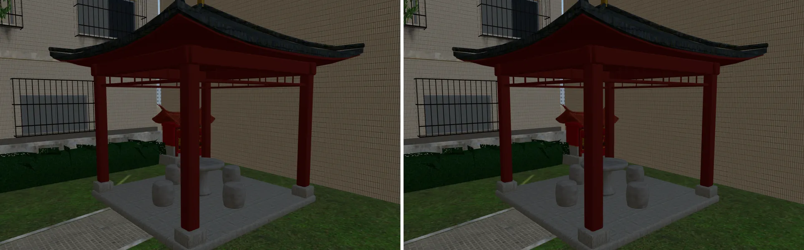
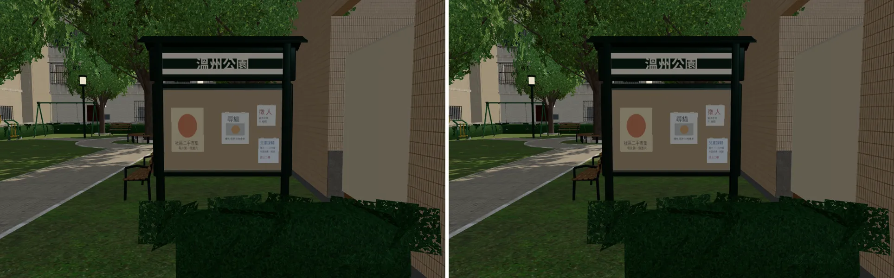
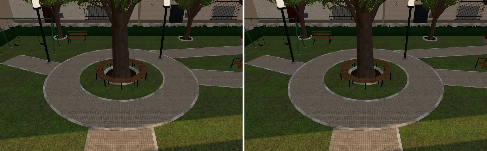

# 溫州街小公園：疊在一起會閃的面（BACKLOG A7）——已交件

帳號 A 的 LAWWW2，2026-10-21 20:0x UTC。狀態：**已交件**，交 LAWWW 整合。這是「溫州街收尾①」。

## 問題

小公園（`wz_park.glb`）有幾組面重疊在同一個平面上。鏡頭一動，兩個面輪流蓋過對方，畫面上會一直閃（z-fighting）。

用 `tools/blender/env_second/check_coplanar.py` 掃整個模型，「一定會閃」有 11 組：
- 涼亭南北向的樑和東西向的樑，上下緣在同一個面；
- 土地公廟神龕的背板貼在紅牆上；
- 環狀步道和接進來的直步道，路面同高；
- 公布欄的軟木板貼在鋁板上。

## 改法（`tools/blender/env_second/wz_park.py`，commit `c53c3c6d`）

- 涼亭南北向的樑：上下各縮 5 mm。
- 神龕背板：離紅牆 5 mm。
- 環狀步道：比直步道高 4 mm。
- 軟木板：離鋁板 3 mm。

物件、材質、三角形數都沒變；導航沒變。

## 檢查結果（`check_coplanar.py`）

| | 修改前（開發分支的 `wz_park.glb`） | 修改後 |
|---|---|---|
| 重疊的面（組） | 62 | 37 |
| 一定會閃 | **11** | **0** |
| 遠處才閃 | 18 | 1 |
| 背對背的雙面 | 32 | 35 |

- 剩下那 1 組「遠處才閃」在涼亭頂，0.04 m²，玩家看不到。
- 「背對背的雙面」是兩個面背靠背、朝相反方向。單面材質不會閃；雙面材質只有從背面看才可能閃，這次沒動。
- 完整清單：[`coplanar_before.txt`](coplanar_before.txt)、[`coplanar_after.txt`](coplanar_after.txt)。

## 遊戲內前後對照（確認沒有改壞）

- 環境：`tools/shots/scene_shot.py`，1280×800。Playwright＋SwiftShader，**不是 iPhone**。
- 基準：開發分支 `b804db03`，只在本機 worktree 換 `wz_park.glb`。開發分支到發布後的 `a9da472a`，`wz_park.glb` 都沒變過（同一個 blob）。
- 拍攝設定：[`shots.json`](shots.json)（溫州街 15:00，固定鏡頭、藏起玩家）。
- 每張圖左邊是修改前、右邊是修改後。

閃爍要畫面在動才看得到，靜止的截圖看不出差別。這三張只用來確認：涼亭、神龕、公布欄、步道的樣子都沒有被改壞。

## 還不到的地方（誠實寫）

- 沒有錄影，閃爍消失只靠 `check_coplanar.py` 的數字證明，沒有用眼睛確認。
- 真機沒看過。

## 接法（LAWWW）

- **只換檔，不用改程式**：`assets/models/env/second_ai/wz_park.glb`（`c53c3c6d`）。
- 腳本 `tools/blender/env_second/wz_park.py` 也一起換。
- 導航沒變，不用重跑導航測試；想確認的話可以跑 `tests/wz_street_integration.py`。
