# 溫州街效能：第一輪（LAWWW2-B 2026-10-16）

LAWWW-B 的 P2：溫州街主巷三個鏡頭（`tests/wz_street_integration.py` 的 lane_east、lane_west、arcade；含陰影那一輪、含玩家）
目標 draw call ≤ 310、三角形 ≤ 42 萬。

## 量法

`tools/blender/env_second/shots/wz_perf.py <worktree> <url> <out.json>`：讀檔到溫州街 (30,−1) 17:30，三個鏡頭各量總數；
再把每個正式模型、每類套件物件、場景裡其他東西（玩家＋腳踏車、太陽的陰影）一次藏一組，看少多少。路人量的時候移出場景，和 LAWWW-B 的測試相同。
`tools/blender/env_second/shots/glbstat.py <glb>` 列出 GLB 每個 primitive 的三角形數（含 instancing 數量）。

測試環境：LAWWW-B 開發分支 72e40401＋這一輪的五個 GLB；SwiftShader（雲端沙盒）。

## 結果

| 鏡頭 | 之前 draw call | 之後 | 之前三角形 | 之後 |
|---|---|---|---|---|
| lane_east | 392 | **337** | 528k | **482k** |
| lane_west | 355 | **301** | 514k | **454k** |
| arcade | 448 | **372** | 546k | **499k** |

lane_west 到目標；另外兩個還差 27～62 次、6～8 萬三角形（下面「還沒做的」）。

## 改了什麼（看起來不變）

| 模型 | primitive | 三角形 | 做法 |
|---|---|---|---|
| `wenzhou_street.glb` | 108 → 71 | 217k → 150k | ① 其他純色材質（v6 店面的碗盤、水果、木架、不鏽鋼、盆栽…）合進頂點色材質：小東西用 `cafe_vc_wz_*`（遊戲的 `WZ_NO_SHADOW` 對 `cafe_vc_` 開頭的不投影），門窗雨遮照舊 `wz_vc_*`（投影）② 只擺一兩個的 instancing（店裡的冰箱、販賣機、麵攤、傘架、電表、凳子…）改成一般網格合進大網格 ③ 多材質零件拆開再合 ④ 鐵窗的細條改成「十」字兩片（每根 4 個三角形）、冷氣格柵改薄片、水塔 12 邊、街上盆栽的盆 10 邊、碗疊 7 邊 |
| `cafe_exterior.glb` | 41 → 33 | 34k → 38k | ②③；盆栽葉子進頂點色。三角形多了是 Café 店內 v4b（WZ4b）的大盆栽這次一起進外觀（玻璃看得到的店內和室內區域同一套配置） |
| `wz_park.glb` | 35 → 26 | 不變 | ① ②③；樟樹、老茄苳不再一棵一個網格；兩棵楓香同一季節狀態合一個（名字照舊 `SEASON_SWEETGUM_on/off_*`，遊戲照名字切換） |
| `wz_jphouse.glb` | 18 → 17 | 不變 | ① |
| `bike_ride.glb` | 28 → 15 | 不變 | 純色零件（鍍鉻、黑色零件、輪胎、反光片、軟墊、綁帶）合成一個頂點色材質 `ride_vc`；車架烤漆 `ride_frame`（遊戲改色）、座墊、輻條、車燈不動；節點、樞軸、定位點都不變。腳踏車每個場景都有：陰影那一輪也少 13 次 |

節點名稱、`SEASON_*`、`*_FACE_*`、晚上發光的材質名（`WZ_NIGHT`）、樹幹透視的材質都沒動；導航、碰撞不在 GLB 裡。

## 對照（左：之前；右：之後；11:00，同一個鏡頭）

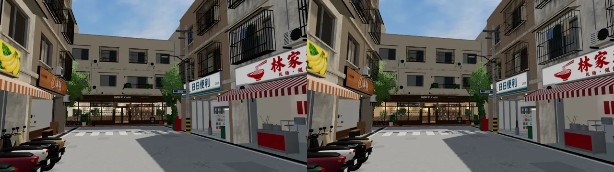
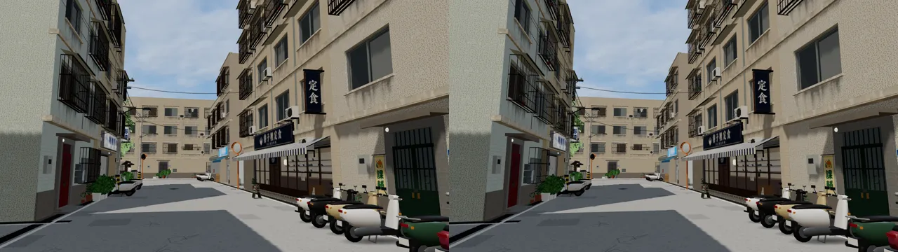
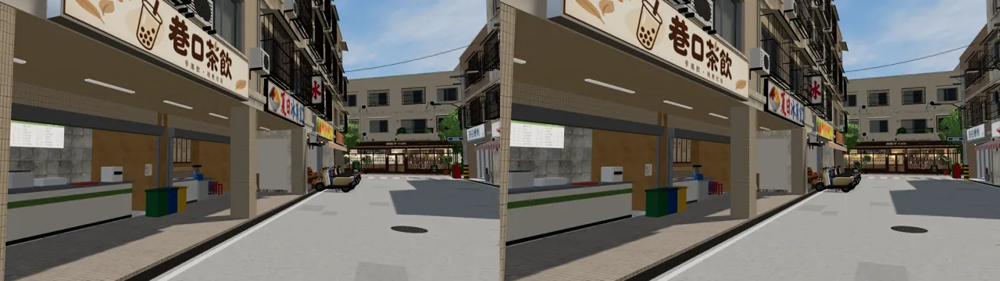

鐵窗特寫（第一版斜 45° 的 X 字薄片一半朝下、整片鐵窗變暗，改成正對街道的「十」字；整片底板改回三條踏板）：

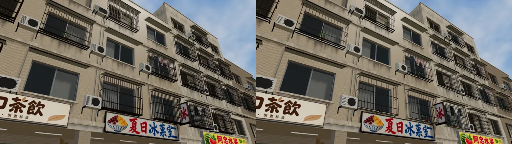
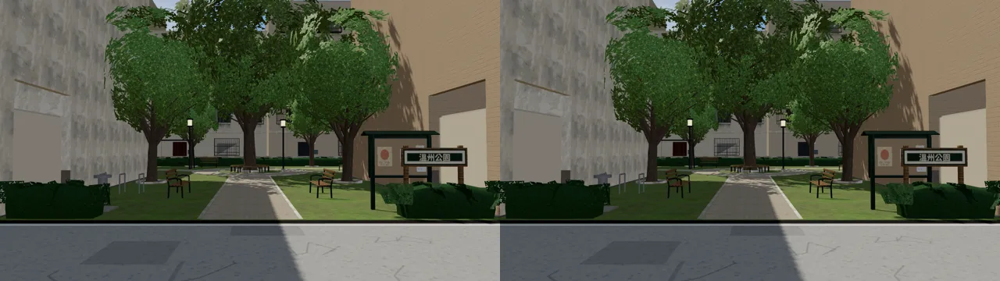
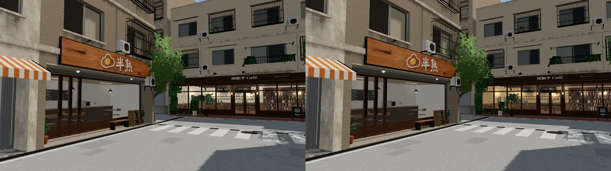

腳踏車（Blender，上：之前；下：之後）：

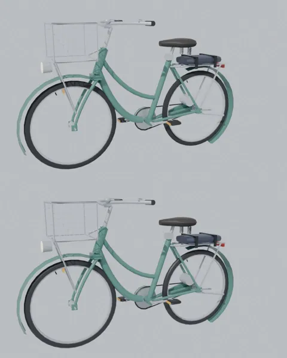

## 還沒做的（arcade 還要少 62 次 draw call、8 萬三角形）

- 拆解（arcade 鏡頭）：陰影那一輪 117 次；街道 GLB 104 次；套件群組 88 次（Café 外觀 33、路燈光暈等 MeshBasic 30、停著的腳踏車 10…）；玩家＋腳踏車 53 次；小公園 31 次；日式宿舍 24 次。
- 我這邊下一步：
  - 街道 GLB 裡二十幾個小貼圖材質（店內地板、條紋雨遮、菜單、價目、書背…每個 2～60 個三角形）合成一張貼圖集；
  - 機車：38 台 × 1,500 三角形＝5.8 萬（InstancedMesh、整條巷子不裁切），做輕量版；
  - 日式宿舍、Café 外觀的小貼圖材質也合。
- LAWWW-B 那邊可以考慮的（不是我的檔案）：機車 InstancedMesh 照路段分組（公館已經是）、陰影那一輪只讓大面積的東西投影（套件群組 136 個投影網格）。

# 第二輪（LAWWW2-B 2026-10-16 12:4x UTC；FIX-WZ-PERF）

## 結果（LAWWW-B 開發分支 93d95ccb＝含 LAWWW-B 的陰影減量 bdb87446；同一組鏡頭）

| 鏡頭 | 第一輪＋LAWWW-B 陰影減量 | 第二輪 | 三角形 |
|---|---|---|---|
| lane_east | 315 | **280** | 44.4 萬 |
| lane_west | 291 | **258** | 42.0 萬 |
| arcade | 334 | **314** | 46.1 萬 |

arcade 還差 4 次、三角形三個鏡頭還多 0～4 萬（下面「第三輪」）。

## 改了什麼（看起來不變；對照在最下面）

- **貼圖集**（lib2 `atlas_small`、`atlas_rows`）：
  - 小的貼圖材質（店內地板、條紋雨遮、木頭、書背、樑…）合成一張。
  - 沿 u 重複很多次的用「一列一個材質」的貼圖集：u 照舊重複，v 擠進那一列。
  - 有字的不收：招牌設計稿、菜單、價目、告示、一盞的匾。第一次試的時候招牌設計稿也進去了，遊戲裡變成整片灰，已經排除。
  - 大面積的不收：公園的草地、石板路。
  - 溫州街 71 → 53 個 primitive；Café 外觀 33 → 26；小公園 26 → 24；一盞 17 → 12。
  - Café 店內的 `cafe_int_atlas`：**遊戲的 CAFE_BOUNCE 要加一行**（白天店裡也開燈；名字 `cafe_int_` 開頭，照舊不投影）。
- **不投影**：貼在牆上的薄零件（門、窗框、鋁框、窗簾、曬的衣服、水管、信箱）改到不投影的頂點色材質 `cafe_vc_wz_*`；會投影的只剩雨遮、屋頂板、騎樓天花板。
- 蕨類盆栽兩個原型合成一個（−2）。
- **機車輕量版**（scooter.glb）：輪胎 12 邊、車殼斷面 8 點，3,052 → 2,572 三角形（巷子裡 38 台，少約 9 千）。

## 對照（左：第一輪；右：第二輪；11:00）

主巷三個鏡頭、水果店、小公園近景、一盞：

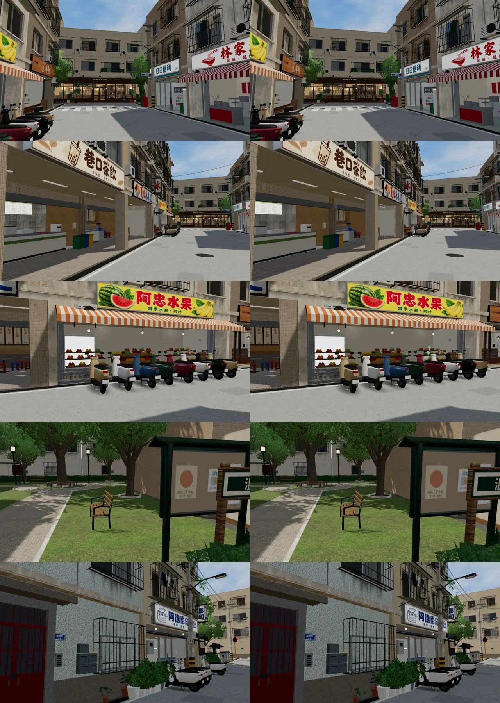

招牌（排除有字的材質以後，設計稿招牌正常）、鐵窗、Café、條紋雨遮：

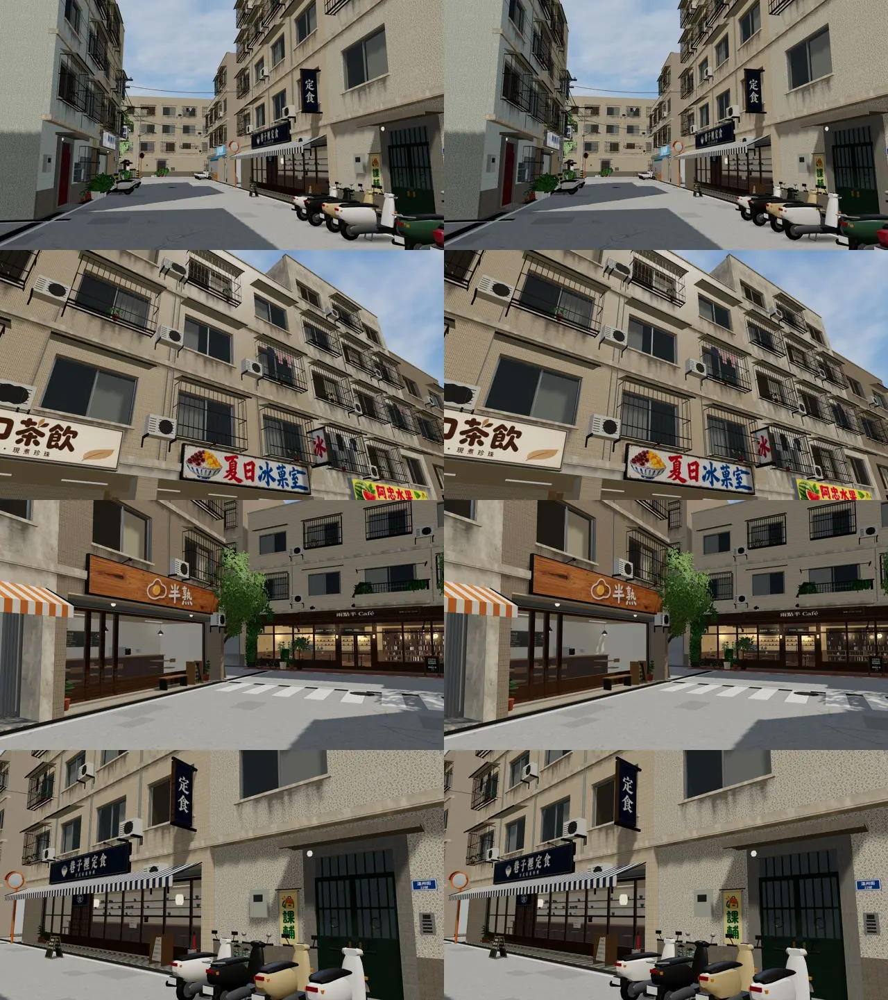

# 第三輪（LAWWW2-B 2026-10-16 13:3x UTC）：修第二輪的畫面退步＋三角形

## 量法

LAWWW-B 自己的 `tests/wz_street_integration.py`，在 LAWWW-B 開發分支 f1651491 上，換上這一輪的三個 GLB；同一組鏡頭，藏起路人，含陰影那一輪、含玩家。

| 鏡頭 | 第二輪（LAWWW-B 量） | 第三輪 | 三角形：第二輪 → 第三輪 |
|---|---|---|---|
| lane_east | 280 | **303** | 44.4 → **43.1** 萬 |
| lane_west | 258 | **286** | 42.0 → **40.7** 萬 |
| arcade | 298 | **321** | 45.6 → **44.3** 萬 |

- **draw call 多了約 25**：把第二輪的畫面退步修回來的代價，見下面。arcade 超過 310 的目標 11 次。
- **三角形少約 1.3 萬**。
- 其他檢查：
  - `wz_street_integration` 35 項通過，只有效能那一項沒過；第二輪也沒過，因為三角形超標。
  - `cafe_glb_integration` 59 項通過。兩項沒過，換回第二輪的 Café 一樣不過，不是這一輪造成的：
    - 「8 個座位不變」：WZ4 加了 7 個座位，測試還是舊的 8 個；
    - 「套件 Café 外觀藏起來」：還有 7 個看得到，請 LAWWW-B 看。
- 試過、沒有用的：把 `wz_sf_`、`wz_arcade_floor`、`cafe_base_stone` 加進 `WZ_NO_SHADOW`，只少 5 次（arcade 316）。

## 第二輪的畫面退步（這一輪修好）

- **哪裡壞了**：第二輪的「一列一個材質」貼圖集（`atlas_rows`），每個 v 週期只有 64 像素。
- **為什麼**：遊戲裡遠一點，GPU 照 u 方向選 mipmap，v 方向的細節就剩原本的 1/4～1/8。
- **結果**：木紋、磁磚、馬賽克、磨石子、花崗石、鐵捲門、浪板、石材牆基變成直條紋或一片糊。
  - 例：冰菓室後牆的木板牆腰變成一片咖啡色。
  - 同鏡頭對照，左起第一輪／第二輪／第三輪：

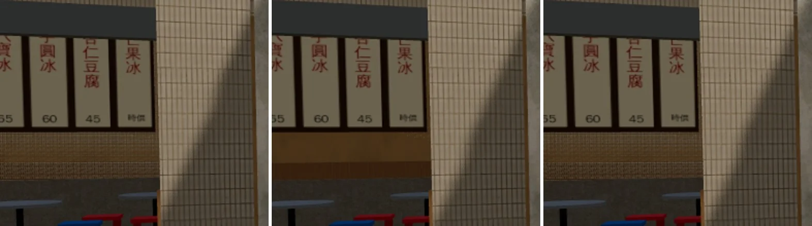

- **修法**（lib2 `atlas_rows` 的 `max_vloss`）：
  - 先量每張貼圖「v 方向縮到每週期 8 像素再放大」和原圖差多少。
  - 只收 v 方向幾乎沒有變化的：條紋雨遮 4 種、灰泥。其他照舊各自的材質。
  - 第一版用 64 像素量，木板牆腰只有 0.03，照樣收進來、遊戲裡照樣糊，改成 8 像素。
- **影響**：
  - 溫州街 19 → 5 種收進貼圖集；
  - Café 外觀、一盞的「一列一個材質」不做了，回到第一輪的樣子。

## 改了什麼（看起來不變）

- **窗框**：五根框條改十字薄片，325 扇窗。
- **街上的盆栽**：10 邊 → 8 邊。
- **冷氣風扇**：正面一片 12 邊形。原本 0.5 cm 厚的圓柱，側面、背面看不到。
- **Café 外觀**：四種葉片卡合成一張帶透明的貼圖集 `cafe_leaf_atlas`，名字 `cafe_leaf_` 開頭，遊戲照舊雙面＋alphaTest、不投影。
- 合計：溫州街畫的三角形 149,807 → 139,253。

試過、退回的：
- 窗台改成鋁框的材質：遊戲裡窗台變深灰。
- 菜單、價目、告示、門簾合成一張 512 格的貼圖集：寬的菜單被壓扁、字橫向糊掉。

## 對照（左：第二輪，LAWWW-B v9.9 候選用的；右：第三輪；11:00）

arcade、一盞、冰菓室／水果店、主巷東：

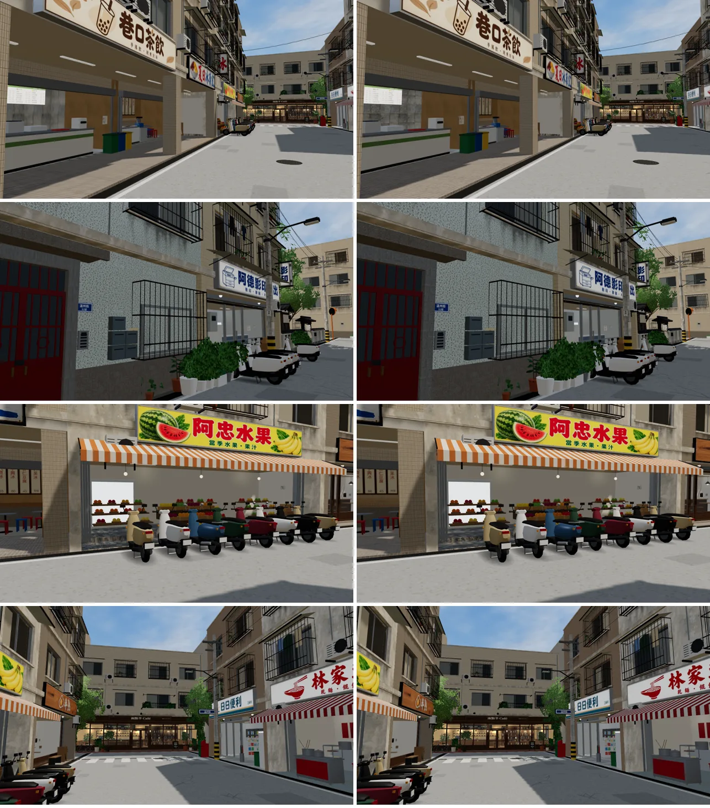

## 接下來（第四輪，下一版）

- **draw call 要拿回來，但不能再犧牲畫質**。方向：
  - 同一種地板、牆面貼圖的店合併；
  - 店內看不到的面刪掉；
  - 遠景的店內改頂點色。
- **三角形還多約 2.3 萬**（arcade）。我這邊的大頭：
  - 機車 38 台×約 1,250，約 4.9 萬；
  - 鐵窗 154×126，約 1.9 萬；
  - 店內碗盤、水果；盆栽葉子。
  - 診斷：`WZ_DIAG=1` 重建 `wz_street.py`，印出每個材質的三角形數。

# 第四輪（LAWWW2-B 2026-10-16 14:0x UTC）：draw call 拿回來、不糊

## 結果（LAWWW-B 的 `wz_street_integration`，f1651491＋這一版的 wenzhou_street；第三輪的 Café、一盞不變）

| 鏡頭 | 第三輪 | 第四輪 | 三角形：第三輪 → 第四輪 |
|---|---|---|---|
| lane_east | 303 | **289** | 43.1 → 43.3 萬 |
| lane_west | 286 | **272** | 40.7 → 40.9 萬 |
| arcade | 321 | **307** | 44.3 → 44.5 萬 |

- **draw call 三個鏡頭都回到 310 以下**，畫面和第三輪一樣（下面對照）。
- **三角形還多 1.3～2.5 萬**（目標 42 萬）。
- 其他 35 項通過。

## 改了什麼

- **lib2 `atlas_tiles`（新）**：第三輪排除的 14 種磁磚、木紋、地板、鐵捲門、石材牆基、書背貼圖，合成一張 2D 貼圖集。
  - 做法：
    - 每個面沿 UV 的整數格線切開，每一塊只落在一個週期裡，UV 平移到 0～1，對到貼圖集的一格。
    - 每格四周用貼圖自己繞回來的像素墊邊（wrap 12 px）：遠處的 mipmap 混到的是同一張貼圖，不會混到隔壁格。
    - 底色、法線（強度烤進像素）、ORM（粗糙度、金屬度）三張圖同一個排列。
  - 和第二輪的「一列一個材質」不一樣：v 方向不擠，所以不糊。
  - 店裡的木頭家具、店內地板（花崗石、磨石子、白磚、花磚）、馬賽克：一格放 2×2 個週期，少切很多刀。
    - 這些隔著玻璃看，每個週期的像素少一半看不出來。
  - 騎樓地板（走在上面、近看）、鐵捲門、石材牆基：一格一個週期。
  - 切開以後這 14 種的三角形 3,634 → 6,826。
- **材質名 `wz_in_tiles_wenzhou` 開頭是 `wz_in_`**：遊戲的 `WZ_NO_SHADOW` 已經有這個字首，不投影。
  - 店裡的家具、地板、騎樓地板、鐵捲門的影子本來就看不到；投影的話，切開的三角形在陰影那一輪又畫一次。
  - **遊戲端不用改**。
- 貼圖集 1024×1024（`textures/gen/wz_tiles_wenzhou_{base,nor,orm}.png`）：

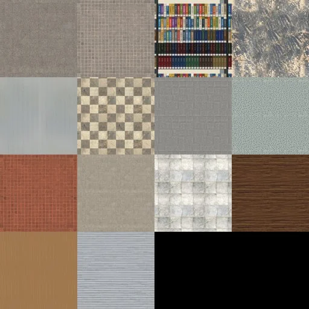

## 對照（左：第三輪；右：第四輪；11:00）

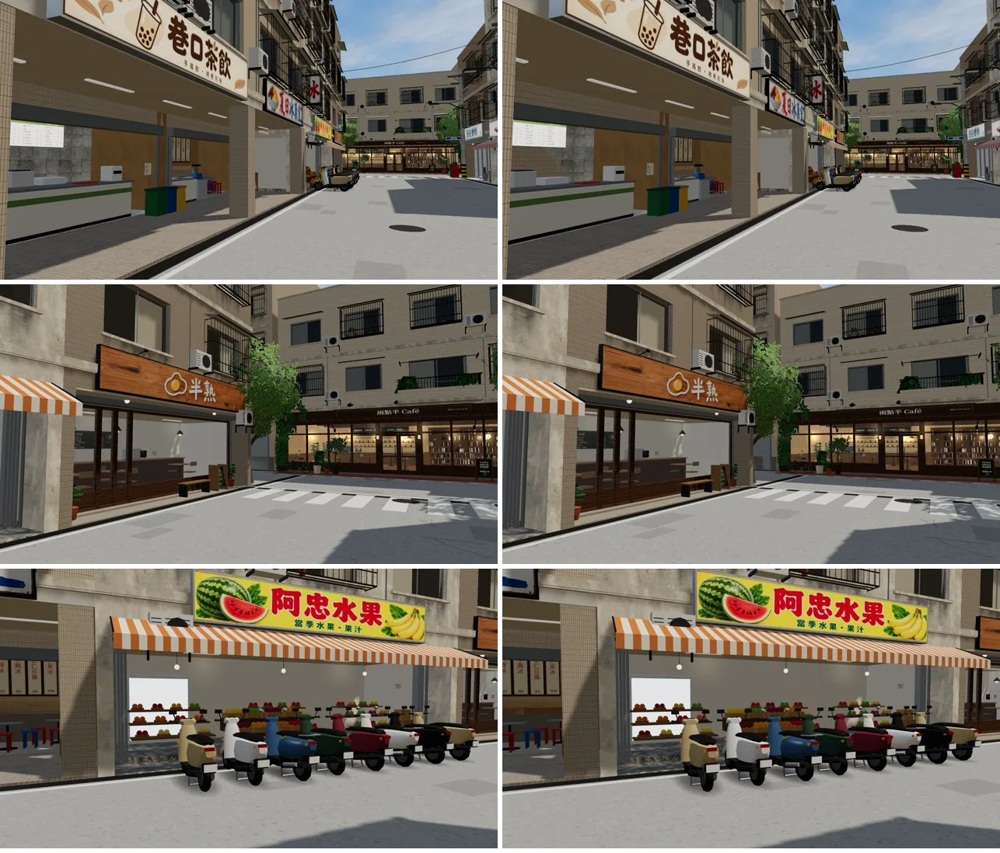

放大（冰菓室木板牆腰、水果店地板）：

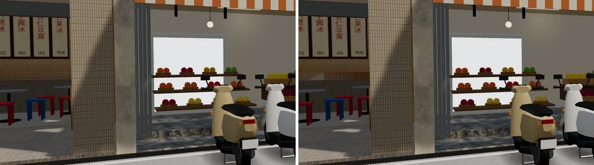

## 三角形還要少的（下一步）

- 我這邊最大的：
  - 機車 38 台×約 1,250，約 4.9 萬。已經是輕量版，再減就變積木，先不動。
  - 鐵窗 154×126，約 1.9 萬。
  - 店內的小東西：便利商店貨架上的商品、碗盤、水果，合計約 2 萬（`WZ_DIAG=1` 看得到）。
- 遊戲端（LAWWW-B）：套件群組約 6 萬、玩家約 8 萬（含陰影）。

# 第五輪（LAWWW2-B 2026-10-16 14:1x UTC）：三角形

| 鏡頭 | draw call | 三角形：第四輪 → 第五輪 |
|---|---|---|
| lane_east | 289 | 43.3 → **42.1** 萬 |
| lane_west | 272 | 40.9 → **39.7** 萬 |
| arcade | 307 | 44.5 → **43.3** 萬 |

- lane_west 達標；lane_east 差 1.2k、arcade 差 1.3 萬。其他 35 項通過。
- 溫州街畫的三角形 142,445 → 132,341；機車 2,572 → 2,492。

改了什麼（看起來不變；下面對照）：

- 鐵窗兩側籠子的條子改一片朝外的薄片：從正面看本來就只看到側邊，從巷子斜看是正面。
- 街上盆栽的盆：4 點輪廓，少底座和盆口兩圈（`cafe_layout.pot` 的 `taper4`）；大葉盆栽的葉子 4 段（`plants.broad_plant` 的 `leaf_n`，室內照舊 6 段）。
- 屋頂水塔 10 邊、機車輪胎 10 邊（平滑著色）。
- 店面組件（`sk_*`）離地 0.95 m 以下、朝下的面刪掉：放在地上、層架上的箱子、桌椅、櫃子的底面，鏡頭看不到（1,220 個三角形）。

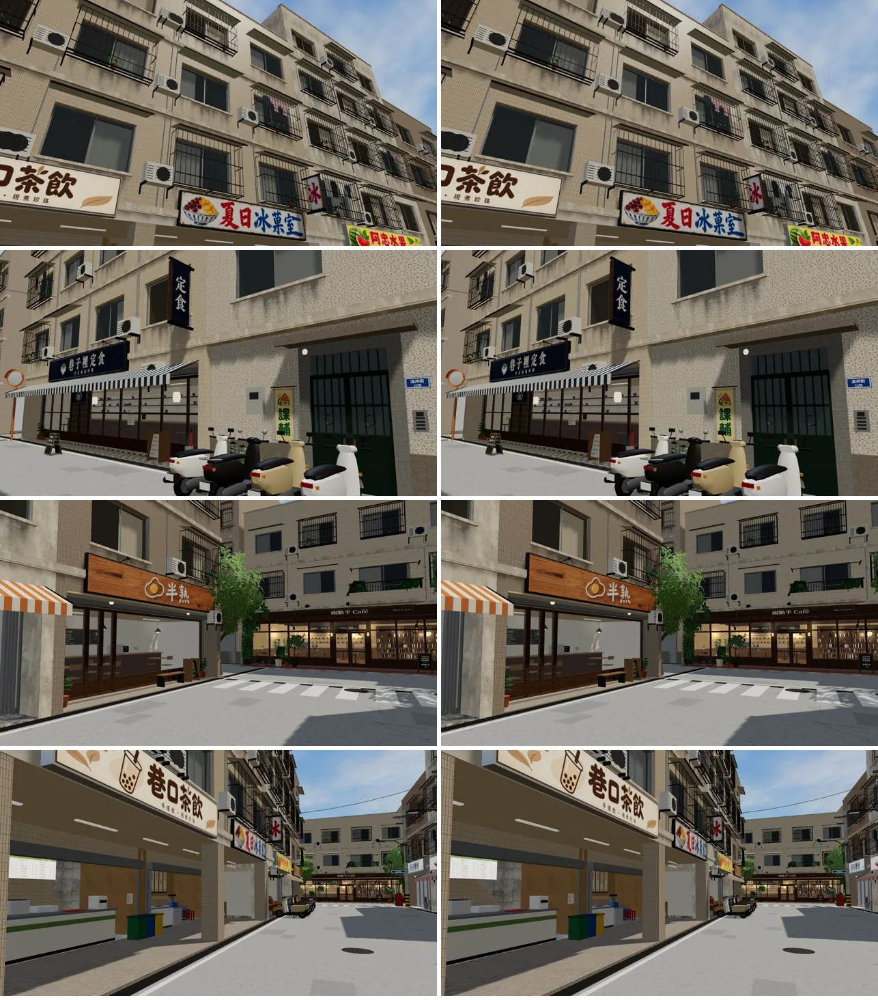

鐵窗、冷氣、盆栽放大：

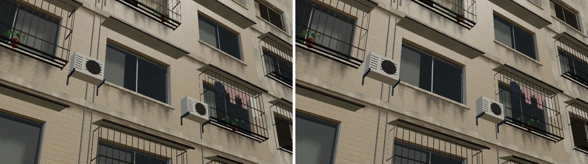

## 第五輪之後：擺上 ART-WZ7 路邊小物（LAWWW2-B 14:3x）

- 擺了三件（AA-B 的 `wz7_street_props.glb`），在店面退縮的門廊裡（門面線和店面玻璃之間，建築的導航阻擋範圍內，人走不進去）。
  - **外送保溫箱＋上面一頂安全帽**：林家乾麵（A4）門廊的西端，外送員在等餐。
  - **回收紙箱捆＋一袋寶特瓶**：日日便利（A5）門廊的西端，門在東邊。
- 傘桶、U 型鎖還沒擺：三角形預算不夠（每件 1.3～1.7k）。
- 量測（LAWWW-B 的測試）：draw call 290／272／308、三角形 42.4／39.7／43.6 萬（+2.8k）。

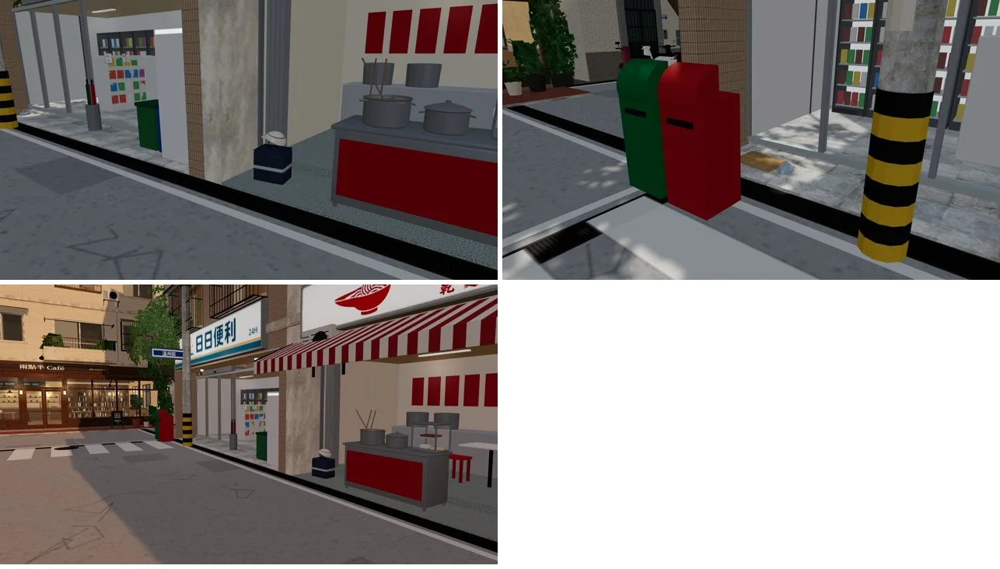
