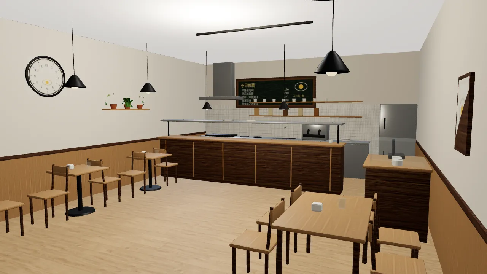
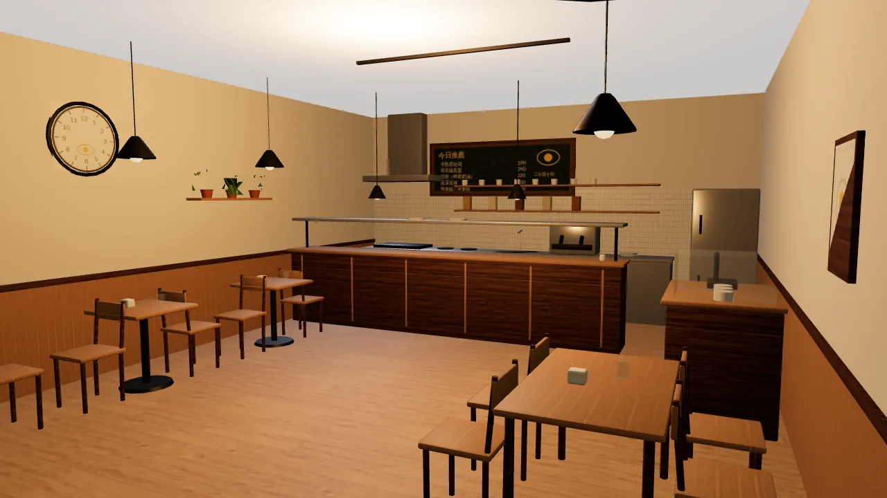
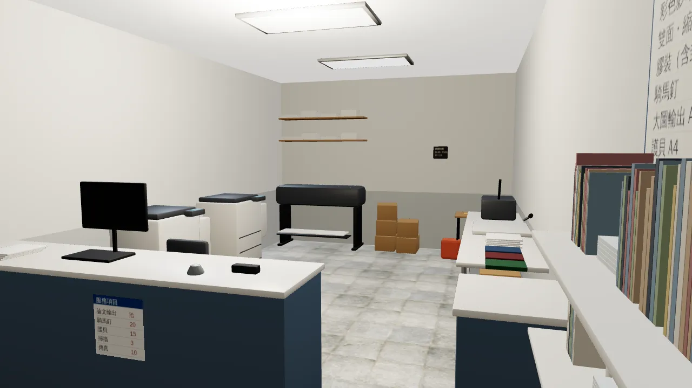
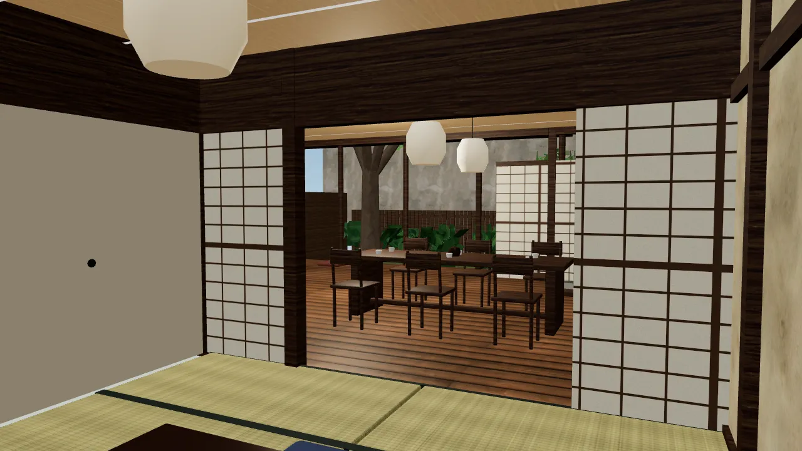
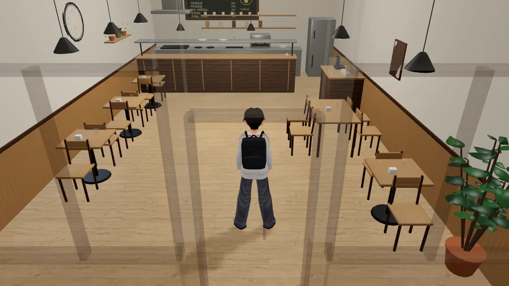
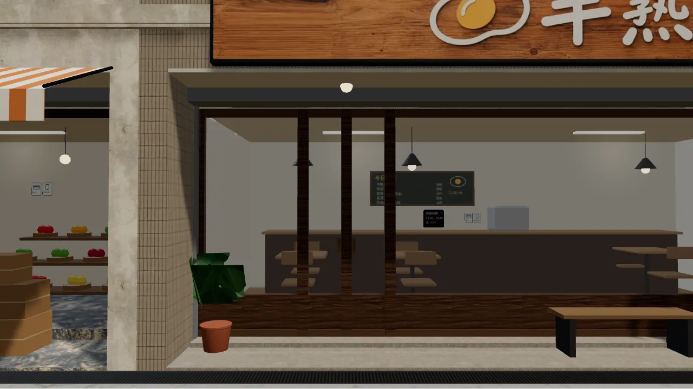
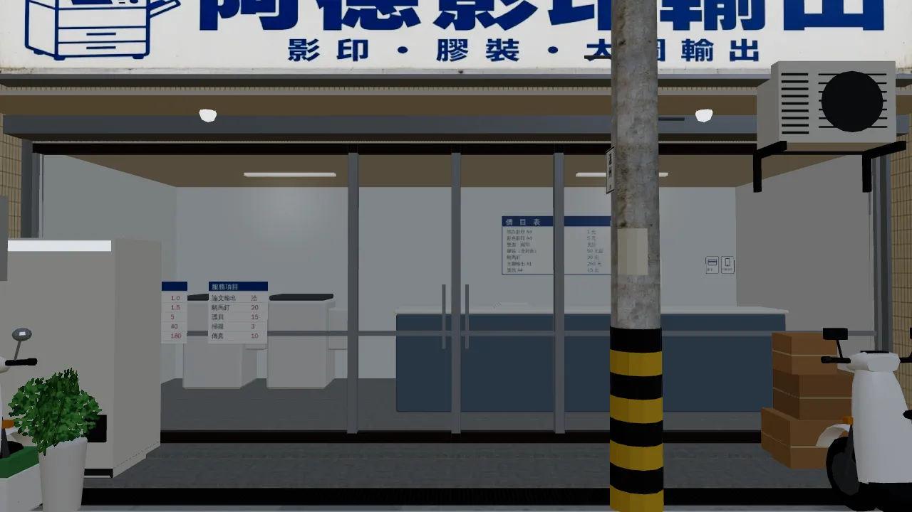
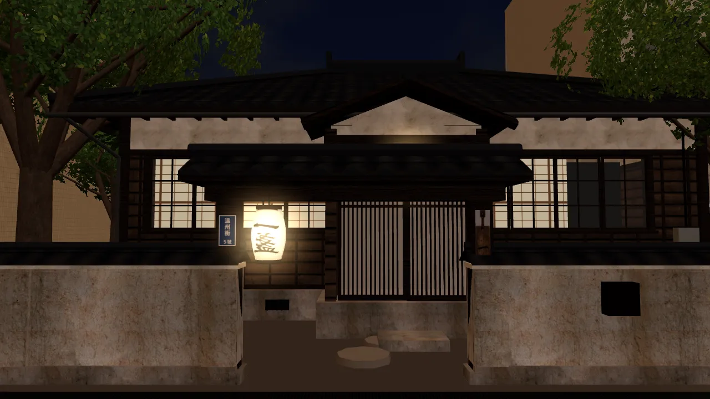
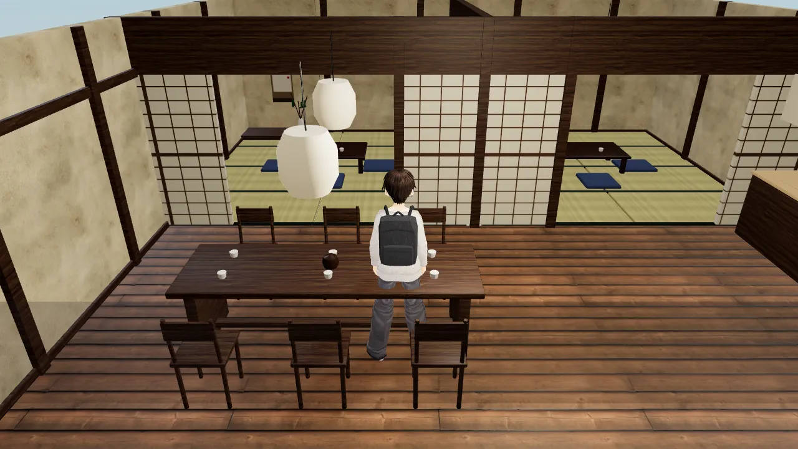
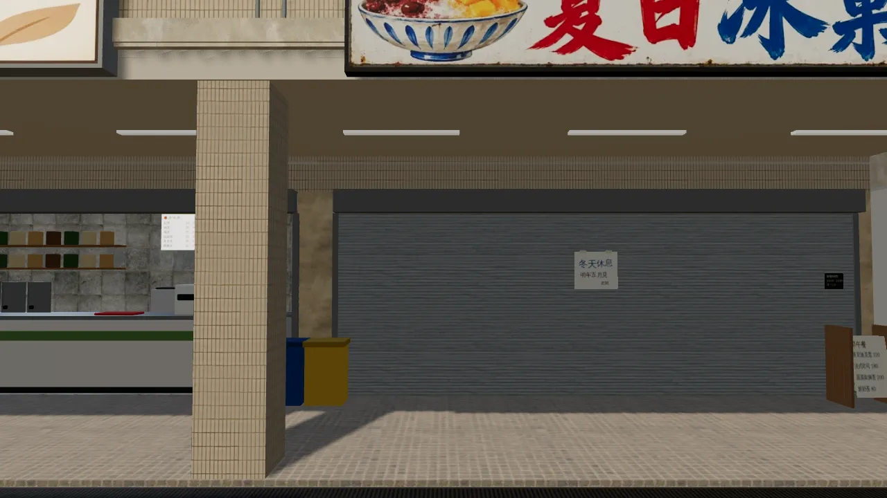

# 溫州街三家新店的 3D 室內（ART-WZ3）——驗收圖與整合說明

LAWWW2-B，2026-10-16。使用者 06:4x：「三家店室內都要3D!」——走進去、選位子坐下。規格：AA_164 第 2 節。
配置（給遊戲和 Blender 共用）：`src/data/wz_shops_layout.js`；模型：`tools/blender/env_second/wz_shops_interior.py --shop brunch|print|teahouse`。

| 店 | GLB | 大小（區域） | 三角形 | 材質 | 座位 |
|---|---|---|---|---|---|
| 半熟早午餐 | `assets/models/env/second_ai/wz_brunch_interior.glb` | 6.4×10×3.2 | 14.4k | 21 | 12（兩人桌 4、四人桌 1） |
| 阿德影印輸出 | `wz_print_interior.glb` | 4.4×9.2×3.0 | 15.9k | 20 | 1（打工時坐櫃台）＋阿芃的位子 |
| 一盞茶屋 | `wz_teahouse_interior.glb` | 8.4×14.6×2.6（房子 z −5～5、緣側 5～6.2、前院 6.2～9.6） | 14.1k | 28 | 12（茶席 6、緣側 2、和室 4） |

## 內容

- **半熟**：
  - 後牆的料理台：煎台、爐口、水槽、咖啡機、排煙罩、開放層架上的杯子和罐子；冰箱；
  - 出餐檯：木條檯身、出餐板、兩盞保溫燈、老闆娘的蛋計時器；結帳櫃台＋蛋糕櫃；
  - 12 個位子，每桌有水杯、餐巾；
  - 左牆的大時鐘（錶面下面一顆蛋）、黑板（今日推薦、粉筆畫的蛋、「三分四十秒」）、蛋的線條畫、層架小盆栽、門口兩盆大植物；
  - 每桌一盞吊燈。
- **阿德影印輸出**：
  - 客人區：自助影印機（投幣）、文具架、價目表；
  - 櫃台：客人那一面貼價目；上面有阿德的電腦（螢幕朝裡面）、鍵盤、叫人鈴、訂書機、等人拿的紙疊；
  - 店裡：兩台大影印機（分頁器）、大圖輸出機（印好的海報垂下來）；
  - 長工作檯：膠裝機、裁紙刀、紙疊、做好的膠裝本，下層紙箱；
  - 阿芃寫功課的小桌：作業簿、鉛筆盒、凳子、書包；紙箱堆、後牆層架的紙；
  - 平板日光燈；牆上「本店不影印整本書」（WZ-C2）、營業時間。
- **一盞茶屋**：
  - 玄關：石材地、式台、鞋櫃、脫在門口的鞋、格子門；
  - 茶席：深色木地板、長桌＋六張木椅、茶杯、茶壺；
  - 水屋：流理台、電熱水壺、四個茶罐、計時沙漏、層架上的茶碗、暖簾；
  - 兩間和室：榻榻米 2×4 張、深色緣，矮桌、四個坐墊；
  - 和室 A 的床之間：掛軸「茶」、花器、插花、床柱；兩間和室中間是襖（關著），前面的紙拉門中間拉開；
  - 聚樂壁＋柱＋長押、木板天花＋格緣、和紙吊燈；
  - 緣側：兩個坐墊、簷下的柱與屋簷；
  - 前院（低一階、走不到）：苔、碎石、踏石、沓脫石、石燈籠（晚上亮）、竹掃把靠在矮木牆；老樟樹和街道同一個模型；後面是隔壁公寓的牆。

## 給 LAWWW-B 的整合

1. 照現有的室內區域做（`room()`＋`attachRoomGLB`，和麵店、Café 一樣）：
   - 區域大小、出生點、出口、導航阻擋、座位、互動點都在 `wz_shops_layout.js`；
   - 會淡出的牆是 `WALL_<side>_*`（自訂屬性 `dir`），掛在牆上的圖（黑板、時鐘、價目表、掛軸）也在牆的組裡，牆淡出時一起藏。
2. 一盞的前面沒有牆：緣側和前院是開放的。
   - `room()` 的前牆請不要畫（或放到前院後面 z=9.6，換成矮木牆的位置）；
   - 前院用 layout 的 block 擋住（z 6.2～9.6）。
3. 窗（半熟、影印的店面玻璃）：`room()` 的窗景照舊（winWall 'front'）。
4. 溫州街的進店點 `enterAt`、離開的位置 `exit.spawn`：在 layout 裡。

## 驗收圖

`*_blender_*.jpg`：Blender Cycles 預覽（天花板一盞面光＋太陽）。遊戲內截圖要等 LAWWW-B 接好區域才拍得到。

## 還沒做

- 遊戲內截圖（等區域接好）。
- 打工時的 NPC 站位（老闆娘、阿德、阿芃、蘇姨）：AA-B 的事件寫好後，再一起放站位點。

---

## 遊戲內截圖（LAWWW-B 整合版 861ec9f1＋這裡的 v2 GLB；LAWWW2-B 2026-10-16 09:0x UTC）

桌機 Playwright 1280×720，`?turbo`；**不是手機實機**。

| 半熟（白天） | 半熟（晚上） |
|---|---|
|  |  |
| **阿德影印 v2（白天：灰色石材地磚、立著的筆記本）** | **一盞 v2（和室 → 緣側 → 庭院）** |
|  |  |
| **半熟：玩家的跟隨鏡頭（盆栽是模型葉子）** | **店門口：半熟** |
|  |  |
| **店門口：阿德影印** | **店門口：一盞（晚上燈籠亮）** |
|  |  |

### v2 改了什麼（看了 v1 的遊戲內截圖以後）

1. **一盞**：
   - 天花板、格縁、屋簷下的板改成朝下的單面，玩家的跟隨鏡頭在天花板上面時看得穿。
   - v1 是雙面的實心板，跟隨鏡頭只看到一整片木頭，看不到玩家。
2. **阿德影印**：
   - 地板：花磚在遊戲裡像黑白棋盤，換成灰色石材地磚。
   - 文具架：一格一格的彩色方塊像積木，換成立著的筆記本、一疊色紙、筆筒，顏色淡一點。
3. **盆栽**：半熟、阿德影印換成模型葉子（`tools/blender/plants.py`，總圖、霖澤館同一套）。v1 的葉片卡遠看像折紙。

### 還沒驗的

- 冰菓室冬天的鐵捲門：拍照工具只有換區域時才套用日期，兩張都是 9/17 的樣子。冬天那張單獨重拍中。
- 半熟店外（溫州街 GLB）的盆栽還是葉片卡，下一版溫州街（v6d）換。

### v3（09:3x UTC）

- **一盞**：緣側上方的橫樑放進會淡出的一組（`WALL_engawa_*`，dir 和前牆一樣）。鏡頭在庭院上方時，原本整條擋在玩家前面。
  - 
- **冰菓室冬天**（12/20）：鐵捲門拉下、「冬天休息」的紙。LAWWW-B 的月份判斷正確。
  - 
