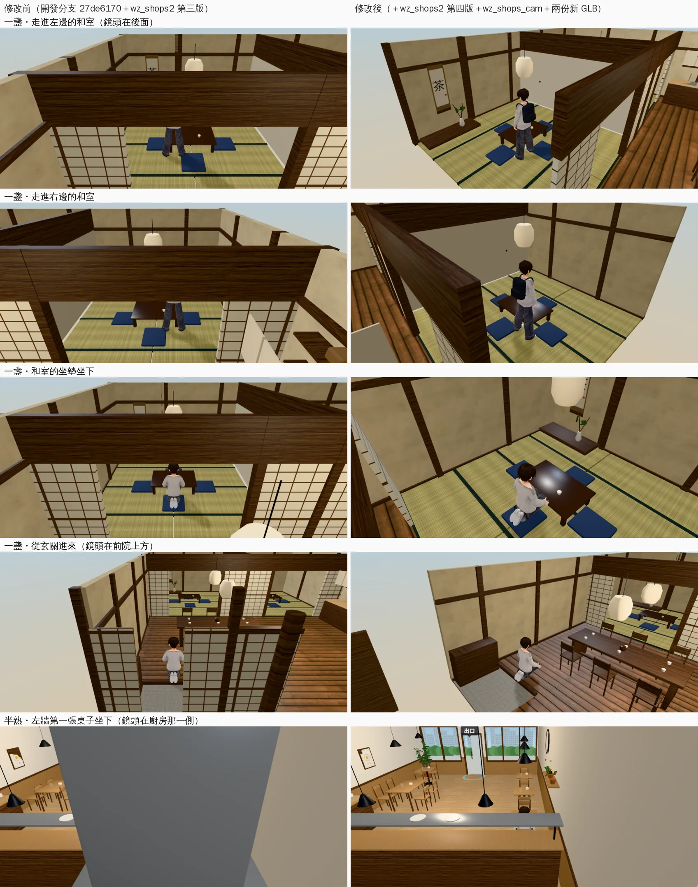
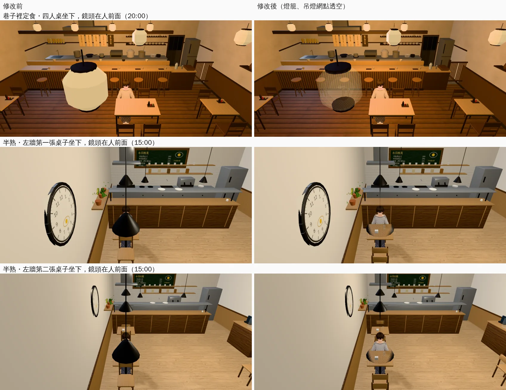

# 溫州街店家室內：鏡頭不會被隔間、排煙罩、吊燈擋住（鏡頭遮擋盤點）

帳號 A 的 LAWWW2，2026-10-22 05:4x～06:3x UTC。

- **狀態**：已交件；`READY_FOR_ART_REVIEW`（場景美術由使用者驗收）。
- 模型、patch、單元測試、遊戲內前後、座位檢查都做完了。鏡頭在人前面的角度（定食燈籠、半熟吊燈）j33 補拍好了，在下面「鏡頭在人前面」。
- **起因**：
  - j23（AA364 兩家新店）拍到半熟早午餐「坐下」那一張，鏡頭被一大塊灰色擋住（修改前、修改後都一樣）。
  - 查下去是排煙罩。為了確認還有沒有別的，寫了一支盤點工具，把溫州街五家店掃了一遍。

## 盤點工具（`tools/blender/env_second/room_cam_audit.py`）

- 跟隨鏡頭照 `engine3d.js` 的 `followCam` 算：室內俯角 0.38、溫州街店家 camDist 4.0、頭高 1.45 m。
- 每個站得住的點（0.5 m 一格）和每個座位、8 個方向，從鏡頭往人身上 12 個點拉線，看幾條被「不會淡出」的網格擋住。
- 不算的：會淡出的牆（`WALL_*`）；單面材質的背面（天花板只朝下）；設成網點透空的材質。
- 擋住三成以上的方向算「擋住」。
- 這是找問題用的，數字不是驗收標準；看到可疑的，都要到遊戲裡拍同一個位置確認（j30）。

| 店 | 開發分支現在 | 這次修改後 | 主要擋住的東西 |
|---|---|---|---|
| 一盞茶屋 | **29.3%**（2136 個方向） | **2.4%**，坐著的 0 | 和室前面的紙拉門那一排、兩間和室中間的襖：鏡頭退到隔間另一邊。正面的紙拉門、格子門、柱子、簷下的柱子、簷口不會淡出 |
| 半熟早午餐 | **11.4%**（1280） | **5.2%** | 排煙罩（掛在後牆上，後牆淡出了它還在）；從門口那一側看坐在左牆桌子的人，前一張桌子的吊燈擋住臉 |
| 阿德影印、林家乾麵、巷子裡定食 | 5.3%、4.4%、8.6% | 沒改（定食店的燈籠在 `wz_shops2.diff` 第四版） | 都是走道、櫃台旁邊零星的角度 |

剩下的 2.4%（一盞）：站在紙拉門的開口、沿著隔間看的方向，柱子在中間。剩下的 5.2%（半熟）：在出餐檯後面的走道（打工時才進去）往用餐區看，出餐檯上層的不鏽鋼板擋住。

## 改了什麼

### 正式模型（`tools/blender/env_second/wz_shops_interior.py`；三角形都沒變）

- **半熟**（`8d1ff6b1`）：
  - 排煙罩、開放層架、杯子、罐子掛在後牆上，改成歸後牆的組（後牆淡出時一起藏）。
  - 這份 GLB 也帶著 `612028f6` 的椅子方向修正（開發分支現在的椅子是反的，椅背卡在人和桌子中間）。
- **吊燈**（半熟、一盞，`38c4b821`）：燈罩、吊線、保溫燈改用自己的材質 `wzs_pendant`（和黑鐵同一個顏色），遊戲才能只讓吊燈網點透空。
- **一盞**（`38c4b821`）：
  - 正面那一排（柱子、格子門、拉開收在兩端的紙拉門）、簷下的五根柱子、簷口的封板，都歸 `WALL_engawa`（鏡頭在前院上方時一起淡出）。
  - 和室前面紙拉門那一排，兩端貼著左右牆的柱子，歸左右牆的組。
  - 床之間的床柱貼著後牆，歸後牆的組。

### 程式（`patches/wz_shops_cam.diff`，疊在 `wz_shops2.diff` 第四版上面）

- `src/zones3d.js` 的 `wzShop`：配置的 `camWalls`（`[x, z, 寬, 深]`）做成看不見的盒子，當跟隨鏡頭的牆（`zone.camCols`）。
  - 和教學館、宿舍、美國公寓同一套：擋到就拉近、抬高。
  - 比天花板高 2 m：鏡頭在天花板上方往下看時，越過隔間上緣的線也要擋。
- `src/data/wz_shops_layout.js`：
  - 一盞：`camWalls` 是紙拉門那一排（z −0.6，開口也算）和兩間和室中間的襖（往後延伸到後牆外 2 m）。`seeThru` 是和紙燈籠、吊線、前院樟樹的樹幹。
  - 半熟：`seeThru` 是吊燈、保溫燈（燈罩、吊線、燈泡）。
  - `seeThru` 的接法在 `wz_shops2.diff` 第四版（巷子裡定食的燈籠）。

## 測試

- `tests/wz_shops_cam_unit.js`（新，在 `wz_shops_cam.diff` 裡；Node，不需要瀏覽器）：
  - 在 Node 建出遊戲真正的一盞，鏡頭照 `followCam` 算。隔間照配置的 items（`shoji_wall`、`fusuma`）自己算，不是拿 `camWalls` 來量。
  - 檢查三件事：
    - 每個站得住的點、8 個方向，鏡頭到人的頭和腰的線，不會穿過紙拉門或襖；
    - 和室的坐墊坐下，鏡頭在前、在後都看得到人；
    - 網點透空的材質有標，其他材質不受影響。
  - 正式模型：一盞正面那一排、簷下的柱子、簷口都在 `WALL_engawa`；床柱歸後牆；兩家店的吊燈有自己的材質；配置寫的網點透空材質都在模型裡。
  - **修改前 12 FAIL**：鏡頭有 24.9% 的方向穿過隔間。**修改後 ALL PASS**：0%。
- `wz_shops2_unit`：套了這個 patch 以後照樣 ALL PASS。
- j30（開發分支 `27de6170`＋`wz0_prop_nav`＋`wz_shops2` 第四版＋`wz_shops_cam`＋新的 GLB，完整工作目錄）：`wz_shops_unit`、`wz_shops2_unit`、`wz_shops_cam_unit`、`street_props_nav_unit` ALL PASS。
- `seats_on_furniture`（j30）：半熟 12、定食 18、一盞 12 個座位，有問題 0。

## 遊戲內前後（佇列 j30；Playwright＋SwiftShader 手機橫向模擬，不是 iPhone）

左：開發分支 `27de6170`＋`wz_shops2.diff` 第三版（現在的樣子）；右：＋第四版＋`wz_shops_cam.diff`＋兩份新 GLB。同一個位置、同一個時間。

- **一盞・走進和室**：修改前鏡頭在紙拉門那一排的另一邊，門楣擋住上半身，只看得到腳。修改後鏡頭留在和室裡，看得到人、床之間、掛軸。
- **一盞・坐墊坐下**：修改前門楣橫在畫面上半，燈籠在鏡頭旁邊。修改後鏡頭在和室裡、從斜後方往下看。
- **一盞・從玄關進來**：修改前正面的紙拉門、柱子擋在人兩邊和前面。修改後正面那一排淡出，看得到玄關、茶席、後面的和室。
  - 這兩張的人是跪坐的姿勢：截圖工具前一張讓人坐下，換位置時沒有站起來。是截圖的問題，不是遊戲。
- **半熟・第一張桌子坐下**：修改前排煙罩的煙囪擋住整個畫面。修改後看得到整間店。
  - 但這個鏡頭在廚房那一側，坐著的人在出餐檯後面，只露出頭頂。
  - 這不是常見的鏡頭：從門口走進來坐下，鏡頭會在人的前面（門口那一側）。那個角度是吊燈的問題，排在佇列 j33 補拍。

### 鏡頭在人前面（佇列 j33：`fast_shots` 指定鏡頭方向）

從門口走進來、坐下面向門口時，鏡頭會留在人的前面（門口那一側）。這是最常見的坐姿鏡頭。

- **巷子裡定食**（燈籠，`wz_shops2.diff` 第四版）：鏡頭旁邊那一盞燈籠修改前是一大塊白色；修改後變成網點，看得到後面的桌子和人。
  - 燈籠上下兩圈深色的邊在共用的頂點色網格裡，沒有一起透空。
- **半熟**（吊燈，這一件）：左牆第一、第二張桌子，修改前前一張桌子的黑色燈罩剛好蓋住臉；修改後燈罩變成網點，臉看得到。

## 接法（LAWWW）

1. 先套 `wz_shops2.diff`（第四版），再套 `wz_shops_cam.diff`。
   - 在開發分支 `27de6170` 上，和 `wz0_prop_nav.diff` 疊著套也乾淨。
2. 換兩個檔（我的分支 `38c4b821`）：
   - `assets/models/env/second_ai/wz_brunch_interior.glb`（＋`.json`）
   - `assets/models/env/second_ai/wz_teahouse_interior.glb`（＋`.json`）
3. 跑 `node tests/wz_shops_cam_unit.js`、`wz_shops2_unit.js`、`wz_shops_unit.js`、`tests/seats_on_furniture.py`（半熟、一盞）。

## 還不到的地方（誠實寫）

- 一盞：站在紙拉門開口、沿著隔間看的少數方向，柱子還是在中間。
- 半熟：出餐檯後面的走道往外看，上層的不鏽鋼出餐板擋住一部分。
- 盤點是估計：站得住的點用配置的範圍和阻擋框估，不是遊戲的導航格。
- 定食店燈籠上下兩圈深色的邊沒有透空（在共用的頂點色網格裡）。
- 真機沒看過；遊戲內截圖是 Playwright＋SwiftShader 手機模擬。
