# 溫州街三家新店的室內：遊戲內截圖（ART-WZ3）

狀態：**READY_FOR_ART_REVIEW**（LAWWW2-B 2026-10-16 13:4x UTC）。等使用者看。

- 怎麼拍的：
  - 在 LAWWW-B 開發分支 f1651491 上拍，LAWWW-B 已經接成 `wz_brunch`、`wz_print`、`wz_teahouse` 三個區域；
  - 一盞換上這一版的 GLB；
  - `fast_shots.py`，1280×720，藏起玩家和路人；白天 11:00、晚上 19:30。
- 鏡頭設定：`tools/blender/env_second/shots/` 沒有另外存；座標寫在每張的說明。

## 半熟（早午餐）

| 白天：從門口往裡看 | 白天：從料理台後面往外看 | 晚上：從門口 |
|---|---|---|
| 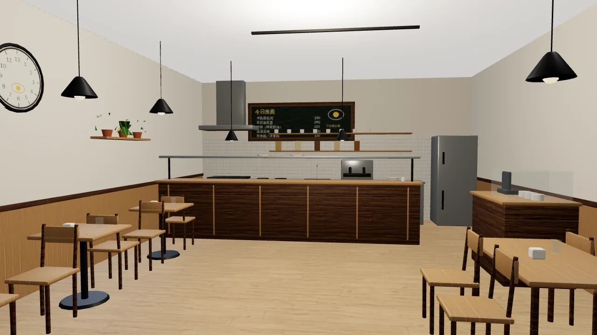 | 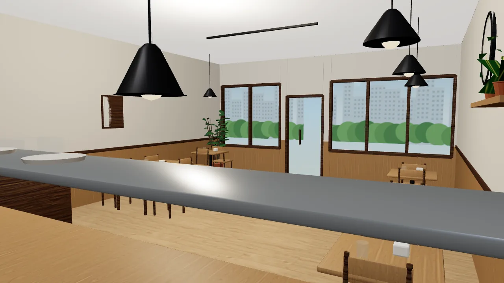 | 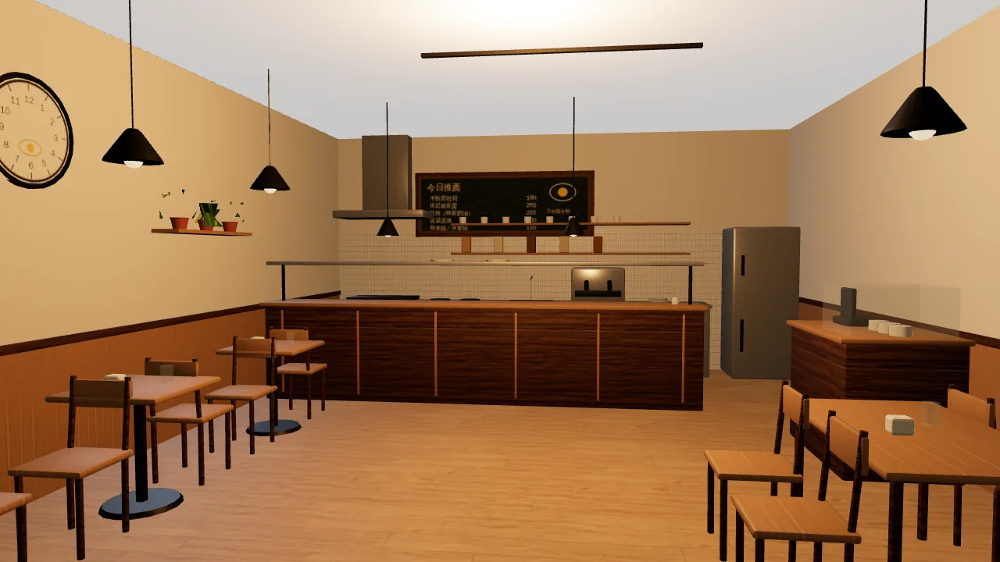 |

- 料理台、黑板菜單（字是畫進貼圖的）、吊燈、層架、冰箱、兩人桌和長桌。
- 窗外是貼圖的街景。

## 阿德影印輸出

| 白天：從門口往裡看 | 白天：從後面往外看 | 晚上：從門口 |
|---|---|---|
| 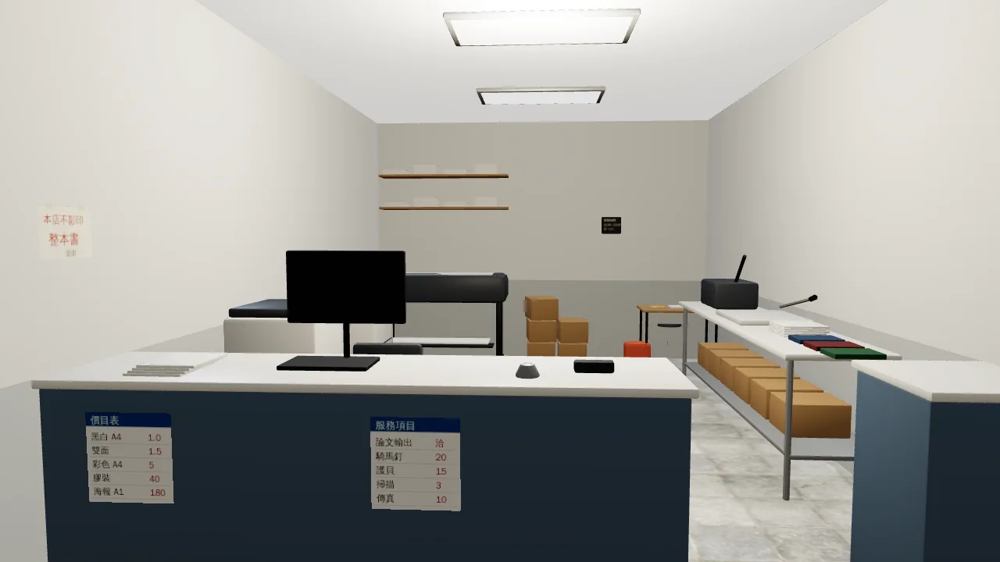 | 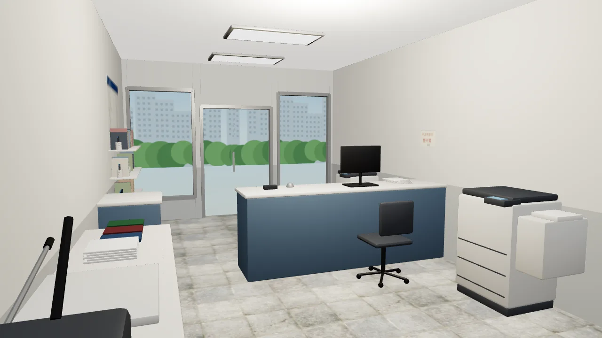 | 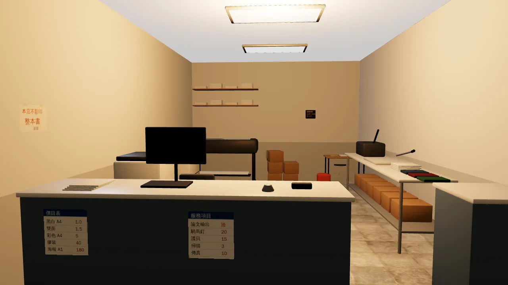 |

- 櫃台（客人那一面貼價目表、服務項目）、電腦、影印機、大圖輸出機、紙箱、文具架、日光燈。
- **要 LAWWW-B 決定**：晚上整間偏橘黃。
  - 原因：區域的 `room()` 用 `warm:true`，三家店都是。
  - 影印店是日光燈，建議 `wz_print` 用 `warm:false`，或讓燈色跟著店。

## 一盞（茶屋）

| 白天：玄關往裡看 | 白天：前面往和室看 | 和室 A（床之間） | 晚上：玄關 |
|---|---|---|---|
| 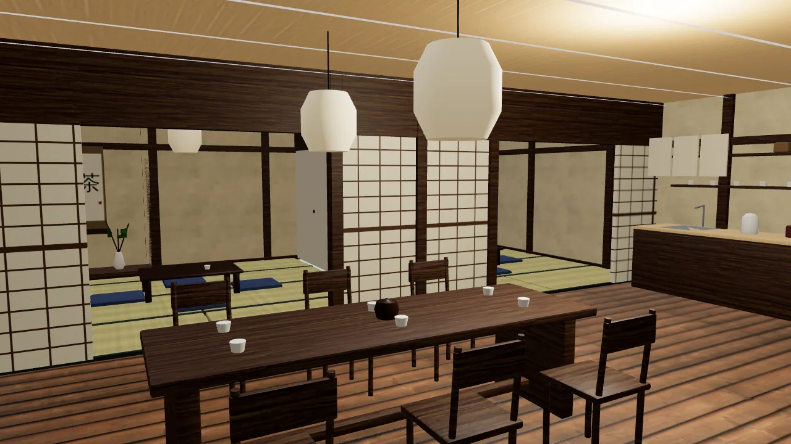 | 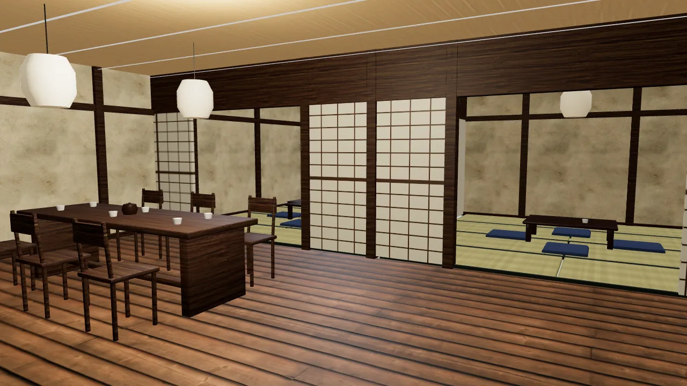 | 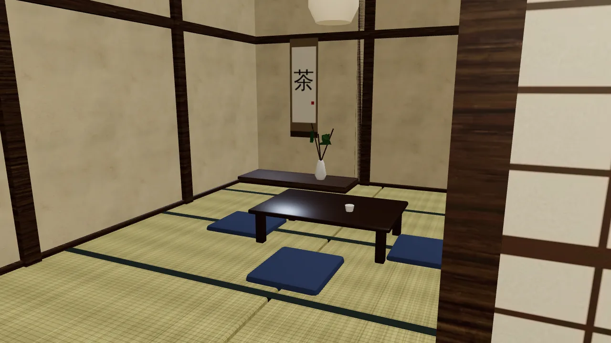 | 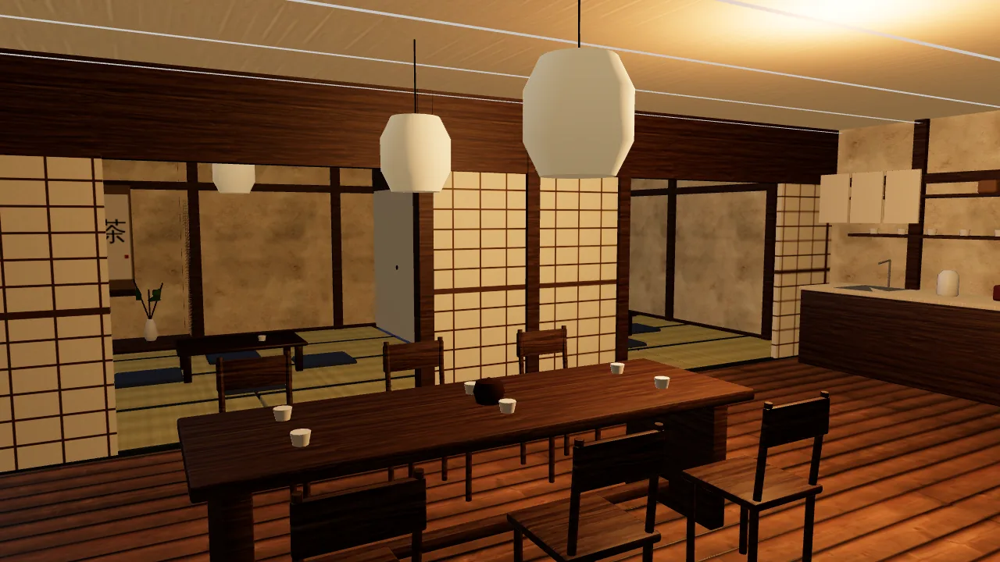 |

- 長桌、紙燈籠、紙拉門、兩間和室（矮桌、坐墊）、床之間（「茶」字掛軸、插花）、水屋。
- **這一版改的**：和室的聚樂壁（土牆）原本是照片貼圖的大塊污漬，遊戲裡像髒牆。
  - 改法：貼圖對比降到 0.4（b3lib `pbr` 新參數 `contrast`）、貼圖縮小。
  - 結果：細砂的乾淨土牆。
  - 左：之前；右：之後。
  - 白天的「前面往和室看」那張（`teahouse_front_day`）是改之前拍的。

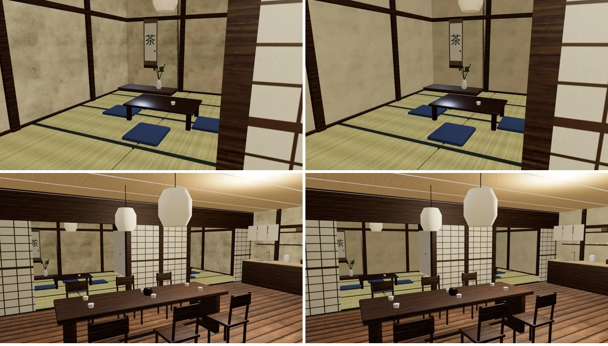

## 還沒達到的

- 三家的窗外都是貼圖，不是 3D 街景。
- 手機實機沒看過。
