# 溫州街三家新店（半熟、阿德影印輸出、一盞）室內光照烘焙（INTERIOR-AAA-REVIEW-1028；LAWWW2-B 2026-10-31）

- **起因**：INTERIOR-AAA-REVIEW-1028 第 5 節 P1（光照）。照「玩家多常去」的順序：便利商店（已整合 `d5bfed485`）→ 書店（已交 `3a40b7013`）→ 溫州街三家。
- **狀態**：`READY_FOR_ART_REVIEW`（交件時）。建築、場景只有使用者能標 `ART_APPROVED`。
  - 截圖是 Playwright＋SwiftShader（電腦 1280×720），不是實機。
  - 讀檔放位置、藏玩家和 NPC 是 [捷徑]。
- **這一包只做光照（P1）**，擺設（P4）沒做。

## 一、做法

- 三家同一支建模腳本 `tools/blender/env_second/wz_shops_interior.py`，烘焙腳本 `tools/blender/env_second/lightbake/bake_wz_shops.sh brunch|print|teahouse`。
- 重匯的白模和部署的 GLB 一樣：
  - 半熟、一盞位元組相同；
  - 影印店差 1,864 bytes，只差在便條貼圖 `shop_notes` 的 PNG 編碼（解出來的像素完全相同；圖集 10-22 加了巷口茶飲的菜單，影印店用的兩格沒變）。
- **遊戲不用改程式**：
  - 三家都走 `zones3d.js` 的 `wzShop` → `attachRoomGLB`，看到 GLB 的 `extras.lightmap` 就接（和 Café、麵店一樣）。
  - 這三家沒有另外加補光（便利商店 `CVS_BOUNCE`、書店 `BK_BOUNCE` 那種），天花板的自發光有光照貼圖時本來就不加。
  - 一盞的模型在遊戲裡整個移 −2.3 m、房間群組移 +2.3 m，兩者抵銷；光照貼圖照 UV 對應，不受影響。

### 方位（太陽從哪裡進來）

- 溫州街區域沒有轉方向（x 往東、−z 往北）。
- **半熟**：在街的北側（出口 (42,−4.1) 朝 +z），店面朝南。房間座標＝真的羅盤方位，下午兩點的太陽在西南（215°、仰角 38°），從店面的兩扇大窗照進來。
- **阿德影印**、**一盞**：在街的南側（出口朝 −z），店面朝北，太陽在屋子後面。
  - 影印店：白天只有店面進來的天光（太陽 0）。
  - 一盞：前院在北邊，主屋的影子蓋住緣側和前院靠屋子的那一半；樟樹的上半、矮木牆照得到太陽（房間座標 40°＝真的 220°）。

### 燈（照模型的燈具位置）

- **半熟**：
  - 五張桌子上方各一盞黑色錐形燈罩的吊燈：燈泡在燈罩裡，光往下，天花板只吃反彈光。
  - 出餐檯上方兩盞保溫燈，偏橘。
  - 天花板兩條軌道各三顆往下照的投射燈。
  - 白天燈也開著。
- **阿德影印**：
  - 天花板四片平板日光燈（往下照的面光源，冷白）。
  - 燈下 0.8 m 各一顆點光源：面光源只往下照，天花板只吃得到地板反彈的光，和便利商店、普通教學館同一個問題。
- **一盞**：
  - 茶席長桌上方兩盞、兩間和室各一盞和紙燈籠。
  - 燈罩是封閉的：烘焙時燈罩、燈泡當作不存在，和紙往四面透光。
  - 石燈籠的燈泡在石頭的火袋裡，看不到，只有遊戲的光暈，所以不另外放燈。

### 哪些烘、哪些照舊即時光（`--nolm`）

- **半熟**：
  - 烘：地板、天花板、牆、料理台（不鏽鋼：麵店 10-30 的教訓，大面積的不鏽鋼不烘會和旁邊對不起來）、桌椅、出餐檯、櫃台。
  - 照舊即時光：燈泡、燈罩、黑鐵（桌腳、時鐘框）、杯盤、罐子、小零件、黑板、時鐘、蛋的畫、植物、證書（TRACE_）。
- **阿德影印**：
  - 烘：影印機、櫃台、紙箱、文具架、工作檯。
  - 照舊即時光：燈管、燈框、窗框、黑色小零件、紙疊、牆上的紙。
- **一盞**：
  - 烘：地板、緣側、天花板、榻榻米、牆、柱、拉門、紙門、坐墊、矮桌、苔地、碎石、踏石、石燈籠、矮木牆。
  - 照舊即時光：樟樹（葉片卡、樹皮）、灌木、楓樹、杜鵑、燈罩、杯盤、小零件、掛軸、貓的照片、貓碗。
  - 隔壁公寓的牆也照舊即時光：16 m 寬、5.6 m 高的背景，退在矮木牆後面 4.5 m；烘的話要分掉一大塊貼圖。
- 外殼（`--shell`）：
  - 半熟、影印店：只開店面那一面（+z）。
  - 一盞：開前院那一面和上面——前院沒有屋頂，天光從上面進來；主屋有天花板擋著。

## 二、參數（試烘紀錄：64 取樣，遊戲內同角度和改前比）

- **半熟**：
  - 第一版（吊燈 60 W、保溫燈 12 W、軌道燈 15 W 點光源、天光 0.8）：天花板上六個亮斑。
    - 原因：軌道燈用點光源，離天花板只有 15 cm，往四面發光。改成往下照的 12 cm 小面光源。
  - 第二版：亮斑沒了，但白天整間偏灰，少了原本的暖色。
  - **右牆多兩塊方形的影子**：支線做完才出現的證書（`TRACE_SQ20`），遊戲平常藏著它，烘焙時卻在，影子被烘進牆裡。
    - 改成烘焙時當作不存在（`--hide`）。一盞的貓照片（`TRACE_SQ14`）、貓碗（`WZ_CATBOWL`）同樣處理。
  - 定案：天光 1.0、白平衡 1.0,0.94,0.86、白天燈 0.9。
- **阿德影印**：第一版就用。
  - 四片平板燈各 30 W（冷白 0.96,0.98,1.0）、燈下點光源 6 W、天光 0.6。
  - 白天、晚上都是冷白的日光燈，櫃台下、牆角有影子。
- **一盞**：第一版就用。
  - 和紙燈籠各 40 W（暖 1.0,0.84,0.64）、天光 1.0、太陽 1.4。
  - 前院的碎石、苔地有樹影，和室靠紙門那一側亮、裡面暗。
- 參數都寫在 `bake_wz_shops.sh` 開頭。
- 第一次試烘影印店時，我在它烘到一半改了腳本：bash 是邊跑邊讀，讀到錯位，出現 `lm: command not found`，影印店重烘。
  - 之後都從腳本的副本跑。
- 牆面在 64 取樣時是斑駁的雜訊，正式烘焙 512 取樣。

## 三、改前改後（同角度；左＝開發分支原樣，右＝光照烘焙 512 取樣）

- 鏡頭：`tools/blender/env_second/shots/wz_lm_shots.py`。藏玩家、路人；14:00、20:30。
  - 半熟：①門口往裡看 ②左牆三張兩人桌 ③出餐檯、廚房 ④四人桌、櫃台。
  - 阿德影印：①門口往裡看 ②櫃台 ③櫃台後面的工作區 ④兩台大影印機。
  - 一盞：①玄關往裡看 ②茶席長桌 ③右邊的和室 ④緣側往前院看。

### 半熟

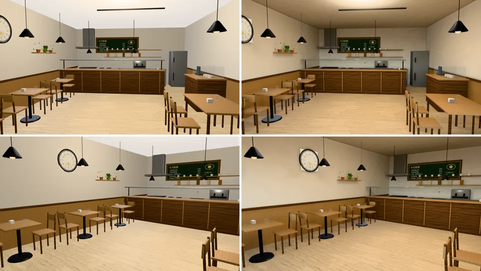

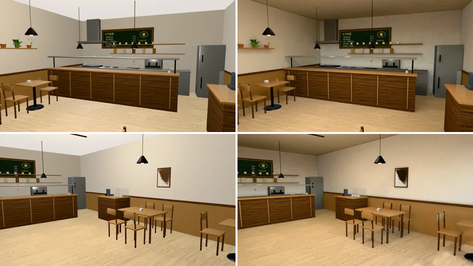

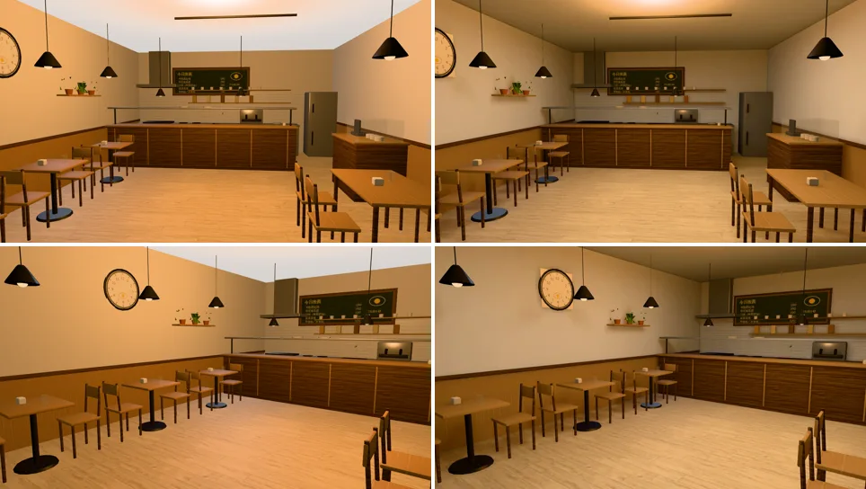

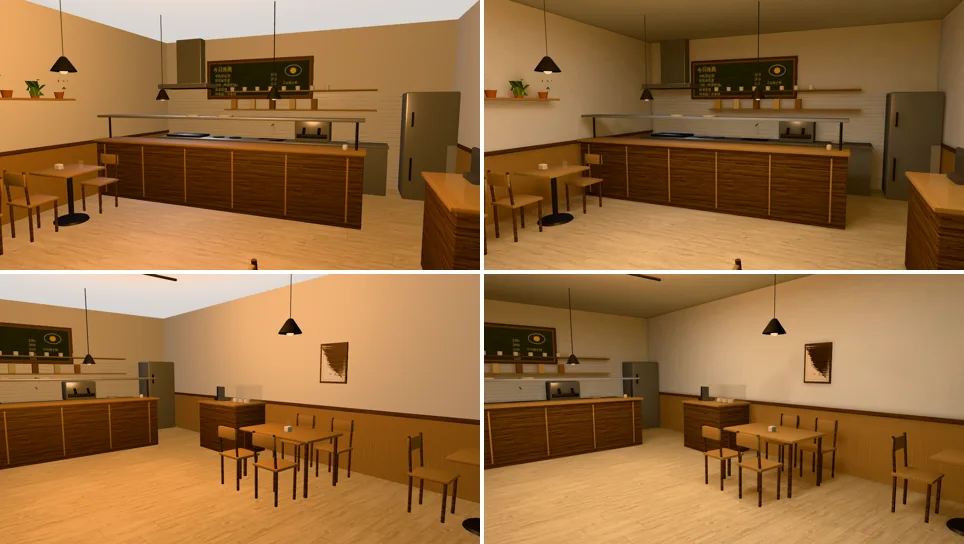

- 天花板因為燈罩擋住而暗下來，燈下亮一圈；出餐檯正面、桌子底下、牆角有影子。改前整間一樣亮，像攝影棚。
- 晚上原本整片偏橘；現在比較中性，天花板暗、桌面亮。
- 淺色木地板照舊是淺色（D112）。

### 阿德影印輸出

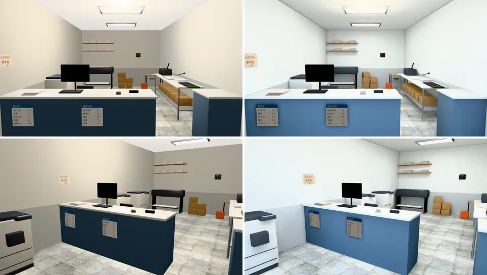

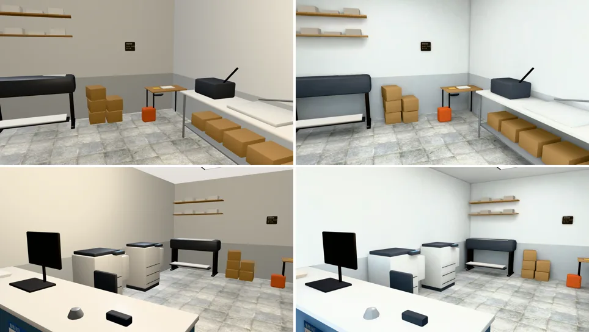

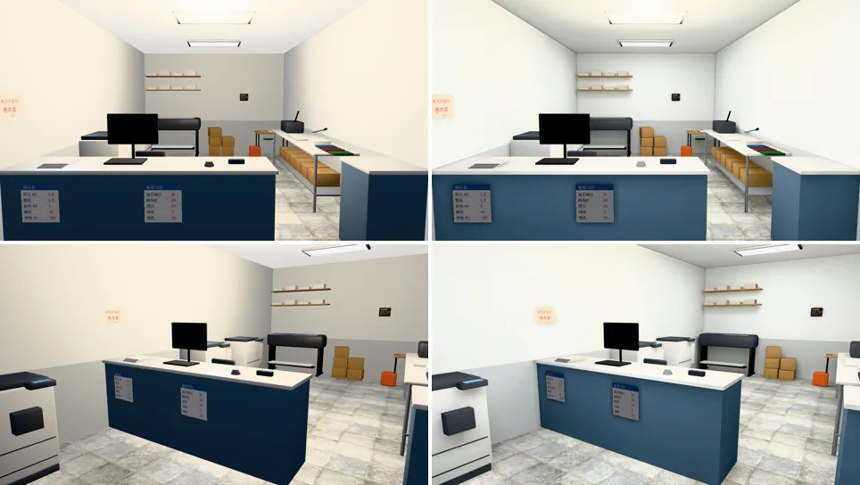

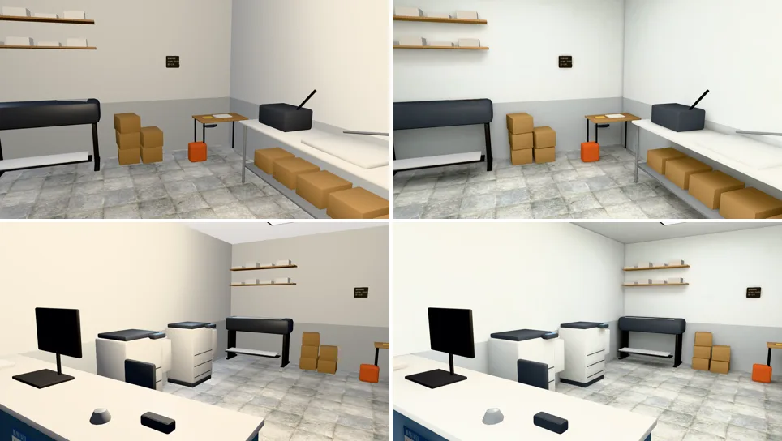

- 冷白的日光燈：牆從米色變成偏白，櫃台底下、影印機和紙箱底下、牆角有影子。
- 晚上和白天差不多亮：店面朝北，白天本來就只有一點天光，主要靠日光燈。

### 一盞

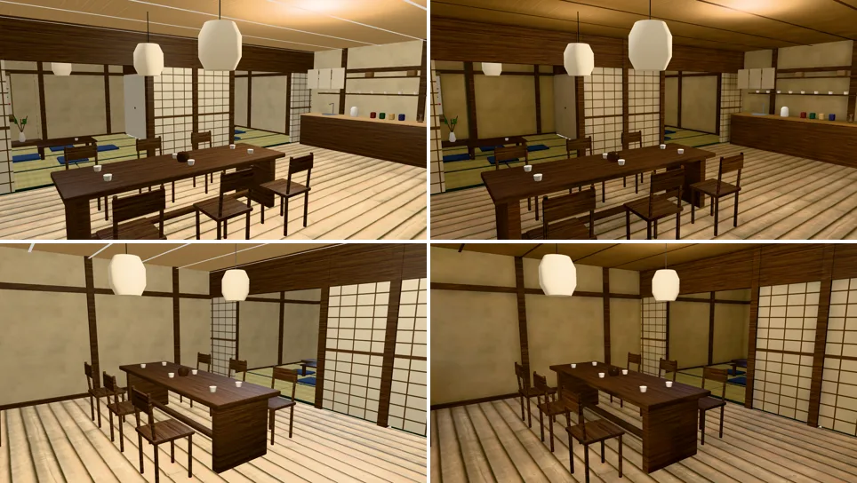

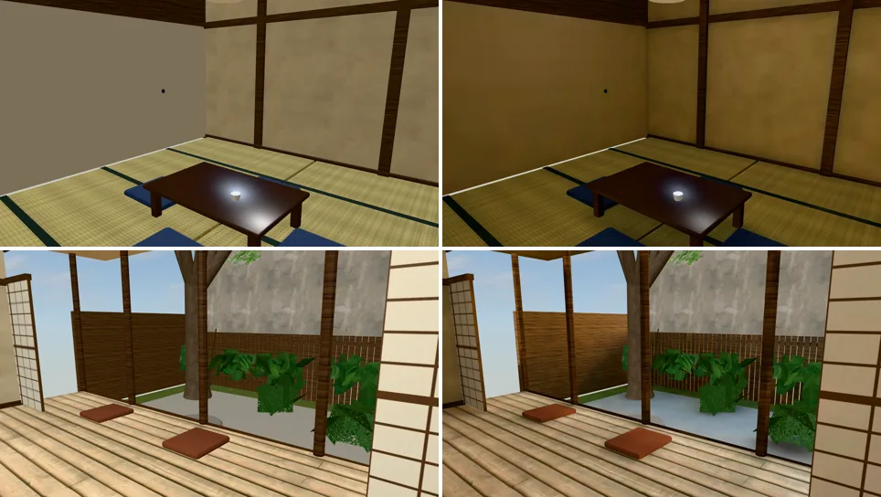

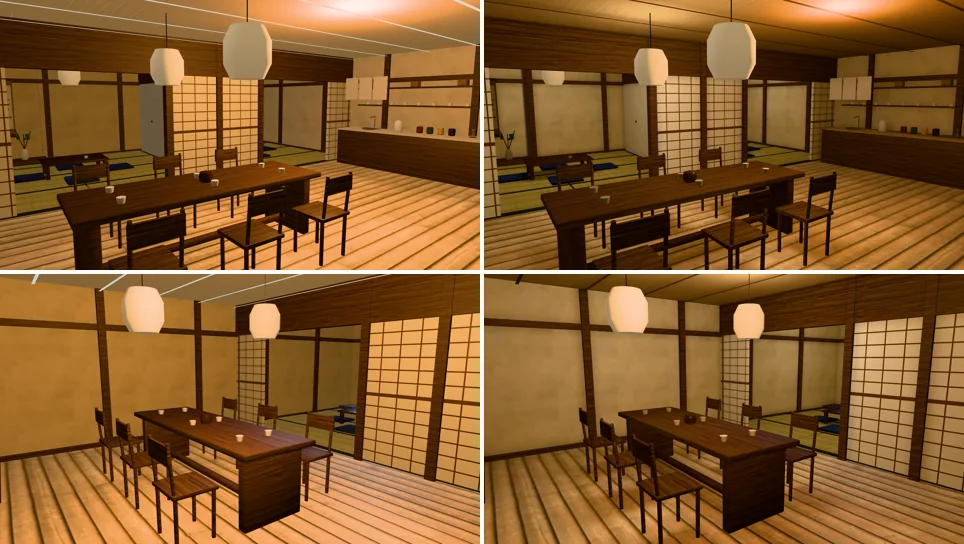

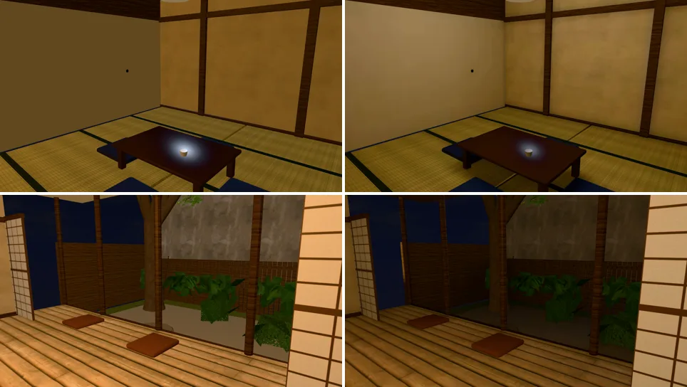

- 和室靠紙門那一側亮、裡面暗；茶席的天花板四角暗下來。
- 前院沒有太陽直射（主屋的影子），碎石、苔地是柔和的天光。
- 晚上燈籠下一圈暖光，天花板和牆角暗。

### 還不夠的（照實寫）

- 擺設（P4）沒做：客人、店員、正在做的事。這一包只做光。
- 小東西照舊即時光：杯盤、燈罩、植物、半熟的黑鐵桌腳；晚上離燈遠的地方，這些比旁邊烘過的桌椅亮一點。
- 一盞的樟樹、隔壁公寓的牆照舊即時光：前院烘過的地面和它們的亮度不是同一套光，白天看得出來一點。
- 烘焙的太陽不會動：半熟下午的陽光從店面照進來，早上、傍晚也是同一個角度。

## 四、檢查、效能、測試

（補）
