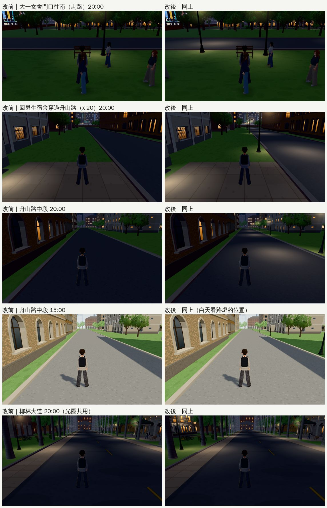

# 舟山路晚上不再整條是黑的（2026-10-24，LAWWW2-B）

- **來源**：巡查表第 3 節 P3「大一女舍門口 20:00：門口前的馬路幾乎全黑，路燈只照到草地和長椅」。
- **時機**：LAWWW-B 21:27 說照巡查表 P3 繼續、挑每天看得到的。
- **對**：開發 `a690484c8`（已含 ENGINE-SEASON-DUSK）。
- **環境**：Playwright＋SwiftShader 手機模擬（1280×720），不是 iPhone 實機。
- **狀態**：`READY_FOR_ART_REVIEW`。場景的 `ART_APPROVED` 只有使用者能標。

## 原因

- 舟山路（校園 `zones3d.js`，z 42.5～51.5、x −110～110，220 m）原本**沒有一盞路燈**。
  - 只有大一女舍長椅旁那一盞，燈臂朝長椅。
  - 遊戲內量：舟山路一帶發光的燈，只有那一盞和兩棟女舍的門廊燈。
- 晚上在大一女舍門口等人、回男生宿舍時穿過舟山路（往宿舍的路 x 17～23），馬路整條是黑的。

## 改法（`patches/zhoushan_lamps_1024.patch`，對 `a690484c8`）

1. **舟山路南側加 9 盞路燈**（宿舍那一側，路緣外 1.1 m，z 52.6）：
   - x −97、−75、−53、−31、−9、14、26、48、70，間距約 22 m；
   - 燈臂朝馬路，有路面光圈（`roadPool`），和椰林大道同一套；
   - −97 照女舍長椅後面那段馬路；14、26 夾著往男生宿舍的路；
   - 避開大一女舍 A、B 門口和長椅那一盞；
   - 每盞導航擋 0.5 m。放之前在遊戲裡量過每個位置站得住、1.2 m 內沒有別的阻擋。
2. **路面光圈加深度偏移**（`rp.material.polygonOffset`，factor −8／units −16）：
   - 第一版截圖發現光圈有放上去、但畫面上看不到。
   - 原因：舟山路和往宿舍的步道交疊，柏油被 `stripLayer` 往上推一層，斜看時把只高 1.5 cm 的光圈整個蓋掉。
   - 椰林大道是另一片路面，原本就看得到；加了以後改前改後一樣（下面最後一列）。

## 改前、改後（同一個鏡頭）

- **大一女舍門口往南**：長椅後面那段馬路有一圈路燈的光；左邊多一盞路燈。
- **回男生宿舍穿過舟山路**：路口兩側的燈、整條路一段一段的光圈。
- **舟山路中段**：前方一排路燈，腳下有光。
- **白天**：路燈立在宿舍那一側的草地邊，和椰林大道的燈一樣。
- **椰林大道**：改前改後一樣（光圈的深度偏移沒有副作用）。
- **數字**：
  - 白天 draw call 一樣（203）、三角形 +5.4k；
  - 晚上視野裡每盞燈多 3 個（光暈、燈下光圈、路面光圈）：舟山路中段 167 → 185；
  - 其他幾張的差異是同一時間 NPC 數量不同，不是燈。

## 測試（套 patch 後）

- **新測試 `tests/zhoushan_lamps_unit.js`**：修改前 FAIL，修改後 ALL PASS。
  1. 南側一排路燈：燈臂朝馬路、有路面光圈、導航擋 0.5 m、在路緣外；
  2. 相鄰間距 ≤ 25 m；女舍長椅後面的馬路、往宿舍的路口都在路面光圈裡；
  3. 不擋往宿舍的路、女舍門口，離長椅那一盞 ≥ 5 m；
  4. 路面光圈有深度偏移。
- `node tests/nav_buildings_unit.js`：ALL PASS。
- `tests/campus_layout_nav.py`：ALL PASS（主要地點站得住、走得到，舊存檔的位置，沒有 JS 例外）。
- **沒測**：`tests/reachability_all.py`（全遊戲 103 個互動點，要很久）、手機實機。
