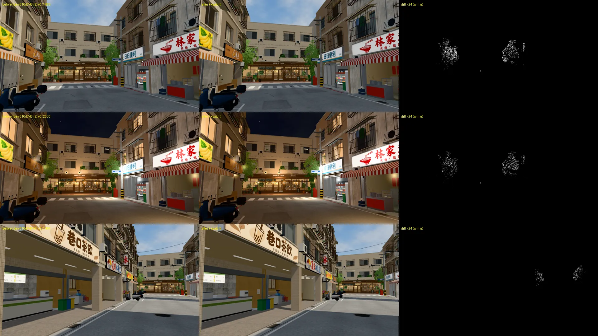

# 換區域不卡第三輪：室內（PERF-ZONE-ENTER-1018；LAWWW2-B 2026-10-30）

- **派工**（LAWWW-B 10-30，P1，D108／D99）：使用者回報過「換畫面卡一兩秒」（X14）。
  - 範圍：經濟系那一年最常進的室內——溫州街、兩點半 Café、阿鳳麵店、社科院圖書館、博思 101、宿舍。
  - 交 patch，附相關 Node 測試結果。
  - 改 `engine3d.js`、`game3d.js` 的載入流程要先告訴他；只動場景那一邊（`zones3d.js` 的區域 warmup 等）可以直接做。
- **結果**：只改 `src/zones3d.js`（場景這一邊），`engine3d.js`、`game3d.js` 沒動。
  - patch：`docs/art-rebuild/second_ai/patches/zone_enter_readback_1030.patch`（對開發 `610d74642`）。
- **狀態**：`READY_FOR_REVIEW`。讀像素那一段確定拿掉了；**整體換區域的時間在 SwiftShader 上看不出變快**（第三節第 2 點），要實機量。
  - 量測是 Playwright＋SwiftShader 電腦模擬（1280×720），**不是電腦、手機實機**。
  - SwiftShader 的 GPU 也用 CPU 模擬，時間比實機長很多，只拿來比前後、找卡在哪一段。

## 一、先查卡在哪裡

### 1. `Z3.warmup`、`Z3.prewarm` 本來就每個區域都做

- `game3d.js` 的 `enter`：黑畫面時 `Z3.prewarm`（只在電腦），淡入以後 `Z3.warmup`。
- 兩個都不分室內室外，所以「把 warmup 做進室內」本身沒有要改的。

### 2. 改前量測：18 站

- 工具：`tools/shots/interior_enter_probe.py --desktop`。
- 路線：公館 → 溫州街 → Café → 溫州街 → 麵店 → 校園 → 社科圖 → 校園 → 博思 101 → 校園 → 宿舍 → … 共 18 站。
- 結果：淡入以後最長的一格 3～8 秒，但這段時間裡新編的 shader 只有 0～5 個。
  - 室內的 shader 在黑畫面時大多已經編好、讀過結果：prewarm 讀了 75～93 個。
  - 所以淡入以後停住，主要不是編 shader。
- 資料：`data/ie_before_desktop.json`、`data/before_desktop.log`。

### 3. 用 profiler 看長的那幾格在做什麼

- 工具：`tools/shots/x14_prof.py --route …`。
- 資料：`data/prof_before.log`。
- 室內、溫州街最明顯的是兩段 `zones3d.js` 裡的 `getImageData`（讀畫布的像素）：

| 哪一段 | 什麼時候 | 停多久（SwiftShader） |
|---|---|---|
| `wzAtlasFaces`：招牌、門牌、店內景深卡合成一張 atlas，算每一格的平均色（atlas 空白處填這個顏色） | 進溫州街、Café（窗外的街）、校園，**黑畫面時**；溫州街每次進來都重做 | 1.4～3.4 秒 |
| `lmMean`：光照貼圖的平均亮度（晚上沒烘焙的小東西跟著暗多少，RT-NIGHT-1028） | 進 Café、麵店、社科圖、博思、宿舍，貼圖載好那一刻，常常剛好在**淡入時** | 1.5～4.7 秒 |

- **只有第一次讀像素慢**，後面幾次都在 30 ms 以內。
  - 讀的不是什麼大圖：4×4、32×32 的小畫布。
  - 原因：這兩個畫布在 GPU 上，讀像素要等 GPU 把排在前面的工作全部做完。前面排著的有：
    - 招牌的字；
    - 解碼、上傳那張 1024～2048 px 的光照貼圖；
    - 剛送出的 shader。
- 其餘長的格子大多是 `(idle)`：主執行緒在等 GPU（貼圖上傳、shader）。這部分見第四節。

## 二、改了什麼（`src/zones3d.js`）

1. **光照貼圖的平均亮度（`lmMeanAsync`）**：
   - 用 `createImageBitmap` 把圖縮成 32×32：瀏覽器在另外的執行緒解碼、縮小。
   - 再畫到 CPU 上的小畫布（`willReadFrequently`）讀像素，主執行緒不用等 GPU。
   - 同一個網址只算一次：再進同一個房間直接用記下的值。
   - 沒有 `createImageBitmap`，或它失敗時，照原本的 `lmMean`（也改成 CPU 上的小畫布）。
2. **atlas 每一格的平均色（`wzAvgC`）**：
   - 同一張畫布、或內容一樣的格子（板面資料＋畫布大小一樣），用記下來的值。
   - 第二次進溫州街、Café 的窗外街、校園，不再讀像素。
3. **招牌、門牌的畫布（`wzCanvas`）畫在 CPU 上**（`willReadFrequently`）：
   - 只用在 `wzSignTex`、`wzPlateTex`。
   - 這些畫布只拿來合成 atlas，原本的 CanvasTexture 不會傳上 GPU。
   - 第一次讀平均色也不用等 GPU。
4. **店內景深卡**（`TK.interiorTex`，`townkit3d.js` 的畫布，跨區域共用同一張）：
   - 第一次照舊讀一次，之後用記下來的值。
   - `townkit3d.js` 沒有改。

模型、貼圖、shader 都沒有改，畫面應該一樣；第三節第 3 點是同角度比對。

## 三、量測

### 1. `getImageData`（每一站總共停多久；`tools/shots/readback_probe.py`）

| 站 | 改前 | 改後 |
|---|---|---|
| 溫州街（第 1 次） | 2,328 ms（14 次） | 3 ms |
| Café | 5,096 ms | 0 ms |
| 溫州街（第 2 次） | 1,431 ms | 0 ms |
| 麵店 | 1,724 ms | 0 ms |
| 校園（第 1 次） | 67 ms | 0 ms |
| 社科圖 | 4,777 ms | 0 ms |
| 校園（第 2 次） | 957 ms | 0 ms |
| 宿舍 | 1,574 ms | 0 ms |

（改後 Café 的 atlas 一次都沒讀：窗外那條街的招牌和溫州街是同一批，用記下來的值。）

### 2. 18 站（`interior_enter_probe.py --desktop`；改前、改後各跑一次，同一條路線）

| 站 | 黑畫面（秒） | 淡入後最長一格（秒） | 淡入後多出來的（秒） | 淡入後新編 shader |
|---|---|---|---|---|
| gongguan → wenzhou（第 1 次） | 7.6 → 6.4 | 0.0 → 0.2 | 0.0 → 0.0 | 0 → 0 |
| wenzhou → cafe（第 1 次） | 6.8 → 8.3 | 5.8 → 6.1 | 4.8 → 4.9 | 0 → 0 |
| cafe → wenzhou（第 2 次） | 7.2 → 6.4 | 0.1 → 10.2 | 0.0 → 6.1 | 0 → 0 |
| wenzhou → noodle（第 1 次） | 8.0 → 5.8 | 3.1 → 3.4 | 1.7 → 2.8 | 3 → 19 |
| noodle → campus（第 1 次） | 6.4 → 6.2 | 4.4 → 5.6 | 3.1 → 6.5 | 0 → 0 |
| campus → soclib（第 1 次） | 11.1 → 5.3 | 3.1 → 6.4 | 1.4 → 5.7 | 1 → 12 |
| soclib → campus（第 2 次） | 6.8 → 6.2 | 5.0 → 6.0 | 7.8 → 8.1 | 0 → 0 |
| campus → boya（第 1 次） | 10.5 → 3.1 | 2.4 → 4.2 | 0.5 → 2.6 | 0 → 12 |
| boya → campus（第 3 次） | 6.5 → 6.6 | 5.7 → 5.3 | 8.6 → 7.8 | 0 → 0 |
| campus → dorm（第 1 次） | 7.9 → 4.9 | 5.0 → 3.1 | 2.2 → 0.8 | 1 → 18 |
| dorm → campus（第 4 次） | 8.0 → 9.3 | 0.2 → 8.3 | 0.0 → 4.9 | 0 → 0 |
| campus → soclib（第 2 次） | 7.8 → 10.8 | 5.8 → 3.5 | 4.1 → 2.1 | 4 → 4 |
| soclib → campus（第 5 次） | 7.8 → 7.0 | 5.3 → 5.5 | 3.1 → 8.6 | 0 → 0 |
| campus → boya（第 2 次） | 6.6 → 5.4 | 3.5 → 4.1 | 1.8 → 2.3 | 0 → 0 |
| boya → gongguan（第 1 次） | 4.6 → 7.4 | 7.3 → 5.0 | 5.5 → 3.1 | 0 → 0 |
| gongguan → noodle（第 2 次） | 4.6 → 7.6 | 4.7 → 3.2 | 3.6 → 2.1 | 5 → 5 |
| noodle → wenzhou（第 3 次） | 7.0 → 5.9 | 0.1 → 0.1 | 0.0 → 0.0 | 0 → 0 |
| wenzhou → cafe（第 2 次） | 11.3 → 23.8 | 8.6 → 2.3 | 6.9 → 0.5 | 0 → 0 |
| **合計** | **136.6 → 136.4** | | **55.3 → 69.1** | |

- 資料：`data/ie_before_desktop.json`／`data/ie_after_desktop.json`（＋`.log`）。
- **看不出整體變快。** 黑畫面合計一樣，淡入後多出來的合計反而多 14 秒。
- **同一站兩次差到 ±5～12 秒**，比讀像素省下的（每站 1.4～5 秒）還大，雜訊蓋過去了。
  - 例：Café 第 2 次的黑畫面，改後有一格 24 秒，那一格沒有新編 shader、也沒有讀像素（等 SwiftShader 的 GPU 執行緒）。
  - 改前同一站是 11 秒。
- **第一次進室內**（麵店、社科圖、博思、宿舍）：
  - 黑畫面合計 37.6 → 19.1 秒：讀光照貼圖像素那一下原本常常落在黑畫面裡。
  - 但淡入後新編的 shader 變多（0～3 → 12～19 個）：黑畫面短了，房間模型還沒編完就淡入。
  - 工作沒有消失，換了地方做。
- 結論：讀像素那一段確定拿掉了（第 1 點，直接量的）。玩家實際會不會覺得順，SwiftShader 量不出來：
  - SwiftShader 的 GPU 是 CPU 模擬，等 GPU 的時間（下一節）比實機長很多倍。
  - 讀像素是「主執行緒停下來等 GPU」，實機上 GPU 快，省下的比例可能比較明顯，但**沒有實機數字以前不能這樣說**。

### 2b. `tests/perf_scenes.py`（派工指定的量法；溫州街兩景，15:00）

- `perf_scenes.py` 量的是**站著不動時一格的成本**（draw call、三角形、一格多久）。
  - 沒有室內的場景，也不記進場時編 shader 的次數。
  - 進場第一次編 shader 的次數和時間改用 `interior_enter_probe.py`（上一點的「淡入後新編 shader」、`prewarm.settled`）。
- 這一包不改模型、材質、貼圖，照理不會變。量出來也差不多：

| 場景 | draw call | 三角形 | 一格（ms，SwiftShader） |
|---|---|---|---|
| wenzhou_mid | 300 → 294 | 49.3 萬 → 47.4 萬 | 17.3 → 16.7 |
| wenzhou_cafe | 233 → 236 | 35.0 萬 → 35.0 萬 | 13.1 → 17.4 |

- 差的那一點是路人走到哪裡：同一次量的幾個鏡頭平均也在變。
- 資料：`data/perf_scenes_before.json`、`data/perf_scenes_after.json`。

### 3. 招牌同角度比對（溫州街，白天 14:00、晚上 20:30）

- 工具：`tools/blender/env_second/shots/fast_shots.py`。
- 鏡頭：取自 `street_after.json` 前四個鏡頭，藏玩家、NPC，等正式模型到齊才拍。
- 結果：差異 0.05～1.25% 像素，全部在兩棵行道樹的葉子上（被風吹動，兩次拍的時刻不同）。
  - 招牌（林家、日日便利、巷口茶飲、夏日冰菓室、Café 的匾額）完全一樣，白天晚上都是。

### 3b. 晚上沒烘焙的小東西跟著暗多少（rtNight）有沒有變

- 光照貼圖平均亮度改成 `createImageBitmap` 縮圖以後算。所以把有光照貼圖的 13 間房間都用舊、新兩種算法各算一次（`tools/shots/rtnight_mean_cmp.py`）。
- 結果：小數點後 4 位全部一樣。
  - 社科圖 0.4569、法圖 0.5657、Café 0.7521、總圖大廳 0.8059、霖澤 0.8726、宿舍大廳 0.9409、博思 0.9454。
  - 其餘 6 間是 1.0000。
- 所以晚上的亮度不變。

### 4. Node 測試（測試樹＝開發 `610d74642`＋這一包）

- 全部 Node：**772 過、3 個 FAIL**。
- 3 個 FAIL 在開發分支原樣（`610d74642`，不加這一包）也 FAIL，失敗的項目一模一樣：
  - `aa497_supporting_unit.js`、`whois_unit.js`、`xinci_romance_unit.js`。
  - 這三支用 `git show <commit>` 讀 AA 的稿，那幾個 commit 不在我這份 clone 裡。
- 和這一包直接有關的都過：
  - `room_rtnight_unit.js`（rtK：Node 讀不到像素，照舊用預設 0.55）；
  - `library_hall_lightmap_unit.js`、`singleside_interiors_unit.js`、`night_forget_unit.js`。

## 四、還沒解決的（不是這一包能改的）

profiler（`data/prof_before.log`）和 18 站的資料裡，剩下停最久的是這三種：

1. **prewarm 讀編譯結果（`settle`）在黑畫面停 4～7 秒**：
   - `prewarmRun` 的 cap（2000 ms）只在兩個 shader 之間檢查。一個 `getUniforms` 就可能停很久，所以常常超過 cap。
   - 室內第一次進來，settle 讀了 74～98 個 shader，花 3.9～7.0 秒。
2. **一格 5～24 秒、沒有新 shader、主執行緒閒著（`(idle)`）**：在等 GPU（SwiftShader）把貼圖上傳、shader 編完。
   - 實機上這段會短很多，但多少要實機量。
3. **路人 VRM（`char.npc_*`）跟著那一格一起到**：
   - 看起來是那幾秒主執行緒被佔住，載好的回呼排在後面，不是 VRM 本身慢。

- 這三種都在載入流程：`zones3d.js` 的 `prewarm`／`warmup` 時間分配、`game3d.js` 的 `enter` 什麼時候淡入。照派工的說法要先問你，所以這一包沒有動。
- 建議下一步：**先在使用者的電腦上量一次**。
  - 現在沒有現成的量法：`?mdbg` 只顯示移動的資料，沒有換區域卡多久。
  - 要的話可以加一個小面板，網址參數才顯示，記「換區域：黑畫面多久、淡入後最長一格」（`E.lastPrewarm` 已經有黑畫面那一段）。這是 `game3d.js` 的事，你決定。
  - 有實機數字再決定要不要動 prewarm 的 cap、settle 的做法。
- SwiftShader 的數字只能比「卡在哪一段」，不能代表使用者電腦上多久。
