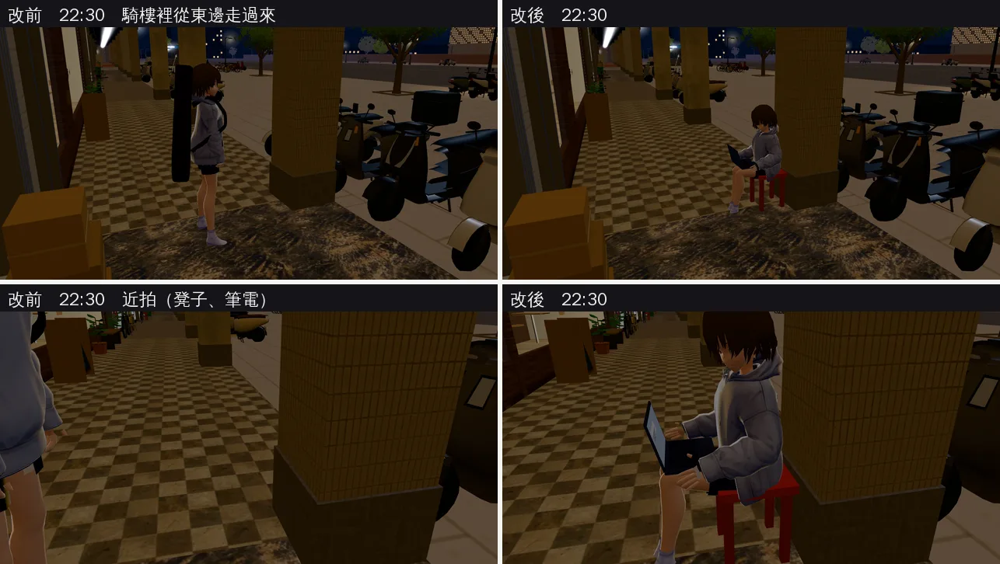

# 子晴在公館騎樓：坐在插座旁邊、筆電開著（ZQ-ARCADE-SEAT-1028；LAWWW2-B 2026-11-01）

- **起因**：BB-C 10-28。子晴（heroine_04）有三段公館作息，都是 linger 在 (16, 20.6)：
  - `c506_4_2`（Y2S2 週二、四 21:00～23:30，暑假照舊）
  - `c507_4_2`（Y3S1）
  - `c509_4_1`（大四）

  旁白寫「她坐在騎樓下的插座旁邊，筆電開著」，可是 3D 裡她站著、背著吉他、沒有筆電，騎樓也沒有可以坐的地方、沒有插座。
- **分工**：LAWWW-B 11-01 06:5x 同意做法 (a)(b)(c)，排在 D99 美術之後（美國第二輪、醉月湖已交）。
  - 我做：場景（凳子、插座、座位）和道具（筆電）。
  - LAWWW-B 改：作息（heroine_circle.js 那 4 筆）、坐下時開筆電。
- **狀態**：`READY_FOR_ART_REVIEW`（場景＋道具）。
  - 截圖是 Playwright＋SwiftShader（電腦 1280×720），不是手機實機。
  - 讀檔到公館 22:30、直接放子晴、`GAME.sitAt` 讓她坐下是 [捷徑]（作息那一段還沒改）。
- **沒有改人物模型**（D99）。筆電是道具，掛在髖部。

## 一、做了什麼

1. **(a) 凳子、插座**（`wz_shopkit.py` 的 G08 水果行 clutter → `gongguan_shops.glb`）：
   - G07／G08 交界那根騎樓柱子（x 15.6、z 19.03～19.58），靠騎樓那一面放一張紅色塑膠凳 (15.6, 19.8)。和麵店、滷味攤門口同一個原型。
   - 柱子那一面離地 35 cm 一個白色插座：上下兩個插座，各有兩條直的插孔加接地孔。世界 x 15.81，在她左手邊。
   - 插座是新原型 `p_outlet`，可以朝本地 −x 或 −z；clutter 多一種 `('outlet', x, zc, y, 'z')`，離地的東西不登記腳印、不擋路。
   - GLB 只有兩個網格變了（逐個網格比過）：
     - `wz_in_shop` +32 頂點（凳子）；
     - `cafe_vc_wz_matte` +280 頂點（插座）。
   - 節點 163、網格 48、材質 39 都沒變，draw call 不變，三角形 +140。
   - `gongguan_shops.props.json` 多一個凳子的腳印 `sk_stool_r_G08` [15.43, 19.63, 15.77, 19.97]。
2. **(b) 筆電道具 `laptop_lap`**（`tools/blender/char_second/prop_pool.py` → `assets/models/char/second_ai/laptop_lap.glb`，9e407dd2d）：
   - 288 面、2.3 萬 bytes，深灰鋁殼、螢幕亮著，沒有牌子、商標（D77）。
   - 接法（patch）：
     - `assets3d.js` 一行 manifest；
     - `props3d.js` 一行：髖部，`pos [0, 0.06, −0.26]`，`sit:'only'`，`hidden:true`，和傅鐘長椅的保溫瓶 `thermos_bench` 同一種。
     - `character3d.js`：子晴的 `MODEL_PROPS` 多一個 `'laptop_lap'`。只有這一處、一個字串。
   - 坐下而且 `CHAR.setProp(obj,'laptop_lap',true)` 了才看得到。
3. **(c) 座位**（`zones3d.js` 的公館）：
   - `seats` 加一張「坐在騎樓的板凳」(15.6, 19.8)，yaw 0，背靠柱子、面向騎樓。
   - 玩家的互動點（半徑 1.4）。
   - `GG_PROP_BLOCKS` 加凳子那一塊。
   - 只在正式模型有登記時放（凳子只在 GLB 裡）。

## 二、第一版放錯邊（照實寫）

- 第一版放在柱子靠馬路那一側 (16.15, 19.35)、面向馬路。
- 遊戲內一看不行：
  - 騎樓外停了一整排機車，從馬路那邊看她整個被擋住；
  - 從騎樓裡走過只看得到她的背。
- 改到柱子靠騎樓那一面、面向騎樓：騎樓裡走過來看得到她的正面和腿上的筆電，機車在柱子另一邊。

## 三、改前改後（同一個鏡頭，22:30）

- 坐下時吉他收起來（遊戲原本坐下就會這樣），沒有穿進柱子。
- 效能（騎樓那個鏡頭，同一份存檔）：draw call 217 → 218、三角形 39.0 萬 → 39.5 萬（+5.3k）。
  - 新增的模型只有筆電 288 面、凳子和插座 140 面；
  - 其餘是她換了位置、姿勢以後，畫面裡和影子裡的東西不一樣（同一個鏡頭、人站的地方不同），不是新增的模型。
  - draw call +1：多了筆電、少了收起來的吉他。
- **還不夠的**：
  - 插座在她左手邊、離地 35 cm，這幾個鏡頭被她的腿和凳子擋住，看不到。要看得到得放高一點（例如 1.1 m），可是那樣不像騎樓柱子上的插座。先照常見的高度。
  - 筆電沒有電線接到插座。人物會動，電線要跟著人走，是另一件事。
  - 「馬路那一側往騎樓看」那一張沒拍成：SwiftShader 太慢，鏡頭沒切過去。從第一版的截圖看，馬路那一側會被停的機車擋住一半。

## 四、給 LAWWW-B（作息那一段，你的檔案）

- heroine_circle.js 子晴那 4 筆（`c506_4_2` 兩筆、`c507_4_2`、`c509_4_1`，at (16, 20.6)）改 `act:'read'`。
  - 可以不寫 `seatAt`：story3d.js 的 `seatNear` 找 3.5 m 內最近的空位，(16, 20.6) 到凳子 0.89 m。
  - 要寫就是 `seatAt:[15.6, 19.8]`。
- 坐下時 `CHAR.setProp(n.obj, 'laptop_lap', true)`，離開時關掉。道具有 `sit:'only'`，站起來本來就看不到。
- 玩家先坐了那張凳子，她就沒有位子：`seatNear` 找不到空位，照舊用 linger 站著。要不要另外處理由你決定。
- `c504_4_3`（2026 暑假，公館騎樓的咖啡店，at (12, 20.6)）的旁白也有「筆電上是一隻像素的貓」。她在那裡如果坐下，也可以開同一個道具。那一段要不要改照你的判斷。

## 五、怎麼套

1. **換二進位**（從我的分支 `claude/funny-albattani-iawshm` 拿）：
   - `assets/models/env/second_ai/gongguan_shops.glb`、`gongguan_shops.json`、`gongguan_shops.props.json`；
   - `assets/models/char/second_ai/laptop_lap.glb`（`laptop_lap.json` 是說明）。
2. **patch**：`docs/art-rebuild/second_ai/patches/zq_arcade_seat_1101.patch`（對開發 `bd7754e2e`，`git apply --check` 過）：
   - `zones3d.js`（公館座位、`GG_PROP_BLOCKS`）
   - `assets3d.js`、`props3d.js`、`character3d.js`（筆電道具，各一行）
   - 新 `tests/zq_arcade_seat_unit.js`
3. **重建**：`/opt/blenv/bin/python tools/blender/env_second/wz_street.py -- --set gongguan`（招牌圖集沒改，不用重跑 `sign_atlas.py`）。

## 六、測試

- 新 `tests/zq_arcade_seat_unit.js`（Node，不需要瀏覽器）：
  - 開發 `bd7754e2e` 原樣：**FAIL 4**（④ 是不退步的檢查，原本就 PASS）；
  - 只套 patch、模型沒換：FAIL 2；
  - patch＋新模型：**ALL PASS**。
  - 檢查項目：
    - ① 座位、互動點；
    - ② 「插座旁邊」那 4 筆作息點離座位 3.5 m 內；
    - ③ 模型的凳子和 `GG_PROP_BLOCKS` 一致；
    - ④ 凳子前面站得住、騎樓照樣走得通；
    - ⑤ 筆電道具的 manifest、檔案、props3d、`MODEL_PROPS`。
- `tests/street_props_nav_unit.js`（街上雜物的腳印和導航一致）：新模型＋patch ALL PASS。
- 全部 Node 的結果寫在交件訊息。
- 沒跑：`tests/gongguan_layout_nav.py`、`tests/reachability_all.py`（瀏覽器，慢）。導航只多了凳子 0.34 m，緊貼柱子靠騎樓那一面，騎樓還有 2 m 寬，Node ④ 有檢查。手機實機也沒跑。
