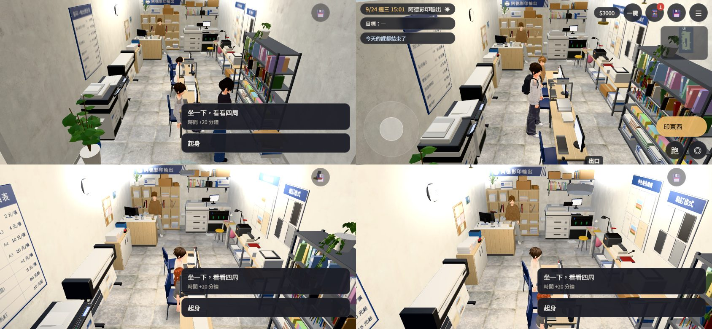
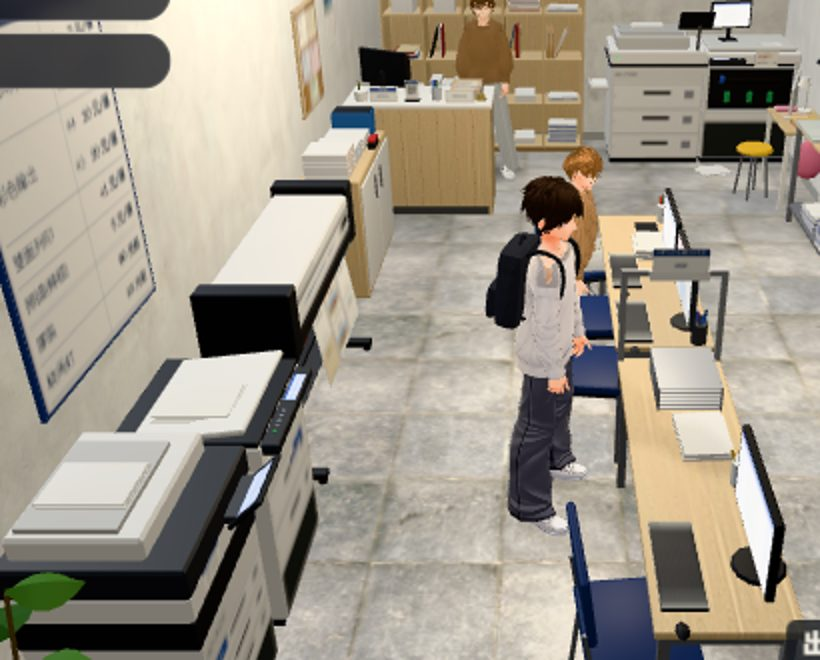

# ADE-SEATS-NAV-1104：阿德影印的座位、站位、打工位置

LAWWW2-C，2026-11-05（P2，LAWWW-C 11-04 派；BB-C 11-04 13:00 依 CC 的 ADE_int_in、ADE_int_job）。

狀態：**patch 交 LAWWW-C**（`ade_seats_nav_1104.patch`，在開發分支 1344de13d 上乾淨）。Node 測試修改前 FAIL 2、修改後 ALL PASS；瀏覽器還沒跑（D131）。

## 先說結論：四件事裡，兩件是探針的判斷、兩件是真的

| BB 看到的 | 實際是什麼 | 怎麼處理 |
|---|---|---|
| 四張電腦椅「坐下了」FAIL（0、2、3 號） | **有坐下**：CC 的截圖裡玩家坐在椅子上，跳出「坐一下，看看四周／起身」的選單（下圖）。選單開著時 `player.busy` 一直是 true，探針等的是「`seat` 而且不 busy」，等 20 秒等不到 | 探針改條件（給 CC-C，見下面） |
| 1 號椅「互動按鈕是印東西」 | 那一刻 **1 號椅有客人坐著**（截圖：玩家背後那張椅子上有人）。有人坐的位子遊戲本來就不顯示「坐下」（`E.nearestInteractable` 跳過 occupied），最近的就變成「印東西」 | 遊戲沒錯。探針要先看那張椅子有沒有人（CC 的 CUST 那一段也量到客人坐在 (−0.07, 0.85)） |
| 2 號椅「點地 222 次到不了」 | 探針點的是**椅子正中間**（站不住的地方），遊戲把人帶到椅子旁邊 0.7 m 的走近點；探針「到了」的門檻比 0.7 小，就一直點。那時按鈕已經是「坐下來用電腦」，按了也坐下了（截圖） | 探針改成走到 `GAME.seatApproach(seat)`（遊戲自己挑的走近點） |
| 打工三個站位「都沒到過」（a 1.94、b 2.04、c 1.1 m） | **真的**：①一班的程式（jobs3d.js `runShift`）只播三段對話、快轉時間，從來沒有讀配置的 `work.{a,b,c}`，人一直站在走進來的地方；②a 站位是櫃台後面的辦公椅，貼著西牆，前、後、兩側的走近點都站不住（櫃台、牆、後櫃、椅子本身），照座位的走法也走不到 | patch：辦公椅加走近點 `ap`；`JOBS.station` 每一段開始前把玩家帶到那一段的站位 |





## patch 改了什麼（`ade_seats_nav_1104.patch`）

1. **`src/data/ade_layout.js`、`src/data/wz_shops_layout.js`（print）**：
   - 櫃台後面的辦公椅（seats 的 `office_chair`、`work.a.me`）加 `ap: [-1.1, -3.4]`。
   - 這一點是櫃台後面那條通道的西端：站得住，離椅子 0.76 m，從店門口走得到。
   - `GAME.seatApproach` 本來就優先用 `seat.ap`（Café 的沙發也是這樣）。
2. **`src/jobs3d.js`（LAWWW 的檔，提案）**：
   - 新增 `S.station(GM,k,seg)`：讀 `WZ_SHOPS_LAYOUT[店].work[seg].me`。
     - 站的：`GM.walkTo` 走過去、轉向；
     - 坐的：`GM.seatApproach` → `GM.walkTo` → `GM.sitAt`；
     - 下一段先 `GM.standUp`。
   - 人不在那一間店裡（`G.zone`）、配置沒有這一段，就不動。
   - `runShift` 在 `sg.a`（接單）、`sg.b`（做的時候）、`sg.c`（交件）前面各叫一次。
   - 先只開阿德影印（`S.STATION_SHOPS={copy:'print'}`）。早午餐店、茶屋的 `work` 還沒對過新室內，例如茶屋 a 是掃院子，要不要開 LAWWW 決定。
   - 老闆、阿芃的站位（`boss`、`kid`）這一版沒有搬，人還是照原本的生成位置。要搬的話在 `S.station` 裡加，阿德的 NPC 怎麼找要照 story3d.js 的 clerk。
3. **`tests/ade_seats_nav_unit.js`（新）**：見下面。

## 測試（`node tests/ade_seats_nav_unit.js`，開發分支 1344de13d）

| 檢查 | 修改前 | 修改後 |
|---|---|---|
| ① 四張客人椅子：按鈕範圍裡站得住、最近的互動是那張椅子（「印東西」沒蓋掉）、從店門口走得到 | PASS | PASS |
| ② 站著的客人（3）、阿德（clerk、staff 3）、打工 b／c 的 me、老闆（3）：站得住、從店門口走得到 | PASS | PASS |
| ③ 打工 a（辦公椅）有走近點 ap、站得住、走得到、離椅子 0.9 m 內 | **FAIL**（沒有 ap，候選點都站不住） | PASS（0.76 m） |
| ④ `JOBS.station` 一班三段都走到 0.6 m 內、a 坐下、b 以後起身；人不在店裡不動；`runShift` 三段前都叫 | **FAIL**（沒有這個函式） | PASS |

- ①② 修改前就 PASS：店裡的導航本來就走得通。BB 看到的座位問題是探針的判斷，不是導航。
- 會讀 jobs3d.js、wz_shops_layout.js、ade_layout.js 的其他 51 支測試，在修改後全部 PASS。
  - 包括 aa420_jobs、aa433_jobs、jobs_from_start、jobs_exam_clash、ade_v1c、seat_reach、shop_diners、spawn_exit、quick_travel。

## 給 CC-C：探針 `cc_ade_int_probe.py` 三個地方

1. IN 的「坐下了」：
   - 改成 `!!GAME.E.player.seat`，不要求 `!busy`：坐下以後的選單開著時一直是 busy。
   - 或改成「seat 而且 #choices 有『起身』」。
2. IN 每一張椅子先看有沒有人坐：
   - `GAME.E.npcs.some(n=>n.seat&&Math.hypot(n.seat.x-x,n.seat.z-z)<0.35)`。
   - 有人坐就記「有人坐」、跳過，不算 FAIL。
3. 走過去的目標：
   - 用 `GAME.seatApproach(座位)` 回傳的那一點，不用椅子正中間。
   - 椅子站不住，遊戲會把人帶到旁邊 0.6～0.9 m。
- JOB：LAWWW-C 接了這個 patch 以後重跑。三個站位應該都在 0.6 m 內，a 是坐著。

## 接法（LAWWW-C）

```
git apply docs/art-rebuild/second_ai/wip/ade_seats_nav_1104/ade_seats_nav_1104.patch   # 在 1344de13d 上乾淨
node tests/ade_seats_nav_unit.js
```

## 還沒做、還沒驗

- 瀏覽器（D131）：打工一班走三個站位的畫面。CC 的 JOB 重跑，看坐辦公椅的樣子、走路會不會撞到阿德。
- 老闆、阿芃跟著段落換位置：這一版沒做。
- 早午餐店、茶屋的站位：沒開。
