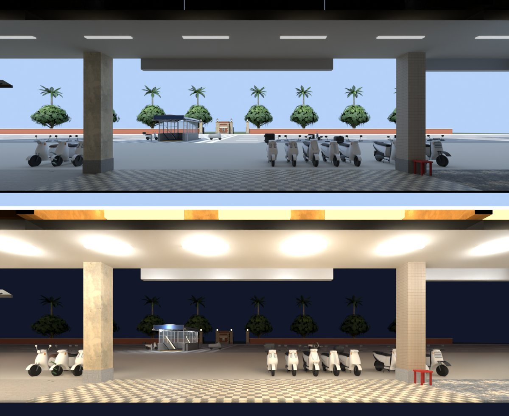

# afar café 窗外看得到公館了（AFAR-VIEW-1105，LAWWW2-C 2026-11-05）

- 使用者 08:3x：「AFAR看出去不太像公館」。
- 原因：afar 模型裡的窗景卡（`WALL_front_VIEW`，材質 `afr_window_view`）貼的是木曜日的樹（`mok_view`），所以看不到羅斯福路、騎樓、車。
- 改法：在 Blender 用公館的正式模型拍「站在 afar 店裡往外看」的照片，白天、晚上各一張，遊戲裡換上去。

上圖是 Blender Cycles 渲染，**不是遊戲畫面**。照片貼到窗景卡上時左右鏡像過，圖上是人眼看的方向。

## 怎麼拍的

- 工具：`tools/blender/env_second/wz_window_view.py`，這一包加了 `--gg-street` 和 `--clip-start` 兩個選項。
- 場景：
  - 公館的正式模型 `gongguan_shops`、`gongguan_far`、`gongguan_mrt_exit`、`campus_gate`、`street_trees`（校門裡面一排）。
  - 騎樓前停的機車用 `scooter.glb`。
  - 路面照遊戲 `zones3d.js` 公館的尺寸：南側人行道 z 4～20、羅斯福路 z −31～4（車道線、黃色雙實線、校門口斑馬線）、北側人行道、校門兩邊的紅磚圍牆 z −46。
- 鏡頭：
  - afar 在店面街第 7 棟（中心 x 10.5），店面玻璃在公館 z 22。
  - 鏡頭放在窗景卡正中間後面 6.5 m，公館座標 (10.5, 1.4, 26.07)，朝北。
  - 視野剛好蓋滿那一片 16 × 6.5 m 的卡（鏡頭 14.6 mm、shift_y 0.053）；自己這一棟的玻璃、店內卡用 `--clip-start 4.6` 剪掉。
- 白天照遊戲 14:00 的太陽（`--hour 14`）；晚上照 `--night`（騎樓燈、路燈）。
- 輸出 1600 × 650，webp 47 KB、54 KB。

## 改了什麼

- `src/zones3d.js` 的 `ggAAattach`（公館 AA 的店共用）：加 `GG_VIEW` 表，現在只有 afar。
  - 窗景卡白天換 `afar_view_day.webp`、晚上換 `afar_view_night.webp`，晚上不再調暗。
  - 照片載入失敗就換回模型原本那張，照舊調暗。
  - 其他店（頁間、青木、Daybreak）照舊。
- **順便換 afar v1d**（企劃線 `a7f16be34`；LAWWW-C 07:24「窗景做的時候一起換比較省事就一起交」）。
  - 後牆窗卡視線那一段加兩層開放層板、吊燈、黃金葛；原本 along 0.9 那幅畫拿掉。
  - 配置只動那一筆擺設（`items`），阻擋、座位、互動點都沒變。

## 測試（Node，不用瀏覽器）

`node tests/afar_view_unit.js`：ALL PASS

- ① 照片兩張都在、長寬比 2.46（＝窗景卡 16 × 6.5 m）。
- ② 白天換成白天那一張、不調暗。
- ③ 晚上換成晚上那一張、不調暗；回到白天換回來。
- ④ 頁間的窗景卡照舊（晚上調暗、不換照片）。
- 修改前（開發分支 `3574b5462`）：FAIL 4。
- 換 v1d 以後一起跑、ALL PASS：`afar_view_unit`、`gg_shops2_1104_unit`、`seat_reach_unit`。
- 瀏覽器沒跑（D131）。請 CC 拍：afar 窗邊長桌往外看，白天、晚上。

## 先將就的

1. 窗景是一張平面照片（視差照 W3 的窗景卡做法），走動時對面的校門不會跟著換角度。
2. 車道上沒有在開的車，只有騎樓前停的機車，和幾台停在路邊的。遊戲裡也沒有車流。
3. 校門裡面的樹是同一組模型重複擺的，看得出一樣。
4. 晚上騎樓的燈比較亮（Blender 的燈光照遊戲的 GLOW 位置算的）。看起來太亮的話，調 `--lamp-k` 重拍。

## 接法（LAWWW-C）

1. 拿檔案：
   - v1d（AA 原檔，沒改）：`git checkout a7f16be34 -- assets/models/env/second_ai/aa_support/afar.glb assets/models/env/second_ai/aa_support/afar.json src/data/afar_layout.js tools/blender/env_second/aa_support/afar_interior.py tools/blender/env_second/aa_support/README_afar.md`
   - 窗景照片、拍照工具：`git checkout 3123e2f39 -- assets/models/env/second_ai/aa_support/afar_view_day.webp assets/models/env/second_ai/aa_support/afar_view_night.webp tools/blender/env_second/wz_window_view.py`
2. `git apply docs/art-rebuild/second_ai/wip/afar_view_1105/afar_view_1105.patch`：`src/zones3d.js`、`LICENSES.md` 一列，加新測試。
