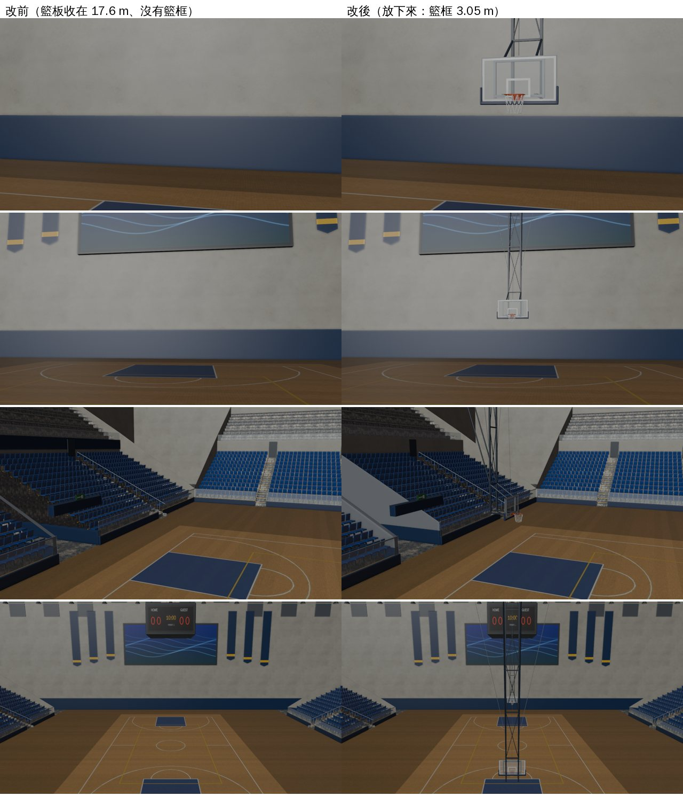
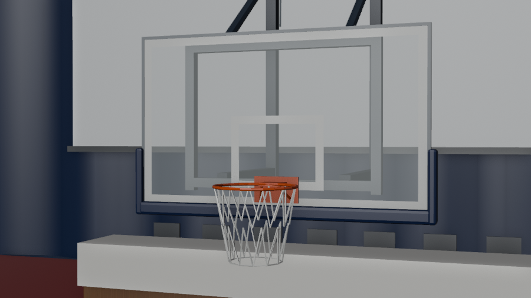

# ART-ARENA-HOOPS-1105：3F 主球場的籃架（LAWWW2-B 2026-11-07）

使用者 11-05 07:1x：「主球場一群人跑來跑去 連籃框都沒有 還有人穿裙子打籃球??」。穿裙子的那一半，LAWWW 已經改了（ARENA-NOHOOP-1105：只用褲裝底模）。這一包做籃架。

狀態：**READY_FOR_ART_REVIEW**（場景美術，BB-B／使用者看）。遊戲內瀏覽器截圖還沒拍（D131：交 CC）。

## 原因

`gym_arena.py` v1～v8 的籃架是「收在上面」的樣子：籃板吊在 17.6～18.65 m，在大螢幕上方，而且沒有籃框。從場上看，就是沒有籃框。

## 做法

改成屋頂吊下來、**放下來**的樣子，尺寸照比賽規格，位置照 `gym_layout.js` 的 `arena.court.hoops`：

- **籃框**：上緣 3.05 m、內徑 45 cm、橘色；板面上有固定板和斜撐；
- **籃網**：12 個掛鉤，兩段菱形網目，下緣 2.62 m；
- **籃板**：強化玻璃 1.80×1.05 m，下緣 2.90 m；板面在端線內 1.20 m，離籃框中心 37.5 cm；鋁框；
- **板上白線**：外框 5 cm；籃框上面的小方框 59×45 cm，下緣和籃框同高；
- **護墊**：深藍，下緣一整條，兩側到 3.25 m；
- **吊架**：
  - 板後的框；
  - 兩支水平臂；
  - 兩支直立主桿：在板後 1.1 m，一路到屋頂，中間有交叉斜撐；
  - 屋頂兩支 H 型鋼橫梁：籃架剛好在兩榀桁架中間，橫梁跨在兩榀的下弦上；
  - 往端牆的斜撐；左右防晃拉索；
  - 捲揚機和鋼索。

整組放在 **`SET_HOOPS`** 群組裡：

- 不和別的材質合併，遊戲可以整組開關；
- 烘焙時藏起來（bake_gym.sh 的 HIDE `SET_`），不吃光照貼圖，和屋頂鋼架、座位一樣用即時光；
- 球場其他部分照舊，重烘一次（256 取樣、約 3 分鐘）；
- 地上沒有東西（最低 2.62 m），導航不用改。

模型數字：三角形 70,148 → 75,380（+5,232）；物件 +8（每個材質一個）；材質 +6；GLB 4.42 → 4.70 MB（未壓縮的統計）。

近看（預覽有開著平常藏起來的布置，所以後面看得到舞台的長桌）：

## 遊戲端 patch（`arena_hoops_1107.patch`，對開發 c244ce20e）

1. `src/gym3d.js`：典禮那天（`z.ceremonyOn`）收起 `SET_HOOPS`。北端有舞台，籃架會在舞台前緣上方。其他日子打開。
2. `src/crowd3d.js`：`S.ARENA_HOOPS` 預設 true，打球的人回到北邊籃框半場跑（ARENA-NOHOOP-1105 那一段照舊在，設 false 就回到場邊等）。這是你 tasks.json 寫的「交件後 LAWWW 把 CROWD.ARENA_HOOPS 改 true」，我順便放進 patch，你要自己改也可以。
3. `tests/gym_crowd_unit.js` 第 1 項的 3F 那一條跟著改：
   - 原本檢查「籃架還沒接上＝站場邊」；
   - 現在檢查「籃架接上＝打球的人在北邊籃框半場跑（跑一段停一下、面向籃框）、只用褲裝底模」。
4. 新測試 `tests/arena_hoops_unit.js`（讀 GLB，不需要瀏覽器）：
   - SET_HOOPS 群組在；
   - 兩個籃框：上緣 3.05、中心對準 ±2 cm、內徑 45 cm；
   - 籃板：尺寸、下緣、板面位置；
   - 白線在板面前面；
   - 籃網高度；
   - 吊桿到屋頂；
   - 地上沒有東西；
   - 舊的 17.6 m 籃板拿掉了；
   - 第 2、3 點的遊戲端改動在。

## 測試（Node，雲端）

- `tests/arena_hoops_unit.js`：開發原樣（舊 GLB、沒有 patch）**FAIL 16** → 新 GLB＋patch **ALL PASS**。
- 體育館相關 9 支都 ALL PASS：gym_arena、gym_arena_lm、gym_arena_tap、singleside_gym、gymcer、gym_ceremony、gym_crowd（改過）、gym、gym_pose。
  - 其中 gym_arena_lm 第 ⑦ 項，第一次 FAIL：那一項檢查「載入以後 500 字以內有 attachRoomGLB」，我的程式插在它前面，把它擠出去了。改成插在 attachRoomGLB 後面以後過了。
- 全部 Node：跑完補在下面。

## 還沒做、還沒驗

- 遊戲內畫面（CC）：平常日子從場邊、看台看籃架；典禮那天籃架收起來；打球的人跑到籃框下。
- 籃架是即時光、沒有烘焙陰影。地板上不會有籃板的影子：屋頂 117 盞 LED 照下來，影子本來就很淡。
- 籃框沒有做「收上去」的版本（典禮那天整組藏起來）。要做收上去的樣子，可以再加一組。
