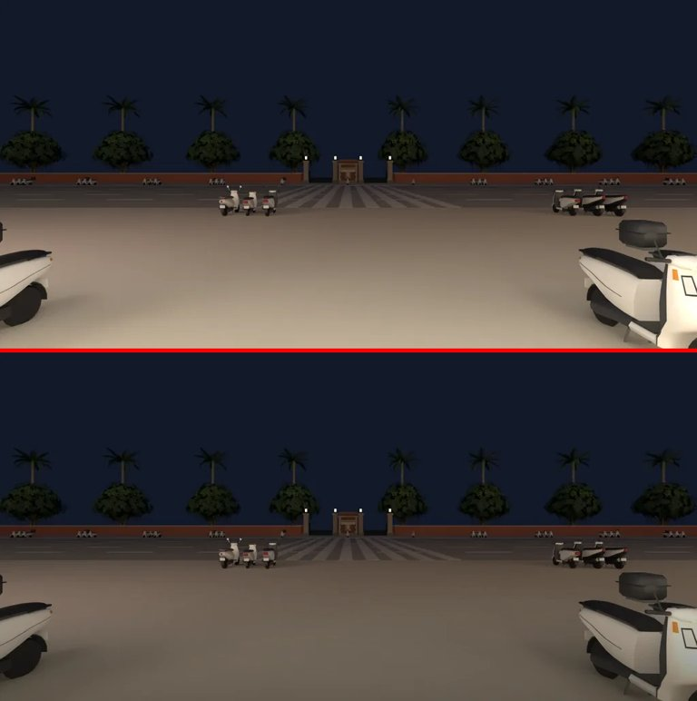

# 慢輪單車晚上門外地上一塊亮白長方形（BB-B 11-08 06:43 PC GPU 判定第 2 點，P3；LAWWW2-B 修，D108 場景）

**狀態：交件**。只換一張窗景照片，不用改程式。

## 現象
- 證據：cc-testing `CC/logs/LM2_LM3_gpu/bikeshop.jpg`，「out 1930」那張（從店裡往門口看，19:30）。
- 門外地上有一塊很亮的白色長方形，旁邊的街景是暗的。白天正常，其他店晚上沒有這樣。

## 原因
- 慢輪的櫥窗、門外是同一片視差窗景（`Z3.ggViewPanes`：兩扇櫥窗合成一片、放大到蓋住整面店面）。照片是 `assets/models/env/views/bikeshop_{day,night}.webp`，WINVIEW-AUDIT-1105 用 Blender 從櫥窗中間拍的。
- 晚上那張的下半部（店門口的騎樓地面）被騎樓的燈照得很亮：最下面一成平均 159。同一條街的書店、便利商店夜景同一個位置約 85。
- 櫥窗有窗台，只看得到照片上半部（暗的街景）；門開著、門洞一直到地上，看得到照片最下面那段亮的地面。所以只有門洞那一塊亮。

## 怎麼改
- `bikeshop_night.webp` 地平線以下（照片高度 52% 以下）照高度往下漸暗，最下面 ×0.52：
  - 改前，由上往下每一成的平均亮度：25, 25, 25, 24, 23, 52, 96, 125, 144, 159
  - 改後：25, 25, 25, 24, 23, 50, 83, 96, 97, 90
- 地面還是暖色、看得出騎樓有燈，只是不再比街上其他東西亮一截。
- 白天那張不動。

## 要換的檔
| 檔案 | sha256（開發 → 這一版） | 大小 |
|---|---|---|
| `assets/models/env/views/bikeshop_night.webp` | `aaa81711…` → `3294ef34…` | 14,962 → 18,380 B |

- 照片是 LAWWW2 拍的（e29912473）。

## 還沒驗
- CC 用同一個機位重拍 out 1930，BB-B 判。
