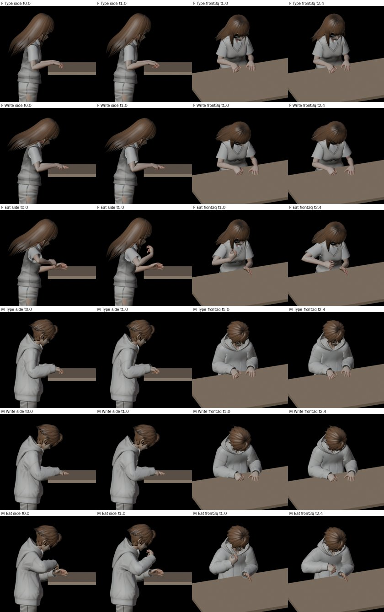

# CAFE-EDGE-1105：桌子比較近的座位，坐著做事的片段

LAWWW2-C，2026-11-05。來源：LAWWW-C 11-04 21:42Z 的第 3 點「Café 桌緣 0.20 的版本」（NPC-ANIM-LOOPS-1104，P3）。

狀態：**MODEL_READY**，Node 測試都過了。瀏覽器還沒跑（D131）。

**這份要接在 SIT-HEIGHT-1104（267f3d9a9）後面**：坐下的高度改了以後，片段才是對的。



## 玩家會看到什麼

這些店的桌子離座位比較近（座位點到桌緣）：

- afar、青木茶室、Daybreak：0.15
- 木曜日：0.20
- 林家：0.17
- 社科圖：0.23～0.25

原本的片段是照總圖自習桌擺的（桌緣 0.30）。往後坐最多只能挪 3 cm，所以這些位子都合不上，坐在那裡的人只是手放大腿上。

這次多一組照桌緣 0.20 擺的片段，F、M 各 7 個：打字、打字＋觸控板、寫字、滑手機、翻書、喝飲料、吃飯，名字是 `Sit_<動作>_<F|M>_E20_Loop`。

- 桌緣 0.14～0.32 的近桌：手在筆電、筆記本、碗上。手腕到桌緣的距離和參考一樣，測試量到差 0.0 cm。
- 遊戲會先試桌緣比較接近的那一組：
  - 0.27（118 巷的店）照舊用原本那一組。
  - 0.10 以下太近（肚子會頂到桌子），不用片段，照舊手放大腿。

## 改了什麼

### 片段（ual_sit_tasks.glb，28 → 42 個，1.26 MB）

- `tools/anim/sit_task_loops.py` 多了 `--edges 0.30,0.20`。第二個桌緣只做 `--near-bodies`（預設 F、M）。
  - F2、M2 不做：坐高改了以後它們只多補幾個人。
  - 原本的 28 個一模一樣，expect 也一樣。
- 近的那一組：
  - 桌子前緣在 0.20，所有手的目標往人那邊 10 cm。
  - 身體、頭的姿勢和原本一樣。
  - IK 都到位：手腕和 expect 差 ≤ 0.1 cm。
  - 吃飯：1 秒時筷子尖離嘴 1.5 cm，夾麵時在碗裡 0.0～0.4 cm。
  - 喝飲料：杯緣離嘴 0.5～1.0 cm。
- `tools/anim/preview_vrm_clip.py` 多了 `--edge`（預覽用）。

### 遊戲（cafe_edge_1105.patch：character3d.js、tests/sit_task_wire_unit.js）

`C.SIT_TASK` 多了這些：

- `REFS:[{edge:0.30,sfx:''},{edge:0.20,sfx:'_E20'}]`。
- `HANDS.F_E20／M_E20`：取 json 的 `expect.hands0`。
- `WIN[動作].F_E20／M_E20`：在遊戲裡量的，見下表。

`sitTaskFit` 的做法：

- 照「桌緣和哪一組比較接近」排序，再照 ALT 試身材，第一個合得上的就用。
- 回傳多一個 `ref`（0.30／0.20）。`sitTaskOf` 也帶 `ref`，測試用。

### 近的那一組的 WIN

量法：坐高改了以後，在遊戲骨架上量，見 `tests/sit_task_wire_unit.js` H 那一項。

| 動作 | F_E20 | M_E20 | 近端是誰擋住 |
|---|---|---|---|
| 打字／打字＋觸控板 | 0.16～0.271／0.236 | 0.16～0.271／0.236 | 指尖不過筆電鉸鏈（0.370 − 0.216） |
| 寫字 | 0.145～0.304 | 0.145～0.309 | 肚子（桌面高度身體最前面 0.125）＋2 cm |
| 滑手機 | 0.145～0.276 | 0.145～0.275 | 肚子 |
| 翻書 | 0.145～0.28 | 0.145～0.279 | 肚子 |
| 喝飲料 | 0.145～0.335 | 0.145～0.335 | 肚子；遠端照參考那一組 |
| 吃飯 | 0.16～0.294 | 0.16～0.293 | 女生前臂離桌面 1.5 cm（0.158） |

- 遠端：放在桌上的手腕往前 3 cm 還在桌上。
- 打字＋觸控板的遠端照參考那一組，收 3.5 cm（右手要摸得到觸控板）。
- 肚子的位置另外量：在遊戲裡播每一個 E20 片段，看身體（不含手臂）在桌面高度 0.70～0.80 最前面到哪，F、M 都是 0.124～0.126。

## 接法（LAWWW-C）

1. 先接 SIT-HEIGHT-1104（267f3d9a9）：`git checkout` 那一串＋`git apply sit_height_1104.patch`。
2. 再 checkout 這次的檔，取代 SIT-HEIGHT 那一份的 ual_sit_tasks：
   ```
   git checkout <交件 SHA> -- assets/models/char/second_ai/ual_sit_tasks.glb assets/models/char/second_ai/ual_sit_tasks.json \
     tests/sit_task_loops_unit.js tools/anim/sit_task_loops.py tools/anim/preview_vrm_clip.py
   ```
3. `git apply docs/art-rebuild/second_ai/wip/cafe_edge_1105/cafe_edge_1105.patch`：在 226e8ce4e＋sit_height_1104.patch 上面乾淨。

只接 SIT-HEIGHT、不接這份也可以：42 個片段的 GLB 照用，近的那一組不會被叫到。

## 測試

都在 226e8ce4e＋兩份 patch：

- `tests/sit_task_loops_unit.js`：56 項 ALL PASS（42 個片段；F_E20、M_E20 也比對 expect）。
- `tests/sit_task_wire_unit.js`：58 項 ALL PASS。新的 E3 三項：
  - 桌緣 0.20 用 Sit_Type_F_E20、不挪、手腕到桌緣一樣。
  - 0.14 寫字用 Sit_Write_F_E20、往後 3 cm。
  - 0.27 照舊參考那一組、0.10 沒有片段。
  - H 也量了 F_E20、M_E20。
- 也都過：`sit_height_unit`、`seat_ambient_unit`、`seat_activity_1104_unit`、`crowd_seat_talk_unit`、`shop_diners_unit`、`eat_unit`、`inv_sit_together_unit`、`shop_enc_seat_unit`。

## 已知不足、沒測的

- **桌面高度沒核對**：片段要桌面在 0.72～0.79（tolV＋往上下坐 1.5 cm）。
  - afar、Daybreak、青木、木曜日、林家正式模型的桌面高度，我在 Node 量不到。Node 裡只有程序化備用的桌子（0.85）。
  - 如果正式的桌子是 0.85 的高桌，兩組都合不上，照舊手放大腿。**要 CC 在瀏覽器看**。
- **Daybreak 吧台**：0.06 的那幾個位子太近，照舊沒有片段。
- **近的那一組的姿勢**：手肘比較往後、手比較貼身體（看預覽圖）。BB 判自不自然。
- **瀏覽器沒看過**。要 CC 拍：
  - afar、Daybreak 的近桌：筆電、寫字。
  - 林家吃飯（S.TASK_EAT 開了以後）。
  - 社科圖 0.23～0.25 的位子。
