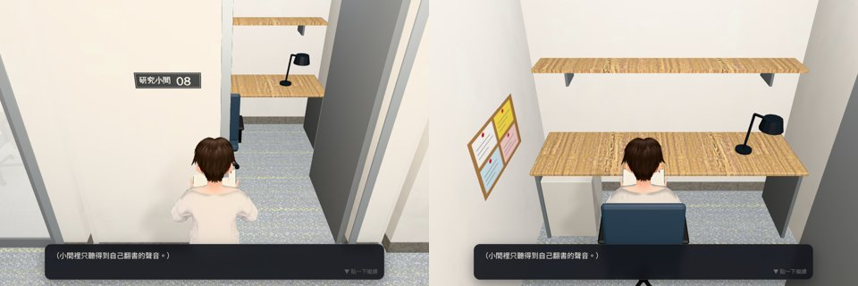

# 研究小間玻璃後面的讀者（LAWWW 11-03 12:08 的小派工，P3；CARREL-FREE-1103 以後）——LAWWW2 2026-11-03

狀態：`READY_FOR_REVIEW`。patch 接開發分支 `b049c84e3`，用 `git apply --check` 檢查過。

## 起因
研究小間改成免預約以後，08 在開館時間一直開著，其他九間玻璃後面都是空的，整排看起來很怪。

## 改法：`carrel_readers_1103.patch`
- `src/library_upper3d.js`
  - `LUP.carrelWant(G)`：開館時段（08:00～22:00）決定 01～10 哪幾間有人。08（玩家的）、03（學姊的，她的劇情 lupstory3d.js 自己放）不算在內。照日子和時段（上午、下午、晚上）各算一次，大約六成有人。
  - `LUP.populateCarrels(GM, entering)`：讀者坐在那一間的椅子（`carrels[].seat`），pose 是 `read`，frozen；從門上的小窗看得到。待著不會重複放；時段換了沒輪到、或閉館，就藏起來（門是關的，所以不讓他們走出來）。
- `src/story3d.js`：兩行，緊接在書庫 `LUP.populate` 那兩行後面，進來、待著各叫一次。
- `tests/library_upper_unit.js`：新增第 8 項，共 4 個 check：
  - 只坐那八間；
  - 30 天 × 三個時段，平均每個時段 5.2 間有人；
  - 閉館沒有人；
  - populateCarrels 放好、不重複、閉館藏起來；story3d 有叫。
- 開發分支 b049c84e3 上 ALL PASS。同樣跑過、都通過：`lupstory_unit`、`door_open_unit`、`library_media_unit`、`aa595_rules_unit`、`phone_unify_unit`、`say_cover_unit`、`sis_y3_sched_unit`。

## 第二版（11-03 19:4x）：加上 08 號座位的鏡頭（BB 13:42 P3）
- 起因：小間只有 2.4 × 2.2 m。坐下以後鏡頭被隔板擋住，畫面左半邊是牆。
- `src/library_upper3d.js`：`seatsOf` 後面加一段 `z.update`。
  - 坐在 `spots.my_seat`（距離 < 0.3 m）時，鏡頭距離 `distTarget` 是 1.7 m，鏡頭轉到背後（yaw π，門那一側）。
  - 玩家自己轉鏡頭（`manualT > 0`）時不搶鏡頭。
  - 站起來時，距離恢復成區域的 `camDist`（4.2）。
- `tests/library_upper_unit.js` 第 9 項：坐下 60 格後 yaw ≈ π、dist 1.7；站起來 dist 4.2。在 b049c84e3 上 ALL PASS。
- 這一版的 patch 只有研究小間：`src/library_upper3d.js`、`tests/library_upper_unit.js`，以及 `src/story3d.js` 的兩行。總圖第五版（`wip/library_v5/`）和六法 via（`wip/tea_seats_liufa/`）的 patch 也改 story3d.js，但改的是不同的行。三份依序套在 b049c84e3 上，`git apply --check` 都通過。
- 遊戲截圖（開發分支 b049c84e3＋這三份 patch，15:00，已預約 08）：左邊是站在 08 門口，右邊是坐下以後。坐下時鏡頭在背後 1.7 m，看得到人、桌子、檯燈、軟木板，隔板不擋。實際值 yaw 3.14、dist 1.7。
  
- 對話框那一行（「小間裡只聽得到自己翻書的聲音。」）是區域本來就有的旁白，不是這次加的。

## 沒做
- 瀏覽器裡從門上小窗看的截圖還沒拍。
- 讀者的外觀用 `STORY.extraSpec(880+…)`，就是路人池。
