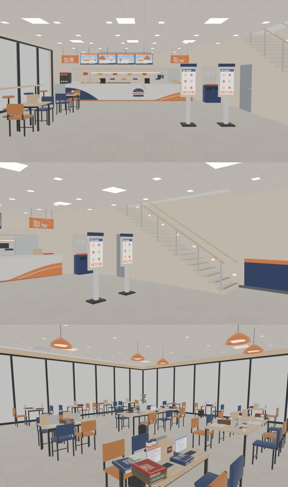

# 大口漢堡走得進去（XS-SHOPS-REST-1105 ①，LAWWW2-C 2026-11-05）

- **第 1 版進遊戲**（D141；LAWWW-C 04:51 排的順序：大口漢堡 → 大步 → 好拍 → 運動廣場）。
- 模型：BB〔帳號 A〕的兩顆 GLB，和 BB 分支 `claude/wonderful-mayer-7fm9g6` 一模一樣。
  - 一樓 v2b：`dakou_1f.glb`，1,671,360 B，12 材質。
  - 二樓 v2：`dakou_2f.glb`，2,514,308 B，11 材質。
  - 配置：`src/data/dakou_layout.js` v3，BB 的原檔，沒改。
  - 版本：BB 已經改到一樓第 4 版（v2b）、二樓第 3 版（v2），兩層的 ref_match 都 ALL PASS。
- 這一包做的：區域 `xs_dakou`、兩層導航、樓梯、座位、出入口、新生南路的停車架、測試、接線。
- 企劃：AA_621（24 小時；考試那兩週大家在這裡念書）、AA_615（新生南路南邊路口）。
- 參考圖：使用者 11-03 生成的 `dakou_2f.webp`、`dakou_ext.webp`。BB 的對照圖在 `docs/story_planning/bb_models/dakou/`（企劃線、BB 分支）。這一包沒有重做疊圖（D141）。
- 驗收狀態：INTEGRATED（Node 模擬）。瀏覽器沒跑（D131）。

## 1. 玩家可以做什麼

- 新生南路上大口漢堡的店門變成「進大口漢堡」。進去站在店門內 1.6 m，面向櫃檯。
- **一樓**：
  - 17 個座位：靠窗高腳吧台 7（照高腳椅的座面抬高）、雙人桌 10。
  - 點餐、自助點餐、取餐、回收餐盤都走得到。互動點的資料在 `DK3.INTERACT`，台詞和點餐由 LAWWW 接，同山嵐、同弦。
  - 廚房、櫃檯後面、員工通道、樓梯下的儲藏室都關著，進不去。
- **樓梯**：靠東牆，從一樓前面往北爬上二樓。
  - 21 階，每階 0.1714 m、踏面 0.28 m，約 33°，真的走得上去（D38 第 4 點）。
  - 上半段兩層共用，和山嵐、木曜日一樣。
  - 一樓 GLB 的 20 個踏面和導航算的一樣高：讀 GLB，最大差 0.003 m。
- **二樓學生自習區**：
  - 62 個座位都可以「讀書」（AA_621「照兩點半的 studySession」）：長桌、四人桌、窗邊雙人桌、靠牆插座吧台 14 張高腳椅。
  - 插座、書架走得到。
  - 樓梯口的洞站不住，邊上是玻璃欄杆。
- **鏡頭**：
  - 人在一樓、鏡頭拉高過二樓地板時，二樓整層藏起來（剖面視角）。
  - 人在樓梯上時，鏡頭不穿過二樓樓板。
- **晚上**：BB 模型裡的窗外夜景卡（`NIGHT_FRONT`、`NIGHT_WEST`）18:36 到 05:36 才顯示。

三張都是 `glb_preview.py` eevee，均勻光，不是遊戲畫面。

## 2. 先將就的（D141：給使用者看的清單；不擋玩）

1. **白天窗外是暗的**：BB 的窗外卡是夜景，白天藏起來。之後要做白天的窗卡，或接新生南路的街景。
2. **燈光**：沒有烘光照，用即時光（一樓兩盞、二樓兩盞）。燈板、吊燈的材質自己發光。
3. **WALL_BANDS 不淡出**：一樓東西兩面牆的深藍護牆（高 1.08 m）是同一個網格、沒有淡出方向。改名成 `DK_BANDS`，不放進淡出清單。它很矮，不會擋到人。
4. **互動點還沒有按鈕**：點餐、自助點餐、取餐、回收餐盤、插座、看書架。由 LAWWW 照 AA_621 接，資料在 `DK3.INTERACT`。上下樓直接走樓梯，不做按鈕。
5. **新生南路的店門字**：「進大口漢堡（速食（24 小時））」括號套括號，和山嵐、同弦一樣，是 `xinsheng3d.js` 照 type 組出來的。
6. **效能**：一樓 22,934 三角形、二樓 35,958（含 23 組 instancing）；11 個材質是雙面。
7. **新生南路多一座停車架** (−8.6, 37)：在大口漢堡門口北邊 3.4 m 的路邊。
   - 原因：`bike_park_1104_unit` 要每個出口 12 m 內有停車處，原本從大口漢堡出來最近的是 22.9 m。
   - 畫面上會多一座架子（套件畫的，和其他四座一樣）。

## 3. 另外修的：林家乾麵那一包弄壞的測試（`lin_order_fix_1105.patch`）

這三處是我上一包（ee917acd3）的錯，照實寫：

1. **`index.html`**：`lin_layout.js` 插在 `daily_offbeat_layout.js` 和 `bike_layout.js` 中間。
   - `bike_shop_park_unit` 第 12 項要 `bike_layout.js` 緊接在 `daily_offbeat_layout.js` 後面，所以 FAIL。
   - 改成把 `lin_layout.js` 放在 `bike_layout.js` 後面。它只要在 `wz_shops_layout.js` 後面就好。
2. **`tests/wz_shops_unit.js`**：在 `ih.indexOf('…wz_shops_layout.js')` 的括號裡多插了一個 `'src/data/lin_layout.js'`。
   - 這個字被當成第二個參數（搜尋起點，算出來是 0），所以結果碰巧一樣。改回原樣。
3. **`tests/wz_interiors_aa659_unit.js`**：`req('…wz_shops_layout.js')` 也一樣多插了一個參數，`req` 只用第一個，沒有作用。改回原樣。

| | `bike_shop_park_unit` | `wz_shops_unit` | `wz_interiors_aa659_unit` | `wz_lin_v1c_unit` |
|---|---|---|---|---|
| 開發分支 `685337469` | FAILED 1（第 12 項） | ALL PASS | ALL PASS | ALL PASS |
| ＋這個 patch | ALL PASS | ALL PASS | ALL PASS | ALL PASS |

## 4. 測試（Node，不用瀏覽器）

`node tests/dakou_unit.js`：ALL PASS（22 項；套上接線 patch 以後多一項 ⑪ 名字、24 小時）

| | 檢查 |
|---|---|
| ① | 登記、兩顆正式模型 |
| ② | 兩層同尺寸同原點、二樓 3.6、三塊樓板；進來的位置；店門走得到 |
| ③ | 樓梯一階一階的高度、坡度、一樓 GLB 的 20 個踏面 |
| ④ | 一樓 → 樓梯 → 二樓、二樓 → 一樓；找路經過樓梯 |
| ⑤ | 一樓 17 個座位、4 個互動點；7 張高腳椅抬高 |
| ⑥ | 二樓 62 個座位、3 個互動點；79 個按鈕都帶樓層、二樓都可以讀書、插座吧台 14 張抬高 |
| ⑦ | 樓梯口的洞站不住；一樓從樓梯頂、側邊走不出去；廚房、員工通道、櫃檯後面進不去 |
| ⑧ | 新生南路的店門、走出來的位置 |
| ⑨ | 兩顆 GLB 分層（兩層高的只在樓梯間）；WALL_ 的 dir；夜景卡 |
| ⑩ | 兩層沒有小孤島（每 0.1 m 一點，一樓 9,397 點、二樓 10,571 點） |
| ⑪ | 名字「大口漢堡」、24 小時（接線 patch 套上以後） |

照實寫：

- 修改前：區域不存在，① 就 FAIL。
- 第一次跑 FAIL 4 項，都查過：
  - ③ 踏面：測試寫錯。BB 的踏面頂點在樓梯兩邊（x 4.60、6.00），我取的範圍把兩邊去掉了，只找到 1 階。改了範圍，20 階都在、最大差 0.003 m。
  - ④ 找路：測試寫錯。`E.pathTo` 回傳 `[x,z]` 陣列，我當成 `{x,z}`。
  - ⑨ 分層：測試寫錯。一樓的扶手、玻璃欄杆本來就高過二樓地板，二樓樓梯間的牆往下垂到 1.7 m，都在樓梯間裡。改成照位置判斷，和山嵐 ⑨ 一樣。
  - ⑨ WALL_BANDS：真的有問題。它跨兩面牆、沒有方向，淡出會用錯的方向。照上面「先將就」第 3 條處理。

在乾淨的開發分支 `685337469`＋兩個 patch＋新檔案上，下面 37 支 ALL PASS：

- 本包相關：`dakou_unit`（23 項，含 ⑪）、`seat_reach_unit`（xs_dakou 79 個座位都碰得到「坐下」）、`bike_park_1104_unit`、`bike_shop_park_unit`、`xinsheng_unit`、`shanlan_unit`、`nanyang_unit`、`tongxian_unit`、`spawn_exit_unit`、`placemap_unit`。
- 其他 27 支：calendar_hours、quick_travel、exit_ring、scene_bg_keys、rooms_glb、wz_offbeat、aa653_shops、mokuyobi_aa618、aa619_guitar_zone、gg_shops2_1104、prop_restand、v3_typhoon2、shop_rename_1104、lamppost_nav、aa117_notes、aa347_y1、crowd、indoor_crowd、presence、wall_dir_inherit、bike、bike_seat、campus_bikes、wz_shops、wz_shops2、wz_interiors_aa659、wz_lin_v1c。
- 瀏覽器沒跑（D131）。

## 5. 接法（LAWWW-C）

1. 拿檔案：`git checkout <本包 SHA> -- src/dakou3d.js src/data/dakou_layout.js tests/dakou_unit.js assets/models/env/second_ai/bb_support/dakou_1f.glb assets/models/env/second_ai/bb_support/dakou_2f.glb tools/blender/env_second/bb_support/dakou_interior.py`
2. 套 patch（都在 `685337469` 上乾淨，先後都可以、可以分開接）：
   - `git apply docs/art-rebuild/second_ai/wip/dakou_zone_1105/dakou_wire_1105.patch`
     - `index.html`：在 `shanlan3d.js` 後面載入兩個檔。
     - `places.js`：名字「大口漢堡」、說明「24 小時」。店門不擋，和便利商店一樣。
     - `zones3d.js`：新生南路多一座停車架。
     - `seat_reach_unit`：加大口漢堡的兩個檔。
     - `LICENSES.md`：一列。
   - `git apply docs/art-rebuild/second_ai/wip/dakou_zone_1105/lin_order_fix_1105.patch`：第 3 節的三處。
3. 劇情（LAWWW，AA_621）：點餐、菜單（雙層牛肉堡套餐 159…）、二樓讀到天亮。

## 6. 檢查清單（RULES_2D_TO_3D 第 7 步）

- [x] 參考圖的種類：使用者生成的圖。
- [x] 「最重要的那一塊」：二樓自習區的長桌、吊燈、整排窗（BB 的 ref_match 鏡頭，上面第三張）。
- [x] 店名原創（D77）；標誌是漢堡加三道光，用深藍、橘、米色，沒有用紅黃。
- [x] 沒有複製貼上：模型是 BB 的，這一包沒有改模型。
- [x] 走得到、坐得下、上下樓梯，都寫進 Node 測試。區域原本不存在，① 就 FAIL。
- [x] 驗收狀態：INTEGRATED（Node 模擬）。遊戲內截圖要等瀏覽器。
