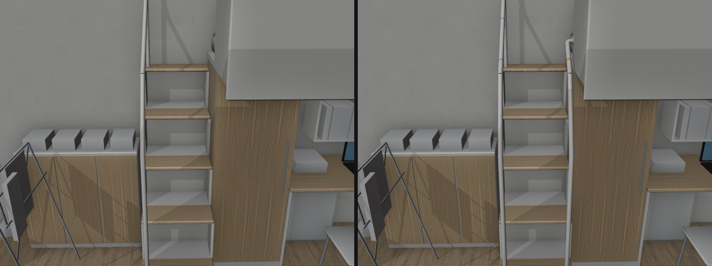
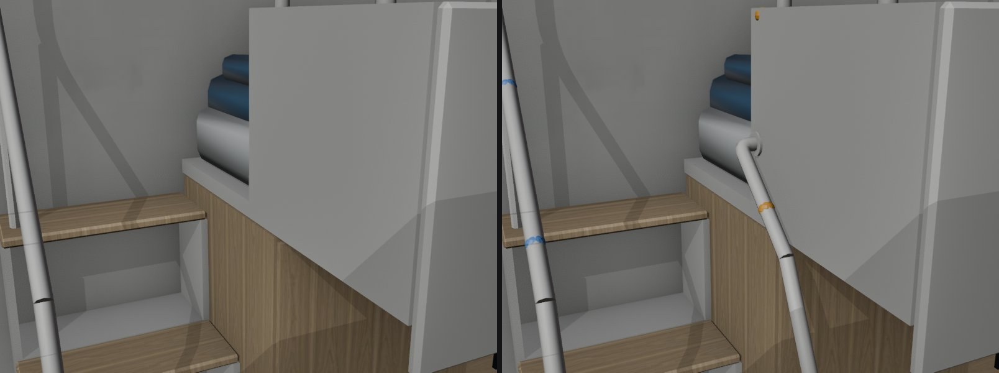
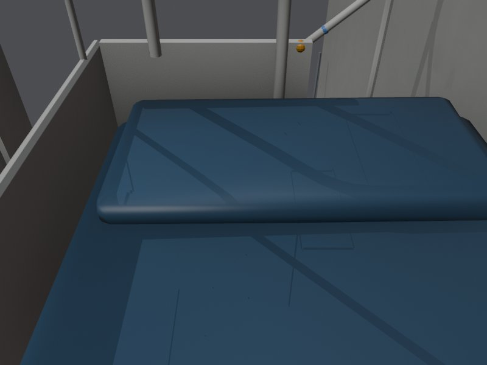
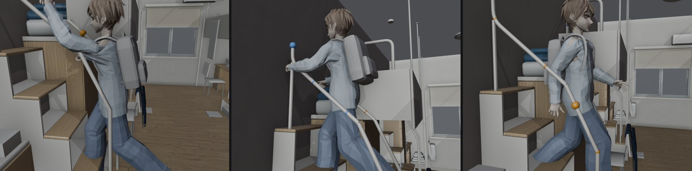

# DORM-LADDER-GRIP-1105：宿舍上舖梯子靠床那一側加扶手、每一階兩手抓的點

LAWWW2-C，2026-11-05。任務 DORM-LADDER-HEAD-GRIP-1102 的 ②（P1）。①（頭穿過天花板）已經由 DORM-CEIL-1103（房間 3.4 m）和 LAWWW 的 DORM-LADDER-STOOP-1103（彎腰）處理，這裡只附每一階的數字。

狀態：**MODEL_READY**。Node 測試都過了；瀏覽器還沒跑（D131）。

起因：LAWWW 爬梯子手勢（CLIMB-POSE-1102）的 README「只有一邊有扶手……靠床那一側的手在低幾階時是抓在空中」，請 LAWWW2：

- 在靠床那一側加扶手或握把（建議和現在的扶手對稱）；
- 給一份「每一階兩手可以抓的點」。



## 玩家會看到什麼

- 上舖的階梯兩側都有白色扶手了。以前只有門那一側有。
  - 靠床那一側：和門那一側的下半段一樣，第一階往上直的到 1.2 m，再斜著往牆邊。
  - 斜到床尾板的邊（1.84 m）就彎進床尾板，鎖在一個圓形底座上。
  - 上床的開口（靠牆那一半）沒有擋到。
  - 四組床都加了。
- 爬梯子時手要抓哪裡，配置裡有了（`sleep_scene.grips`）。
  - LAWWW 的 climbIK 照這個改以後，靠床那隻手就不會抓在空中。
  - 最上面兩階的手也不會伸進牆裡：現在的 climbIK，第 4 階手伸進牆 6 cm、第 5 階 24 cm。





## 每一階兩手抓哪裡（L2，祐廷）

人物自己的左右。爬上去面向牆，爬下來面向房間。高度是離地板。

| 階 | 爬上去 左手 | 爬上去 右手 | 爬下來 左手 | 爬下來 右手 |
|---|---|---|---|---|
| 1（0.32） | 門那側扶手 1.73 | **新扶手** 1.73 | **新扶手** 1.20 | 門那側扶手 1.20 |
| 2（0.64） | 門那側扶手 1.97 | 床尾板頂 2.11 | **新扶手** 1.52 | 門那側扶手 1.52 |
| 3（0.96） | 門那側扶手頂端 2.30 | 上下床扶手 2.38 | **新扶手** 1.79 | 門那側扶手 1.79 |
| 4（1.28） | 門那側扶手頂端 2.30 | 上下床扶手 2.38 | 上下床扶手 2.20 | 門那側扶手上端 2.16 |
| 5（1.60） | — | — | — | — |

- 第 5 階是 `null`：爬上去在這一階轉身跪上床，爬下來是從床上挪過來，手放開（跪姿的手放大腿）。
  - 站在第 5 階，肩膀在 2.88 m，最近的扶手頂端 2.30 m，離肩膀 0.61 m，搆不到（祐廷肩膀到手腕 0.46 m）。
- 挑點的方法（`dorm_room4.py` 的 `ladder_grips`）：
  - 每隻手只在自己那一側找：
    - 門那一側：扶手、最上面那根直柱；
    - 靠床那一側：新扶手、床尾板上緣、上下床扶手（床尾板頂 4 cm 以上那一段）。
  - 挑離「自然的位置」最近、離肩膀 0.22～0.50 m 的那一點。
    - 爬上去：肩膀往前 0.26、往上 0.05＝抓前上方；
    - 爬下來：肩膀往前 0.10、往下 0.40＝扶在腰旁邊。
  - 肩膀照祐廷在遊戲 climb／climbdown 姿勢量：肩關節在腳上 1.32 m、左右各 0.14、往前 0.09／0.04。
- 測試量到（遊戲的祐廷、遊戲姿勢）：肩膀到抓的點 0.20～0.51 m。

### 資料格式（`dorm_room4.layout.json` → `src/data/dorm_room_layout.js`，四組床都有）

`sleep_scene.grips`：

- `up`、`down`：每一階一個 `[左手, 右手]`，和 `steps` 一樣多。
  - 每隻手 `{p:[x,y,z], on:'door_rail'|'door_post'|'bed_rail'|'footboard_top'|'hoop', dir:[…]}`。
  - `p`＝扶手中心線上的點（床尾板是上緣往下 1.5 cm、板子厚度的中間）。
  - `dir`＝那裡扶手的方向（單位向量），手掌可以照這個轉。
  - 搆不到＝`null`。
- `body`：挑點時用的人（上面那幾個數字）。

`sleep_scene.rails`：

- 扶手中心線的折線：`door_rail`、`door_post`、`bed_rail`、`footboard_top`、`hoop`，粗細 `r` 0.016。
- 要讓手沿著扶手滑可以用。

### 給 LAWWW：climbIK 怎麼接（建議，動作歸 LAWWW，D128）

- 爬上去：走到第 k 階的那 0.38 秒，前半段一隻手從 `grips.up[k-1]` 移到 `grips.up[k]`，後半段另一隻手。
  - 哪一隻先動：跟現在一樣照腳，往上踩的那隻腳的對側手先動。
  - 第 1 階的前一個位置：站在地上，手從片段漸漸抓上去（照現在的 blend）。
- 爬下來：反過來，從 `grips.down[k+1]` 移到 `grips.down[k]`。
  - 第 5 階的 `null`：從跪姿（手在大腿）直接移到第 4 階的點。
- 手腕的位置：`p` 往掌心退大約 3～4 cm（扶手半徑＋手掌厚度）。

## 頭頂離天花板（①的數字）

天花板 3.40 m（DORM-CEIL-1103）、head_max 3.32。祐廷 1.75 m，遊戲姿勢、含頭髮。測試印的：

| | 第 1 階 | 第 2 階 | 第 3 階 | 第 4 階 | 第 5 階 | 跪在上床點 |
|---|---|---|---|---|---|---|
| 爬上去 | 1.38 m | 1.06 | 0.74 | 0.42 | 0.14 | 0.34 |
| 爬下來 | 1.38 | 1.06 | 0.74 | 0.42 | 0.14 | |

- 第 5 階站直的話頭頂在 3.34 m，比 head_max 高 2 cm。LAWWW 的 headFit 讓人彎一點，離天花板 14 cm。
- 只有第 5 階需要彎腰，第 1～4 階都夠高。

## 改了什麼

- **`tools/blender/env_second/dorm_room4.py`**（四組床都加）：
  - 靠床那一側的扶手 `BED_LO`（`dorm_frame_white`）、`BED_UP`（`LOFT_<組>_frame`，1.5 m 以上那一段和門那一側一樣在透視群組）、法蘭。
  - `ladder_grips`、`grip_samples`：算 `sleep_scene.grips`；`rails`：扶手中心線。
  - 門那一側的扶手、上下床扶手的形狀都沒動，只是把折線存成變數。
  - 三角形 19,536 → 20,320（+784，每組 196）。
- **`assets/models/env/second_ai/dorm_room4.glb`**＋三張光照貼圖（白天、晚上、熄燈）：
  - 用 `bake_dorm_room4.sh` 照原本的參數重烘，見下面「光照有沒有變」。
- **`dorm_room4.layout.json`**：只多 `grips`、`rails`。其他（導航、座位、睡覺的點）和改前一模一樣，測試比對過。
- **`tools/blender/env_second/lightbake/dorm_room4_lm.json`**：烘焙紀錄。
- **新增**：
  - `tests/dorm_ladder_grips_unit.js`（測試）；
  - `tools/anim/climb_pose_export.js`：匯出祐廷爬梯子的遊戲姿勢 OBJ；
  - `tools/blender/env_second/dorm_ladder_preview.py`：這份的對照圖。

## 光照有沒有變

用 `bake_dorm_room4.sh` 照原本的參數重烘（512 取樣、1024 貼圖；這次 573 秒）。

- 新扶手有分到光照貼圖，和門那一側一樣是烘焙的光，不是即時光。
- 整張貼圖重新排版，所以不能逐點比。改用同一組世界座標的點，各自用自己的第二套 UV 讀貼圖、比亮度（0～1）：

| 點 | 白天 改前→改後 | 晚上 改前→改後 |
|---|---|---|
| 地板中間 | 0.554 → 0.550 | 0.622 → 0.628 |
| 地板 L2 梯子前 | 0.434 → 0.429 | 0.492 → 0.501 |
| 後牆（窗旁） | 0.481 → 0.466 | 0.517 → 0.519 |
| L2 書桌面 | 0.594 → 0.604 | 0.690 → 0.701 |
| L2 第 1 階踏板（靠床那一側） | 0.478 → 0.472 | 0.554 → 0.537 |
| L2 第 3 階踏板 | 0.315 → 0.326 | 0.369 → 0.365 |
| R1、L2 被子 | 0.507／0.512 → 0.501／0.518 | 0.579／0.595 → 0.577／0.603 |
| 天花板 | 0.387 → 0.397 | 0.425 → 0.427 |

- 白天、晚上差 ±3.4% 以內，是取樣雜訊的程度。
- 熄燈那一張本來就很暗（0.01～0.09），差 0.01 以內。
- 第 1 階靠床那一側晚上暗 3%：新扶手的影子。

## 接法（LAWWW-C）

```
git checkout （交件 SHA） -- assets/models/env/second_ai/dorm_room4.glb assets/models/env/second_ai/dorm_room4.layout.json \
  assets/models/env/second_ai/dorm_room4_lm_day.webp assets/models/env/second_ai/dorm_room4_lm_night.webp assets/models/env/second_ai/dorm_room4_lm_dark.webp \
  tools/blender/env_second/dorm_room4.py tools/blender/env_second/lightbake/dorm_room4_lm.json \
  tests/dorm_ladder_grips_unit.js tools/anim/climb_pose_export.js tools/blender/env_second/dorm_ladder_preview.py
python3 tools/gen_dorm_room_layout.py
```

- 不用改程式：現在的 climbIK 不讀 `grips`，接了以後畫面上只多扶手。
- `dorm_room4.py`：開發分支那一份是 11-02 以前的舊版（6 m 寬），接不接都不影響遊戲；接了以後 `bake_dorm_room4.sh` 才對得上。

## 測試

都在開發分支 ed7600ec5＋這一包（Node，不是瀏覽器）。

- **新的 `tests/dorm_ladder_grips_unit.js`：ALL PASS**（9 項）。
  - 祐廷、遊戲的 climb／climbdown 姿勢，每一階都量。
  - grips 每個點都在扶手上（最遠 1 mm）。
  - 肩膀到抓的點 0.20～0.51 m；左右手都在自己那一側；離牆 ≥ 12.6 cm。
  - 新扶手離身體（手臂以外）最近 3.0 cm，和門那一側的舊扶手一樣（3.0 cm）。
  - 跪在上床點、從上床點挪到最上面一階，也沒碰到新扶手。
  - 床板以上的新扶手都在離牆 0.50 m 以外（上床的開口是 0.47 以內）。
  - `src/data/dorm_room_layout.js` 和 layout 一樣（要先跑 gen_dorm_room_layout.py）。
  - **改前的 GLB（`DORM_GLB=舊檔`）第 ③ 項失敗**：找不到新扶手的頂點。
- 宿舍相關的另外 28 支也都 ALL PASS：
  - dorm_lightmap、dorm_seethru、dorm_cam、dorm_dark_lights、room_ceiling、dorm_205、jacket_econ；
  - dorm_desk_items、dorm_y2／y3／wz_items、v0_dorm_props、room_y4、aa502_dorm203、aa517_dorm_y24；
  - bed_nap、bed_tonight_alarm、dorm_mates_live、kai_dorm、sleep_resume、dorm_moved_out、dorm_bh_y4_late、dorm_lounge；
  - dorm_sleep_scene、ladder_headroom、climb_pose、loadgen_locks、nav_buildings。
- 導航、座位、睡覺的點都沒變：layout 除了 grips／rails 和改前一模一樣（比對過）。



## 已知不足、沒測的

- **climbIK 還沒照 grips 改**：動作歸 LAWWW（D128）。改之前，畫面上只多了扶手，手還是現在的位置。
- **腳還是走路片段，最上面兩階腳會伸進牆**（不是這一包造成的；CLIMB-POSE-1102 README 第 3 點）：
  - 測試最後一行印的，祐廷走一個循環最深伸進牆多少：

    | | 第 3 階 | 第 4 階 | 第 5 階 |
    |---|---|---|---|
    | 爬上去（面向牆，前腳） | 7 cm | 28 cm | 49 cm |
    | 爬下來（面向房間，後腳） | 2 cm | 23 cm | 44 cm |

  - 每天早上起床爬下來（getUp）都會經過第 5、4 階。
  - 要 LAWWW 看：步子在梯子上縮短，或腳貼著踏板（footIK），或做爬梯子專用的腿。
- **爬上去的完整演出（S.SLEEP_FULL）最上面一階，上身會往前靠進牆**：
  - 肩膀到 x −2.03，牆在 −2.0。
  - 預設不演爬上去（BUG-SLEEP-CINEMATIC-1103），現在看不到。
- **扶手的樣子 BB 判**：白色、和門那一側同一根管子、彎進床尾板的那一頭有圓形底座。
- **瀏覽器沒看過**。要 CC 拍：
  - 宿舍 203 的梯子：白天、晚上、熄燈三張光照；
  - 起床爬下來那一段。
- 只量了祐廷：只有玩家會爬宿舍梯子。
