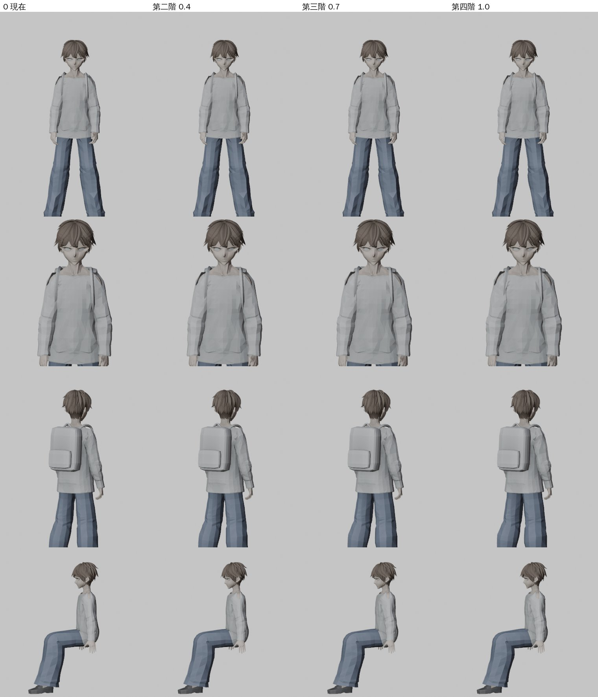
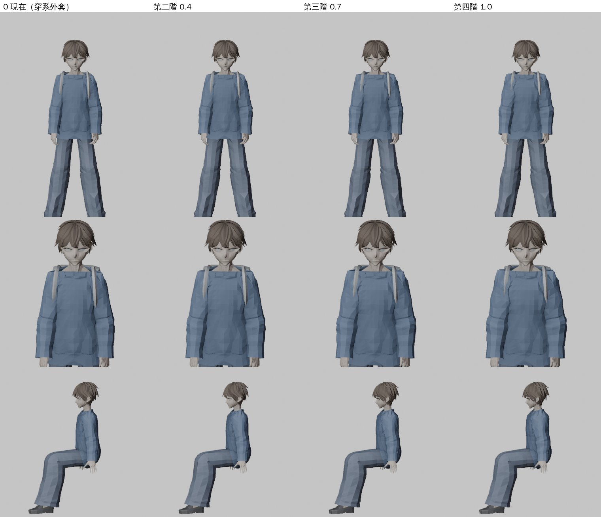

# GYM-FIT-1107 ②：體態第二階段——祐廷的身體形狀（LAWWW2-B 2026-11-07）

使用者 11-07：「健身器材我還是不能用 應該要讓騎腳踏車變快 肌肉線條更明顯」。LAWWW-B 05:12 P1 派工，原文：「做得到的話做一版給我驗（角色美術 LAWWW 驗收，D100a）」。

狀態：**READY_FOR_ART_REVIEW**（D100a 由值班 LAWWW 標）。遊戲內畫面還沒拍（D131：交 CC）。

第一階段（FIT-3D-BODY-1027，LAWWW2-C）只有姿勢：挺胸、肩膀往後，當時寫「不改身體形狀，第二階段要問使用者」。使用者 11-07 這句話就是第二階段的要求。

## 做法：玩家 VRM 加一個 morph「fit」，照體能四階打開

**不用骨頭縮放**，原因有兩個：

- 上臂非等比縮放以後，手肘一彎，前臂會被拉長、變形（子骨頭繼承父骨頭的縮放和旋轉，變成剪切）；
- 掛在骨頭上的配件（後背包）也會跟著變大。

骨頭縮放的試做圖留在 `../gym_fit_equip_1107/muscle_proto.jpg`。

**改成形狀（morph）**，工具是 `tools/anim/fit_body_morph.py`（純 numpy 改 glTF，不用 Blender）：

- **怎麼撐**：每個頂點照它綁的骨頭，沿那根骨頭的軸往外撐。位移＝強度 × 輪廓 × 頂點到骨頭軸的距離。
  - 撐的量和離軸的距離成比例，所以衣服（比較外面）撐得比皮膚多一點，**裡外的順序不會反過來**：衣服不會被皮膚穿出來，外套也一樣。
- **各部位**：

  | 部位 | 怎麼變 | 強度 |
  |---|---|---|
  | 上臂 | 二頭肌（中段）＋三角肌（肩頭）兩個隆起 | 0.30 |
  | 前臂 | 靠手肘那一段 | 0.15 |
  | 肩膀（鎖骨那根骨頭） | 斜方肌、三角肌 | 0.22 |
  | 胸口 | 胸肌（前面多）、背闊肌（兩側） | 0.11／0.07 |
  | 大腿 | 中段 | 0.10 |
  | 小腿 | 小腿肚（後面多） | 0.12 |
  | 腰 | 微收 | −0.035 |

- **不動的地方**：手掌、頭、脖子、腳掌、頭髮、臉（臉上原本的表情 morph 不碰）。
- **骨頭長度不變**：動作、腳步貼合、坐姿不受影響。
- **做了哪兩個 VRM**：
  - `vroid_yuting.vrm`（遊戲預設）：身體、毛衣、褲子、鞋子同一個網格，系外套 JACKET_ECON 另一個，兩個都有；
  - `bl_yuting.vrm`（?blchar）：身體＋衣服。
- **最大位移**（第四階）：上臂、肩膀約 2.7 cm，外套 2.4 cm。

**四階**（`fit3d.js` 的 `S.BODY`）：0（普通）／0.4（有在運動）／0.7（結實）／1（經常鍛鍊）。

**看得出來的地方**：第四階肩膀變寬、上臂（二頭肌、三角肌）明顯飽滿，毛衣、外套跟著撐，沒有皮膚穿出來。第二階只是輕微。

**做不到的**：「線條」——肌肉的分界、血管。玩家一直穿長袖毛衣，只看得到輪廓。真要看到線條，要露出手臂：例如健身房換短袖運動服。那是新衣服，要使用者決定。

## 遊戲端 patch（`fit_body_1107.patch`，對開發 c244ce20e）

- `src/character3d.js`：建 VRM 時找有 `fit` 的網格（`u.fitMorph`）；`animate` 照 `u.fitBody`（0～1）設強度，值變了才設。
- `src/fit3d.js`：`S.BODY=[0,0.4,0.7,1]`；`S.sync` 設姿勢的同一個地方也設 `u.fitBody`。只有祐廷；換存檔、讀檔跟著變。
- 新測試 `tests/fit_body_unit.js`：
  - ① 兩個 VRM 的身體、衣服、外套有 fit，臉、頭髮沒有；
  - ② `S.BODY` 四階；`sync` 照體能設；`animate` 照 `u.fitBody` 開關；
  - ③ 經常鍛鍊時上臂粗 ≥ 10%；手掌、頭、腳掌不動（< 2 mm），脖子底部 < 5 mm；骨頭位置不變；
  - ④ 上臂皮膚跑到毛衣外面的頂點沒有變多；
  - ⑤ 坐下時大腿底部往下 < 1 cm。
- 新 VRM 沒有 patch 也安全：fit 一直是 0。

## 測試（Node，雲端；瀏覽器畫面交 CC，D131）

- `tests/fit_body_unit.js`：
  - 開發原樣（舊 VRM、沒有 patch）：**FAIL 6**（沒有 fit、沒有 FIT.BODY、上臂一樣粗）。
  - 新 VRM＋patch：**ALL PASS**。量到的數字：
    - 上臂離骨頭軸平均 4.86 → 5.77 cm（+18.7%）；
    - 手、頭、腳 1.15 mm（idle 本身的雜訊約 0.7 mm）；脖子底部 2.32 mm（一部分綁在胸口骨頭上）；
    - 上臂皮膚跑到毛衣外面：1／94 → 0／92；
    - 坐下時大腿底部往下 0.36 cm；
    - 骨頭位置不變（兩邊上臂根 27.03 cm）。
- 相關的照舊過：fit_posture、fit、sit_height、sit_feet、seated_look、skirt_sit_morph。
- patch 單獨套、或接在裙子 skirt_sit_1107.patch 後面套，對開發 c244ce20e 都套得上（git apply --check）。

## 檔案

- `assets/models/char/vroid_yuting.vrm`、`assets/models/char/bl_yuting.vrm`：只加 morph fit，權重、形狀、貼圖不動。
- 工具：`tools/anim/fit_body_morph.py`（輸入要用沒有 fit 的原檔）。
- `fit_body_1107.patch`：character3d.js、fit3d.js、新測試。

## 還沒做、還沒驗

- 遊戲內畫面（CC）：四階站、走、跑、坐；穿系外套；鏡頭近看手肘彎的時候袖子。
- 四階的數字（0／0.4／0.7／1）和強度是我定的。要更明顯或更淡，改 `S.BODY` 或重跑工具的 `--k`。
