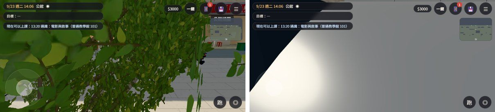

# GG-DOOR-CAMS-1104：公館店門口鏡頭被擋（青木茶室、頁間書屋）

狀態：**已交付**（patch＋Node 測試）。遊戲畫面等 CC 用同一個探針重拍（D131）。LAWWW2 帳號 A，2026-11-10。

## 原因（Node 建出遊戲的公館、照 followCam 算鏡頭量到的）
- **青木茶室**（門 −54.05）：
  - CC 探針站在門前 6 m (−54.05, 15) 往店門看，跟隨鏡頭在背後 (−54.0, 3.2, 8.7)，離行道樹 (−53, 9.4) 只有 1.3 m，鏡頭在樹冠裡。
  - 樹幹有樹幹透視（userData.seeThrough），**葉子沒有**；葉子也不是碰撞盒。所以整個畫面都是葉子。
- **頁間書屋**（門 −36.4）：
  - 同樣站法，鏡頭在 (−36.4, 3.17, 8.66)，頭到鏡頭那一條線穿過捷運出口亭，整個畫面是亭子的牆。
  - 出口亭的**鏡頭碰撞盒比正式模型小**：碰撞盒 x −43～−36.6、z 9.3～12.7；gongguan_mrt_exit.glb 地面以上是 x −43～−35.78、z 8.73～13.27。東端 0.8 m 沒有碰撞，門前 x −36.4 剛好在那一段。

## 修法（patch `gg_door_cams_4042c708a.patch`，在開發分支 4042c708a 上做的）
- `src/townkit3d.js`：正式行道樹（street_trees.glb）的葉片材質
  - 離鏡頭 4 m 內網點透空，1.4 m 內全部不畫。和樹幹透視同一種 4×4 網點；遠處的樹不受影響，影子照舊（只改畫面那一個 shader）。
  - 照樹幹的做法接 `E3.patchSeeThrough`：擋在鏡頭和玩家之間的葉子，在玩家周圍透空。
  - 風照舊。program 快取鍵改成 treeLeaf2。
  - 全遊戲的行道樹都套用（校園、公館、溫州街），鏡頭穿過樹冠時不再滿畫面葉子。
- `src/zones3d.js`：捷運出口亭的鏡頭碰撞盒照正式模型的外框（7.22 × 3.4 × 4.54，中心 (−39.39, 1.7, 11)，名字 `gg_mrt_camcol`）。導航阻擋不動。
- 新測試 `tests/gg_door_cams_1104_unit.js`。

## 測試
- `gg_door_cams_1104_unit.js`：開發分支原樣 **FAIL 3**（1 葉片沒有近距透空、沒有樹幹透視；3 頁間門前兩個角度穿過出口亭；4 碰撞盒比模型小）；加 patch **ALL PASS**。
- 回歸 ALL PASS：street_trees、gg_gate_cam_1107、street_props_nav、gg_flower_stall、campus_bell_seethru、campus_hall_pillar_seethru、linze_pillar_seethru、cafe_seethru、dorm_seethru、singleside_streets、gg_shops2_1104、gg_views_1107、zone_prefetch。
- GLSL：Node 裡只能檢查組出來的 shader 字串（內容寫在測試第 1 項）。實際編譯要在瀏覽器（D131），請 CC 開公館、校園各看一次 console 沒有 shader 錯誤。

## 沒有測過、先將就
- 瀏覽器畫面：請 CC 用 `cc_gg_int_probe.py` 的 art 重拍 art_aoki_door、art_yejian_door，再走校園椰林大道一段，看樹下鏡頭。
- 葉片透空的距離 4 m 是估的。太近的葉子會看到網點，太遠又會一次消失一大片；BB 看了覺得不對再調 TL_NEAR。
- 套件階段的程序化樹（正式模型沒載入時的備用）沒有改。
