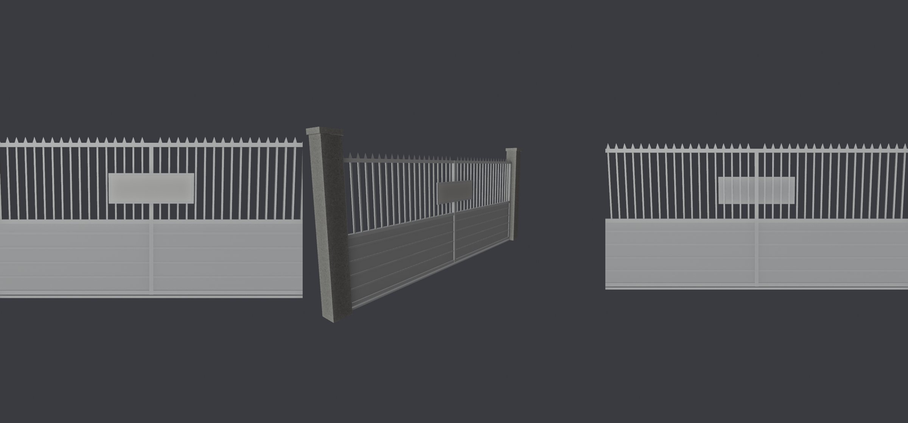

# GG-LANE-CLOSE-1110：公館往溫州街那條巷子的巷口關起來（X199 配套）— LAWWW2 帳號 A，2026-11-10

- 狀態：`MODEL_READY`（第 1 版），交 LAWWW 整合；BB 判。以開發分支 99294fead 為底。
- 遊戲截圖請 CC 拍（D131）：公館騎樓西端，往巷子裡看，白天、晚上各一張。

## 為什麼
- 使用者 X199（11-03 選擇題）：溫州街只從新生南路進出，公館往溫州街的巷口「拿掉」。
- 遊戲已經處理了兩件事：導航擋住、巷口一排盆栽（`gg_lane_closed_pots`）。
- 但公館正式模型 `gongguan_shops.glb` 還看得到 6 m 寬的巷子往南延伸，像是走得進去。
- LAWWW 11-10 14:21 派：巷口要一看就是進不去（D36：不用隱形牆、不要讓人以為能走），導航不動。

## 玩家會看到什麼
- 盆栽後面、騎樓店面玻璃那條線往裡 0.3 m，有一道台北巷弄常見的住戶鐵門：
  - 兩根清水混凝土門柱，貼著兩邊的牆；
  - 深綠色烤漆的兩扇拉門：下半截鐵板加橫向壓條，上半截直條，頂上一排短尖頭；
  - 地上有滑軌；
  - 門中間掛白底紅字的告示牌「私人巷道 請勿進入」，字由遊戲畫。
- 從騎樓往裡看，腰的高度先碰到鐵門。上半截是直條，看得到裡面還有巷子，但門關著，不會以為走得過去。
- 模型 716 個三角形、78 KB、3 個網格（混凝土、鐵件、告示牌）。

- Blender 預覽不畫頂點色，鐵門看起來是灰的，遊戲裡是深綠。告示牌是空白的，遊戲畫字。

## 做法
- `tools/blender/env_second/gg_lane_gate.py` → `assets/models/env/second_ai/gg_lane_gate.glb`，公館區域座標。
- `src/assets3d.js`：加 `bldg.gg_lane_gate`（放在花攤那一列後面）。
- `src/zones3d.js`：公館區域建好以後載入，用 `attachWenzhouModel` 接上，告示牌照 PLATE_FACE_ 畫字。載入失敗＝只有盆栽，和原本一樣。
- `src/data/zone_assets.js`：用 `node tools/gen_zone_assets.js` 重新產生。
  - 公館多了 `bldg.gg_lane_gate`；
  - 順便把已經過期的幾項更新了：新生南路的 `xs_planters`、`xs_gate`，校園照檔案大小重排。這是工具算的，不是手改。
- **導航完全不動**：巷口照舊是 `blockRect(-71, FZ+1.4, 6.2, 3.2)`，門後面本來就在 `blockOutside` 外面。

## 測試
- 新測試 `tests/gg_lane_close_unit.js`，照 index.html 的順序載入全部程式，建出公館區域：
  1. 有模型：manifest、檔案、zone_assets 的公館都有；
  2. GLB：鐵門擋滿兩邊的牆之間（x −74～−68，不凸進牆裡）、z 22.1～22.5、高 ≥ 2.2 m，有「私人巷道」告示牌；
  3. 遊戲：
     - 接上了；
     - 導航和沒有模型時一格都不差：巷口走不進去、騎樓走得通；
  4. 從騎樓往巷子裡看（腰的高度），先碰到鐵門（z 22.26）。
- 結果：**開發分支 99294fead：FAILED 4**；套上 patch：**ALL PASS**。
- 第一次跑第 2 項沒過：門柱的柱頭凸進兩邊的牆 2 cm。改了模型，柱頭靠牆那一邊不凸出去；測試條件沒有放寬。
- 回歸：讀到公館區域、gongguan_shops、zone_assets、ASSETS.manifest、wz_entry 的 108 支，全部通過（含 `wz_entry_xinsheng_unit`、`zone_prefetch_unit`），見 `regression.log`。

## 整合
- `git apply --binary gg_lane_close_1110.patch`，已確認可以套在 99294fead 上。
- 內容：zones3d.js、assets3d.js、zone_assets.js、gg_lane_gate.glb／json、gg_lane_gate.py、新測試、LICENSES.md。
