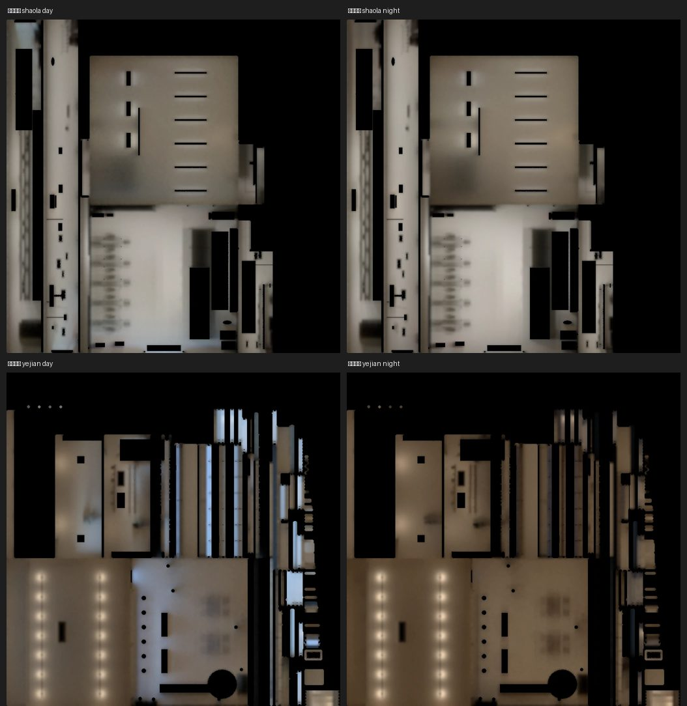

# 光照第一級第二批：公館燒臘、頁間書屋（LAWWW2-B 2026-11-07；lm_audit_1107 第一級）

接在第一批（便利商店、洋洋、轉角唱片，`a6509d2a0`，LAWWW-B 已整合 `4fcd3c45b`）後面。照 LAWWW-B 11-07 14:51：**在 AA／BB 的原檔上烘**，只加第二套 UV、`extras.lightmap`、拆開共用的材質，不動幾何、節點、座標、配置。

## 動了誰做的哪個檔
| 區域 | 檔案 | 誰做的 | 原檔 sha256（烘焙紀錄也有） | 大小 |
|---|---|---|---|---|
| noodle 公館燒臘 | `assets/models/env/second_ai/bb_support/shaola_interior.glb` | **BB**（v7；LAWWW 接進遊戲 `92243344b`） | `ef642b2bc9cb8ca2554fd6b50c6193f6c2239a64d45e4fcca54490dba7263904` | 3,905,580 → 3,989,208 B |
| bookstore 頁間書屋 | `assets/models/env/second_ai/aa_support/yejian.glb` | **AA**（v3b `d593be119`） | `6e8536ee6eac037e39631076a77bf7a5bee8db3da04bc6ad5178bed8e13fecda` | 2,628,224 → 2,729,996 B |

原作者以後重新匯出，光照貼圖會不見，要再跑 `bash tools/blender/env_second/lightbake/bake_gg_new.sh shaola`（或 `yejian`）。

## 新檔（都在我的分支 `claude/funny-albattani-iawshm`）
- `assets/models/env/second_ai/bb_support/shaola_interior_lm_{day,night}.webp`（27／26 KB）
- `assets/models/env/second_ai/aa_support/yejian_lm_{day,night}.webp`（36／33 KB）
- 烘焙紀錄 `tools/blender/env_second/lightbake/{shaola_interior,yejian}_lm.json`
- 腳本 `tools/blender/env_second/lightbake/bake_gg_new.sh`（加 `shaola`、`yejian` 兩段）
- 測試 patch `gg_lm2_1107_tests.patch`（對開發 `951543b9c`）：`gg_new_lm_unit.js` 加這兩間＋第 5 項（窗景卡、牆的 extras 照舊）；`shaola_wire_unit.js` 的檔案大小 3,905,580 → 3,989,208

**遊戲程式不用改**：兩間都走 `Z3.attachRoomGLB`，GLB 有 `extras.lightmap` 就接。

## 怎麼烘的
| | 公館燒臘 | 頁間書屋 |
|---|---|---|
| 房間 | 6 × 13 × 3.2 m，店面 +z | 12 × 10 × 3.8 m，店面 +z（整片窗） |
| 燈 | 天花板 18 支日光燈各 14 W；燒臘櫃 5 顆、左牆 2 盞暖色 6 W | 28 顆燈泡照高度換點光源：天花板 14 顆 13 W、吊燈 9 盞 8 W、檯燈落地燈 5 盞 4 W（2700K）；燈泡本身烘的時候藏起來 |
| 烘 | 地板、天花板、四面牆 | 地板、天花板、四面牆、牆上的木作（護牆板、窗框） |
| 不烘（照舊即時光） | 桌凳、燒臘、不鏽鋼、燈、印刷品、玻璃、**牆上的頂點色零件**（試烘時佔光照貼圖 26%、七到九成全黑：貼著牆、在櫃台後面、在廚房） | 家具和書櫃的木頭（島太多）、書、黃金葛、印刷品、頂點色小東西、燈泡、玻璃 |
| 窗外的景 | 遊戲本來就有（`shopViewPane` 視差窗），沒加 | 模型本來就有（`WALL_front_VIEW_yej_window_view`），烘的時候藏起來、照樣輸出，`windowView`／`dir` extras 照舊 |
| 拆開的材質 | 沒有 | `yej_oak`（牆上木作烘、家具不烘 → 家具用 `yej_oak_rt`）；遊戲只用名字找 `yej_window_view`，不受影響 |

光照貼圖亮度（WebP 編碼後、有用到的像素平均）：
| | 白天 | 晚上 | 過曝 |
|---|---|---|---|
| 公館燒臘 | 0.44 | 0.46 | 0% |
| 頁間書屋 | 0.36 | 0.29 | 0% |
| （參考）洋洋／轉角唱片／便利商店 | 0.42／0.34／0.57 | 0.38／0.32／0.51 | |

書屋晚上比較暗是故意的（暖色燈泡的書店）；試烘 10／7 W 時 0.26，加到 13／8 W。

## 測試（Node，D131）
- `gg_new_lm_unit.js`：開發原樣 **FAILED 2**（這兩間沒有 `extras.lightmap`）→ 加這批 **ALL PASS**。
- `shaola_wire_unit.js`（改大小）ALL PASS。
- 和這兩間、店內光照、`attachRoomGLB` 有關的 **46 支全部過**（在開發 951543b9c＋這批＋CAM-GONGGUAN-GATE patch 的工作樹上跑；清單：提到 shaola／yejian、建 noodle／bookstore 區域、用 attachRoomGLB／roomLightmap 的測試）。

## 還沒驗
1. **遊戲內**（CC 拍、BB 判）：兩間白天、晚上，從店門往裡、往窗外看；燒臘的走道、燒臘櫃前面；書屋的書牆、窗邊吧台、沙發角。
2. 光照貼圖和即時光的家具接得順不順（桌凳、書櫃用即時光，牆和地用光照貼圖）。
3. GPU 顏色、手機效能（PC）。
