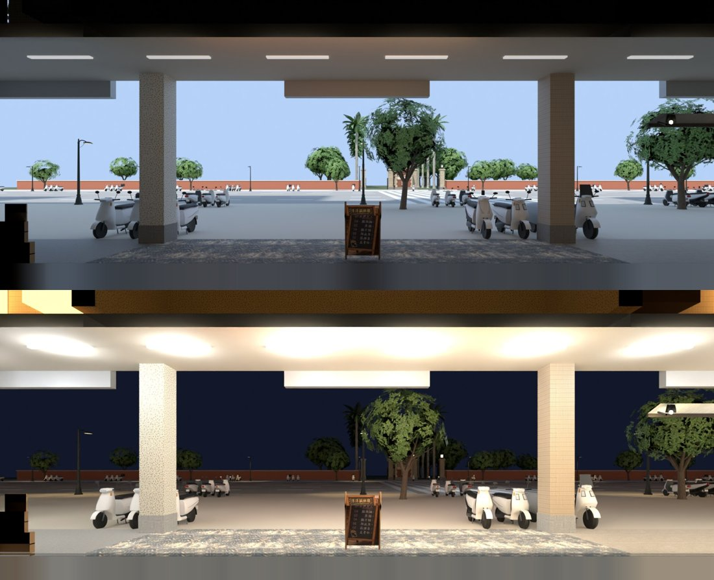
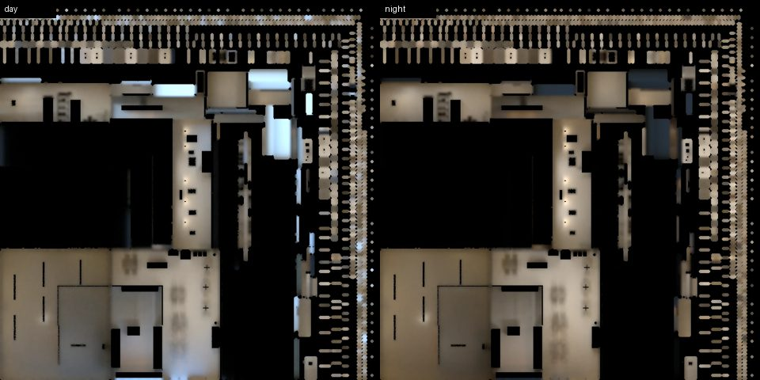
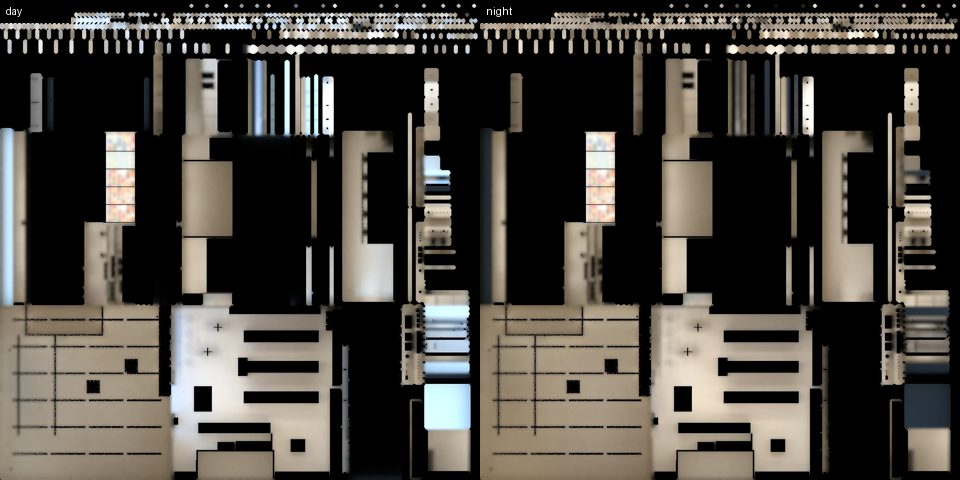
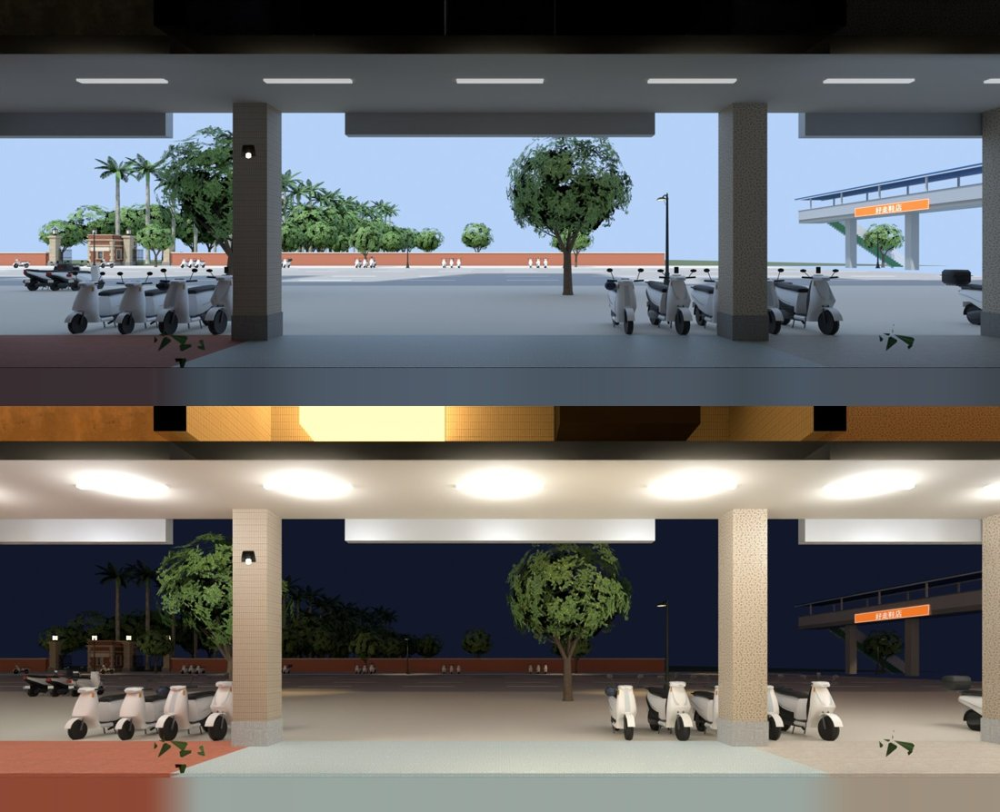
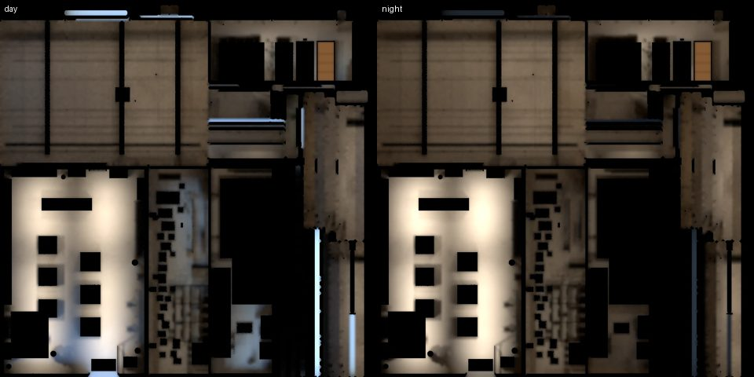

# 公館三間店：光照烘焙＋窗外的景（洋洋鹹酥雞、轉角唱片、日和便利店）（LAWWW2-B 2026-11-07）

**派工**：
- LAWWW-B 14:51：AA／BB 新做的店（lm_audit_1107 第一級）**直接在原檔上烘**。
  - 只加第二套 UV、`extras.lightmap`、拆開共用的材質；不動幾何、節點、座標、配置。
  - 記原檔 sha256，交件列「動了誰做的哪個檔」。
- LAWWW-B 15:35：插隊烘，順序洋洋 → 轉角唱片 → 便利商店。
  - 「兩間的 GLB 都沒有窗外的景（view card），從店裡看玻璃外面是空的，烘的時候順便看要不要補一張（照 afar 的做法）。CC 拍、BB 判。」
- BB-B 16:04（判開發分支 `e66781d1f` 的轉角唱片）：
  - P2：天花板切掉時，樑、燈盒、招牌從上面擋住畫面；
  - P3：鏡頭在東側時，右牆整組一起淡出，只剩黃金葛架沒跟著。

**狀態**：READY_FOR_ART_REVIEW（場景：BB／使用者判）。瀏覽器沒跑（D131），遊戲內畫面要 CC 拍。

**一句話**：
- 三間的光照烘好了。
- 洋洋、轉角唱片補了窗外的景：公館街景，白天、晚上各一張。
- 轉角唱片 BB-B 16:04 的 P2（天花板上的東西擋畫面）、P3（右牆一半淡出）改好了。
- 遊戲要接一個 patch（`zones3d.js` 兩處＋測試）。

## 動了誰做的哪個檔

| 檔案 | 原作者 | 原檔 sha256 | 動了什麼 |
|---|---|---|---|
| `bb_support/cvs_interior.glb` | BB（帳號 A） | `cb5efc95…` | 加第二套 UV、`extras.lightmap`、拆開共用材質（`bake_room.py`）；幾何、節點不動 |
| `bb_support/yangyang_interior.glb` | BB（帳號 A），`e5e9351e0` | `1e030a66…` | 同上；另外**加一個節點**：窗景卡 `WALL_front_VIEW_yy_window_view`（LAWWW-B 15:35） |
| `bb_support/corner.glb` | CC（帳號 A）v1c，`cc-testing 4fc38d513` | 開發分支 `fe406b44…`（＝我 38f4021e1 改過的） | ① 改 `corner_interior.py` 重產（BB-B 16:04 P2／P3）② 烘光照 ③ 加窗景卡 `WALL_front_VIEW_cr_window_view` |
| `tools/blender/env_second/bb_support/corner_interior.py` | CC | — | 第二次改（CORNER-CEIL／FADE-1107），檔頭寫了誰改、為什麼 |

原作者以後重新匯出，光照貼圖、窗景卡會不見，要再跑一次 `bake_gg_new.sh <店>`（窗景卡在裡面一起加）。

## 1. 洋洋鹹酥雞（公館 G05）

### 窗外的景（新加）

- 卡：`WALL_front_VIEW_yy_window_view`，玻璃外 2.5 m（店內 z 8.0）、16 × 6.5 m（y −1～5.5），和 afar 同一種卡（雙面、底色＋自發光 0.12、照片左右鏡像）。
  - 用 `tools/blender/env_second/lightbake/glb_add_viewcard.py` 加在烘好的 GLB 上：烘的時候沒有這張卡，不擋天光、不吃光照貼圖。
  - 卡上嵌的那一張是照片載入失敗時的備用；遊戲用 `GG_VIEW.yangyang` 白天、晚上換照片（晚上不調暗），和 afar、青木、頁間、Daybreak 同一套（`ggAAattach`）。
- 照片：`tools/blender/env_second/gg_shop_views.sh yangyang`（Blender Cycles 128 取樣、1600 × 650）。
  - 鏡頭在店的正中間、換成公館座標 (−9.4, 1.4, 27.57)，朝北；焦距 18、shift_y 0.053、`--clip-start 6.0`（剪掉自己這一棟的玻璃、招牌）。
  - 公館正式模型＋**遊戲公館區域裡的實際位置**：機車 122 台、行道樹 103 棵（照樹種）、路燈 46 盞（`tools/blender/env_second/gg_scene/*.json`，Node 建開發分支 `e66781d1f` 的公館區域匯出）。
    afar、青木那幾批還沒有樹、路燈的位置（整顆 street_trees.glb 放一次，椰子和樟樹疊在一起），這一批照遊戲種。
  - 白天照遊戲 14:00 的太陽；晚上路燈光圈（18 m 內只照燈下一圈，XS-NIGHT-1107 第 2 版 BB-B 的意見）。晚上的亮度和 afar 那張差不多（平均 112／116、騎樓天花板 224／217）。
  - 照片最下面一條（鏡頭前 6 m 內的騎樓地板和玻璃一起被剪掉，afar 那幾張也是一條天空色）：用上面幾列地面的顏色左右模糊補滿。



上圖是 Blender 渲染，**不是遊戲畫面**。看得到：自己這一棟的騎樓柱、菜單看板、騎樓外的機車、羅斯福路、對面的紅磚圍牆、校門、椰林大道、行道樹、路燈。

### 光照

- 白天：天光從店面（+z）進來（外殼只開這一面）；晚上：只有店裡的燈。
- 燈（從 BB 的腳本 `yangyang_interior.py` v1c 讀的位置）：天花板日光燈管 6 支各 30 W（`tube_lights.py` 讀 `yy_screens` 朝下的那幾片）、桌上黃銅圓頂吊燈 4 盞各 20 W、右牆鵝頸壁燈 5 盞各 10 W，暖色。
- 烘：地板、天花板、四面牆（漆面＋磚牆腰牆）、木作（桌面、椅子、結帳櫃）。
- 不烘（照舊即時光）：頂點色的櫃台、廚具、小東西（`yy_vc` 1 萬個三角形）、炸物（`yy_food` 3.1 萬）、金屬、燈、螢幕、海報、玻璃。
- 亮度（不是黑的地方的平均）：白天 0.39、晚上 0.35；過曝 1.9％／0.02％（白天在店面玻璃那一圈）。
- 黑的那一大塊：牆的外殼背面（在漆面後面，看不到）、桌椅底面。



## 2. 日和便利店（公館 G03）

- 燈：天花板 29 條 LED 燈條，每條 14 W（試烘 22 W：白天平均 0.63、燈條附近吃掉）。冷藏櫃的發光照樣照到地上。
- 烘：地板、天花板、四面牆、木作；不烘：貨架和商品（4.8 萬個三角形）、金屬、燈條、冷藏櫃、螢幕、印刷品、店面貼紙、玻璃。
- 亮度：白天 0.53、晚上 0.47（24 小時、晚上很亮）；過曝 4.1％／0.6％（都在店面玻璃那一圈：門口地上、朝玻璃的牆面）。
- 便利商店本來就有視差窗（`room()` 的 winXs／view），不加窗景卡。



## 3. 轉角唱片（公館 G12）

### BB-B 16:04 的 P2、P3（模型＋一段遊戲程式）

**P2：天花板切掉時，樑、白色燈盒（吸頂冷氣）、店名飾板從上面擋住畫面。**
- 原因：天花板是單面朝下，鏡頭高過天花板就看不到；樑、管線、軌道燈、冷氣和天花板合成同一個網格以外的東西，從上面看還在，橫在房間中間。
- 改法：
  - 模型（`corner_interior.py`，CORNER-CEIL-1107）：樑、管線、軌道、投射燈、吸頂冷氣改成 side `'ceil'`，網格名字 `CEIL_` 開頭、自己合併成一組；左牆上半段的店名飾板自己一組 `WALL_left_TOP_logo_*`，`extras.ceilHide`。
  - 遊戲（`zones3d.js` 的 `attachRoomGLB` 加 `ceilHide`）：模型裡有 `CEIL_` 網格或 `ceilHide` 的，鏡頭高過天花板（`CEIL_` 網格最高的地方，轉角唱片 3.28 m）就一起藏起來，回到下面再出現。
    和美國公寓的屋頂、吊扇同一個做法（`us3d.js`）。吊燈、吊繩照舊（和其他店一樣）。
  - **另一間也會受影響**：BB 的大口（`dakou_2f.glb`）有一個 `CEIL_LIGHTS`（二樓天花板 7.19 m 的燈板），也走 `attachRoomGLB`。加了這段以後，鏡頭高過二樓天花板時燈板也會藏（天花板本來就看不到，燈板浮在空中反而怪）。請 BB 判。

**P3：鏡頭在東側時，右牆的音響一起淡出，黃金葛架沒跟著。**
- 原因：遊戲照每個網格自己的外框中心判斷要不要淡出。同一面牆的零件中心都不一樣：
  - 牆 3.94、鐵架 3.3、黃金葛架 3.53；
  - GPU instancing 的音響在原點附近，鏡頭一過 x 0 就淡出。
  - CC 的 log：fade_E 時淡出的只有 instancing 那 15 個，牆、鐵架、黃金葛架都沒淡出。
- 改法（模型，CORNER-FADE-1107）：每一面牆的零件（含 instancing 節點）都給同一個淡出判斷點 `extras.at`（`attachRoomGLB` 本來就支援），放在那一面「最靠店裡的東西」那條線上：
  - 右牆 x 2.715（鐵架前緣）、左牆 x −3.352、後牆 z −5.13、前牆 z 4.09；
  - 鏡頭一到那面牆的東西上面，整組一起淡出。
- 鏡頭在店中間（x 1.5）時，右牆整組都不淡出（不會只淡出一半）。

**數字**：
- 三角形 55,004 不變，材質 11 個不變（窗景卡另外一個）；
- primitive 65 → 70：多出來的是 `CEIL_` 那幾組、店名飾板；
- 吊燈、投射燈的 instancing 照舊。

### 窗外的景（新加）

- 卡：`WALL_front_VIEW_cr_window_view`，牆外 2.5 m（店內 z 8.25）、16 × 6.5 m。
- 照片 `gg_shop_views.sh corner`：鏡頭 (55.6, 1.4, 27.82)、`--clip-start 6.25`。
- 看得到：
  - 自己這一棟的騎樓柱、機車、行道樹；
  - 左邊的校門、圍牆、椰林；
  - 右邊捷運出口前的天橋。



### 光照

- 燈（照配置 `corner_layout.js` 的 lights，和 GLB 的 `GLOW_*` 同一個位置）：
  - 兩條軌道上 18 盞投射燈，每盞 16 W、70° 朝下（遊戲的投射燈打向牆上的唱片，烘焙簡化成往下、光束放寬）；
  - 3 盞白色圓罩吊燈各 40 W；
  - 暖色 3000K。
- 烘：地板、天花板、外露的樑、四面牆。
- 不烘：
  - 木作（唱片櫃、唱片箱、層架）：幾百個小島，第一次試烘把 1024 貼圖切碎，地板、牆分到的解析度太低；
  - 唱片、商品、頂點色的小東西和音響、金屬、葉子和海報、發光、招牌、玻璃；
  - GPU instancing 的東西（`--keep-instances`：照舊是 instancing，共用網格不烘）。
- 試烘五輪：

  | 輪 | 燈 | 白天／晚上 | 問題 |
  |---|---|---|---|
  | 1 | 12 W、40° | 0.19／0.15 | 太暗；木作切碎貼圖 |
  | 2 | 24 W、40° | 0.32 | 軌道底下的地板兩條過曝 6% |
  | 3 | 20 W、70° | 0.34 | 過曝 3～5% |
  | 4、5 | 修 instancing 的第二套 UV | — | 見下面「工具的改動」 |
  | 定案 | 16 W、70° | **0.32／0.31** | 過曝 1.5％／2.9％（投射燈正下方） |



### 工具的改動（`tools/blender/env_second/lightbake/`，我的檔）

- `bake_room.py`：`--keep-instances` 時，好幾個物件共用的網格不烘。
  - Blender 匯入 GPU instancing 時，第二個以後的實例叫「網格名.001」，`--nolm` 的 `…_vc$`、`…_inst$` 認不到。
  - 試烘第三、四輪：它們被烘、共用網格的全部多了第二套 UV，材質一半有一半沒有（`gg_new_lm_unit` ②③ 抓到的）。
  - 以前用 `--keep-instances` 的法圖、總圖 3F：書本來就整個不烘，這個改動對它們沒影響（沒有重烘）。
- `glb_fix_instnames.py`（新）：烘完照原檔把 instancing 節點的名字、`extras`（`WALL_`／`CEIL_`、`dir`、`at`）補回去（Blender 重新匯出會叫「corner_interior.N」）。
- `glb_add_viewcard.py`（新）：加窗景卡。
- `bake_gg_new.sh`：三間的設定。
- `gg_shop_views.sh`（新）＋`gg_scene/*.json`：公館店內往外看的照片。

## 遊戲端（patch：`gg_new_1107.patch`，對開發分支 `03e92c411`，`git apply --check` 過）

| 檔案 | 改什麼 |
|---|---|
| `src/zones3d.js` | ① `GG_VIEW` 加 `yangyang`、`corner_records` 兩筆（兩間本來就走 `ggAAattach`，不用改別的）② `attachRoomGLB` 最後加 `ceilHide(z,root)`＋新函式 `ceilHide`（見 3.） |
| `LICENSES.md` | 一列：兩間的窗景照片、窗景卡 |
| `tests/gg_new_lm_unit.js`（新） | 三間的光照：貼圖在、該烘的有第二套 UV、不烘的沒有、沒有共用材質、淡出的牆節點都在 |
| `tests/gg_views_1107_unit.js`（新） | 兩間的窗景卡：照片在、長寬比、卡在玻璃外 2.5 m、白天／晚上換照片 |
| `tests/corner_ceil_1107_unit.js`（新） | 轉角唱片：鏡頭高過天花板藏 CEIL_、右牆一起淡出 |
| `tests/corner_glb_unit.js`（改） | 加 ⑤ CEIL_／ceilHide、⑥ 每面牆同一個淡出點；① 材質數不算窗景卡 |
| `tests/corner_shop_unit.js`、`tests/yangyang_shop_unit.js`（改） | 第 1 項檢查 GLB 的檔案大小（釘死 3,865,148／3,406,332 B）→ 改成這一版的大小 |

**接法**：
1. 拿檔案：
   ```
   git checkout <這一包的 commit> -- assets/models/env/second_ai/bb_support/{cvs_interior.glb,cvs_interior_lm_day.webp,cvs_interior_lm_night.webp,yangyang_interior.glb,yangyang_interior_lm_day.webp,yangyang_interior_lm_night.webp,yangyang_view_day.webp,yangyang_view_night.webp,corner.glb,corner.json,corner_lm_day.webp,corner_lm_night.webp,corner_view_day.webp,corner_view_night.webp} tools/blender/env_second/bb_support/corner_interior.py
   ```
2. `git apply docs/art-rebuild/second_ai/wip/gg_new_lm_1107/gg_new_1107.patch`

## 測試（Node，開發分支 `03e92c411`）

| 測試 | 開發原樣 | 只換模型 | 模型＋patch |
|---|---|---|---|
| `gg_new_lm_unit`（新） | （沒有這支） | — | **ALL PASS**（16 項） |
| `gg_views_1107_unit`（新） | FAILED 6 | — | **ALL PASS** |
| `corner_ceil_1107_unit`（新） | FAILED 4 | — | **ALL PASS** |
| `corner_glb_unit`（改） | ⑤⑥ FAIL | ALL PASS | **ALL PASS** |
| `corner_shop_unit`、`yangyang_shop_unit` | ALL PASS | FAILED 1（檔案大小） | **ALL PASS**（改大小） |
| `seat_fold_unit` | ALL PASS | — | **ALL PASS**（`ceilHide` 放在 `seatFold` 前面：這支用正規式找 `seatFold(z,root); }`） |

另外讀到這三間、`attachRoomGLB`、窗景、光照、公館、大口的 **218 支** `*_unit.js` 一起跑：
- 上面三支修好以後全部通過。

## 還沒驗（請 CC 拍、BB 判）

瀏覽器沒跑（D131）。

1. **洋洋**：
   - 白天 14:00、晚上 21:00；
   - 店裡往店門看（窗外的騎樓、機車、羅斯福路）；
   - 全店俯視。
2. **轉角唱片**：
   - 白天、晚上的 camRef 視角；
   - 店門往外看；
   - **BB-B 16:04 那四個方向的 fade 鏡頭＋坐高腳椅、坐沙發**：樑、冷氣、店名飾板應該看不到；鏡頭在東側時右牆整組（含黃金葛架）一起淡出。
3. **便利商店**：白天、晚上，店門往裡、結帳櫃台。
4. **大口二樓**：鏡頭高過二樓天花板時燈板 `CEIL_LIGHTS` 會藏。看有沒有怪。
5. 手機效能：
   - 轉角唱片 primitive 65 → 70；
   - 三間各多兩張光照貼圖（70～95 KB）；
   - 兩間各多一張窗景卡。
