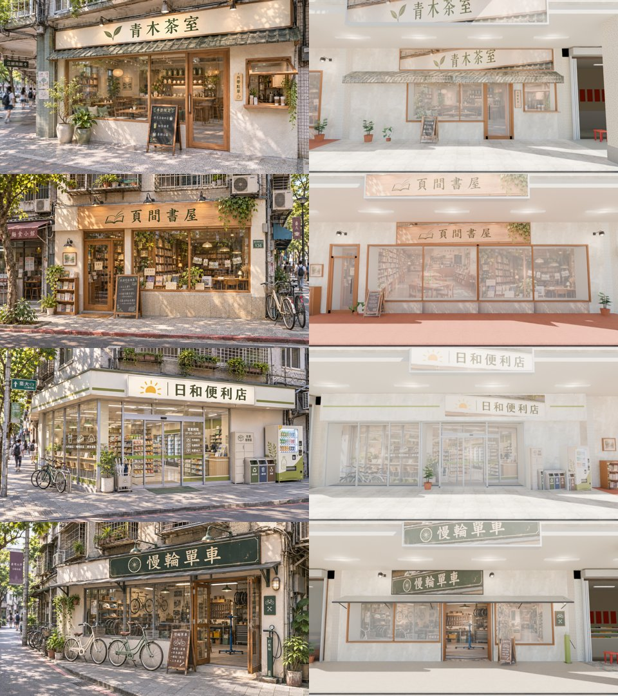

# 公館四間新店的外觀 v1（青木茶室、頁間書屋、日和便利店、慢輪單車）：MODEL_READY（外觀結構）；遊戲內截圖待 PC

- **需求**：使用者 11-04 01:0x（經 AA，AA_647）：「公館除了燒臘店以外可以互動的三間　包含單車　依照我給你的新店名　新外觀　新內部美術　重新設計」。
- **分工**：外觀四間是 LAWWW2（都在 gongguan_shops GLB）；室內由 AA（頁間、青木）、BB（日和）、CC（慢輪）做。
- **參考圖**：`docs/story_planning/ref_images/shops/gongguan_{tea,book,cvs,bike}_ext.webp`（企劃線）。
- **patch**：`gongguan4_fronts_v1.patch`，接開發分支 `e678da595`，`git apply --check` 通過。
  - 內容：`gongguan_shops.glb`、`.json`、`.props.json`；`zones3d.js` 的 `GG_PROP_BLOCKS` 一行（門口雜物的導航阻擋）。

## 做法（照新生南路的做法，SCENE_RULES §12）
- 招牌、窗裡看到的店內、門裡面、黑板立牌、販賣機、置物櫃、回收桶、書車、牌匾，都從參考圖裁下來、校正透視：
  - 腳本 `tools/blender/env_second/xs_front_tex.py` 的 QG → `textures/gen/gg_fronts_atlas`，28 塊。
- 以下是 3D：
  - 牆（plaster PBR）、窗框、門框、玻璃、景深卡後面的內牆和窗台；
  - 青木的綠瓦屋簷（前緣一排瓦）、日和的白色招牌框（綠色線、底下崁燈）、慢輪的鐵皮雨遮（黑鐵架）；
  - 鵝頸燈、盆栽、打氣站。
  - 腳本：`wz_shopkit.py` 的 `gg_front`（在 `arcade_front_v2` 裡）、`wz_street.py` 的 `GG_XS`。
- 遊戲的店面比參考圖寬。多出來的那一段用同一間店的**室內**參考圖（`_int.webp`）做另一扇窗：
  - 頁間書屋左半扇、日和便利店左邊（參考圖轉角那一面的座位區）、慢輪單車右邊。
- 公館是騎樓：店面在騎樓裡面（z −3）。招牌在店面上方貼一塊，騎樓外的樑上也貼一塊，從馬路看得到。

| 店 | 店門（本地 x） | 從左到右 |
|---|---|---|
| 青木茶室 G01 | 1.3～2.4 木框玻璃門 | 兩個大盆栽、大窗（店內）、門、牌匾「外帶點單」、外帶窗口＋木檯面；綠瓦屋簷；上面一整塊招牌 |
| 頁間書屋 G02 | **−5.15～−4.05**（照 AA 的室內 yejian_layout.js） | 牆＋書車＋畫框、木門、窗兩格（左：室內參考圖；右：外觀參考圖）、窗台下石材腰牆；黑板立牌、盆栽、兩盞鵝頸燈 |
| 日和便利店 G03 | −0.56～1.36 自動門 | 左邊一排落地窗（內用座位）、自動門＋兩側玻璃、白牆前的置物櫃、回收桶、販賣機；白色招牌框＋綠線 |
| 慢輪單車 G06 | −0.5～1.6 整面拉開 | 櫥窗（單車、安全帽）、拉開的門（看得到修車架、工作台）、右邊櫥窗；深綠招牌、鐵皮雨遮、打氣站、黑板立牌 |

- 本地 x：從騎樓看過去左→右，和室內 x 同方向。換成公館座標：x＝店的中心 − 本地 x。
- 舊的直立招牌（舊路書房、單車）拿掉了，因為新參考圖沒有。舊店名的 SIGN_FACE 也不再出現。
- 規格：`gongguan_shops.glb`
  - 三角形 113,861 → 79,642：舊的日日便利、書店有立體的淺店內，換成景深卡，少很多；
  - Blender 材質 129 → 138；
  - 9.4 MB → 7.8 MB。

- 右邊是 Blender 渲染，不是遊戲截圖，太陽偏亮、對比偏低。遊戲裡的光照時段打，要在 PC 截圖比。

## 要 LAWWW 做的（LAWWW 的檔）
1. **頁間書屋的店門互動點**：從店中心往右 0.6 m（公館 x −41.6），移到門口 **x −36.4**（z 照舊 FZ+2）。
   - AA 的室內門在 x −4.6，外觀照它開，所以互動點要跟著移。
   - 室內的出生點照 AA 的 `yejian_layout.js`。
2. 其他三間的互動點不用動：
   - 青木：互動點在大窗前，門在右邊 0.7 m，都在範圍 2.2 內；
   - 日和：門的中心就是互動點；
   - 慢輪：門的中心就是互動點。
3. 店名（zones3d.js 的公館 shops、互動字）：照 AA_647 §6 改。GLB 的招牌已經是新店名。

## 測試
- Node（e678da595＋這份 patch）：
  - `street_props_nav_unit`：公館 45 個地上雜物，人貼牆走不會穿過去；
  - singleside 七支、zone_prewarm、lampshade_flip、bike、bike_seat、campus_bikes、bookstore_exit、bookstore_interior_lm、cvs_interior_lm。
  - 全部 ALL PASS。
- 還沒跑：瀏覽器的 gongguan_glb_integration、gongguan_layout_nav、遊戲截圖（PC，D131）。

## 和參考圖還不一樣的地方（醜點）
1. 參考圖不是騎樓。遊戲的公館是騎樓，所以店面退在騎樓裡，上面多一塊騎樓天花板。招牌兩處都貼。
2. 日和便利店在參考圖是轉角店，左邊那面窗是斜的；遊戲是中間的店，那面窗攤平放在左邊。
3. 青木門口的大盆栽：參考圖是高 0.6 m 的陶盆，這版用街上現成的盆栽（小一號）。
4. 參考圖門口停的腳踏車：慢輪用遊戲裡原本那三台；頁間、日和沒放（人行道上）。
5. 窗裡的店內是參考圖裁的。AA、BB、CC 的室內收了以後，改成從街上渲染室內模型（日常失速那樣），外面看到的才會和走進去的一樣。
