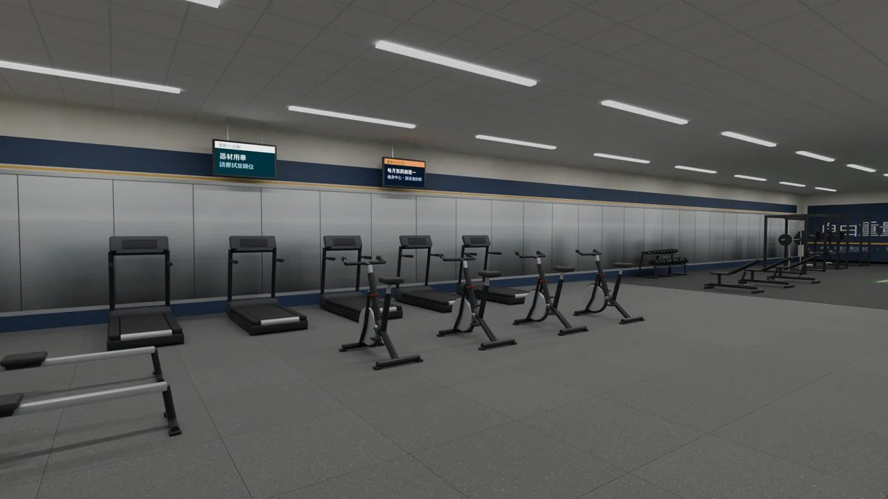

# AA716-GYM-BG：新體育館 B1 健身中心的 2D 背景（LAWWW2-B 2026-11-07）

**派工**：LAWWW-B 07:46。
- 用在 AA_716 子晴故事線第 3 拍以後的約「陪子晴去健身房」（`src/data/arc_invites.js` `heroine_04:3`，`src/arcinv3d.js`）；
- 那一場是 2D 對話，背景原本是深色底＋「新體育館 B1・健身中心」。

**狀態**：**READY_FOR_ART_REVIEW**。
- 2D 背景照 D100 本來歸 BB 跟使用者要；這張是從我們自己的 3D 模型拍的（和窗景照片同一種做法），副本給 BB 看；
- 圖本身沒有字以外的標誌：牆上告示螢幕的字是模型原本的（「器材使用」那一類，沒有品牌）。



## 檔案

- **`assets/bg/gym_b1_fitness.webp`**：1280×720，46 KB。
- 算圖工具 `tools/blender/env_second/bg_gym_b1.py`：
  - 讀遊戲的 B1 正式模型 `assets/models/env/second_ai/gym_b1.glb`；
  - 燈和光照烘焙同一份（`lightbake/gym_b1_lm.json`：天花板 2.4 m 燈管、走廊壁燈），所以明暗和遊戲裡一致；
  - Cycles 96 樣本、1920×1080，縮成 1280×720。

**畫面**：
- 健身中心東半部的有氧區：中間四台飛輪，後面一排跑步機貼著南牆整面鏡子，左下角一台划船機；
- 右邊遠處是自由重量區；
- 晚上 19:00：B1 沒有窗，燈全開；
- **沒有人**（立繪站在前面）。下面三分之一是地板，會被對話框蓋住，不擋器材。

重拍：
```
/opt/blenv/bin/python tools/blender/env_second/bg_gym_b1.py -- <輸出.png> --res 1920x1080 --samples 96 --eye 6.6,1.5,4.3 --look 0.8,1.15,12.6 --lens 19
```
（cwd 放在 scratchpad：在 repo 根目錄跑，glTF 匯入會壞）

## 接法（給 LAWWW-B）

1. 換上 `assets/bg/gym_b1_fitness.webp`。
2. `src/outings3d.js` 登記：
   ```
   S.BG.gym_b1_fitness={label:'新體育館 B1・健身中心',image:'assets/bg/gym_b1_fitness.webp'};
   ```
   - label 照 `arc_invites.js` 原本寫的「新體育館 B1・健身中心」；
   - 要加「首都帝大・」前綴，照 `ntu_court_night` 的寫法也可以。
3. `arc_invites.js` `heroine_04:3` 的 CFG 指到 `gym_b1_fitness`。
4. `LICENSES.md` 加一列（照 `dorm_roof`、`video` 那幾列的格式）：
   ```
   | 新體育館 B1・健身中心（晚上）`assets/bg/gym_b1_fitness.webp`（LAWWW2-B AA716-GYM-BG） | 本作 Blender 算圖（`tools/blender/env_second/bg_gym_b1.py`，遊戲的 gym_b1.glb＋光照烘焙的燈）；健身器材、鏡牆、告示螢幕，沒有品牌和標誌 | 本作 | 陪子晴去健身房（AA_716，heroine_04:3） |
   ```

## 沒做

- 遊戲內對話畫面裡的樣子（立繪疊上去、手機直向裁切）：要 CC 拍。
- 只有晚上一張。要白天：B1 沒有窗，白天晚上看起來一樣，用同一張就好。
