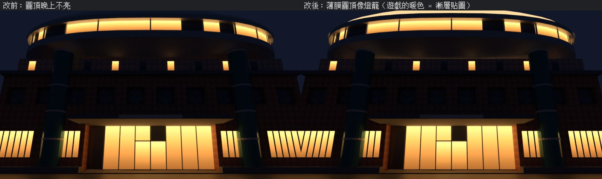

# XS-GYM-DOME-NIGHT-1107：體育館的薄膜圓頂晚上像一座燈籠（LAWWW2-B 2026-11-07）

**起因**：`TODO_SHORTCUTS.md` XS-NORTH-EXT-1105 先將就的第 3 點：「體育館的薄膜圓頂晚上不會亮（照片：『像一座燈籠』）」。

**狀態**：**READY_FOR_ART_REVIEW**（場景美術：BB／使用者看）。
- 下面是 Blender 預覽，不是遊戲畫面；
- 遊戲內晚上的樣子排 CC（D131）。

## 改法

只改模型：`tools/blender/env_second/campus_xsnorth.py --set gym` → `assets/models/env/second_ai/campus_gymext.glb`。**遊戲程式不用改。**

- 圓頂原本和鋼桁架、窗的直條共用白色材質 `ck_gym_white`。現在拆成自己的材質 `ck_glass_lit`：
  - 這個名字遊戲的 `WZ_NIGHT` 已經有：[0xffd49a，晚上 1.0，白天 0]；
  - 校園、新生南路接體育館都走 `attachWenzhouModel`，會自動登記夜間亮度。
- 白天底色和原本一樣（`#eef0ed`，粗糙度 0.5）。
- 自發光貼圖是中性灰的漸層：圓頂邊緣 0.75 → 頂上 0.5。遊戲再乘暖色：邊緣比較亮、頂上柔和，不會整片刺眼。
- 圓頂每一圈給 UV 的 v。
- 名字開頭是 `ck_glass` → `WZ_NO_SHADOW`：圓頂不投影子，橢圓環、牆照舊投影。
- 三角形總數 4,192 不變（圓頂 528 個拆出來）；範圍不變；材質 9 → 10 個（多一個 draw call）。

從前面的鋪面看，淺圓頂只露出邊緣那一圈；從新生南路、校園小廣場遠一點看，看得到的圓頂比較多。

## 測試（Node，開發 `86f0c924f`）

**新測試 `tests/gym_dome_night_unit.js`**（`gym_dome_night_1107.patch`，`git apply --check` OK）。在 Node 建校園、接上正式模型以後：
- ① 圓頂是 `ck_glass_lit`；GLB 裡有自發光貼圖和 UV；發光顏色 0xffd49a；夜間亮度登記成晚上 1、白天 0。
  - Node 裡圖片貼圖載不進來，所以貼圖是直接讀 GLB 的 JSON 檢查。
- ② `TK.setNight(1)` 亮、`setNight(0)` 不亮；圓頂不投影子。
- ③ 其他白色零件（桁架、直條）沒有跟著亮。

| | 開發原樣 | 新模型 |
|---|---|---|
| `gym_dome_night_unit` | **FAIL 2** | **ALL PASS** |
| `xs_north_ext_unit`（範圍、招牌） | ALL PASS | ALL PASS |

## 接法（給 LAWWW-B）

1. 換 `assets/models/env/second_ai/campus_gymext.glb`（我的分支）。
2. 套 `gym_dome_night_1107.patch`（只有新測試）。
3. `tools/blender/env_second/campus_xsnorth.py`：要重匯的話一起帶。

## 還沒驗

- 遊戲內晚上（CC）：
  - 新生南路側門往南看；
  - 校園小廣場看體育館；
  - 21:00、晴。
- 亮度太亮或太暗：改 `dome_mat()` 的漸層（0.75／0.5）重匯。遊戲那邊的 1.0 是所有 `ck_glass_lit` 共用的，不要動。
