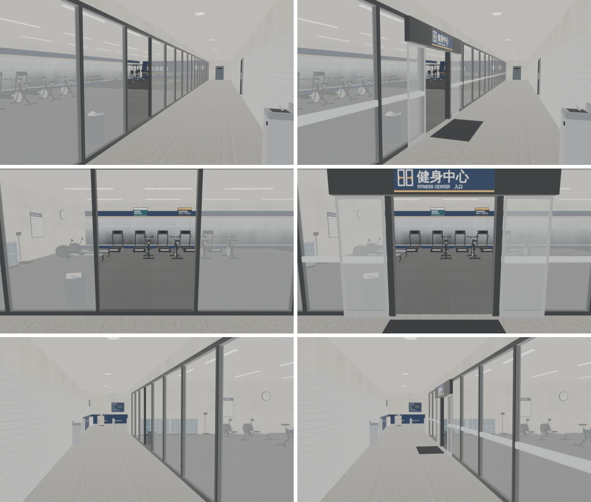

# 健身中心的玻璃門看得出是門（GYM-FIT-1107 美術部分；LAWWW2-B 2026-11-07）

- **第 1 版**（門這一塊；B1 其他地方沒動）。
- 起因：使用者 11-07 試玩 v9.10.21：「健身房都是玻璃門 門不夠明顯 健身器材我還是不能用……」（UA-LAWWW-1107-01）。LAWWW-B 03:37 派給我美術部分；器材互動、運動效果是 LAWWW-B 的程式。
- 狀態：`MODEL_READY`。預覽是 Blender EEVEE（沒有光照貼圖、均勻光），不是遊戲畫面；遊戲內截圖排 CC（D131）。

## 原本錯在哪

- 走廊南邊整排落地玻璃（34 m），門只是少一片玻璃：門邊的框和旁邊玻璃的框一樣細（7 cm），門上沒有東西。從走廊看不出哪裡是門，像整面都是玻璃。
- 門口還橫著一條 8 cm 的下框（門檻）。

## 這一版（`tools/blender/env_second/gym_b1.py`）

照常見的健身房自動門做：
1. **門框**：門兩邊 11 cm 寬、16 cm 深的深色門框（比玻璃框粗、深）＋門楣；門的淨高 2.15 m。
2. **自動門機箱＋招牌**：走廊那一面一條深色機箱（x 2.25～5.95），正中間貼「健身中心 FITNESS CENTER 入口」招牌（深藍底白字、底下黃線，和服務台的牌子同一套；會亮；左邊一個自動門的圖示）。貼圖 `textures/gen/b1_fit_door.png`（`gym_tex.py` 的 `b1_fit_door`）。
3. **門扇**：兩片拉開、停在門兩邊的玻璃門扇（不鏽鋼框），在固定玻璃的走廊那一側。
4. **防撞貼條**：整排玻璃（和門扇）離地 1.0～1.1 m 一條霧白橫條：看得出那是玻璃、門那一格沒有。
5. **地墊**：門口走廊那一側 1.9 × 0.95 m 深色地墊。
6. 門口那一段的下框拿掉。
- 導航不變：門口照舊是配置的 x 3.2～5.0（門框只往門口裡吃 1 cm）。
- 新東西都在玻璃牆那一組（`WALL_fitN_`），鏡頭在健身房裡往外拍時跟牆一起淡出；地墊不淡出。

## 光照烘焙

- 整間重烘（`bash tools/blender/env_second/lightbake/bake_gym.sh b1`：1024²、256 取樣，318 秒）。
- 新的貼條、地墊、招牌照即時光（`bake_gym.sh` 的 `--nolm` 加 `_frost|_door_mat|_fit_sign`）；其他照舊。
- 光照貼圖的平均亮度和改前差不到 1%（白天 42.6→42.4、晚上 42.6→42.3）：只有 UV 重新排。

## 規格

| | 改前（開發 `77195b12a`） | 改後 |
|---|---|---|
| GLB | 4,439,800 B | 4,472,968 B（+33 KB：招牌貼圖、幾何） |
| 網格／材質 | 89／43 | 93／46（+貼條、地墊、招牌三種材質） |
| 三角形 | 56,488 | 56,840（+352） |
| 光照貼圖 | 1024² ×2 | 1024² ×2（重烘） |

draw call 大約 +3（三種新材質）。

## 接法（給 LAWWW-B）

1. 換二進位（從我的分支 `claude/funny-albattani-iawshm`）：`assets/models/env/second_ai/gym_b1.glb`、`gym_b1.json`、`gym_b1_lm_day.webp`、`gym_b1_lm_night.webp`。
2. **不用改程式**（`Z3.attachRoomGLB` 照舊接；`gym_b1` 區域、導航都不動）。
3. 新測試 `tests/gym_fit_door_unit.js`：patch `gym_fit_door_1107.patch`（只有這一個新檔）。
4. 工具（只在我的分支）：`gym_b1.py`、`gym_tex.py`、`bake_gym.sh`、`gym_b1_lm.json`、`textures/gen/b1_fit_door.png`。

## 測試（Node）

- `tests/gym_fit_door_unit.js`：開發分支原樣 **FAIL 3**（① 招牌 ② 貼條 ③ 地墊）；新模型 **ALL PASS**。
  - ④ 門口 9 條水平射線（x 3.4／4.1／4.8 × 高 0.3／1.0／1.8 m）從走廊到健身中心都沒打到東西：沒有看不見的玻璃（不退步，原本也 PASS）。
  - ⑤ 對照：旁邊的固定玻璃打得到。
- 新模型＋開發分支一起跑：`gym_b1_lm_unit`、`gym_b1_fitness_unit`、`gym_b1_plates_unit`、`door_open_unit`、`gym_unit`、`gym_crowd_unit`、`gym_pose_unit`、`gym_hear_unit`、`pe_aa644_unit`、`crowd_depts_unit` 都 ALL PASS。
- 沒跑：瀏覽器、手機（D131 排 CC：B1 走廊往健身中心看、門口正面、健身房裡往外看）。

## 先將就的

1. 門扇是停在旁邊的（開著），沒有開關門的動畫。
2. 健身中心的出口那一面（從裡往外看）沒有招牌，只有門框和機箱的背面。
3. 器材不能用、運動效果：LAWWW-B 的程式，不在這一包。
4. 瀏覽器沒跑（D131）。

## 檢查清單

- [x] 沒有館名、商標（D77）：招牌只寫「健身中心 FITNESS CENTER 入口」。
- [x] 沒有複製貼上（D133）。
- [x] Node 測試修改前 FAIL、修改後 PASS。
- [x] 驗收狀態：MODEL_READY；遊戲內截圖以後請 BB 判。
