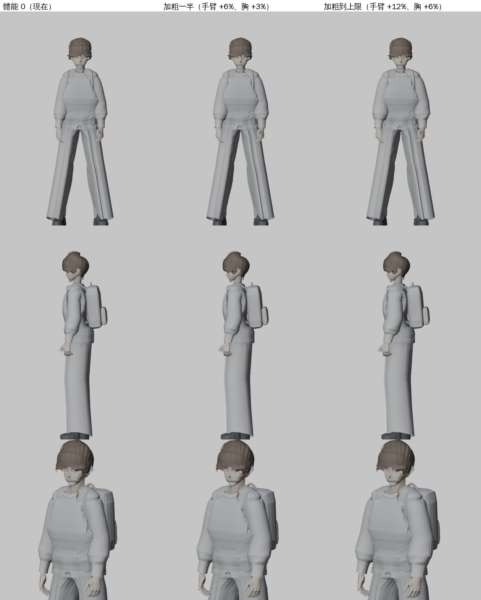

# GYM-FIT-1107：健身中心器材資料＋肌肉線條評估（LAWWW2-B 2026-11-07）

派工：LAWWW-B c244ce20e。原文：「LAWWW2-B 給 gym_layout.js b1.fitness.equip（22 件器材的位置、用的站位、姿勢）＋評估肌肉線條（骨頭縮放或法線貼圖）」。

## 一、器材資料 `b1.fitness.equip`（patch：`gym_fit_equip_1107.patch`，對開發 c244ce20e）

22 件，和 `b1.equipment` 是同一批器材：node、at、ry 一樣，`i` 是在同一種器材裡的第幾台。資料也另存一份 `equip.json`。

| 種類 | 台數 | use（用的時候人在哪裡） | 姿勢 | stand（走過去站的地方） |
|---|---|---|---|---|
| treadmill 跑步機 | 5 | 皮帶上：器材原點往後 0.2、y 0.18、面向鏡子 | run（alt walk） | 後面 z 10.95 |
| bike 飛輪 | 4 | 器材原點 | gym_bike | 後面 z 8.15（8.2 以上碰到擋板） |
| rower 划船機 | 2 | 器材原點、面向 +x | gym_row | 座椅旁邊（第 1 台北側、第 2 台南側） |
| squat_rack 深蹲架 | 2 | 器材前面 1.15 m、面向鏡子 | gym_squat | 同 use |
| smith 史密斯機 | 1 | 器材前面 1.15 m、面向鏡子 | gym_squat | 同 use |
| db_rack 啞鈴架 | 1 | 架子前面 0.95 m，**兩個位子**（x ±0.55） | gym_curl | 架子正前方 |
| bench 訓練椅 | 3 | 器材原點（坐著肩推） | gym_press | 左手邊 x −0.75（兩張椅子中間）、面向 +x |
| mat 墊子 | 4 | 靠 −z 那一端坐、腿往 +z 伸 | gym_stretch | −z 那一端外面 |

史密斯機：模型的槓固定掛在 1.25 m，所以和深蹲架一樣站在機器前面做，不站進機器裡。要站到槓下面，得先做會動的槓。

每一筆另外有：

- `area`：cardio 有氧／weights 自由重量／stretch 拉筋；
- `train`：練到哪裡，例如心肺、腿、手臂，給 AA_713 旁白用；
- `label`：例如「跑步機 3」。

**和路人一致**：use 就是 crowd3d.js 路人現在擺的位置和姿勢。玩家要用之前，可以照位置判斷那一台有沒有人在用。

**測試**：新的 `tests/gym_fit_equip_unit.js`。在 Node 建出遊戲真正的 B1，用引擎的導航檢查：

1. 22 件，每一件都對得到 equipment；
2. stand 都站得下（半徑 0.32 m）、從出生點走得到、面向器材；
3. use：坐著的在器材原點、跑步機在皮帶上、站著用的站得下，姿勢是遊戲有的動作；
4. 進館 24 次，71 人次的路人位置和姿勢都對得到某一件的 use。

- 開發原樣：第 1 項 FAIL（沒有 equip）。
- 加 patch：**ALL PASS**。
- 全部 Node（裙子、籃架、器材三包一起套在開發 c244ce20e 上，1,076 支）：**1,068 PASS／8 FAIL**。8 支在開發原樣也 FAIL：
  - aa535b_lawlib_lake、gg_shops2_1104、invite_menu：開發 718b59ec7 新增「Daybreak 念書」，測試沒跟著改；
  - flirt、gift、msg_reply、study_scenes：scratch worktree 裡沒有故事分支的 commit；
  - ladder_headroom：爬梯子的平滑度，舊的。

## 二、肌肉線條評估

試做的方法：在 Node 裡用遊戲自己的 `CHAR.build`＋idle 動作，只改玩家模型的骨頭縮放，匯出給 Blender 拍。腳本是 `muscle_proto.js`，結果是 `muscle_proto.jpg`。

- **手臂**：upperArm 沿長軸以外的兩個方向加粗（長度不變），手掌反向抵銷；
- **大腿**：加粗前面那個比例的六成，腳掌抵銷；
- **胸口**：寬、厚加粗手臂的一半（肩膀跟著變寬），脖子抵銷；
- **三個等級**：0、一半（手臂 +6%、胸 +3%）、上限（手臂 +12%、胸 +6%）。

**看得到多少**：玩家現在穿長袖上衣、寬褲。加到上限也只看得出手臂、肩膀稍微飽滿一點；第三人稱鏡頭 3～4 m 外幾乎分不出來。加到 +20% 以上就像衣服裡塞了墊子，不像肌肉。

**三種做法比較**：

| 做法 | 看得到嗎 | 成本 | 風險 |
|---|---|---|---|
| ① 骨頭加粗（上面的試做） | 輪廓稍微變，細節沒有 | 遊戲端約 10 行（`CHAR` 建人時照體能設骨頭縮放）；所有衣服自動跟著 | 掛在骨頭上的配件會跟著放大幾 %（例如掛在胸口的後背包）；坐下高度差不到 1 cm（`SIT_FIT` 的大腿厚度）；動作、腳步貼合不受影響（長度不變） |
| ② 法線貼圖畫肌肉 | 只有露出來的皮膚（短袖、短褲）；MToon 卡通著色會把法線細節壓平 | 每個模型畫一張，還要對 UV | 長袖幾乎都看不到，**不建議** |
| ③ 身體＋衣服加一個「fit」形狀（morph，像這次裙子的做法） | 可以控制得最好：肩、胸、手臂的線條 | Blender 每一套衣服都要做一份 | 換衣服就要再做；玩家是主要角色，外觀改動要 BB／使用者看過 |

**建議**：

- 體能四階先用 ①、小幅度（上限：手臂 +8%、胸 +4%、大腿 +5%）。看得出「比較結實」就夠了，不要做成健美。
- 真正讓玩家感覺得到的，是朋友的反應（AA_713 旁白）、走路和騎車變快（已經有了），還有去健身房換短袖運動服。
- 如果使用者想看到手臂的線條，再在**運動服那一套**用 ③ 做。只做一套衣服，不是每一套都做。
- 玩家外觀的改動照 D59、D99，要 BB-B（角色美術）看過。這一份只是評估和試做，**沒有改任何模型**。
