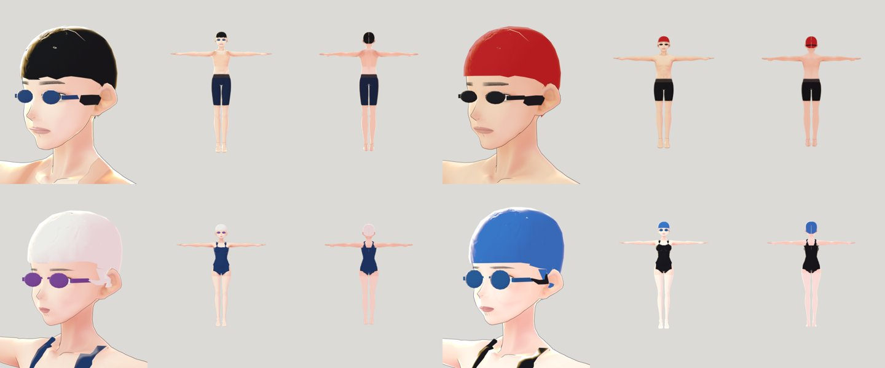
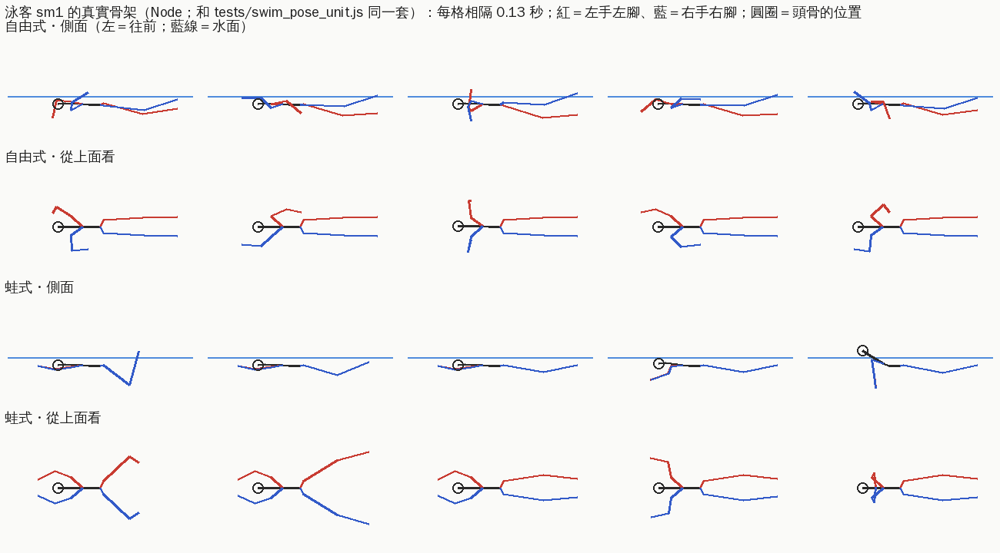

# ART-GYM-POOL-SWIMMERS-1103：游泳池裡游泳的人（泳客模型＋自由式、蛙式）— LAWWW2 帳號 A，2026-11-10

- 狀態：`MODEL_READY`＋動作做好，交給 LAWWW 接進 crowd3d 的游泳池。人物美術由 BB 驗收（D59）。以開發分支 `06e779533` 為底。
- 來源：使用者 11-03「游泳池完全沒人？」（X169 後半）。
- 工具照 D144：新容器跑 `bash tools/blender/setup_env.sh` 就裝好（VRM 外掛 OK、VRoid 樣本 9 個），**不用再問使用者**。
  - 今天早上 10:48 我把「卡在裝外掛」當成要問使用者的事，是我的錯。D144 之後直接裝就做好了。
- 畫面請 CC 錄（D131）：B1 游泳池開館時，水道裡游、到池邊轉身；白天和晚上。下面兩張不是遊戲畫面。

## 玩家會看到什麼
- 四個泳客，身體、臉、膚色都不一樣；都是正式人物生產線做的，不是方塊人：
  - **男 1**：黑色泳帽、藍色泳鏡、深藍及膝泳褲；
  - **男 2**：紅色泳帽、黑色泳鏡、黑色及膝泳褲，膚色較深；
  - **女 1**：白色泳帽、紫色泳鏡、深藍連身泳衣；
  - **女 2**：藍色泳帽、藍色泳鏡、黑色連身泳衣。
- **自由式**：
  - 兩手輪流畫大圓：手伸到頭前面，在水裡往後划到大腿旁邊，再從水面上繞回來（手肘朝上）；
  - 身體跟著左右滾，腳一個划手的循環踢三下；
  - 每兩個循環往右轉頭換氣一次。
- **蛙式**：
  - 兩手從頭前往外撥，收到胸口下面，再往前推出去，接著滑行；
  - 划水時上身抬起來換氣；
  - 收腳時膝蓋往下、往外，腳跟收到水面為止，接著往外往後踢、併攏。
- 每個人的速度（±15%）、起始時間都不一樣，不會同步。
- 在水道裡來回游，到池邊停 1.4 秒轉身。

## 做法
- **人物**：`tools/blender/char_second/swimmer.py`（新）。
  - 身體、臉照路人產生器 `npc.py` 的 stage0（拿掉衣服、補滿皮膚）和 face；沒有頭髮，戴泳帽。
  - 四個人沿用路人 nm4、nm7、nf2、nf3 的身體和臉，各用不同的 VRoid 樣本。
  - **泳衣、泳帽、泳鏡帶子**：從身體網格取出那一圈，沿法線往外撐 3.5～9.5 mm，變成貼身的殼。頂點和骨頭權重都和身體一樣，動作時不會穿模。
    - 邊緣的頂點推回邊界線上，邊緣是平順的線，不會一格一格。
    - 耳朵不包進去。
  - **泳鏡**：鏡片照眼白的範圍做，放在眼睛表面前 7 mm，綁頭骨。
  - 做的時候踩到的坑：VRoid 的網格物件本身轉了 180°，頂點座標的前後和骨頭相反；眼睛骨頭在眼球中心，比臉的表面深 6 cm。
  - **樣本貼圖上的襪子、褲襪**：黑襪、黑褲襪、白過膝襪，都重畫成那個人軀幹皮膚的顏色。
  - 照路人的流程整理（`vrm_finish2.py`，NPC_SMALL）後放在 `assets/models/char/second_ai/bl_swim_{sm1,sm2,sf1,sf2}.vrm`，每個 1.4～1.8 MB。
- **動作**：`src/character3d.js`。
  - 新增兩個姿勢 `swim_free`、`swim_breast`，加在 `C.GYM_POSES` 裡，和健身房器材動作同一套：真實骨架、兩段式 IK、每個人速度和相位不同。
  - 先照直立的人擺好手腳，最後整個人轉成趴著，臀部放在人物原點正上方，背在水面。
  - 參數在 `C.GYM.swim`：
    - 水面 `water` −0.14：照 gym_b1.glb 的 b1_water；人物原點是池邊地面的高度，和其他路人一樣；
    - 從站姿換過來用 2 秒（`blend`），要移動 1 m 多，不能瞬移。
  - 每一格歸零 `rotation.x` 的那一行排除游泳（原本只排除躺著）。
  - 備用人物（GLB、程序化）沒有這兩個動作，會照站著（`GYM_FALL`）。所以**沒有泳客 VRM 時不要放人到水裡**，見下面。
  - 新增 `C.swimLap(t, L, v)`：t 秒、水道長 L、速度 v → `{x, dir, yaw, turn}`。在水道兩頭之間來回，到池邊停 1.4 秒、轉身半圈。
- **manifest**：`src/assets3d.js` 加 `char.swim_sm1`、`sm2`、`sf1`、`sf2`（`swim:true`、lazy、有身高）。
  - **不是 anon、不是 ambient**：不會被抽去當街上的路人。
  - 第一版標了 anon，被 anon_pool_unit 抓到：anon 都要是 ambient。改的是我的登記，不是測試。

## LAWWW 要接的（crowd3d 的游泳池，這個 patch 沒碰）
- 游泳池開館時，水道裡放 2～4 個泳客：`model` 從 `char.swim_*` 挑，`pose` 用 `swim_free` 或 `swim_breast`。
- 水道：
  - gym_layout 的 `b1.pool.basin`：x −12.5～12.5、z −21～−3.5，7 個水道、每道寬 2.5 m；
  - 水道中線 `z = basin.z0 + 2.5*(i+0.5)`，挑不相鄰的水道。
- 每一格：
  - `q = CHAR.swimLap(t + 每個人的偏移, 23.4, 0.9～1.2)`（25 m 扣掉兩頭各 0.8 m）；
  - 人物 `position = (q.x, 0, 水道中線)`，`rotation.y = q.yaw`；
  - y 用池邊地面 0；趴的高度由 `C.GYM.swim` 處理。
- 池子的導航整個擋住，泳客不走導航，直接每一格設位置。
- 泳客的 VRM 還沒載好、或載入失敗（備用人物會站著）時先不要放進水裡。可以等 `ASSETS.has(key)`，或沿用路人分批載入的做法。

## 測試
- 新測試 `tests/swim_pose_unit.js`：在 Node 載入真的泳客 VRM（harness.js），兩種泳式各跑 6 秒。檢查：
  - 趴在水面上（頭和臀部高度差 ≤ 25 cm，頭在前、至少站著時頭到臀部距離的 80%；臀部在水面下 0～35 cm）；
  - 自由式：手畫大圓 ≥ 80 cm、伸到頭前面 ≥ 15 cm、兩手輪流、手會出水也會下水；腳上下踢 ≥ 10 cm、兩腳輪流；
  - 蛙式：兩手對稱、手前後 ≥ 40 cm、往外撥 ≥ 30 cm；兩腳張開 ≥ 20 cm、腳跟不出水超過 10 cm；換氣時頭抬起 ≥ 5 cm；
  - 每一格關節移動 ≤ 8 cm（換過來的頭 2 秒 ≤ 15 cm）、沒有 NaN、兩個人不同步；換回站著時整個人轉回直立；
  - `C.swimLap`：來回、位置連續、轉身；manifest 四個都有檔案、不是 anon／ambient。
- **結果**：
  - 預設（男 1、女 1）和四個人都 **ALL PASS**；
  - 沒有新動作的 `character3d.js`：**FAILED 26**。
- **測試抓到、我改掉的**（都是改程式或模型，測試條件沒有放寬）：
  - 自由式手從背後繞回來時手肘翻過去：手和手肘的參考點在同一側、一直線 → 參考點往外側移；
  - 蛙式手的前後不夠：收到胸口下面再低一點；
  - 從站姿換過來一格動了 22 cm：換過來的時間改成 2 秒。
- **我改了測試寫錯的兩個地方**：
  - 「頭在臀部前面 ≥ 50 cm」比這個人站著時頭到臀部的 49 cm 還長，不可能做到 → 改成站著時的 80%；
  - 「第一秒」改成「換過來的 2 秒」，之後每格 ≤ 8 cm 不變。
- **示意圖抓到、測試加嚴的**：
  - 手看起來縮在肩膀旁邊：量了是樣本的手臂短（肩到腕 43 cm），手腕已經在頭骨前 26 cm → 測試加「伸到頭前面 ≥ 15 cm」；
  - 蛙式收腳時腳跟出水 20 cm → 改到 7 cm，測試加「≤ 10 cm」。
- **回歸**：讀到 character3d、CHAR、健身房、crowd3d、assets3d、manifest、index.html 的測試，共 519 支（含新測試）。515 支 ALL PASS；anon_pool_unit 第一次 FAILED 1（泳客標了 anon），拿掉 anon 以後 ALL PASS；bookstore_exit_unit 是 ALL PASS，最後一行是測試結束後的非同步錯誤訊息，開發分支上也一樣；shop_crowd_new、shop_diners 的通過寫法不一樣（「全部通過」「全部 PASS」）。回歸跑到一半改過蛙式收腳、換過來的時間，用到的 8 支（gym_pose、gym_crowd、gym_hand_props、gym_moving_parts、pe_aa644、aa523、anon_pool、swim_pose）在最終版本重跑，全部 ALL PASS。patch 確認可以套在最新的開發分支 97979ca46 上（swim_pose、anon_pool、gym_pose 都 ALL PASS）。見 `regression.log`。

## 已知、沒做的
- 泳帽前緣還可以再低一點（第 1 版）。
- 遊戲畫面還沒看過，要請 CC 錄，看水面半透明下的樣子、從池邊看的距離感。
- 沒有水花、波紋特效。
- 手機效能：四個 VRM 共 6.5 MB，水道裡同時 2～4 人。
